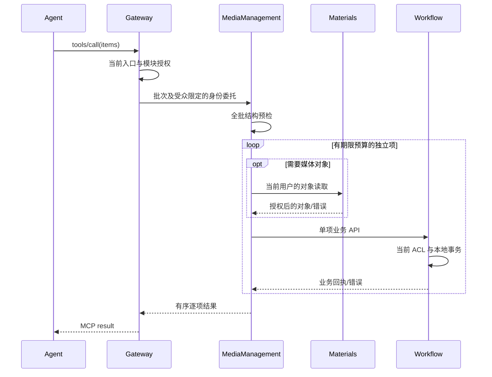

## 触发与结果

已由 Gateway 验证的用户或托管 Agent 调用媒体工具。每批同一主体/组织/可选 Workspace；每项独立返回成功、失败、未知或未发送。业务对象事实属于 Workflow/Materials；本 Workflow 无事实表。

## 执行时间线

## 一致性与生命周期

批量不是事务，某项失败不回滚已完成项。读取最多并发 4 项，写入按顺序执行；所有外部 API 在事务外调用。Template/Workflow/Job 状态由其资源所有者决定；MCP 断开不取消已提交的 Job。Workflow 发布返回受理状态后由既有后台注册完成。

## 幂等与失败

每个 Job 项使用稳定独立幂等键，资源服务负责原请求回执和冲突判断。item_id/call_id 仅用于关联。写请求不自动重试；已发送而未获确定响应是 outcome_unknown，尚未发送是 not_dispatched。取消、期限或整体授权失败停止派发；单项对象无权不阻断其余项。丢失整批响应不能推断所有项失败。

## 身份与权限

Gateway 验证入口与当前模块权限，Worker 验证后端请求断言并使用指定目标委托。目标业务服务验证受众、服务 presenter、操作范围并执行最终对象 ACL。调用体不得覆盖主体/组织/Workspace。Template 是企业资源，创建 Workflow 和提交 Job 需 Workspace。

## 实现合同

批次大小、Schema、工具/API 映射、受众与时限见 [规格](../../../../spec/media-worker-mcp-server.md)。不新增生成 Domain；doubao_generate/gpt_generate 独立执行。
