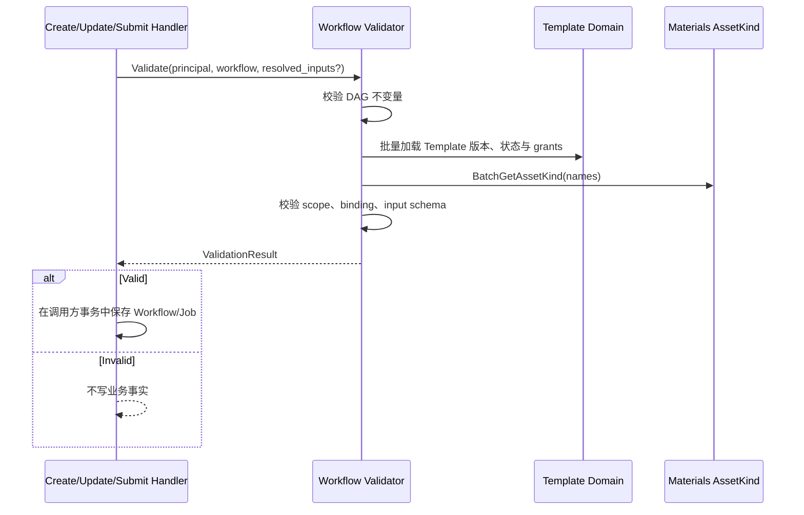

## 一句话职责

## 资源授权边界

创建/编辑候选图时，调用者必须能读取每个引用 Template 的指定版本，且 Template 与 Workflow 属于同企业、Scope一致。Template viewer 不授予 Workflow 编辑权；Workflow editor 不授予源 Template 编辑权。模板内容只通过公开授权读取端口取得，内部冻结快照端口不向用户开放。发布进一步要求引用版本已发布；执行已注册版本使用 Compilation，不在后台重新查询调用者的 Template ACL。

> 边界修正：资产实例可达性由调用方先通过 Materials Reachability 解析；本流程不再次访问资产实例，只校验可信解析结果与 Workflow 输入契约。下文“资产可达性校验”均指该契约校验。

## 执行时间线


对一次 Create/Update/Submit 提交做"实际落库前的安全闸"：依次完成 DAG 结构校验 → Template 状态校验 → 资产可达性与 scope 校验。任一环节失败 → 给调用方返回 reject 原因 + 错误码**全局一致**，不写库。

## 触发点

- `POST /api/v1/workflows`、`PUT /api/v1/workflows/{id}` 进入保存前
- `POST /api/v1/workflows/validate`（不保存）
- `POST /api/v1/jobs` 进入 Submit 阶段

## 阶段

### 1. DAG 结构校验
调用 [workflow](../../domain/0002-workflow/workflow.md) §校验细则 的全部不变式——`workflow.Validator.Validate(w, templates)`。失败直接返回。成功后输出 roots + derived_edges。

### 2. Template 状态与跨资源权限校验
对每个 step 关联的 `(template_id, template_version)`：
1. `Template` 当前 status 必须 ∈ {draft, published}。**archived → reject** `TEMPLATE_ARCHIVED`。
2. 同 workflow scope 下 `Template.Scope` 必须等于 `Workflow.Scope`（**严格相等**）。不同 → reject `SCOPE_MISMATCH`。
3. **跨资源权限一致性**：caller（user）对所引 Template 必须 `my_permission ≥ viewer`（资源 ACL）；不足 → reject `TEMPLATE_INACCESSIBLE`。模板侧可视性由模板自己的 grants 决定，与 workflow.grants 独立。

> 这一阶段阻止"draft 模板被 workflow bind 后被 archive"的情况：用户 archive 一个 template 时，本 service 需异步扫一遍 workflow / job 中活跃 binding；本期先实现"保存时校验"，后续引入 offline scan。

### 3. 输入可达性校验（职责在 caller，不在 media_workflow）
SubmitJob 由 media_workflow 调用 [media_materials reachability workflow](../../../media_materials/workflow/0001-reachability/reachability.md)，校验输入属于同一 Workspace/Scope 并解析为资源 ID 与 Object Path；调用方不负责组装可信 bundle。

- **workflow 保存时（闸 1）**：只校验 slot.kind 注册（`BatchGetAssetKind`），不校验 asset 可达性（workflow 是定义，无 asset 实例）。
- **SubmitJob 时（闸 2）**：校验 bundle ↔ input_schema（required 覆盖、material/asset name 唯一、资源类别与 `asset_kind` 一致、无多余类型、product/virtual_ip 非空如 required）；不调 reachability（caller 已校验可达性）。

Workflow 保存时从每条 `WORKFLOW_INPUT` SlotBinding 及其 Template Slot 派生 Input Schema。material / asset 类型的同名 Workflow Input 如果被绑定到不同 `asset_kind`，拒绝 `INPUT_ASSET_KIND_CONFLICT`；前端和调用方不得根据 input name 猜测类别。product / virtual_ip 可以在不同 Step 中按各 Slot 的 kind 解析，因此其 Input Schema 不要求单一 `asset_kind`。

可达性规则（scope ∧ visibility ∧ 容器可达）定义在 [reachability workflow](../../../media_materials/workflow/0001-reachability/reachability.md)，由 caller 调用。原 §3 的 AssetReachability / Check*Accessible 调用迁至 caller。

### 4. Result
```go
type ValidationResult struct {
    Valid         bool
    Roots         []string
    OutputStepKey string
    DerivedEdges  []Edge
    RejectReasons []RejectReason
}
type RejectReason struct {
    Code    string // 'SCOPE_MISMATCH','TEMPLATE_ARCHIVED','ASSET_UNREACHABLE','DAG_INVALID',...
    Message string
    Subject string // template_id / asset_id / step_key 等
}
```

## 错误码（全局一致）

| Code | 触发场景 | HTTP 状态 |
|:---|:---|:---|
| `DAG_INVALID` | step key 重复 / 多 sink / 离群节点 / cycle | 400 |
| `TEMPLATE_NOT_FOUND` | step 引用 template 不存在 | 400 |
| `TEMPLATE_ARCHIVED` | 已 archive | 409 |
| `TEMPLATE_INACCESSIBLE` | caller 对引用的 template 无 viewer+ 权限 | 403 |
| `SCOPE_MISMATCH` | workflow.scope != template.scope 或 product.scope != workflow.scope | 409 |
| `ASSET_UNREACHABLE` | asset_id 不在调用方可达集合 | 403 |
| `VIP_UNREACHABLE` | virtual_ip 输入 scope 不匹配或 user 无 viewer+ | 403 |
| `ASSET_KIND_MISMATCH` | input slot.kind 与所传 asset 的 asset_kind 不一致 | 400 |
| `INPUT_ASSET_KIND_CONFLICT` | 同一 material/asset Workflow Input 被绑定到多个 asset_kind | 400 |
| `SLOT_KIND_REQUIRED` | slot 未声明 kind，或 kind.resource_type 与 workflow_input.type 不自洽 | 400 |
| `ASSET_KIND_INVALID` | slot.kind / output_asset_kind 未注册或已 DISABLED | 400 |
| `BINDING_INVALID` | to_input 不在 template.inputs.name 内 / required slot 未 binding | 400 |

## 失败处理
任何 RejectReason → workflow / job 不写库；调用方拿到的是 ValidationResult 整体，可视化展示给前端。

## 状态、一致性与权限

本流程是同步只读决策，无持久化状态机。Validator 不开启覆盖远程调用的数据库事务；最终 Create/Update/Submit 必须在写事务内重新检查乐观版本，防止校验后 Template/Workflow 已变化。Principal 来自可信入口，Template Domain 执行引用权限判断；Materials 只返回 Asset Kind 定义。依赖不可用返回 unavailable，不得降级为校验通过。

## 幂等与重试

相同输入和相同依赖版本产生相同 ValidationResult。纯读依赖的瞬时错误可以有限重试；校验拒绝不可重试，必须修改输入或权限。调用方重试最终写入时仍使用原 idempotency_key，并重新执行版本检查。

## 与 media_materials 契约

media_workflow 不直读 Materials 数据库；它通过内部接口调用：

- `BatchGetAssetKind(names) -> (kinds, invalid)`--Workflow 校验期校验 slot.kind / output_asset_kind 已注册、resource_type / media_type 匹配（§2）。
- `UpsertGeneratedAsset(...)`--StepRun SUCCEEDED 时落产物（归 execution，见 [workflow_execution](../0002-workflow_execution/workflow_execution.md)）。

> `AssetReachability` / `CheckProductAccessible` / `CheckVirtualIPAccessible` 由 caller 调 reachability workflow，**不归 media_workflow**（见 §3 职责在 caller）。

## 关联 domain
- [workflow](../../domain/0002-workflow/workflow.md)
- [template](../../domain/0001-template/template.md)
- [execution](../../domain/0003-execution/execution.md)（Submit 阶段复用）

## 关联术语
[Workflow Validation](../../CONTEXT.md)、[Asset Reachability](../../../media_materials/CONTEXT.md)。
