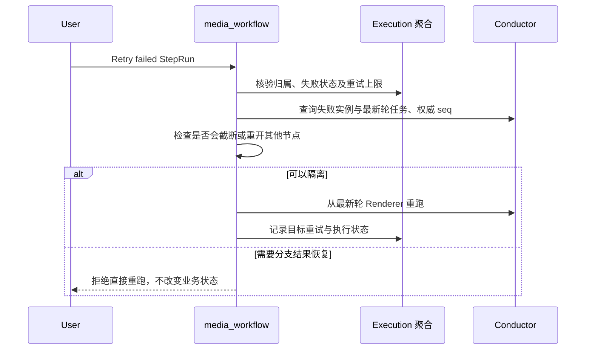
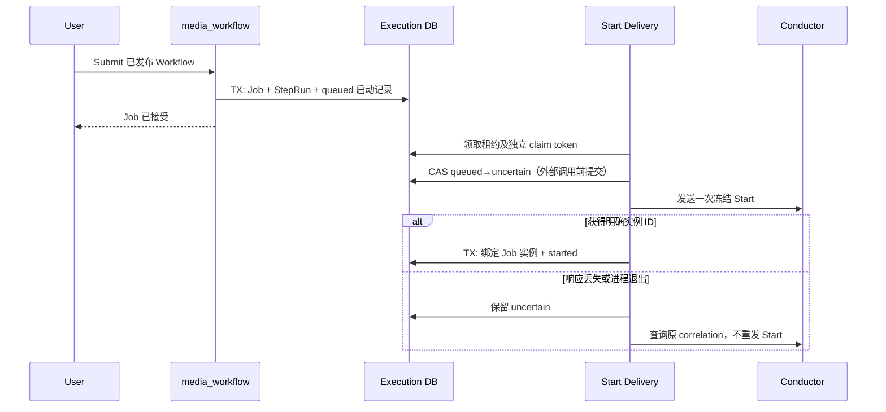
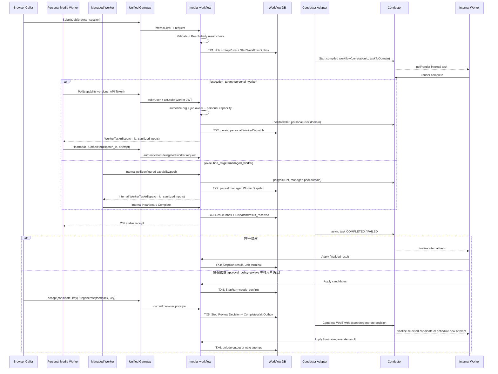
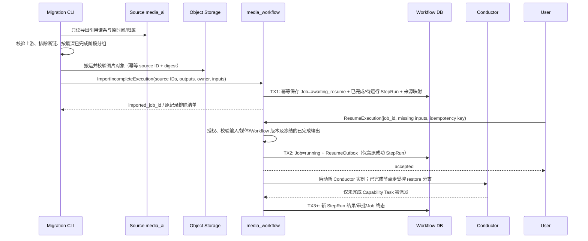
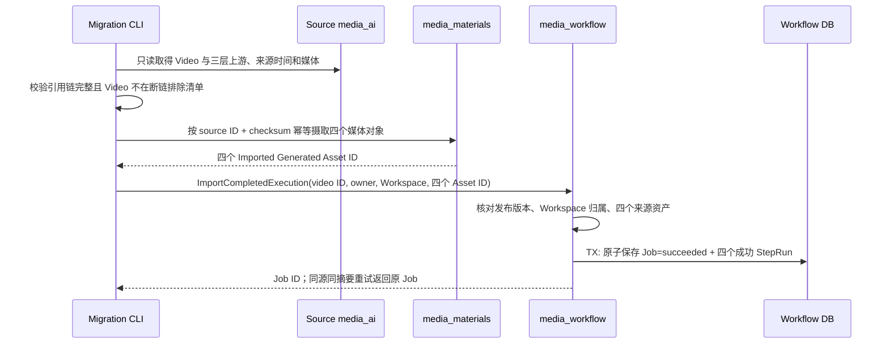
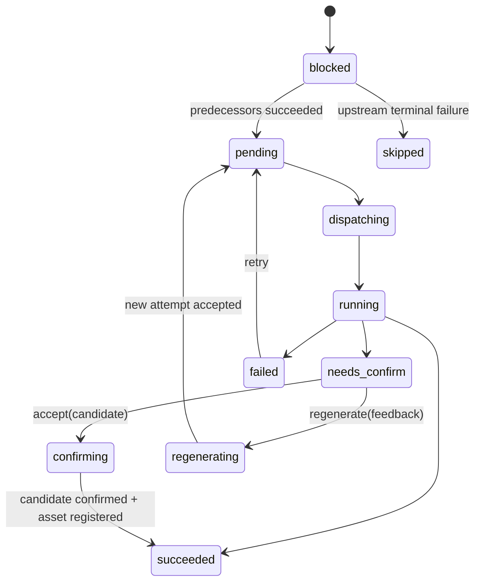
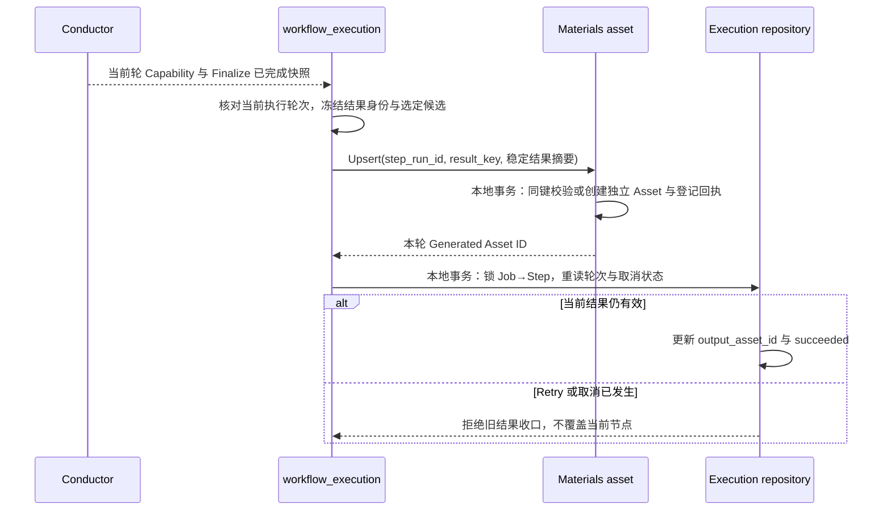

## 一句话说明

Execution 以本地 Job/StepRun 为业务事实源，通过 Outbox 启动已编译的 Conductor Workflow；Personal Worker 只经 Worker Gateway API 领取 Personal Capability Dispatch，Managed Worker 只经 media_workflow 内部运行入口领取 Managed Capability，两者都不能推进业务 DAG。

## 执行时间线

### 失败节点重试的分支隔离

单节点 Retry 的业务边界是目标节点及受影响的下游，不是引擎任务列表中的后缀。已完成、无依赖关系的旁支结果必须保留，其 Capability 不得再次交付 Worker。依赖使用 Job 冻结的 Compilation/IR，不使用后来编辑的 Workflow。

Conductor 指定任务 rerun 按 `seq` 删除后续任务，并可能重开保留的失败任务；它不是 DAG 局部重试。直接路径必须取得权威任务顺序；遇到其他节点会被删除/重开、未知可执行任务或缺少顺序时，在所有副作用前拒绝。此保护不是完整的并行恢复实现。

完整并行恢复必须冻结受影响集合和保留结果，可靠记录重试意图，恢复无关已完成节点的受控产物引用，同时保留目标最新轮反馈。引擎副作用与本地状态需要可靠协调，不能把“先调用引擎，再尽力写库”视为完成。原生执行恢复与历史导入恢复分开，不以 historical origin 绕过归属。

### 普通提交与执行

普通原生 Submit 的启动命令与 Job、全部 StepRun 在同一本地事务保存；参数来自 registered Compilation，并冻结 Definition 名称/版本/hash、稳定输入、Task Domain 与 Job correlation。提交请求不能持有事务调用 Conductor。启动状态独立于 Job 的业务执行状态，客户端断开不删除命令。

公开 Submit 可携带稳定 idempotency_key；省略则每次为新提交，不按相同输入猜测用户意图。键作用域为当前授权的 `(User, Organization, Workspace)`。请求摘要包含 Workflow ID、调用方请求版本（0 代表首次接受时选择发布版）与规范化稳定媒体输入；短期 URL 签名变化不改变语义。Workspace/权限复核先于回执查询。同键同摘要优先返回原 Job，即使其已终态、发布版已改变或原签名已过期；不同摘要冲突。首次接受在事务内锁键并再次查询，原子保存 Job/StepRun/启动命令/提交回执，并发失败方不得留下多余 Job。媒体可读性验证在首次接受事务前完成，重放不再外部读取或启动。

`queued` 表示尚未授权发送，过期领取可由新 token 接手；`uncertain` 表示启动可能发生，只允许查询恢复。当前引擎未通过启动去重门禁，不能把 uncertain 自动改回 queued。数据库回执写失败时保留命令，不把“无法保存实例 ID”冒充未启动；租约过期和旧 token 都不能完成/释放新领取。取消与 uncertain 恢复需记录/终止发现的实例，不能复活 cancelled Job；取消协调与上游幂等契约仍需单独验收。

原生启动取消采用 Job→启动记录的统一锁顺序。取消事务先使 Job cancelled：queued 同事务转 cancelled 并清除 claim，保证尚未授权的 POST 不发生；uncertain 保留待查询事实，started 转 cancel_pending 保留原实例。后台处理 cancelled Job 的 uncertain 只查询 correlation；发现实例后事务外查询并终止，确认引擎终态后以有效 claim 将启动记录记为 cancelled，保存实例 ID，但不把 Job 改回 running。终止响应丢失仍先查询终态再决定是否重发终止；找不到 uncertain 实例不能断言无需清理。取消接口重复调用返回原取消事实，清理失败不撤销取消。

普通 Submit 在写入 Job 前检查输入媒体来自受控存储和 Job 企业，并验证可读性，将媒体地址冻结为 Object Path。Conductor 启动与 Dispatch 保存稳定引用；Worker 领取或重取未过期 Dispatch 时重新解析地址，仅响应中携带短期 URL。解析失败不首次创建 Dispatch，已存在租约保留供恢复；不改写 Job、Conductor 输入或 Dispatch 快照。纯文本动作不经过对象解析。Renderer 仍属于 media_workflow，客户端不承担内部任务。

普通 User 提交前指定目标 Workspace。media_workflow 经 Control 核验访问与当前 `use_workflow` 权限，冻结 Workspace 及其企业；API Token 的可信企业绑定不可被请求覆盖。Personal Worker 交付时匹配 Job owner、企业和 Conductor 实例，拒绝未绑定企业的 Job，不通过改写旧记录绕过校验。

`taskToDomain` 只给 Capability Task 设置与冻结 `execution_target` 一致的 Domain：Personal Target 从 Job owner 派生，Managed Target 从受控 pool 配置派生；Renderer、Finalize 等 Internal Execution Task 使用内部 Domain。服务端经 Registry 决定 taskDef、Target 和 Domain。禁止从共享队列先领取再检查 owner，禁止 Personal/Managed 互相回退，也禁止回退到 `NO_DOMAIN`。

外部调用结果不明确时按 `job_id` correlationId、`dispatch_id` 或 `step_run_id + attempt` 查询，禁止盲目创建第二个执行。初次启动的correlation查询只定位候选，不提供去重保证；唯一候选还须读取精确实例并核对Definition名称/版本、完整冻结输入和Task Domain，匹配才绑定或终止。缺字段、重复实例、不同版本/输入/路由保持uncertain，不错绑、不清理异源实例。Execution Domain 决定 Job/StepRun/WorkerDispatch 转换；Adapter、Compiler 与 Worker 只协调技术执行。

### 审批与重新生成的技术编排

重新生成反馈与决定一同冻结在 Review，并由后台完成本轮 HUMAN。下一轮 Renderer 接收本节点上一轮审批输出、上一轮轮次与当前循环轮次；只有 `previous_generation=current_generation-1` 且决定为 regenerate 时使用反馈。首轮不接受旧决定。每轮重新渲染原冻结模板，再附加紧邻上一轮反馈作为普通文本；不执行反馈里的模板语法、不累计早期反馈，也不改变其他节点。后台重复投递和 Renderer 重试使用同一冻结输入，提示词摘要包含反馈。

新编译定义在 HUMAN 和 Renderer 中冻结 `feedback_mode=last_regeneration_v1`。旧定义缺少该模式时仍允许无反馈重新生成，但带反馈请求必须明确拒绝，不能接收后丢失反馈。该纯渲染过程不查询数据库、对象存储或 Provider，也不迁移到客户端 Worker。

每个原生 Step 的 Renderer、Capability、审批分支置于独立 `DO_WHILE` 内，Finalize 位于循环外。审批输出 `decision=regenerate` 才继续下一轮；`decision=accept` 或自动单候选结束循环，再执行唯一 Finalize。循环不终止整个 Job，也不重跑旁路或已完成上游。预期单候选仍按本轮实际候选数量选择 HUMAN，不能沿用上一轮审批输入。

Conductor 为每轮生成新的 Task ID；循环内引用名称不能含其保留的 `__` 迭代分隔符。API 只完成最新一轮正在等待的 HUMAN 精确引用；对账先确定节点的最新轮次，再投影该轮任务，旧轮候选和失败保留在技术执行审计中但不能覆盖新轮。业务 `retry_count` 不因重新生成增加；Dispatch 的 attempt 是其独立 Conductor Task 的技术重试序号，派发身份还包含 Task ID。用户决定的持久化与 Outbox 仍按 TX5 实施，不在本地事务中调用 Conductor。

旧 Compilation 与在途 Definition 不原位修改。旧定义仍可确认候选，但没有审批循环的旧实例不得通过终止整个 Workflow 或非终态 rerun 模拟重新生成，必须返回明确的不支持错误；新的循环能力通过新版本发布生效。

审批决定与待提交命令保存为同一条不可变 Review 记录。TX5 锁定 Job、StepRun，复核归属、执行实例、候选快照与待确认状态后，保存精确 HUMAN Task ID/引用、生成轮次、用户、幂等键和冻结决定；同时使当前步骤退出待确认。一个 HUMAN Task 只允许一个决定；同键同内容重放返回原记录，同键异内容或同轮另一决定冲突。不同生成轮、不同执行实例不会复用旧决定。

后台事务外领取 pending Review，并以每次领取独立的 claim token 隔离进程重启和租约回收。提交前检查精确 Task ID：已完成且输出匹配原决定则直接标记 applied；已完成但内容不同、执行已取消或任务已被替换则 failed，不再覆盖。暂时不可用只释放自己的 claim，保留原决定与退避时间；旧 claim 不能完成或释放后来重新领取的记录。Review 的 applied 只表示技术审批已被接受，业务输出仍由循环外 Finalize 收口。

Product 输入在提交时冻结商品主图的可访问 URL（无主图时取首图），作为对应 Workflow Input 的 `asset_ref`；Product ID 仍保留在输入快照中供业务追溯。图片进入 Capability 的位置和顺序只由 Template Version 的 Invocation Mapping 决定，不把 URL 拼进提示词正文。

用户命令使用调用方生成的稳定幂等键；显式键重放在查询 Conductor 和判断当前轮之前返回原决定回执，仍须校验当前用户与 Workspace 权限。旧调用方缺少键时，只能以当前 HUMAN 身份兼容同轮去重，不能承诺跨轮网络重放安全。回执包含不透明 Review ID 和 pending/applied/failed，不暴露 Conductor Task ID。读取最新决定不等于当前轮仍可审批。

待确认投影和审批写入采用相同 Job→StepRun 锁序，在本地事务内检查该精确任务是否已有 Review，再更新步骤；Job 的 waiting 状态依据事务内步骤状态计算。Conductor 查询必须发生在锁定前，避免页面刷新与决定提交并发时重新暴露已提交审批。

新审批还冻结读取Job时的Execution Retry Epoch。TX5锁内再次比较该周期，不一致的新决定拒绝；显式键重放仍返回原决定，不把旧决定重绑定到新周期。后台投递旧周期命令只能标记失效，不能完成重试后的任务。投影冻结读取引擎前的周期，并忽略可证明属于更早周期的Review；同周期按generation与精确HUMAN身份防止晚到Render、Invoke、审批、Finalize或Job状态回退。重试允许同一数字generation重建任务，不复用旧审批。没有周期记录的旧Review保留原摘要，不推断或回填其周期；重试后遇到无法以精确已完成HUMAN证明的同轮旧记录时安全拒绝投影。可靠Retry本地接受与上游rerun之间的不确定窗口仍由独立恢复流程负责。

审批投递必须直接使用Review冻结的Conductor Task ID完成HUMAN，不能按Task Reference再次解析提交目标。读取等待状态后即使Retry替换同名HUMAN，旧决定也只能指向旧Task ID，不得重定向到新任务；无法提供精确Task提交能力时保留待恢复命令，不回退引用提交。旧任务不存在或不再等待由对账明确失效；引擎对旧Task结果的语义仍须在真实协议测试中核对。

## 历史图片谱系导入与继续执行

旧系统的 ModelImage、StyleImage、FirstFrame 若上游引用完整而没有下游 Video，是 **Imported Incomplete Execution**，不是孤儿素材或已完成 Job。只有上游缺失、引用错配等真正断链的记录才排除。ModelImage 可被多个 StyleImage 复用；同一个已完成图片节点可被多个导入执行引用，但对象只迁移和登记一次。源 VideoTask 无 Video、VideoPush 引用不存在的 Video 不进入目标执行。

导入不调用 `SubmitJob`，不回填或伪造旧 Conductor 执行。TX1 前先由 media_materials 将源图片摄取为 **Imported Generated Asset**：它以源 ID/摘要幂等，尚无 Job/StepRun 链接；TX1 再保存各历史 StepRun 对该 Asset 的引用。同一 Asset 可被多个导入执行复用，不能为了满足原生 Generated Asset 的必填生成记录而伪造一个 Job。中断后可按 `(source_system, source_record_id)` 重试，不产生重复 Job/Asset。原始创建时间与实际导入时间分别保存，缺失的旧模板版本不可猜测为当前版本；导入的已完成 StepRun 标记历史来源。导入时不自动运行，用户可先在 UI 检查已完成图片并补齐后续 pose/scene/movement 等输入。

`ResumeExecution` 仅允许 `awaiting_resume` Job，校验所有待执行节点需要的输入；不改变已完成图片、原时间和来源 ID。TX2 与 Outbox 同事务，结果不明确时按 Job ID 和 resume idempotency key 查询。启动的是**新的** Conductor 实例，编译后的恢复分支把已完成 StepRun 的可信输出还原为正常 `finalize.output_resource` 形状，跳过这些节点的 Render/Capability/Approval/Finalize 副作用；只执行首个未完成节点及其后继。恢复分支必须校验对象仍可访问且属于目标 Workspace，禁止浏览器自行提交任意已完成输出。重复继续执行返回同一实例；取消、晚到源迁移或旧 attempt 不能覆盖恢复后的状态。某图片被多个执行复用时，每个 Job 分别授权，Asset 只登记一次。

Resume 接收调用方经 Materials 授权取得的短期 URL 时，先限制其为本企业 Storage 命名空间并做有界读取；TX2 只冻结相应 Object Path，不能把签名 URL 写入 Job 或 Outbox。Conductor 启动允许晚于 URL 过期；Capability 在领取时由 media_workflow 携服务凭证向 media_materials 换取新的 URL，并在交付前复核企业命名空间和有效期。解析失败不交付任务，待下次领取重试；不能回退到旧 URL、外部 Provider URL 或其他企业路径。历史 Generated Asset ID 同样在领取时复验来源和归属后重新签发 URL。

Text-only Movement 是独立于对象媒体的有效输入：用户先经 Materials 资源授权选择 movement，Resume 冻结其非空 `content` 和 `asset_kind=movement`，`url` 保持空值；不调用对象探测，也不生成 Object Path。Renderer 使用 `movement.content`，Capability 映射只按冻结的 Invocation Mapping 生成参数，不能把空 `asset_ref` 伪装为视频或图片。若该 Capability 的输入 schema 明确要求 movement 媒体引用，语义校验必须拒绝这项绑定；内容型输入不能越过能力契约。失败、重复命令和 Outbox 恢复遵守普通 Resume 的状态与幂等边界。

已完成 Video 采用另一条导入分支：每个源 Video ID 对应一个 Imported Completed Execution，即一个终态 Job 和四个成功的历史 StepRun。共享的 ModelImage/StyleImage/FirstFrame 仍只登记一次 Asset，但可被多个 Job 引用。VideoPush 的多视频成员与发布事实由独立的 Historical Publication 聚合导入，不成为四节点 Workflow 的额外输出；导入不触发剪辑或发布。

任一资产摄取或核验失败时不写 Job，已摄取资产可按来源键复用；数据库提交结果不明确时按 `(Workspace, source_system, video ID)` 查询并比较请求摘要，冲突返回错误。已完成 Job 没有 Conductor 实例和 Resume 出口；原始视频时间作为完成时间，导入时间另存。源 VideoPush 关联多条 Video 时，先建立各自执行，再由 [historical_video_push_import](../0004-historical_video_push_import/historical_video_push_import.md) 独立保存有序成员；不能因为共享首帧而合并输出。

目前代码已有未完成执行导入、`awaiting_resume` 状态、恢复分支与 StartResume Outbox；一条真实样本已通过 Resume→Conductor→Personal Worker→结果登记联调。任何历史图片都不得通过普通 `SubmitJob` 冒充已恢复执行；VideoPush 是独立历史事实，不参与本流程的 Job 状态推进。

## 状态流转

## 幂等设计

- Job 使用 `(workspace_id, idempotency_key)` 去重。
- Conductor 启动使用 `job_id` correlationId定位候选，不把查询视为引擎去重；Provider 调用使用 WorkerTask 提供的 `dispatch_id + attempt` 去重。
- Worker completion 先以 `(dispatch_id, attempt, operation)` 写 Result Inbox，再异步更新 Conductor；重复请求返回同一 receipt，旧 attempt 不覆盖新状态。
- 用户确认使用 `step_run_id + review idempotency_key` 去重；同一 attempt 的 accept 与 regenerate 互斥。
- Candidate 数量大于 1 时无条件进入 needs_confirm；数量等于 1 时仅 `approval_policy=always` 进入，否则自动确认；数量等于 0 时失败。
- 本地状态与 Outbox 同事务，Conductor/Provider 调用不在数据库事务中执行。

## Dispatch 租约与连接生命周期

- `WorkerDispatch` 独立于 Job 聚合保存，状态为 `claimed -> delivered -> running -> result_received`，可进入 `expired/failed`。
- 向客户端返回任务前必须完成 Dispatch 事务；响应丢失时，同一 Worker 的下一次 poll 返回现有有效 Dispatch。
- heartbeat 幂等延长本地租约，并由 Adapter 更新 Conductor `IN_PROGRESS`/callback；租约不得超过 Conductor response timeout。
- Worker 断线不直接让 Job 失败；租约到期后任务由 Conductor 重投并创建新 attempt/Dispatch。旧 Dispatch 的晚到结果返回 409/410。
- Personal Worker API Token 被撤销后不能继续 poll、heartbeat 或 complete；短时 Internal JWT 的剩余 TTL 是最大撤销延迟。Managed Worker 不使用 Token，停用通过进程配置、pool/capability allowlist 和停止内部 poller 生效。

## 一致性、恢复与权限

TX1 创建完整初始 DAG 运行事实；TX2 在交付前保存 Dispatch；TX3 接收客户端结果但不依赖 Conductor 同步可用；TX4 处理普通结果或进入 needs_confirm；TX5 原子保存用户决定与 CompleteWait Outbox；TX6 提交唯一输出或新 attempt。Outbox/Inbox 至少一次，旧 attempt 结果只审计。取消阻止未开始 StepRun 与 Dispatch 续租，运行中 Provider 按其取消能力处理，晚到成功不得反转 cancelled Job。

浏览器 API 使用 Web Session；`/api/worker/v1/*` 使用基于 API Token 签发的 `sub=User + act.sub=Personal Worker` Internal Identity JWT，不依赖 Kratos Cookie。Personal Worker 有效权限是 User 当前权限、Worker Actor 状态、Token scope、Organization Membership/Entitlement、Job owner 和 Personal Capability allowlist 的交集。

Managed Worker 属于 media_workflow 内部运行时，不调用 Talos或公开 Worker API。它的可信 `actor_id`、pool 和 capability allowlist 来自服务配置；Job `submitted_by` 只表示业务归属，不被 Managed Worker用于模拟登录。若未来它必须代表 User 调用内部资源服务，由 media_workflow 签发绑定 dispatch/audience/scope/lease 的短期委托 JWT。

任务输入中的稳定 Object Path 在领取时换成短时 presigned GET/PUT URL；Worker 完成只返回受控 Object Path、checksum、content type、size 与 provenance。Finalize 验证对象并以 `(step_run_id, result_key)` 幂等登记唯一 Generated Asset。任意 Provider URL 必须先摄取到受控对象存储。

### 生成结果登记与当前产物引用

`result_key` 标识被接受的能力生成结果，不使用 Finalize 技术任务重试 ID 或 Worker delivery attempt。对同轮结果的响应丢失重放返回同一个 Asset；同键不同结果冲突。Retry/重新生成产生新的能力结果身份，即使对象内容相同也登记独立产物。StepRun 保留稳定身份，仅当前选定结果引用可以变更，旧 Asset 的对象、内容和来源不被覆盖。

Materials 调用在 Execution 事务之外；Materials 已提交但本地保存失败时保留资产，恢复只能重放原键。取消后晚到资产可作为审计事实留存，但不能重新关联当前 StepRun，也不自动删除其对象。登记使用受信内部服务身份，Materials 最终验证企业、Scope、owner 与资源来源。两服务不建立跨库外键。
