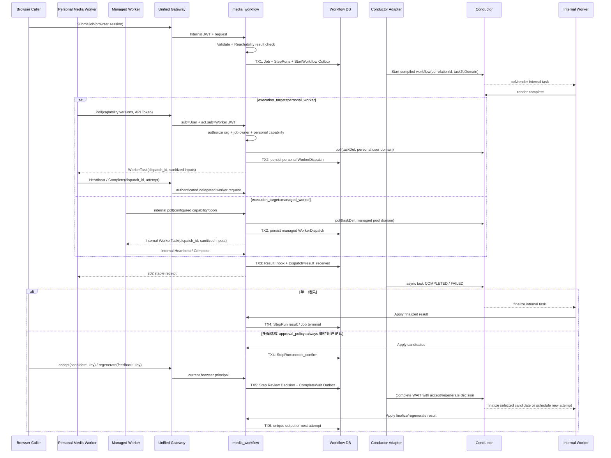
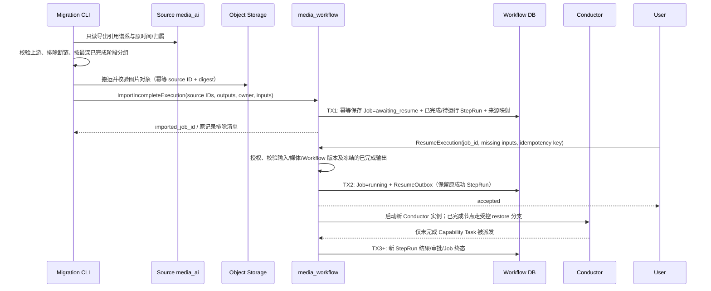
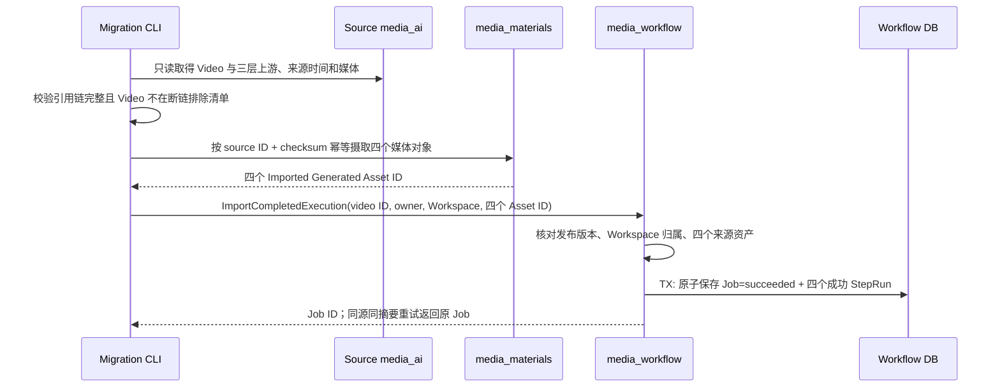
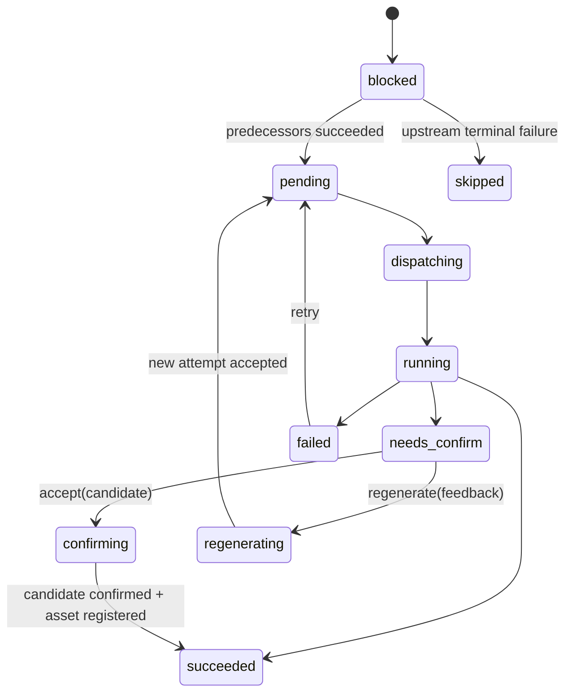

## 一句话说明

Execution 以本地 Job/StepRun 为业务事实源，通过 Outbox 启动已编译的 Conductor Workflow；Personal Worker 只经 Worker Gateway API 领取 Personal Capability Dispatch，Managed Worker 只经 media_workflow 内部运行入口领取 Managed Capability，两者都不能推进业务 DAG。

## 执行时间线

`taskToDomain` 只给 Capability Task 设置与冻结 `execution_target` 一致的 Domain：Personal Target 从 Job owner 派生，Managed Target 从受控 pool 配置派生；Renderer、Finalize 等 Internal Execution Task 使用内部 Domain。服务端经 Registry 决定 taskDef、Target 和 Domain。禁止从共享队列先领取再检查 owner，禁止 Personal/Managed 互相回退，也禁止回退到 `NO_DOMAIN`。

外部调用结果不明确时按 `job_id` correlationId、`dispatch_id` 或 `step_run_id + attempt` 查询，禁止盲目创建第二个执行。Execution Domain 决定 Job/StepRun/WorkerDispatch 转换；Adapter、Compiler 与 Worker 只协调技术执行。

Product 输入在提交时冻结商品主图的可访问 URL（无主图时取首图），作为对应 Workflow Input 的 `asset_ref`；Product ID 仍保留在输入快照中供业务追溯。图片进入 Capability 的位置和顺序只由 Template Version 的 Invocation Mapping 决定，不把 URL 拼进提示词正文。

## 历史图片谱系导入与继续执行

旧系统的 ModelImage、StyleImage、FirstFrame 若上游引用完整而没有下游 Video，是 **Imported Incomplete Execution**，不是孤儿素材或已完成 Job。只有上游缺失、引用错配等真正断链的记录才排除。ModelImage 可被多个 StyleImage 复用；同一个已完成图片节点可被多个导入执行引用，但对象只迁移和登记一次。源 VideoTask 无 Video、VideoPush 引用不存在的 Video 不进入目标执行。

导入不调用 `SubmitJob`，不回填或伪造旧 Conductor 执行。TX1 前先由 media_materials 将源图片摄取为 **Imported Generated Asset**：它以源 ID/摘要幂等，尚无 Job/StepRun 链接；TX1 再保存各历史 StepRun 对该 Asset 的引用。同一 Asset 可被多个导入执行复用，不能为了满足原生 Generated Asset 的必填生成记录而伪造一个 Job。中断后可按 `(source_system, source_record_id)` 重试，不产生重复 Job/Asset。原始创建时间与实际导入时间分别保存，缺失的旧模板版本不可猜测为当前版本；导入的已完成 StepRun 标记历史来源。导入时不自动运行，用户可先在 UI 检查已完成图片并补齐后续 pose/scene/movement 等输入。

`ResumeExecution` 仅允许 `awaiting_resume` Job，校验所有待执行节点需要的输入；不改变已完成图片、原时间和来源 ID。TX2 与 Outbox 同事务，结果不明确时按 Job ID 和 resume idempotency key 查询。启动的是**新的** Conductor 实例，编译后的恢复分支把已完成 StepRun 的可信输出还原为正常 `finalize.output_resource` 形状，跳过这些节点的 Render/Capability/Approval/Finalize 副作用；只执行首个未完成节点及其后继。恢复分支必须校验对象仍可访问且属于目标 Workspace，禁止浏览器自行提交任意已完成输出。重复继续执行返回同一实例；取消、晚到源迁移或旧 attempt 不能覆盖恢复后的状态。某图片被多个执行复用时，每个 Job 分别授权，Asset 只登记一次。

Resume 接收调用方经 Materials 授权取得的短期 URL 时，先限制其为本企业 Storage 命名空间并做有界读取；TX2 只冻结相应 Object Path，不能把签名 URL 写入 Job 或 Outbox。Conductor 启动允许晚于 URL 过期；Capability 在领取时由 media_workflow 携服务凭证向 media_materials 换取新的 URL，并在交付前复核企业命名空间和有效期。解析失败不交付任务，待下次领取重试；不能回退到旧 URL、外部 Provider URL 或其他企业路径。历史 Generated Asset ID 同样在领取时复验来源和归属后重新签发 URL。

Text-only Movement 是独立于对象媒体的有效输入：用户先经 Materials 资源授权选择 movement，Resume 冻结其非空 `content` 和 `asset_kind=movement`，`url` 保持空值；不调用对象探测，也不生成 Object Path。Renderer 使用 `movement.content`，Capability 映射只按冻结的 Invocation Mapping 生成参数，不能把空 `asset_ref` 伪装为视频或图片。若该 Capability 的输入 schema 明确要求 movement 媒体引用，语义校验必须拒绝这项绑定；内容型输入不能越过能力契约。失败、重复命令和 Outbox 恢复遵守普通 Resume 的状态与幂等边界。

已完成 Video 采用另一条导入分支：每个源 Video ID 对应一个 Imported Completed Execution，即一个终态 Job 和四个成功的历史 StepRun。共享的 ModelImage/StyleImage/FirstFrame 仍只登记一次 Asset，但可被多个 Job 引用。VideoPush 的多视频成员与发布事实由独立的 Historical Publication 聚合导入，不成为四节点 Workflow 的额外输出；导入不触发剪辑或发布。

任一资产摄取或核验失败时不写 Job，已摄取资产可按来源键复用；数据库提交结果不明确时按 `(Workspace, source_system, video ID)` 查询并比较请求摘要，冲突返回错误。已完成 Job 没有 Conductor 实例和 Resume 出口；原始视频时间作为完成时间，导入时间另存。源 VideoPush 关联多条 Video 时，先建立各自执行，再由 [historical_video_push_import](../0004-historical_video_push_import/historical_video_push_import.md) 独立保存有序成员；不能因为共享首帧而合并输出。

目前代码已有未完成执行导入、`awaiting_resume` 状态、恢复分支与 StartResume Outbox；一条真实样本已通过 Resume→Conductor→Personal Worker→结果登记联调。任何历史图片都不得通过普通 `SubmitJob` 冒充已恢复执行；VideoPush 是独立历史事实，不参与本流程的 Job 状态推进。

## 状态流转

## 幂等设计

- Job 使用 `(workspace_id, idempotency_key)` 去重。
- Conductor 启动使用 `job_id` correlationId 去重；Provider 调用使用 WorkerTask 提供的 `dispatch_id + attempt` 去重。
- Worker completion 先以 `(dispatch_id, attempt, operation)` 写 Result Inbox，再异步更新 Conductor；重复请求返回同一 receipt，旧 attempt 不覆盖新状态。
- 用户确认使用 `step_run_id + review idempotency_key` 去重；同一 attempt 的 accept 与 regenerate 互斥。
- Candidate 数量大于 1 时无条件进入 needs_confirm；数量等于 1 时仅 `approval_policy=always` 进入，否则自动确认；数量等于 0 时失败。
- 本地状态与 Outbox 同事务，Conductor/Provider 调用不在数据库事务中执行。

## Dispatch 租约与连接生命周期

- `WorkerDispatch` 独立于 Job 聚合保存，状态为 `claimed -> delivered -> running -> result_received`，可进入 `expired/failed`。
- 向客户端返回任务前必须完成 Dispatch 事务；响应丢失时，同一 Worker 的下一次 poll 返回现有有效 Dispatch。
- heartbeat 幂等延长本地租约，并由 Adapter 更新 Conductor `IN_PROGRESS`/callback；租约不得超过 Conductor response timeout。
- Worker 断线不直接让 Job 失败；租约到期后任务由 Conductor 重投并创建新 attempt/Dispatch。旧 Dispatch 的晚到结果返回 409/410。
- Personal Worker API Token 被撤销后不能继续 poll、heartbeat 或 complete；短时 Internal JWT 的剩余 TTL 是最大撤销延迟。Managed Worker 不使用 Token，停用通过进程配置、pool/capability allowlist 和停止内部 poller 生效。

## 一致性、恢复与权限

TX1 创建完整初始 DAG 运行事实；TX2 在交付前保存 Dispatch；TX3 接收客户端结果但不依赖 Conductor 同步可用；TX4 处理普通结果或进入 needs_confirm；TX5 原子保存用户决定与 CompleteWait Outbox；TX6 提交唯一输出或新 attempt。Outbox/Inbox 至少一次，旧 attempt 结果只审计。取消阻止未开始 StepRun 与 Dispatch 续租，运行中 Provider 按其取消能力处理，晚到成功不得反转 cancelled Job。

浏览器 API 使用 Web Session；`/api/worker/v1/*` 使用基于 API Token 签发的 `sub=User + act.sub=Personal Worker` Internal Identity JWT，不依赖 Kratos Cookie。Personal Worker 有效权限是 User 当前权限、Worker Actor 状态、Token scope、Organization Membership/Entitlement、Job owner 和 Personal Capability allowlist 的交集。

Managed Worker 属于 media_workflow 内部运行时，不调用 Talos或公开 Worker API。它的可信 `actor_id`、pool 和 capability allowlist 来自服务配置；Job `submitted_by` 只表示业务归属，不被 Managed Worker用于模拟登录。若未来它必须代表 User 调用内部资源服务，由 media_workflow 签发绑定 dispatch/audience/scope/lease 的短期委托 JWT。

任务输入中的稳定 Object Path 在领取时换成短时 presigned GET/PUT URL；Worker 完成只返回受控 Object Path、checksum、content type、size 与 provenance。Finalize 验证对象并以 `(step_run_id, attempt)` 幂等登记唯一 Generated Asset。任意 Provider URL 必须先摄取到受控对象存储。
