## 一句话说明

Conductor是执行状态与调度权威；本地Job/StepRun持有业务归属/输入/产物关联和查询投影，通过Outbox提交已编译的Conductor Workflow。Personal Worker只经Worker Gateway领取Capability Dispatch，Managed Worker只经内部运行入口领取Managed Capability，两者都不能自行推进DAG。

## 执行时间线

### 异步日志关联（技术元数据，不是执行语义）

提交请求的W3C traceparent随首次接受的启动输入冻结，异步启动在外部调用前恢复该上下文。仅保留标准traceparent，不保存tracestate、baggage、Token、提示词或对象签名。无有效上下文时生成本地非采样关联，不依赖可观测性服务。显式提交键重放不重写原始关联元数据；普通retry保留原实例关联，整次输入覆盖rerun保留原关联元数据。历史无关联数据可使用新关联，但不回填旧记录。

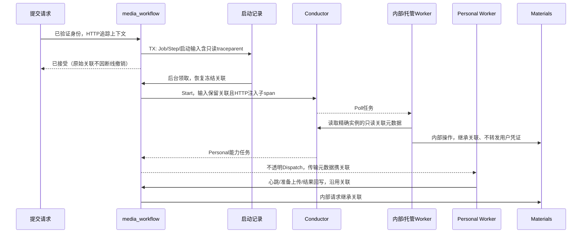

日志只记录固定event、trace_id、Job/Dispatch及技术Task身份、结果状态/安全错误码，不记录任务输入/输出、凭证或签名。追踪标识不能作为幂等键、任务归属、授权或调度依据；用户决定HTTP请求仍有自己的请求trace，并可通过Job/Task身份关联执行。旧发布Definition不原位修改，追踪元数据由运行适配器读取实例输入，不需要重新编译业务图。

### 失败继续与重新生成分离

Job Retry与Step Retry均代理所属实例的Conductor原生retry；Step只是操作入口，不限定恢复范围。普通失败继续使用Conductor原生retry：失败/取消任务恢复，成功旁支、已渲染提示词和既有输入保留。依赖图仍来自冻结Compilation/IR，由FORK_JOIN/JOIN/DO_WHILE表达；业务服务不按seq截断和重置自己的DAG。

用户不满意产物属于HUMAN审批中的regenerate决定，由DO_WHILE开启新轮；不等于调用失败后的技术重试。改变输入或明确整次重新开始才评估原生rerun/restart及其已完成任务影响，不能将指定Renderer rerun作为普通失败继续的默认实现。历史导入恢复仍独立且不用于恢复普通并行旁支。

### 整次输入覆盖重跑兼容路径

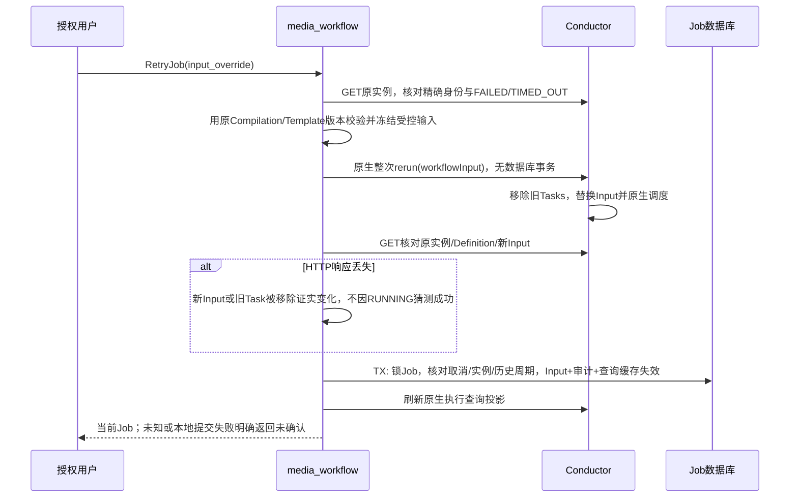

整次rerun与普通retry不同：Conductor复用实例ID但删除旧Task，成功旁支也重跑。Job兼容接口只接受原生FAILED/TIMED_OUT，不以缓存failed授权；Step入口仍拒绝input_override。事务使旧Step查询缓存失效（候选/选择/当前输出/计时清空），不是把原生任务重新排队，也不计算局部DAG影响集合。原Assets和不可变Review保留审计，历史周期只保护缓存/审计提交，不调度任务。

响应成功仍核对原实例的新Input；丢响应时必须同时证明Input或Task身份发生变化。无法证明时不自动重发，RUNNING或本来就相同的Input都不是丢响应证明。外部rerun已提交而本地事务失败不具备跨系统原子性，明确报未确认并查询原实例，不引入持久执行控制器。Finalize来源Product/VirtualIP优先从本轮原生workflowInput读取，避免审计提交延迟错误关联到上轮输入；旧无输入信封定义保留历史兼容读取。

### 普通提交与执行

普通原生 Submit 的启动命令与 Job、全部 StepRun 在同一本地事务保存；参数来自 registered Compilation，并冻结 Definition 名称/版本/hash、稳定输入、Task Domain 与 Job correlation。提交请求不能持有事务调用 Conductor。启动状态独立于 Job 的业务执行状态，客户端断开不删除命令。

公开 Submit 可携带稳定 idempotency_key；省略则每次为新提交，不按相同输入猜测用户意图。键作用域为当前授权的 `(User, Organization, Workspace)`。请求摘要包含 Workflow ID、调用方请求版本（0 代表首次接受时选择发布版）与规范化稳定媒体输入；短期 URL 签名变化不改变语义。Workspace/权限复核先于回执查询。同键同摘要优先返回原 Job，即使其已终态、发布版已改变或原签名已过期；不同摘要冲突。首次接受在事务内锁键并再次查询，原子保存 Job/StepRun/启动命令/提交回执，并发失败方不得留下多余 Job。媒体可读性验证在首次接受事务前完成，重放不再外部读取或启动。

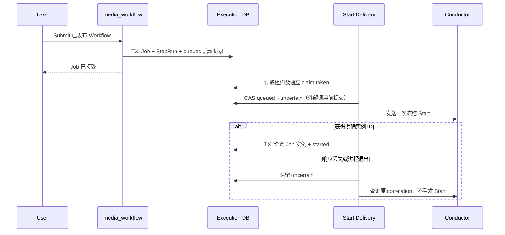

`queued` 表示尚未授权发送，过期领取可由新 token 接手；`uncertain` 表示启动可能发生，只允许查询恢复。当前引擎未通过启动去重门禁，不能把 uncertain 自动改回 queued。数据库回执写失败时保留命令，不把“无法保存实例 ID”冒充未启动；租约过期和旧 token 都不能完成/释放新领取。取消与 uncertain 恢复需记录/终止发现的实例，不能复活 cancelled Job；取消协调与上游幂等契约仍需单独验收。

原生启动取消采用 Job→启动记录的统一锁顺序。取消事务先使 Job cancelled：queued 同事务转 cancelled 并清除 claim，保证尚未授权的 POST 不发生；uncertain 保留待查询事实，started 转 cancel_pending 保留原实例。后台处理 cancelled Job 的 uncertain 只查询 correlation；发现实例后事务外查询并终止，确认引擎终态后以有效 claim 将启动记录记为 cancelled，保存实例 ID，但不把 Job 改回 running。终止响应丢失仍先查询终态再决定是否重发终止；找不到 uncertain 实例不能断言无需清理。取消接口重复调用返回原取消事实，清理失败不撤销取消。

已绑定原生实例的取消在事务前查询精确Conductor实例，只有RUNNING/PAUSED接受新取消；缓存failed/succeeded不能禁止当前活动实例。已取消回执直接重放，不依赖引擎可用性。未绑定初次启动由queued/uncertain协议取消；native缺少持久启动记录不得回退锁外先Terminate后写Job。后台GET实例身份不符不得终止或确认，锁外取消与完成竞争时保留本地取消意图并确认原实例终态。

查询将原生PAUSED投影为非终态paused，不误标need_confirm；引擎恢复RUNNING后刷新运行/审批投影。TERMINATED投影cancelled，FAILED/TIMED_OUT投影failed。这里只表达既有引擎状态，不新增平台暂停/恢复调度器或操作API。

普通 Submit 在写入 Job 前检查输入媒体来自受控存储和 Job 企业，并验证可读性，将媒体地址冻结为 Object Path。Conductor 启动与 Dispatch 保存稳定引用；Worker 领取或重取未过期 Dispatch 时重新解析地址，仅响应中携带短期 URL。解析失败不首次创建 Dispatch，已存在租约保留供恢复；不改写 Job、Conductor 输入或 Dispatch 快照。纯文本动作不经过对象解析。Renderer 仍属于 media_workflow，客户端不承担内部任务。

普通 User 提交前指定目标 Workspace。media_workflow 经 Control 核验访问与当前 `use_workflow` 权限，冻结 Workspace 及其企业；API Token 的可信企业绑定不可被请求覆盖。Personal Worker 交付时匹配 Job owner、企业和 Conductor 实例，拒绝未绑定企业的 Job，不通过改写旧记录绕过校验。

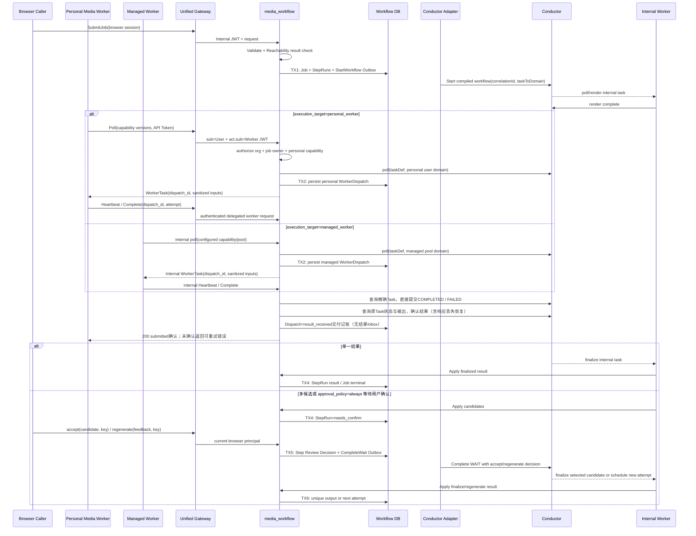

`taskToDomain` 只给 Capability Task 设置与冻结 `execution_target` 一致的 Domain：Personal Target 从 Job owner 派生，Managed Target 从受控 pool 配置派生；Renderer、Finalize 等 Internal Execution Task 使用内部 Domain。服务端经 Registry 决定 taskDef、Target 和 Domain。禁止从共享队列先领取再检查 owner，禁止 Personal/Managed 互相回退，也禁止回退到 `NO_DOMAIN`。

外部调用结果不明确时按 `job_id` correlationId、`dispatch_id` 或 `step_run_id + attempt` 查询，禁止盲目创建第二个执行。初次启动的correlation查询只定位候选，不提供去重保证；唯一候选还须读取精确实例并核对Definition名称/版本、完整冻结输入和Task Domain，匹配才绑定或终止。缺字段、重复实例、不同版本/输入/路由保持uncertain，不错绑、不清理异源实例。Execution Domain 决定 Job/StepRun/WorkerDispatch 转换；Adapter、Compiler 与 Worker 只协调技术执行。

### 审批与重新生成的技术编排

重新生成反馈与决定一同冻结在 Review，并由后台完成本轮 HUMAN。下一轮 Renderer 接收本节点上一轮审批输出、上一轮轮次与当前循环轮次；只有 `previous_generation=current_generation-1` 且决定为 regenerate 时使用反馈。首轮不接受旧决定。每轮重新渲染原冻结模板，再附加紧邻上一轮反馈作为普通文本；不执行反馈里的模板语法、不累计早期反馈，也不改变其他节点。后台重复投递和 Renderer 重试使用同一冻结输入，提示词摘要包含反馈。

新编译定义在 HUMAN 和 Renderer 中冻结 `feedback_mode=last_regeneration_v1`。旧定义缺少该模式时仍允许无反馈重新生成，但带反馈请求必须明确拒绝，不能接收后丢失反馈。该纯渲染过程不查询数据库、对象存储或 Provider，也不迁移到客户端 Worker。

每个原生 Step 的 Renderer、Capability、审批分支置于独立 `DO_WHILE` 内，Finalize 位于循环外。审批输出 `decision=regenerate` 才继续下一轮；`decision=accept` 或自动单候选结束循环，再执行唯一 Finalize。循环不终止整个 Job，也不重跑旁路或已完成上游。预期单候选仍按本轮实际候选数量选择 HUMAN，不能沿用上一轮审批输入。

Conductor 为每轮生成新的 Task ID；循环内引用名称不能含其保留的 `__` 迭代分隔符。API 只完成最新一轮正在等待的 HUMAN 精确引用；对账先确定节点的最新轮次，再投影该轮任务，旧轮候选和失败保留在技术执行审计中但不能覆盖新轮。业务 `retry_count` 不因重新生成增加；Dispatch 的 attempt 是其独立 Conductor Task 的技术重试序号，派发身份还包含 Task ID。用户决定的持久化与 Outbox 仍按 TX5 实施，不在本地事务中调用 Conductor。

旧 Compilation 与在途 Definition 不原位修改。旧定义仍可确认候选，但没有审批循环的旧实例不得通过终止整个 Workflow 或非终态 rerun 模拟重新生成，必须返回明确的不支持错误；新的循环能力通过新版本发布生效。

审批决定与待提交命令保存为同一条不可变 Review 记录。事务前查询原生RUNNING实例，选择最新轮、未被retried替代且IN_PROGRESS的唯一HUMAN，以其输入冻结候选并按数组位置选择。TX5锁定Job、StepRun，复核归属、实例关联和取消意图，仅保存精确Task身份、轮次、用户、幂等键与决定，不改变Step/Job执行状态。一个HUMAN只允许一个决定；同键同内容返回原回执，异内容或同Task第二决定冲突。缓存状态、候选和旧retry_count不能否决原生活动任务。

后台事务外领取 pending Review，并以每次领取独立的 claim token 隔离进程重启和租约回收。提交前检查精确 Task ID：已完成且输出匹配原决定则直接标记 applied；已完成但内容不同、执行已取消或任务已被替换则 failed，不再覆盖。暂时不可用只释放自己的 claim，保留原决定与退避时间；旧 claim 不能完成或释放后来重新领取的记录。Review 的 applied 只表示技术审批已被接受，业务输出仍由循环外 Finalize 收口。

Product 输入在提交时冻结商品主图的可访问 URL（无主图时取首图），作为对应 Workflow Input 的 `asset_ref`；Product ID 仍保留在输入快照中供业务追溯。图片进入 Capability 的位置和顺序只由 Template Version 的 Invocation Mapping 决定，不把 URL 拼进提示词正文。

用户命令使用调用方生成的稳定幂等键；显式键重放在查询 Conductor 和判断当前轮之前返回原决定回执，仍须校验当前用户与 Workspace 权限。旧调用方缺少键时，只能以当前 HUMAN 身份兼容同轮去重，不能承诺跨轮网络重放安全。回执包含不透明 Review ID 和 pending/applied/failed，不暴露 Conductor Task ID。读取最新决定不等于当前轮仍可审批。

待确认投影和审批写入采用相同Job→StepRun锁序，在事务内检查精确Task是否已有Review；已有决定不重复覆盖其候选。Job/Step仍可投影为等待，LastReviewStatus=pending表示已接受、正在送达，不代表允许第二次审批。Conductor查询在锁定前进行，外部调用不进入数据库事务。

原生retry不增加本地执行周期，也不使已通过的Human审批失效。当前Task、Conductor retried标记和循环轮次区分技术尝试与生成轮；审批回执始终绑定精确Human Task ID。旧整次输入覆盖rerun仍有历史周期字段，保留原摘要供兼容隔离，不将它升级为新的执行状态机。

审批投递必须直接使用Review冻结的Conductor Task ID完成HUMAN，不能按Task Reference再次解析提交目标。读取等待状态后即使Retry替换同名HUMAN，旧决定也只能指向旧Task ID，不得重定向到新任务；无法提供精确Task提交能力时保留待恢复命令，不回退引用提交。旧任务不存在或不再等待由对账明确失效；引擎对旧Task结果的语义仍须在真实协议测试中核对。

提交HTTP成功后再次查询精确Task，只有COMPLETED且输出与冻结决定相同才标记applied。未确认保留pending供后续查询，冲突/替代/取消记failed。响应丢失也先查询原Task，不创建新审批任务；accepted_retry_count只保留不可变审计，不授权或禁止原生任务。

## 历史图片谱系导入与继续执行

旧系统的 ModelImage、StyleImage、FirstFrame 若上游引用完整而没有下游 Video，是 **Imported Incomplete Execution**，不是孤儿素材或已完成 Job。只有上游缺失、引用错配等真正断链的记录才排除。ModelImage 可被多个 StyleImage 复用；同一个已完成图片节点可被多个导入执行引用，但对象只迁移和登记一次。源 VideoTask 无 Video、VideoPush 引用不存在的 Video 不进入目标执行。

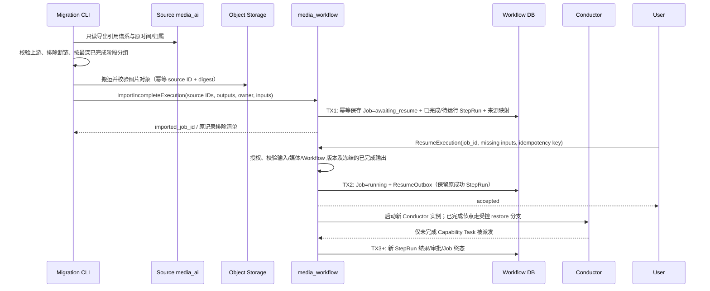

导入不调用 `SubmitJob`，不回填或伪造旧 Conductor 执行。TX1 前先由 media_materials 将源图片摄取为 **Imported Generated Asset**：它以源 ID/摘要幂等，尚无 Job/StepRun 链接；TX1 再保存各历史 StepRun 对该 Asset 的引用。同一 Asset 可被多个导入执行复用，不能为了满足原生 Generated Asset 的必填生成记录而伪造一个 Job。中断后可按 `(source_system, source_record_id)` 重试，不产生重复 Job/Asset。原始创建时间与实际导入时间分别保存，缺失的旧模板版本不可猜测为当前版本；导入的已完成 StepRun 标记历史来源。导入时不自动运行，用户可先在 UI 检查已完成图片并补齐后续 pose/scene/movement 等输入。

`ResumeExecution` 仅允许 `awaiting_resume` Job，校验所有待执行节点需要的输入；不改变已完成图片、原时间和来源 ID。TX2 与 Outbox 同事务，结果不明确时按 Job ID 和 resume idempotency key 查询。启动的是**新的** Conductor 实例，编译后的恢复分支把已完成 StepRun 的可信输出还原为正常 `finalize.output_resource` 形状，跳过这些节点的 Render/Capability/Approval/Finalize 副作用；只执行首个未完成节点及其后继。恢复分支必须校验对象仍可访问且属于目标 Workspace，禁止浏览器自行提交任意已完成输出。重复继续执行返回同一实例；取消、晚到源迁移或旧 attempt 不能覆盖恢复后的状态。某图片被多个执行复用时，每个 Job 分别授权，Asset 只登记一次。

Resume 接收调用方经 Materials 授权取得的短期 URL 时，先限制其为本企业 Storage 命名空间并做有界读取；TX2 只冻结相应 Object Path，不能把签名 URL 写入 Job 或 Outbox。Conductor 启动允许晚于 URL 过期；Capability 在领取时由 media_workflow 携服务凭证向 media_materials 换取新的 URL，并在交付前复核企业命名空间和有效期。解析失败不交付任务，待下次领取重试；不能回退到旧 URL、外部 Provider URL 或其他企业路径。历史 Generated Asset ID 同样在领取时复验来源和归属后重新签发 URL。

Text-only Movement 是独立于对象媒体的有效输入：用户先经 Materials 资源授权选择 movement，Resume 冻结其非空 `content` 和 `asset_kind=movement`，`url` 保持空值；不调用对象探测，也不生成 Object Path。Renderer 使用 `movement.content`，Capability 映射只按冻结的 Invocation Mapping 生成参数，不能把空 `asset_ref` 伪装为视频或图片。若该 Capability 的输入 schema 明确要求 movement 媒体引用，语义校验必须拒绝这项绑定；内容型输入不能越过能力契约。失败、重复命令和 Outbox 恢复遵守普通 Resume 的状态与幂等边界。

已完成 Video 采用另一条导入分支：每个源 Video ID 对应一个 Imported Completed Execution，即一个终态 Job 和四个成功的历史 StepRun。共享的 ModelImage/StyleImage/FirstFrame 仍只登记一次 Asset，但可被多个 Job 引用。VideoPush 的多视频成员与发布事实由独立的 Historical Publication 聚合导入，不成为四节点 Workflow 的额外输出；导入不触发剪辑或发布。

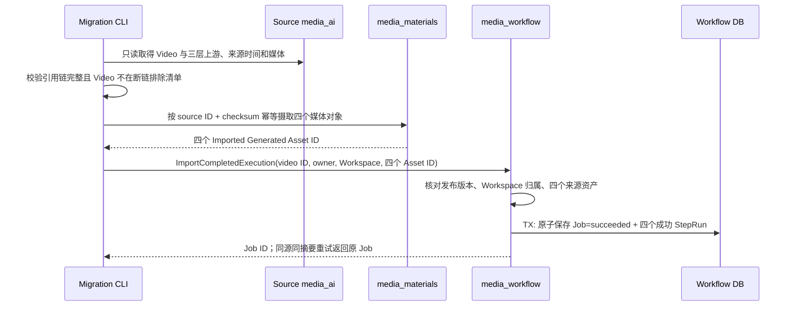

任一资产摄取或核验失败时不写 Job，已摄取资产可按来源键复用；数据库提交结果不明确时按 `(Workspace, source_system, video ID)` 查询并比较请求摘要，冲突返回错误。已完成 Job 没有 Conductor 实例和 Resume 出口；原始视频时间作为完成时间，导入时间另存。源 VideoPush 关联多条 Video 时，先建立各自执行，再由 [historical_video_push_import](../0004-historical_video_push_import/historical_video_push_import.md) 独立保存有序成员；不能因为共享首帧而合并输出。

目前代码已有未完成执行导入、`awaiting_resume` 状态、恢复分支与 StartResume Outbox；一条真实样本已通过 Resume→Conductor→Personal Worker→结果登记联调。任何历史图片都不得通过普通 `SubmitJob` 冒充已恢复执行；VideoPush 是独立历史事实，不参与本流程的 Job 状态推进。

## 状态流转

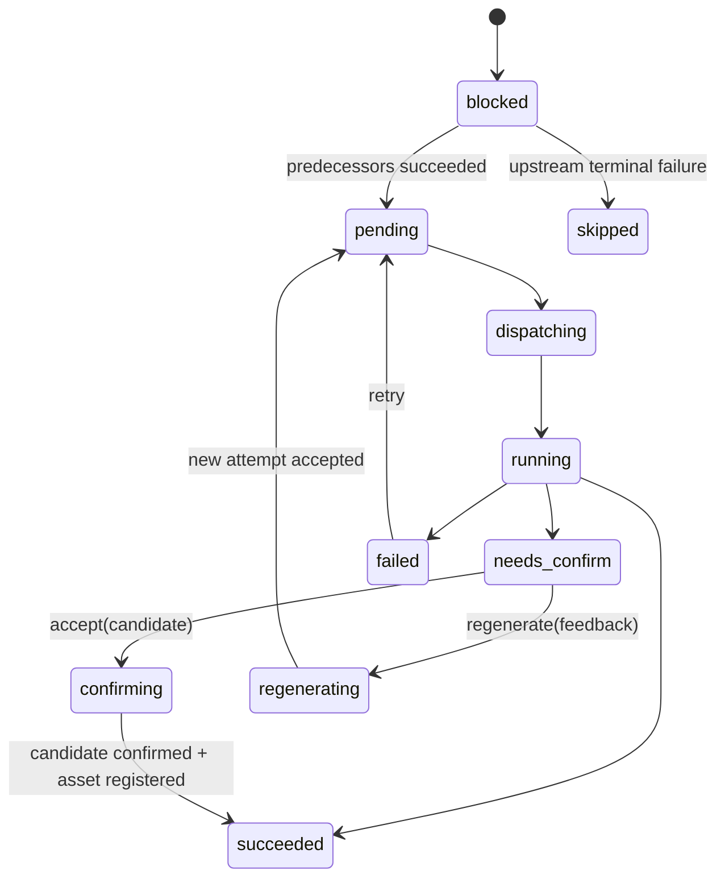

## 幂等设计

### Conductor原生失败恢复

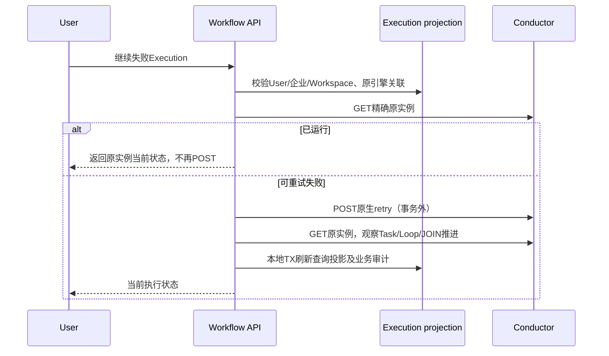

Task重试、失败恢复、并行、JOIN、循环及人工等待由Conductor拥有。普通retry继续失败/取消的未成功任务，保留已完成任务及现有提示词，不自行按DAG重置Step或重新执行renderer。重新生成是HUMAN决定触发DO_WHILE新轮；更改输入重新开始另用明确的原生rerun/restart语义，不混为普通失败继续。

Job/StepRun状态是查询投影，不是与Conductor平行的调度权威。授权、业务资源登记/当前引用、精确审批Task与Worker结果幂等仍由业务服务负责；缓存failed不能阻止引擎已恢复的Task，缓存running不能构造新任务。外部命令不在本地事务内调用；响应不明确先GET，不盲目创建新实例。bounded poll为空不等于失败，继续观察同实例的异步decider。并行成功旁支保留由原生retry负责，不通过恢复Task/手动重排队模拟。

初次Submit、审批决定及结果登记的幂等属于其各自业务边界，不据此再创建执行重试命令/租约/基线证据控制层。input_override兼容迁移必须保留明确语义，不静默删除；公开接线门禁完成前不宣称原生执行交付。

## Dispatch交付记账与原生任务生命周期

### 原生任务交付不依赖本地重试提交

Personal/Managed poll得到任务后，先核对归属、企业、Step与冻结Capability，再查询原Conductor实例和精确Task ID。实例必须RUNNING，Task必须SCHEDULED/IN_PROGRESS且未被retried标记为旧尝试；Dispatch attempt等于该Task的retry_count+1。现有Dispatch重取和活动结果/心跳采用同样的原生身份检查。

Job缓存仍为failed或succeeded不否决已恢复的原生任务，也不先修改缓存来解锁交付。不使用callback=2延迟任务，不清空Step或计算重跑影响集合。取消意图与归属校验仍属于业务边界；本地授权记录不能覆盖引擎已终止、已完成或已替换Task的事实。查询失败时不交付，不伪造Task成功或创建另一个执行。

- `WorkerDispatch`独立保存身份关联与交付记账，正常路径`delivered -> running -> result_received`；旧expired/failed记录保留兼容，不由本地扫描器驱动任务。
- 向客户端返回任务前必须完成 Dispatch 事务；响应丢失时，同一 Worker 的下一次 poll 返回现有有效 Dispatch。
- heartbeat先核对精确原生Task，代理IN_PROGRESS/callback更新并再次确认仍活动，之后只刷新本地交付时间。lease_expires_at是兼容记账字段，不是第二个任务截止时间；Task timeout/response timeout与技术重试由Conductor Task Definition决定。
- Worker断线不由本地时钟触发Job失败或重排队。原Task仍活动时，绑定的执行者可续心跳和交付结果，即使本地时间已过期；原生重投相同Task/attempt给同一绑定身份时，保留Dispatch ID并刷新记账，不创建新attempt。原Task终态、被替代或取消时拒绝活动操作；已确认的相同结果仍可查询重放。不同Worker/凭证/实例不能借记账时间过期夺取现有Dispatch。
- Personal Worker API Token 被撤销后不能继续 poll、heartbeat 或 complete；短时 Internal JWT 的剩余 TTL 是最大撤销延迟。Managed Worker 不使用 Token，停用通过进程配置、pool/capability allowlist 和停止内部 poller 生效。

## 一致性、恢复与权限

TX1保存初次提交与启动事实，TX2保存Dispatch授权关联；Worker结果直接提交原生Task，不另设接收结果事务或后台发送器。Task确认后只记录Dispatch交付完成，不写Job/Step或登记素材。TX5仍原子保存审批决定与待交付命令；初次启动/发布/审批的可靠交付不因Worker结果代理调整而删除。取消意图与原生状态核对仍独立处理，晚到结果不能更新替代Task或反转取消事实。

浏览器 API 使用 Web Session；`/api/worker/v1/*` 使用基于 API Token 签发的 `sub=User + act.sub=Personal Worker` Internal Identity JWT，不依赖 Kratos Cookie。Personal Worker 有效权限是 User 当前权限、Worker Actor 状态、Token scope、Organization Membership/Entitlement、Job owner 和 Personal Capability allowlist 的交集。

Managed Worker 属于 media_workflow 内部运行时，不调用 Talos或公开 Worker API。它的可信 `actor_id`、pool 和 capability allowlist 来自服务配置；Job `submitted_by` 只表示业务归属，不被 Managed Worker用于模拟登录。若未来它必须代表 User 调用内部资源服务，由 media_workflow 签发绑定 dispatch/audience/scope/lease 的短期委托 JWT。

任务输入中的稳定 Object Path 在领取时换成短时 presigned GET/PUT URL；Worker 完成只返回受控 Object Path、checksum、content type、size 与 provenance。Finalize 验证对象并以 `(step_run_id, result_key)` 幂等登记唯一 Generated Asset。任意 Provider URL 必须先摄取到受控对象存储。

Provider任务交付前按已发布不可变Capability schema核对prompt/资源参数及数量；领取和有效lease内的重交付均校验。媒体参数只解析本企业Object Path或配置StorageOrigin内本企业URL，由Materials内部解析接口携服务凭证取得新URL、过期时间及HeadObject的content_type/size_bytes。Gateway以这些存储元数据检查媒体类型/非空与签名有效期，不请求任意外部URL。失败不新建Dispatch、不交付旧签名；已被Conductor领取但校验失败的任务仍由引擎超时/重试机制处理，不伪造成功。配置中已归档、不可读取的Capability也不继续交付现有lease。

客户端`provider_fixture`只为已配置的精确Job/Step返回显式mock结果，不是生产Provider适配器；可以让多个Template复用同一个Capability。配置匹配不代表Job队列隔离，启动前仍需核对Personal Domain待处理任务。内部Render/Finalize继续由服务端执行。

### 生成结果登记与当前产物引用

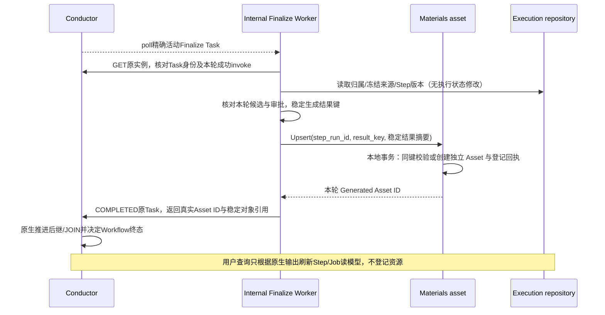

`result_key` 标识被接受的能力生成结果，不使用 Finalize 技术任务重试 ID 或 Worker delivery attempt。对同轮结果的响应丢失重放返回同一个 Asset；同键不同结果冲突。Retry/重新生成产生新的能力结果身份，即使对象内容相同也登记独立产物。StepRun 保留稳定身份，仅当前选定结果引用可以变更，旧 Asset 的对象、内容和来源不被覆盖。

Materials调用不持有Execution数据库事务。登记成功但Task回写失败时，Conductor重交付的Finalize使用同一成功invoke身份重放登记，返回原Asset ID；Finalize技术Task ID不影响结果键。生成新轮或重新执行能力时，新的成功invoke产生独立Asset。取消或任务被替换后，晚到资产保留审计，不能回写新的Task。登记使用受信内部服务身份，Materials验证企业、Scope、owner、来源和对象媒体元数据；两服务不建立跨库外键。

旧Definition仍使用原Finalize输入形状，不原位改写冻结版本。Worker从原实例查找本轮唯一成功invoke，核对候选与精确Finalize身份，不在查询路径补做旧未登记结果。已完成旧实例保留已有业务引用；缺少真实已登记Asset身份的旧输出应明确报不完整，不将散列占位ID当成资产。

内部任务的临时存储/服务不可用报告FAILED，由Task Definition的原生retry策略恢复；无效候选、错身份或不可满足的冻结契约报告FAILED_WITH_TERMINAL_ERROR。错误分类不调度任务，也不新建本地尝试。

### Provider失败回执

客户端Fail请求的`failure_kind`只描述此次能力调用的失败性质：`transient`映射原生FAILED；`permanent`或未填写映射FAILED_WITH_TERMINAL_ERROR。未知值在接收前拒绝。旧未分类回执保留原永久失败行为，不根据错误文本猜测或批量改写。Managed executor以类型化错误声明永久性，未分类内部异常按临时故障报告；Personal fixture未分类的显式测试失败保持永久性。

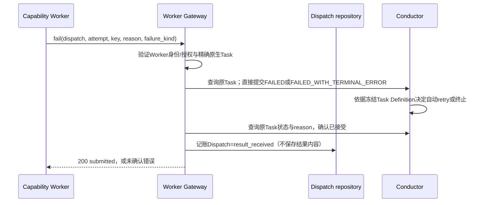

分类决定原生Task失败状态，reason保存为原生reasonForIncompletion。旧空分类仍为永久失败；同Task不同失败分类或reason不得作为已确认重放返回。客户端将未确认结果保存在私有本地目录，发送失败保留结果，重启先恢复交付、不重新执行生成函数。原Task已处于匹配终态时只查询确认，不再次POST；错结果冲突，已过期/替代Task不重定向。此流程不修改Job/Step、生成轮次或DAG；技术retry的次数、延迟和新Task由Conductor负责。多候选仍遵守审批规则，临时失败不能替代用户重新生成。

### Worker结果交付责任

客户端必须先保存完整待确认结果，再发送回写。直接代理不返回“已进入服务器队列”；仅在精确Task的状态与输出/失败原因匹配后返回submitted。请求响应丢失先查询同Task，不通过新Dispatch、新幂等键或重新调用Provider恢复。Task结果确认后，本地待交付文件才可移除；409/410结果留作拒绝记录而不继续发送。Task输出保存和对象存储写入不是分布式事务：生成完成但本地结果保存前崩溃仍由Provider/业务副作用的幂等与查询恢复解决，本地交付日志不消除该窗口。

Managed运行时在一次执行内保存返回结果并只重试发送；进程退出后的函数恢复遵循Conductor至少一次执行与下游幂等契约，不声称具有Personal客户端文件日志的恢复保证。旧Inbox表仅保留历史，不删除或改写；切换前有pending/failed记录则拒绝启动新交付路径，要求先核对原Task，不能静默丢弃结果。

## 新 Execution 的步骤结果复用

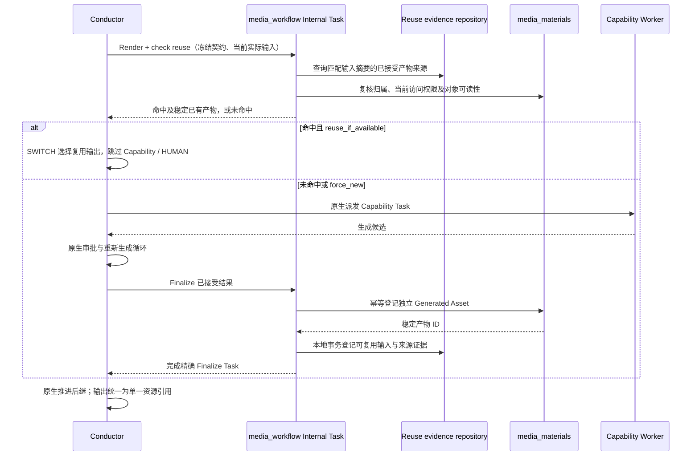

命中只读核验不持有事务调用 Materials，不创建 Worker Dispatch；执行分支、后继推进和失败重试始终由 Conductor 负责。复用索引只保存输入/产物证据，不拥有执行状态或调度权。索引写入与 Materials 登记不是跨服务事务：登记成功而索引失败由 Finalize 原生重试，以原 result_key 重放登记；索引写入成功而 Task 回写失败仍完成原 Task，不再次生成。取消或替代 Task 不允许晚到结果推进新 Task。

缓存缺失、资源已撤销或对象确定不存在为未命中；鉴权/存储服务暂时不可用不能当未命中并产生额外费用，报告可重试内部任务失败。输入摘要不包含签名 URL、Task/Job ID、投递次数或生成轮次；媒体顺序、真实内容和全部生成参数参与摘要。审批重新生成及显式 force_new 不命中复用，避免反复返回被拒绝结果。没有可信模板/能力版本与实际输入证据的旧迁移产物不自动推测命中。
