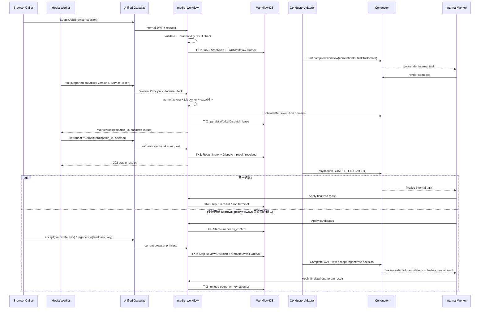
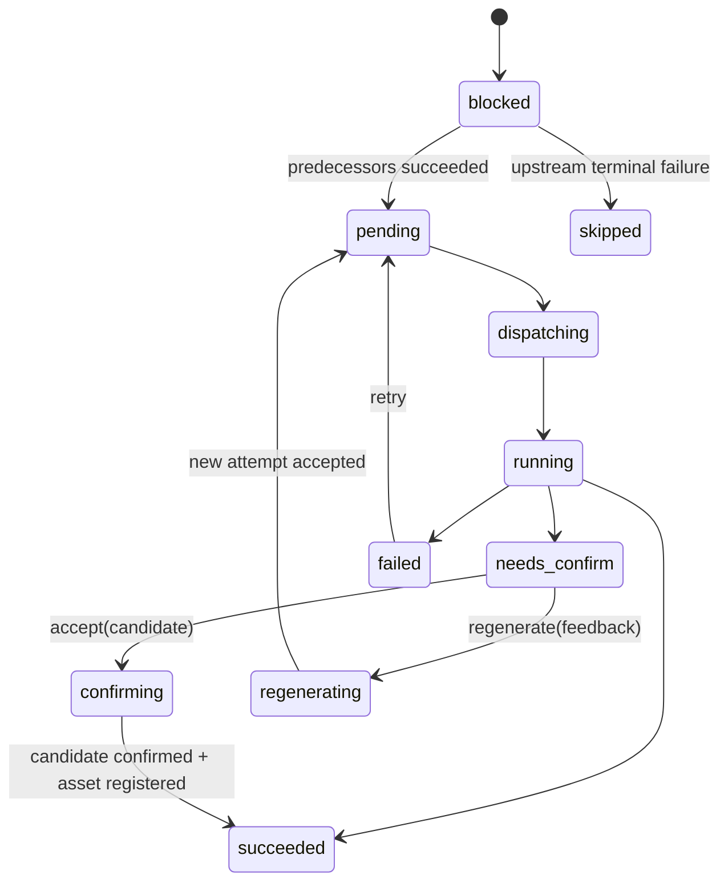

## 一句话说明

Execution 以本地 Job/StepRun 为业务事实源，通过 Outbox 启动已编译的 Conductor Workflow；客户端 Media Worker 只经 Worker Gateway API 领取 Capability Dispatch，不能直接访问 Conductor 或推进业务 DAG。

## 执行时间线

`taskToDomain` 只给 Capability Task 设置由 Job owner 派生的 Execution Domain；Renderer、Finalize 等 Internal Execution Task 使用内部 Domain。Worker 只声明 Capability Version，服务端经 Registry 决定 taskDef 和 Domain。禁止从共享队列先领取再检查 owner，也禁止无 Worker 的任务回退到 `NO_DOMAIN`。

外部调用结果不明确时按 `job_id` correlationId、`dispatch_id` 或 `step_run_id + attempt` 查询，禁止盲目创建第二个执行。Execution Domain 决定 Job/StepRun/WorkerDispatch 转换；Adapter、Compiler 与 Worker 只协调技术执行。

Product 输入在提交时冻结商品主图的可访问 URL（无主图时取首图），作为对应 Workflow Input 的 `asset_ref`；Product ID 仍保留在输入快照中供业务追溯。图片进入 Capability 的位置和顺序只由 Template Version 的 Invocation Mapping 决定，不把 URL 拼进提示词正文。

## 状态流转

## 幂等设计

- Job 使用 `(workspace_id, idempotency_key)` 去重。
- Conductor 启动使用 `job_id` correlationId 去重；Provider 调用使用 WorkerTask 提供的 `dispatch_id + attempt` 去重。
- Worker completion 先以 `(dispatch_id, attempt, operation)` 写 Result Inbox，再异步更新 Conductor；重复请求返回同一 receipt，旧 attempt 不覆盖新状态。
- 用户确认使用 `step_run_id + review idempotency_key` 去重；同一 attempt 的 accept 与 regenerate 互斥。
- Candidate 数量大于 1 时无条件进入 needs_confirm；数量等于 1 时仅 `approval_policy=always` 进入，否则自动确认；数量等于 0 时失败。
- 本地状态与 Outbox 同事务，Conductor/Provider 调用不在数据库事务中执行。

## Dispatch 租约与连接生命周期

- `WorkerDispatch` 独立于 Job 聚合保存，状态为 `claimed -> delivered -> running -> result_received`，可进入 `expired/failed`。
- 向客户端返回任务前必须完成 Dispatch 事务；响应丢失时，同一 Worker 的下一次 poll 返回现有有效 Dispatch。
- heartbeat 幂等延长本地租约，并由 Adapter 更新 Conductor `IN_PROGRESS`/callback；租约不得超过 Conductor response timeout。
- Worker 断线不直接让 Job 失败；租约到期后任务由 Conductor 重投并创建新 attempt/Dispatch。旧 Dispatch 的晚到结果返回 409/410。
- Token 被撤销后不能继续 poll、heartbeat 或 complete；短时 Internal JWT 的剩余 TTL 是最大撤销延迟。

## 一致性、恢复与权限

TX1 创建完整初始 DAG 运行事实；TX2 在交付前保存 Dispatch；TX3 接收客户端结果但不依赖 Conductor 同步可用；TX4 处理普通结果或进入 needs_confirm；TX5 原子保存用户决定与 CompleteWait Outbox；TX6 提交唯一输出或新 attempt。Outbox/Inbox 至少一次，旧 attempt 结果只审计。取消阻止未开始 StepRun 与 Dispatch 续租，运行中 Provider 按其取消能力处理，晚到成功不得反转 cancelled Job。

浏览器 API 使用 Web Session；`/api/worker/v1/*` 使用基于 Service Token Principal 签发的 Internal Identity JWT，不依赖 Kratos Cookie。有效 Worker 权限是 Token scope、当前 Organization Membership/Entitlement、Job owner 或显式 Worker Pool 授权、Capability allowlist 的交集。MVP 不建立 Agent 权限主体，`credential_id` 与 `worker_instance_id` 仅用于租约约束和审计。

任务输入中的稳定 Object Path 在领取时换成短时 presigned GET/PUT URL；Worker 完成只返回受控 Object Path、checksum、content type、size 与 provenance。Finalize 验证对象并以 `(step_run_id, attempt)` 幂等登记唯一 Generated Asset。任意 Provider URL 必须先摄取到受控对象存储。
