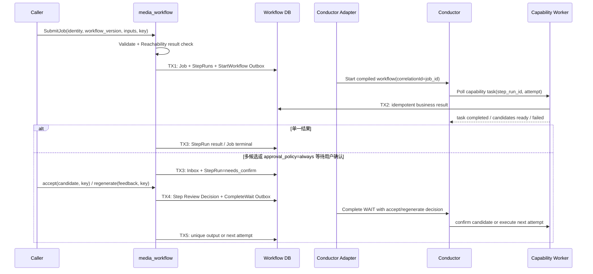
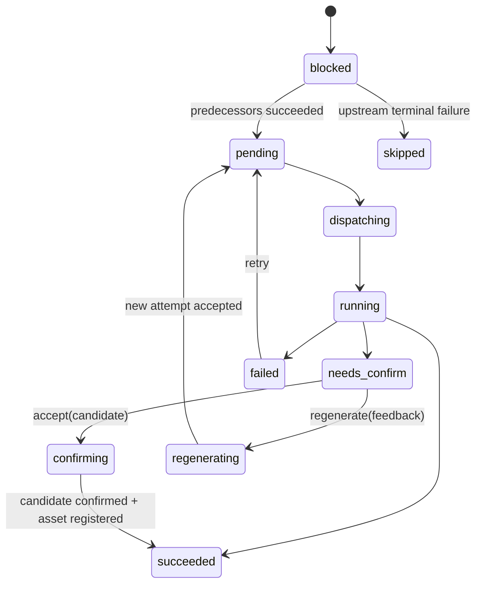

## 一句话说明

Execution 以本地 Job/StepRun 为业务事实源，通过 Outbox 启动已编译的 Conductor Workflow；Conductor 调度 Step Execution Fragment，生成 Worker 不直接领取或推进业务 DAG。

## 执行时间线

外部调用结果不明确时按 `job_id` correlationId 或 `step_run_id + attempt` 查询，禁止盲目创建第二个执行。Execution Domain 决定 Job/StepRun 转换；Adapter、Compiler 与 Worker 只协调技术执行。

## 状态流转

## 幂等设计

- Job 使用 `(workspace_id, idempotency_key)` 去重。
- Conductor 启动使用 `job_id` correlationId 去重；Capability 调用使用 `step_run_id + attempt` 去重。
- 完成事件使用 event_id/下游 task ID 去重；旧 attempt 不覆盖新状态。
- 用户确认使用 `step_run_id + review idempotency_key` 去重；同一 attempt 的 accept 与 regenerate 互斥。
- Candidate 数量大于 1 时无条件进入 needs_confirm；数量等于 1 时仅 `approval_policy=always` 进入，否则自动确认；数量等于 0 时失败。
- 本地状态与 Outbox 同事务，Conductor/Provider 调用不在数据库事务中执行。

## 一致性、恢复与权限

TX1 创建完整初始 DAG 运行事实；TX2 由 Worker 幂等提交执行结果；TX3 处理普通结果或进入 needs_confirm；TX4 原子保存用户决定与 CompleteWait Outbox；TX5 提交唯一输出或新 attempt。Outbox/Inbox 至少一次，旧 attempt 结果只审计。取消阻止未开始 StepRun，运行中 Provider 按其取消能力处理，晚到成功不得反转 cancelled Job。用户/Workspace 在 Job 创建时固定；确认时重新校验当前用户的 Workspace 执行权限。Conductor 不暴露给浏览器；Worker 经 Ory 保护的 Worker Gateway 按 Runtime Environment/Workspace 授权领取能力任务。
