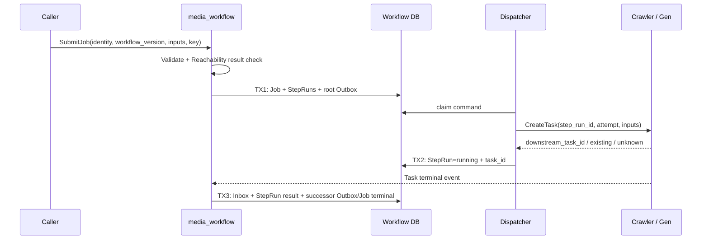
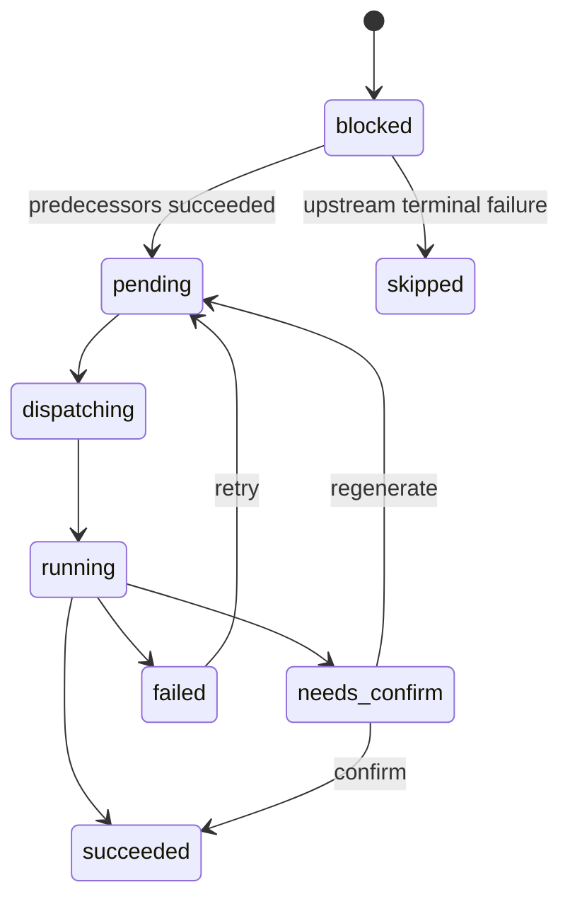

## 一句话说明

Execution 通过本地 Job/StepRun 状态机和 Outbox 向 Crawler/Gen 发出幂等命令，再按事件推进 DAG；不再由外部 Worker 领取 StepRun。

## 执行时间线

下游结果不明确时按 `step_run_id + attempt` 查询，禁止直接创建第二个任务。Execution Domain 决定 Job/StepRun 转换；Dispatcher 和事件处理器只协调命令与结果。

## 状态流转

## 幂等设计

- Job 使用 `(workspace_id, idempotency_key)` 去重。
- 下游创建命令使用 `step_run_id + attempt` 去重。
- 完成事件使用 event_id/下游 task ID 去重；旧 attempt 不覆盖新状态。
- 本地状态与 Outbox 同事务，外部 RPC 不在数据库事务中执行。

## 一致性、恢复与权限

TX1 创建完整初始 DAG 运行事实；TX2 绑定下游任务；TX3 去重事件并原子解锁后继或提交 Job 终态。Outbox/Inbox 至少一次，旧 attempt 结果只审计。取消阻止未开始 StepRun，运行中下游按其取消能力处理，晚到成功不得反转 cancelled Job。用户/Workspace 在 Job 创建时固定；Dispatcher 使用 mTLS 服务身份，下游根据受控代表上下文执行最终资源授权。
