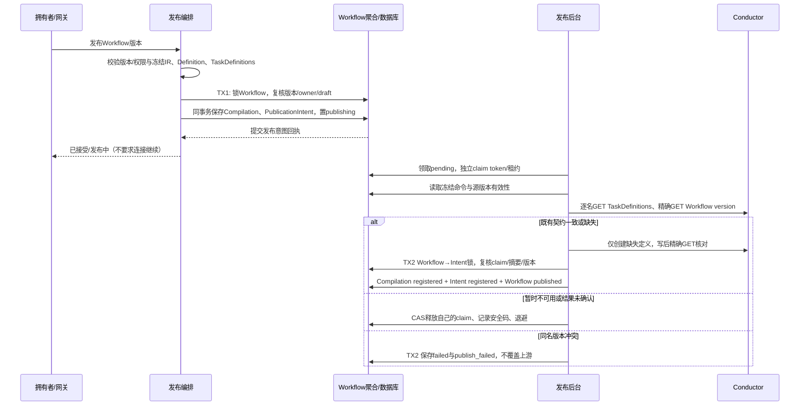
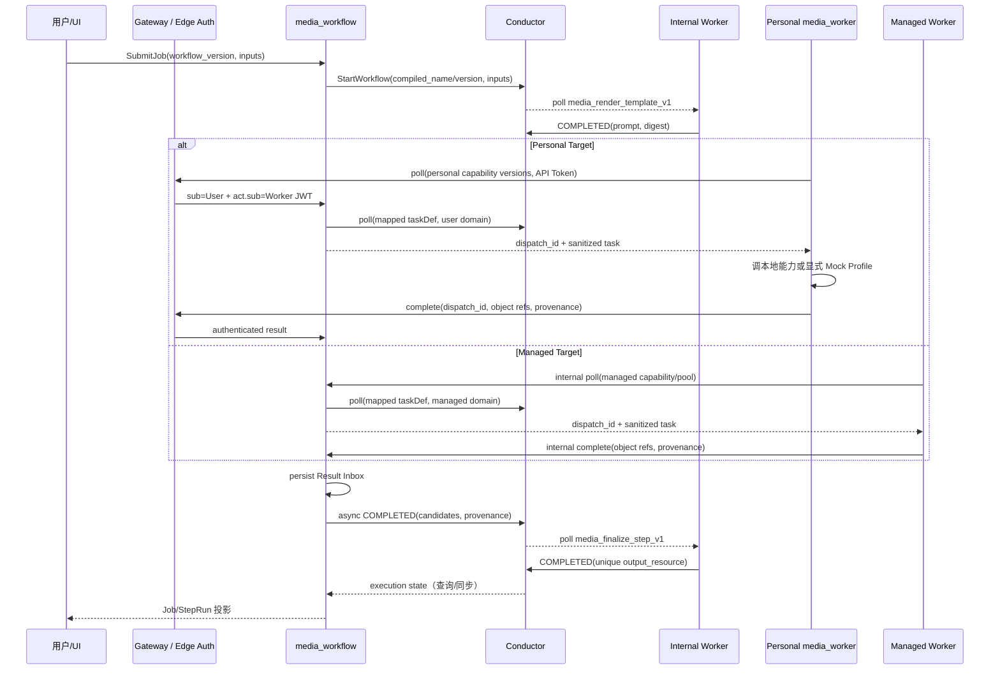

## 一句话说明

Workflow 发布时冻结所有引用版本，先经 Semantic Compiler 生成不可变 Executable Workflow IR，再由 Conductor Backend Compiler 按拓扑波次生成 Definition；经 Outbox 注册成功后才进入可执行的 published 状态。

## 执行时间线

Semantic Compiler与Backend Compiler仍在接受前执行；所有外部注册在TX1提交后、TX2开始前。意图以源Workflow/版本唯一，冻结TaskDefinitions完整注册参数及Definition，不因进程重启重读Template/Capability重编译。读取原意图的重放仍复核当前访问权限；不同摘要冲突。后台使用服务自身Conductor连接，不保存用户Token，拥有者归属由TX1复核。

领取claim过期后可由新进程恢复，旧领取者不能完成或释放新领取者的命令。外部响应丢失先读原定义收口，不能改版本或PUT修复同名TaskDefinition。TX2只发布仍属原owner、原version且未删/未归档的源；源改变时标记superseded，不发布后来修改版本，也不删除已注册审计。注册Conflict必须用户以新版本解决；网络故障保持publishing并退避。请求断线不取消已接受意图。Job启动仅消费registered Compilation与published源，不消费pending意图。

## 状态与幂等

Compilation 状态为 `pending -> registering -> registered | failed`。幂等键是 `(workflow_id, workflow_version, definition_hash)`；同一 hash 重放返回既有映射，不创建新 Conductor version。Conductor 返回冲突时必须读取远端定义并比 hash：相同视为成功，不同视为不可自动覆盖的冲突。

## 编译输出约束

- 循环内task reference采用step key编码，避免Conductor保留的`__`迭代分隔符；原始step_key保留在input。循环外Finalize保留稳定引用。
- Capability Task 的 input 必须保留 `job_id=${workflow.input.job_id}`、原始 `step_key` 和冻结的 `capability_key/capability_version`；它们是服务端 Dispatch 归属校验所需的执行元数据，不是 Provider 参数。缺少这些字段的旧发布定义不得通过解析 task reference 猜测身份或绕过 Dispatch 校验；迁移联调样本时先通过业务 API 结束旧执行，再创建并发布新的样本定义。保留旧 Compilation 与执行快照，不原位覆盖。
- `ExecutableWorkflowIR` 是 Semantic Compiler 与 Backend Compiler 的稳定边界；Conductor Definition 和 FlowGram 文档均不得充当 IR。
- `ExecutableStepIR` 固定 Template/Capability 版本、Execution Target、context bindings、Invocation Mapping、候选数量、唯一输出和 reuse/approval policy。
- 当 Template 配置多候选、`needs_confirm`，或 Step 使用 `approval_policy=always` 时，Backend Compiler 在 Capability 与 Finalize 之间插入 Conductor `HUMAN` task；预期单候选也保留实际多候选审批分支。候选保存在该task input；接受才运行Finalize，重新生成通过当前HUMAN的regenerate决定进入该Step下一循环轮次，不使用非终态rerun，不由客户端Worker承担审批。
- `media_render_template_v1` 固定接收 `template:string` 与 `context:map<string,json>` 并返回 `prompt:string`；Slot 数量和名称只改变 context 内容，不改变 Task Definition。
- Capability 的 `images[]` 等参数由 Backend Compiler 按 Invocation Mapping 生成；Renderer 和 Worker 均不得按 Slot 名猜测。
- Definition 只含稳定 ID、不可变模板内容、Object Path 表达式与非敏感参数；不含二进制、Provider 密钥、cookie、Token 或临时 URL。
- Step 间传递稳定业务资源 ID；二进制与 Provider 密钥不得进入 Definition 或执行 payload。
- Conductor Definition 不是编辑源，禁止从其反向覆盖业务 Workflow。

## 内部 Renderer Worker

`media_render_template_v1` 由 `media_workflow` 限界上下文拥有，使用同一代码库中的纯 Template Renderer，但以独立 Worker 进程轮询 Conductor；它不是独立微服务。Worker 输入中的 `template` 与 `context` 已由 Backend Compiler 和运行时引用组装完成，执行期间不查询 `media_materials`。同一输入必须产生相同 `prompt` 与 `prompt_digest`，以便 Conductor 重投安全重放。API 进程不承载轮询循环，避免 HTTP 生命周期、扩缩容与 Task 并发互相绑定。

## Capability Worker 交互

- Conductor `taskId` 只在服务端使用；客户端幂等键为 `dispatch_id + attempt`，重复结果返回稳定 receipt，不得重复产生 Provider 副作用。
- Personal Worker 离线时 Task 保持可重试状态，不改变 Workflow 或 Job 定义；Managed Worker 停止时其 Pool Task 同样等待重投。
- Mock Profile 只用于联调，按 capability key 返回冻结样本，并在 provenance 中标记 `media_ai_fixture`。
- Mock 资源服务根地址可配置，文件路径与 provenance 不变；换地址不修改已完成执行的历史结果，也不代替生产对象上传。样本状态成功与图片/视频可访问是两道独立验收。
- Internal Worker 与 Capability Worker 生命周期独立；任一方重启不得要求重新发布 Workflow。
- Capability Version 到 `conductor_task_def` 和 Execution Target 的映射来自冻结 Registry；Personal 客户端不能提交原始 task type，且永远不能领取 Managed Capability 或 Renderer/Finalizer。
- 已发布 Capability Version 不可变；归档只阻止新 Workflow 引用，旧 Definition 与 Task 必须保留到在途执行排空。
