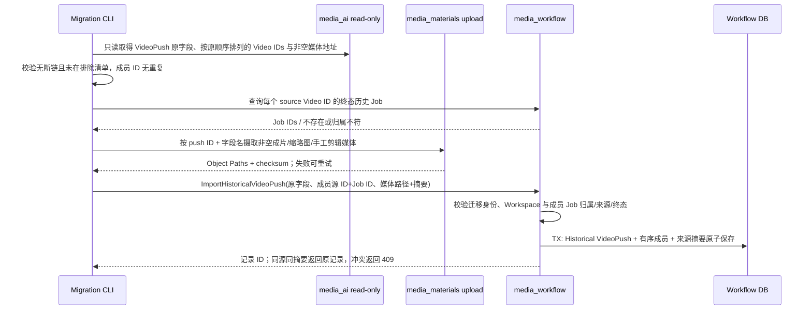

## 一句话说明

可信迁移工具在成员 Video 的终态 Job 已导入后，复制 VideoPush 自身媒体，并以来源 ID 幂等保存 Historical VideoPush；不触发剪辑、发布或 Conductor。

## 触发与结果

| 项目 | 内容 |
|:---|:---|
| 触发 | 迁移工具选择一条完整 VideoPush，或全量批处理处理该来源 ID |
| 前置条件 | 旧记录的所有成员 Video 上游完整；每个成员已有目标 `succeeded` 历史 Job；目标 Workspace/Owner/Organization 一致 |
| 成功结果 | Historical VideoPush 聚合保存原文字、状态、时间、顺序成员及可独立访问的媒体 Object Path |
| 失败结果 | 不写历史发布记录；已成功摄取的媒体可按稳定来源键重试复用，错误进入迁移对账报告 |

## 执行时间线

已导入 Video Job 与 Historical VideoPush 是两个聚合；本流程只以 Job ID 建关系，不修改 Job 或其视频输出。对象摄取发生在数据库事务前，允许出现尚未被发布记录引用的对象；对账和幂等重试负责收敛，不因后续失败删除可能已提交的对象。旧 VideoPush 原始时间与实际导入时间分开保存。只有所有成员和非空媒体可验证时才提交聚合；不存在“半条已发布记录”。

## 状态与不变量

Historical VideoPush 是不可变历史事实，没有运行态或发布状态转换；`is_published` 和旧 `status` 只是来源快照，不会驱动新发布行为。同一 `(workspace_id, source_system, source_record_id)` 至多一条记录。相同来源事实重复导入返回原结果；成员、文字、媒体摘要任一不同返回冲突，不覆盖旧事实。旧客户端断线不改变已提交状态，结果不明时按来源键查询。

## 关键参数

| 参数 | 产生方 | 使用方 | 语义 |
|:---|:---|:---|:---|
| source_record_id | media_ai VideoPush | 迁移工具、media_workflow | 历史发布记录幂等身份 |
| member_source_video_id / job_id | 旧 Video / 目标 Execution | media_workflow | 保留原顺序的跨聚合关联 |
| media_object_path / checksum | media_materials | 历史发布记录 | 后续不依赖旧系统的媒体引用与内容核对 |
| workspace_id / owner_user_id | 目标用户与企业 | media_workflow | 查询及导入授权边界 |

## 一致性边界

| 边界 | 原子事实 | 不包含 |
|:---|:---|:---|
| Materials 对象条件写 | 单个媒体对象及其 checksum | VideoPush 记录与 Job |
| media_workflow 导入事务 | 发布记录、全部有序成员、来源摘要 | 媒体对象写入和既有 Job 状态 |

## 幂等、重试与补偿

| 步骤 | 幂等键 | 重试策略 | 补偿/恢复 |
|:---|:---|:---|:---|
| 媒体摄取 | source push ID + 媒体字段名 | 网络失败原键重试，摘要不同冲突 | 已写对象保留待引用或 GC |
| 记录导入 | workspace + media_ai + push ID | 不明结果先按来源查询，摘要相同返回原记录 | 不覆盖已导入历史事实 |

## 权限与失败

- 迁移写接口仅接受服务端配置的迁移身份；旧 MySQL 只读。目标成员 Job 必须是同 Workspace/Owner/Organization、`origin=legacy_import`、`status=succeeded`、`source_record_id=video:<源 Video ID>`。
- 非空旧媒体无法摄取、摘要不匹配、成员缺失或跨企业时不写发布记录；重复请求事实冲突返回 409。空媒体字段保留为空，不伪造 Object Path。
- 当前 Workflow 的 Capability Worker、Conductor 与发布系统均不参与本导入；将来剪辑/再发布只能用新的显式命令处理。

## 结果事件

无。本次导入只记录历史事实，不触发发布。
