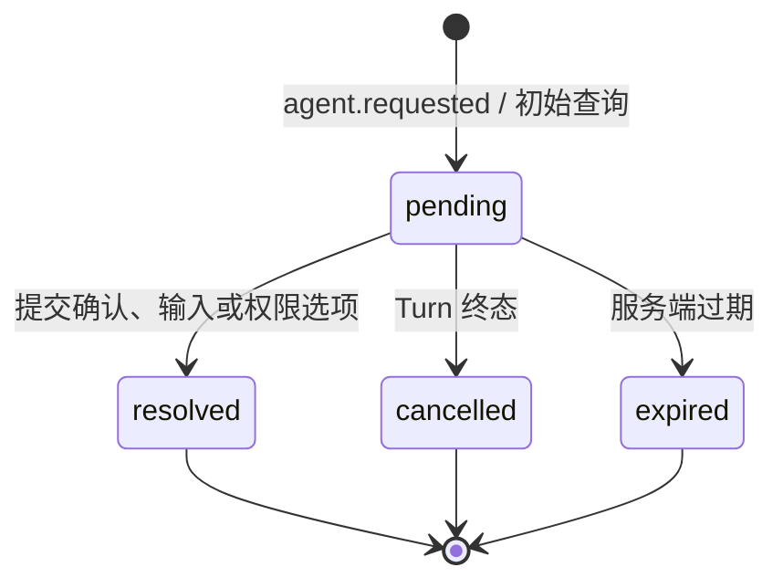

# Agent Request 交互旅程

Agent Request 是 Agent 执行中暂停 Turn 并等待用户回应的服务端事实。Chat App 不创建、不缓存请求为本地事实；它按活动 Session 查询 Gateway 代理的请求列表，并把用户选择通过 resolve 命令发回 Agent。

## 状态与所有权

- 服务端 Agent Request 状态是唯一事实；页面刷新后重新查询，不依赖 localStorage。
- 表单输入和提交中的 busy/error 仅属于当前 Chat App 内存。
- 同一响应重复提交由 Agent 保证幂等；页面成功后隐藏 pending 卡片。
- resolve 失败保留卡片和输入内容，并显示可读错误；不能把 Turn 乐观标记为完成。

## 交互形式

- `permission`：显示服务端提供的工具标题与 option 列表，提交 `{ option_id }`。优先采用 question/prompt，缺少时使用原生 tool_call/toolCall 的 title；仅额外展示 shell 工具待批准的 command 字符串/argv，支持换行和滚动，避免原生标题为空时盲批；不展示整份原始调用参数或私有环境。确认、输入、默认标题与失败提示支持中英翻译。
- `confirm`：提交 `{ confirmed: true|false }`。
- `input` 及未知类型：显示文本输入，提交 `{ value }`。

窄屏下卡片和选项按钮垂直或换行排列；API key、请求原始凭据和内部 Runtime 配置路径不展示（用户审批命令中实际涉及的文件路径除外）、不写入 URL 或本地存储。

Gateway 公共 HTTP 使用 IDL 的 payload_json/response_json 字符串与毫秒时间戳；L2 chat-client 在列表和 resolve 响应处统一解码为 AgentRequest，不能把 HTTP DTO 直接强转为组件模型。无效 JSON/非对象载荷显示请求错误，不进行推测授权。

## 执行失败与显式恢复

会话列表分别返回 Gateway 登记 status 和 Agent 的 runtime_status、execution_epoch；不可把登记 active 等同于可提交。failed/interrupted 后 runtime_status=paused，Chat 禁止发送并展示暂停原因和“恢复会话”。用户点击后使用稳定 operation_id 与当前 execution_epoch 调用既有 Resume API，成功后重新查询服务端；不自动重放失败输入，原 queued 按既有 FIFO 规则处理。恢复中禁止重复点击，失败保留暂停提示；切换 Session 后忽略旧请求结果。

turn.failed 的安全 error_class 在 UI 显示可读原因，模型认证缺失或失效提示配置凭据。历史回放中的失败事件不得覆盖较新的完成状态。Gateway 对暂停提交返回409，Agent 的400参数错误不得包装为500或回显私有响应。
