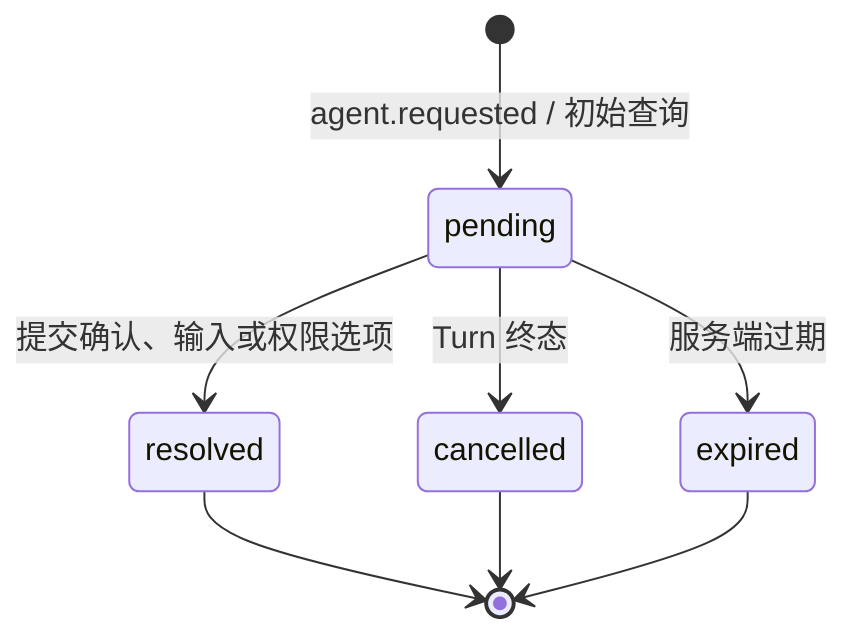

# Agent Request 交互旅程

Agent Request 是 Agent 执行中暂停 Turn 并等待用户回应的服务端事实。Chat App 不创建、不缓存请求为本地事实；它按活动 Session 查询 Gateway 代理的请求列表，并把用户选择通过 resolve 命令发回 Agent。

## 状态与所有权

- 服务端 Agent Request 状态是唯一事实；页面刷新后重新查询，不依赖 localStorage。
- 表单输入和提交中的 busy/error 仅属于当前 Chat App 内存。
- 同一响应重复提交由 Agent 保证幂等；页面成功后隐藏 pending 卡片。
- resolve 失败保留卡片和输入内容，并显示可读错误；不能把 Turn 乐观标记为完成。

## 交互形式

- `permission`：显示服务端提供的 option 列表，提交 `{ option_id }`。
- `confirm`：提交 `{ confirmed: true|false }`。
- `input` 及未知类型：显示文本输入，提交 `{ value }`。

窄屏下卡片和选项按钮垂直或换行排列；API key、请求原始凭据和 Runtime 路径不展示、不写入 URL 或本地存储。
