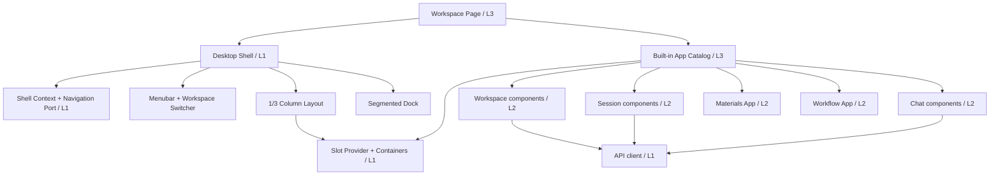

# UI Platform 架构

## 分层

沿用 `ui_platform/contributing/architecture.md` 的四层依赖：L0 UI primitives、L1 foundation、L2 domains、L3 pages。Slot 基础设施属于 L1；Workspace、Session、Chat 业务组件属于 L2；Workspace Page 在 L3 组合它们并注册内置 App。

## 运行时组合

根路由提供 Organization/Team/Workspace 选择空态；独立模式使用 `/o/:organizationId/t/:teamId/w/:workspaceId` 加载 Workspace Page，`?session=` 表示可分享的活动 Session。旧 `/w/:workspaceId` 在迁移期解析后重定向。`/admin/users` 与企业管理页是受保护的管理页面，沿用 Shell 的身份与导航语义但不建立 Workspace Profile。Workspace Page 建立 Shell Context；App wrapper 从该上下文取稳定 ID 与 Navigation Port，再把显式 props 传给 L2 组件。L2 Domain 之间不得互相导入。

Slot Provider 只理解 `AppDefinition`、`AppInstance`、Layout Slot 和 Profile，不理解 Workspace、Session 或 Chat。Dock 消费 Slot Provider；AppWindow 只渲染活动实例并提供 header portal。切换 Workspace 时由路由和 Workspace ID 重新建立 Profile 与 Session 边界。

同一套 Materials/Workflow App 必须支持 standalone 与 plugin 两种宿主。standalone adapter 由本地 Router/Menubar 实现 Shell Context，plugin adapter 把 Agent Platform Host 能力映射到同一端口；业务 App 不根据运行模式分叉导航逻辑。
