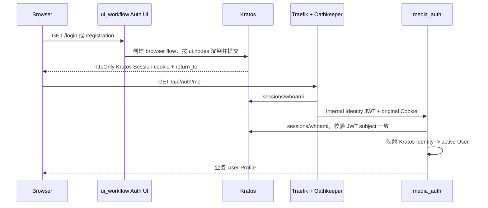

# 浏览器认证流程

## 登录与会话恢复

未认证或业务 User 为 disabled/deleted 时，Shell 不渲染业务 App。401 发起新的 Kratos browser login flow，`return_to` 只能是当前同源的绝对 URL。

## 登录与注册页面归属

- `ui_workflow` 只拥有 `/login` 与 `/registration` 的视觉和交互呈现，样式与业务 Shell 解耦。
- Kratos 仍拥有 flow 生命周期、字段定义、CSRF、校验消息、分步注册和 session；前端不得复制身份规则或绕过 `ui.nodes`。
- 页面从同源 `/self-service/{login|registration}/flows` 读取 flow，并且只向同源 `/self-service/{login|registration}` action 提交。
- 登录与注册互相提供入口；登录保留密码恢复入口。窄屏只展示认证卡片，宽屏可展示简洁的产品说明，但不加载业务 Shell。
- 已登录用户完成或重新进入认证 flow 后回到同源业务首页；外部 `return_to` 必须降级为 `/`。

### 密码字段

- 登录密码、注册密码和确认密码字段均提供独立的显示/隐藏按钮；默认隐藏，按钮必须可通过键盘操作并提供可访问名称。
- 显示状态只属于当前输入框的组件内存，切换时不得修改输入值、提交语义或焦点顺序。
- 密码及其显示状态不得写入 URL、日志、localStorage 或其他浏览器持久化存储。
- 提交期间输入框与显示/隐藏按钮一并禁用，防止表单状态产生歧义。

## Agent 入口的认证地址

Agent UI 通过当前同源 Edge 创建并提交 Kratos browser flow。Kratos 的 public base URL 可能沿用同主机 Workflow 的5173端口，而 Agent 入口为18080。前端只接受同协议、同 hostname、无 URL 用户信息且符合预期 self-service 路径的地址；端口不同时保留 flow/token 查询参数，将提交或导航地址归一到当前 origin。跨主机、跨协议及其他路径拒绝，密码与一次性 token 不提交到另一个端口。CSRF 与 Session 仍由 Kratos 校验。

## 登出

Kratos browser logout 是两步协议：Shell 先请求 `/self-service/logout/browser` 获得一次性 `logout_url`，校验 URL 并按上述 Agent 入口规则归一为当前同源的 `/self-service/logout` 地址，再由浏览器导航执行。成功后回到 `/login`；仅清理旧 `mw_token` 或前端内存不算登出。

## 恢复与错误状态

- `/recovery`、`/settings`、`/verification` 暂由 Kratos Login UI 承载；验证码和恢复凭证不进入业务前端。
- Vite 开发模式也必须把这些页面及 Login UI 的静态资源代理到统一网关，不能由 SPA fallback 吞掉路径；`/login` 和 `/registration` 仍由本地前端承载。
- 创建 flow、提交凭证或登出失败时保留明确错误，不假装本地状态已完成。
- loading 期间显示认证加载态；401 显示/跳转登录；403 的 disabled/deleted 业务状态不得无限重试。
