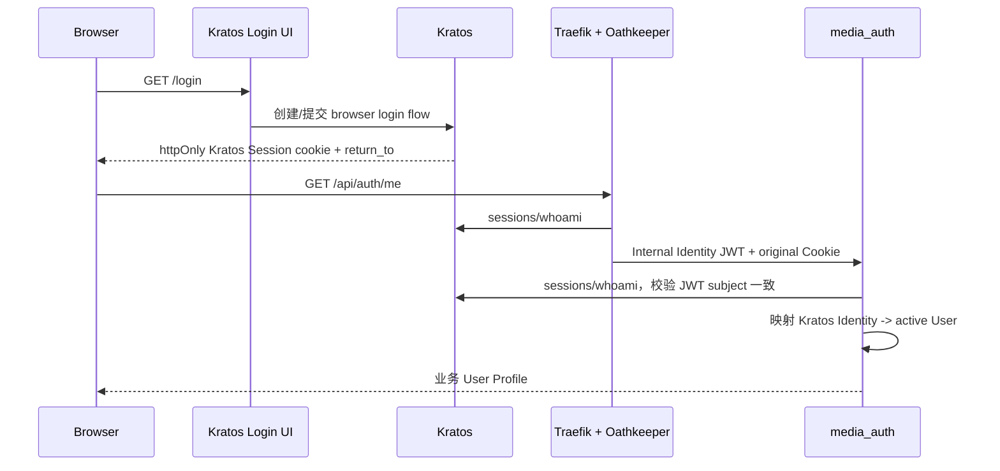

# 浏览器认证流程

## 登录与会话恢复

未认证或业务 User 为 disabled/deleted 时，Shell 不渲染业务 App。401 发起新的 Kratos browser login flow，`return_to` 只能是当前同源的绝对 URL。

## 登出

Kratos browser logout 是两步协议：Shell 先请求 `/self-service/logout/browser` 获得一次性 `logout_url`，校验 URL 与当前 origin 相同且 path 为 `/self-service/logout`，再由浏览器导航执行。成功后回到 `/login`；仅清理旧 `mw_token` 或前端内存不算登出。

## 恢复与错误状态

- `/recovery` 由 Kratos Login UI 承载；验证码和恢复凭证不进入业务前端。
- 创建 flow、提交凭证或登出失败时保留明确错误，不假装本地状态已完成。
- loading 期间显示认证加载态；401 显示/跳转登录；403 的 disabled/deleted 业务状态不得无限重试。
