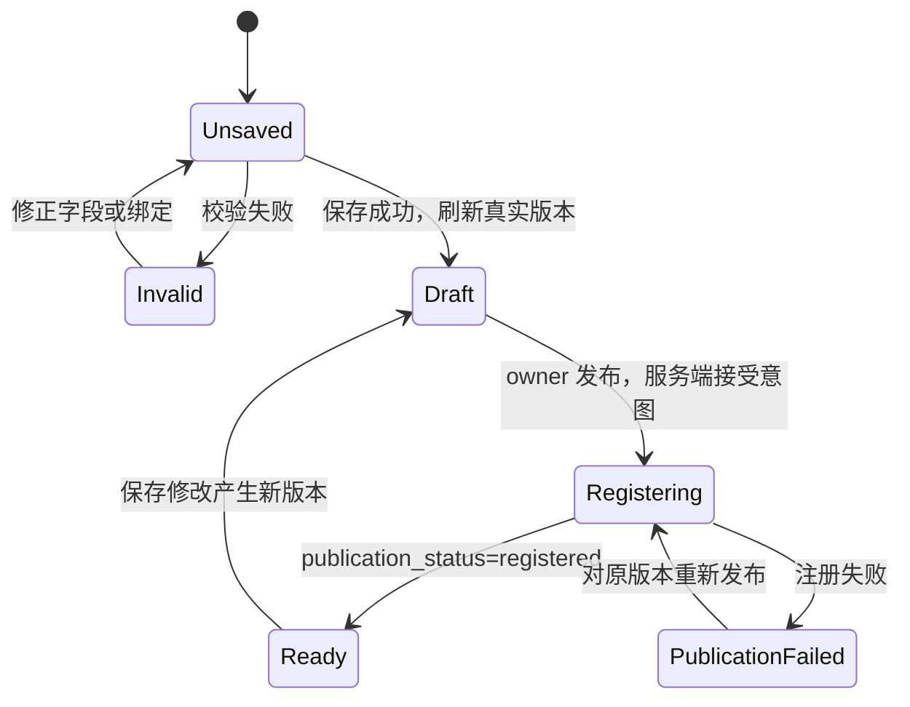
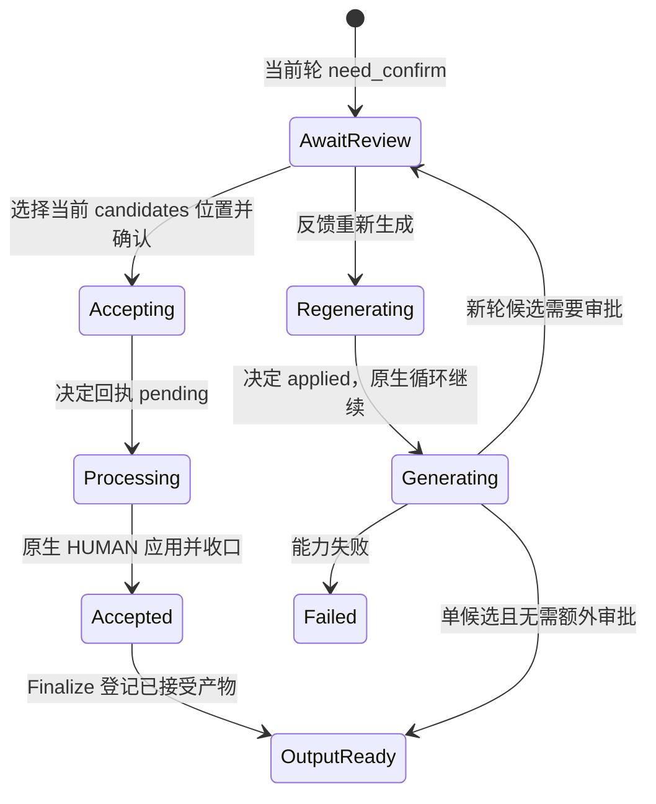

# Workflow v1.2 用户旅程与交互契约

2026-10-08 用户已确认 Penpot v1.2 修订原型，进入开发。保留 Slot、AppDefinition、instanceId 与 Header Portal，后续接入 media_platform 不嵌套独立 Shell。实施见 [spec](../../spec/ui_design/workflow-v1.2.md) 与 [plan](../../plan/ui_design/workflow-v1.2.md)。

## 范围与视觉基线

视觉沿用 Penpot「工作流 UI · v1.1」：暖浅色背景、白色导航与卡片、炭黑主按钮、黄色强调、原字体与尺寸。只在文件「工作流 UI · v1.2」修改交互、示例和状态；不修改原稿。素材、工作流、模板、任务四类入口不因技术表数量而增加。

流程制作人与流程使用人是操作场景，不是新增 IAM 角色。一个用户可以兼任；每个操作仍由服务端资源授权、功能准入和归属检查决定。

## 1. 进入企业与 Workspace

登录后确认当前企业；工作流域明确展示部门/Workspace，素材与模板属于企业，不随 Workspace 切换复制。Scope 是业务范围，不是企业或部门。

- 登录/注册/恢复按 Kratos flow 渲染，未配置的 SSO 不作为固定入口。密码支持显示/隐藏。
- 没有企业、部门、Workspace 或功能许可时分别显示原因，不展示能提交的空表单。仅展示当前用户有权限的创建/选择入口，不自动授予企业功能。
- 切换企业/Workspace 后取消旧查询、重建资源选择与草稿边界；有未保存内容时先提示保留/放弃，不把上一个企业的资源或凭证带入下一次提交。
- 浏览器只使用用户会话，经网关访问业务服务；Workflow 编辑和运行页不配置 Worker API Token、Internal JWT 或 Conductor 地址。

## 2. 准备素材

素材库入口先区分 Material、Generated Asset、Product、Virtual IP，再按各自真实业务字段展示。

| 类型 | 创建/编辑重点 | 查看重点 |
|:---|:---|:---|
| Material | 名称、Scope、已注册素材类型、媒体或文本；动作允许纯文本 | 媒体/动作内容、类型、来源；类型多选常驻展开 |
| Product | 主图与有序多图、受众、商品详情、展示动作、标签、电商扩展及元数据 | 主图切换、结构化业务信息、选择兼容 Workflow 的入口 |
| Virtual IP | 头像、全身、三视、九视分别上传；人物设定分组编辑 | 四类图片可定位查看；缺图明确展示，而非隐去字段 |
| Generated Asset | 当前不提供手工创建 | 已接受的生成产物、来源执行/节点、预览和媒体访问 |

上传先显示本地预览及上传状态，成功后业务表单保存 Object Path。上传中禁止保存；业务保存失败保留已上传引用，不再次上传或删除对象。短时媒体 URL 只用于展示，不作为表单持久值。详情使用独立子页，不在素材卡上堆叠 Product 详情弹窗。

Product 的“可用工作流”表达输入兼容性，而非归属/已使用关系。选择已发布且注册就绪、同企业/Scope/目标 Workspace 可用、Input Schema 声明 PRODUCT 的 Workflow，再进入预填该 Product 的运行表单；仍需补齐其他必填项。归档定义不可运行。无真实查询支撑的 SKU/绑定/使用历史/全量审计/存储占用不填模拟数字。

## 3. 制作模板

新建模板 → 选择生成能力 → 定义槽位 → 编写提示词与调用映射 → 检查输入 → 保存草稿 → owner 发布版本。

- 模板绑定企业及 Scope；编辑不提供重新绑定企业入口。
- Capability 通过平台、生成方式、生成类型、整数版本表达，例如 `jimeng.i2i.multi_image_prompt@1`。业务用途是输出 Asset Kind，例如 model_image，不把它误当 Capability。
- Execution Target 来源于能力版本，只读展示，不能在模板中切换 Personal/Managed 或填写 Worker ID。
- 输入编辑按槽位名、资源类型、Asset Kind 和必填组织；图片映射使用可排序的资源槽位，提示词映射为渲染结果。用户不编辑 IR 或引擎技术任务。
- “检查槽位”是本地静态检查，不伪装成不存在的服务端 Template Validate/Render 预览。发布/保存的服务端错误定位到对应字段；真实渲染提示词在执行中按需查看。
- 保存修改产生新 draft 版本；发布只作用于当前明确版本。旧已发布版本仍可被已授权定义引用，已有 Compilation/Job 不被草稿覆盖。
- 多候选属于中间生成结果，接受后形成单一节点输出；“单输出”不表示只能生成一张图。

## 4. 制作与发布工作流

新建/打开 → 添加模板节点 → 配置输入来源 → 设置审批与复用 → 指定最终输出 → 校验 → 保存 → 发布 → 确认注册就绪。

画布占据编辑区；基础信息、归属、Scope、可见性放入可展开设置。节点点击或键盘选择才展开右侧配置。点击与拖动独立，拖动只整理当前视图，不改变业务依赖。

- 画布只连 step_output；workflow_input/const 在节点内配置。无连接所有节点的“开始输入节点”。
- 添加模板须核对具体可读版本与同企业/Scope；发布使用已发布版本，不自动跟随最新草稿。
- 删除节点先列出受影响绑定，再明确确认，失效输入作为校验错误呈现，不静默连接其他节点。
- 候选大于一始终审批；always 还审批单候选。复用策略配置在定义节点上，不在运行表单提供未受 Submit 支持的全局开关。
- 最终输出为唯一汇点。样例使用已验收的 model_image → style_image → first_frame → video，不把配音、发布、剪辑等未接入能力混入示例。

发布 HTTP 成功不能立即展示“可运行”。注册中只读观察原版本回执；失败允许重新请求同版本发布，不新建 Workflow 来绕过失败。非 owner 无发布操作；功能许可被撤销时不执行保存/发布，但仍允许有权用户查看和管理清理。

## 5. 运行已发布工作流

选工作流 → 按冻结 Input Schema 选资源 → 核对版本、输入和审批摘要 → 提交 → 进入原 Job 详情。

- 每个输入项显示业务名称、资源类别、必填性和预览。只选择当前企业、Scope 与冻结 Asset Kind 兼容的资源；没有兼容候选时说明缺少哪类资源，不允许任意类型兜底。
- Product/VIP 保留业务身份与当前业务快照；媒体归一化为企业 Object Path。纯文本动作无需伪造图片或视频引用。
- 携带 Workflow 明确版本、企业、Workspace；同一个提交意图生成并复用一个 idempotency_key。用户改输入、换版本或明确创建另一任务才形成新意图。
- 提交中禁用重复操作；超时/断线显示“正在确认提交结果”，优先查询同键原回执，不直接提示“再创建一次”。版本冲突重新加载并要求复核；授权失败保留输入草稿但不能继续提交。
- 显示定义中已冻结的审批/复用策略，不显示虚构费用或运行时全局复用开关。viewer 只代表资源可读，仍须具备 Workspace 准入及 workflow 功能。
- Personal Worker 未执行时只能显示实际等待/超时状态，不承诺点击运行就自动生成。Mock 必须明确标记测试结果，不伪装成真实厂商调用。

## 6. 观察与处理执行

任务列表以“我的任务”为当前授权边界；每项优先显示 Workflow 名称/固定版本、状态、执行位置、是否需要用户动作及最终结果。企业管理员身份不意味着可审批其他人的 Job。

执行详情以冻结拓扑与节点状态为主体，选中节点才展开候选/结果/失败原因。当前头版本与执行版本不同、且冻结拓扑查询不可用时，显示真实 StepRun 状态列表和版本提示，不拿新定义的边伪装旧执行。

| 当前情况 | 主动作 | 不允许的混淆 |
|:---|:---|:---|
| pending/running | 观察；允许时取消 | 不以本地 Dispatch 租约倒计时决定任务失败 |
| need_confirm | 选择当前轮候选确认；反馈重新生成 | 不跨轮选择候选，不把它称为普通 retry |
| failed | 查看原因；失败继续 | 不承诺只重跑当前节点；原生 retry 恢复所属执行 |
| 明确的终态且要修改输入 | 修改输入重新运行 | 整次 rerun 会重跑成功节点，必须单独提示 |
| awaiting_resume | 查看历史前缀；补输入继续 | 不是普通新建提交或失败 retry |
| paused | 显示暂停与原因，允许时取消 | 当前无公开用户暂停/恢复 API，不放虚假按钮 |
| succeeded | 查看最终输出及节点中间产物 | 单个最终输出不是候选数组 |
| cancelled | 显示取消结果 | 不假装取消会立即删除上传对象 |

### 审批闭环

点击确认不是立即标 succeeded。接受回执后禁用该轮重复决定，等待真实状态刷新；未知响应查询最近 Review 回执，不换键再生成。选择参数为当前 candidates 数组位置，不把显示序号、Worker attempt 或 retry_count 当生成轮次。完整旧轮历史尚无公开查询，原型只能展示当前候选；旧已接受 Generated Asset 可追溯，不虚构任意旧轮候选。

候选上传不等于业务 Generated Asset 已登记，审批前预览文案不写最终 Asset ID。短时 URL 过期重新请求，不误判为执行失败。实时更新优先 SSE、断线后重新读取快照；加载、失联、权限变化与业务失败分别表达。

## 7. 继续历史未完成任务

待继续列表 → 历史执行详情 → 查看已完成前缀 → 补缺少输入 → 显式继续 → 同一 Job 的执行详情。

成功前缀只读，输入补齐表单只让用户补缺项，不通过全局 force_new 重做旧图片。Resume 使用自己的稳定意图键；重放回到原 Job。历史完成记录没有伪造 Conductor 调度实例，不显示不存在的在线 Worker/租约。

## 8. 共享与权限

owner 打开共享设置 → 选择私有/部门共享/企业内公开 → 为同企业部门赋 viewer/editor → 保存或撤权 → 刷新真实授权结果。

private 忽略 Grant；team 按有效部门 Grant；public 只在所属企业边界公开。共享定义不共享用户执行权限。编辑者可编辑、归档；owner 才能发布、改可见性和授权。资源权限与功能许可分开展示。

当前 Get/List 无 my_permission 或 Grant 列表，原型可表达目标交互，但实施前必须确认最小读接口；不能用部门管理员或“可读”推断 editor。部门选择只来自可见的真实 Auth 数据；不展示其他企业部门。授权失败/撤权竞争/权限源503都保留明确状态，不能以按钮显隐替代服务端校验。

## 9. 数据与异常门禁

- 空数据、加载、401、403、409、权限源不可用、媒体失效、未知提交/决定响应均有独立状态。
- 桌面复用原左右布局；窄屏配置进入可关闭面板，关闭不丢草稿，返回焦点到所选节点。只读状态不伪装可保存表单。
- 当前公开查询未覆盖 Capability 目录、有效权限/Grant、冻结执行图、轮次历史和全量统计；见[对齐审查](../../review/ui_design/penpot-v1.2-backend-alignment.md)。原型用明确样例，运行页面无数据时不伪造。
- v1.2 原型验证七个主旅程、关键分支与返回路径；Penpot 跳转不是真实 API 验收。确认后再编写实施 spec/plan、补足经确认的最小只读支持并开发前端。
