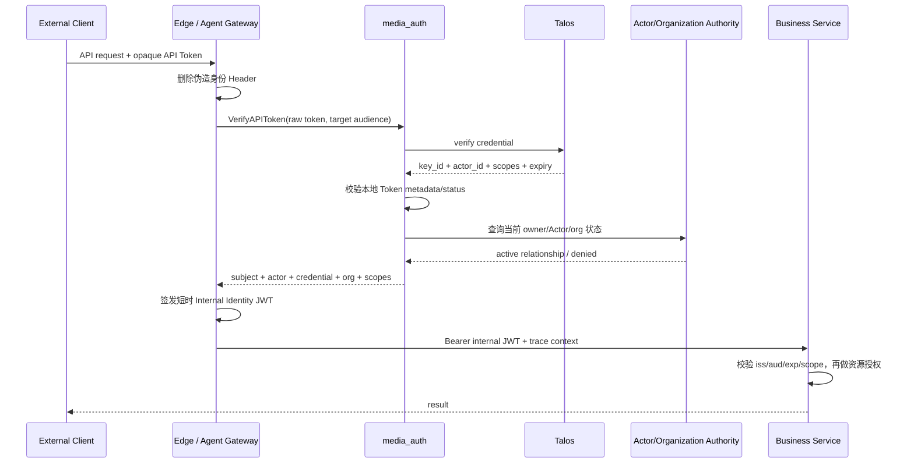

## 一句话说明

CLI、Agent 或 Personal Worker 携带 opaque API Token 到其受信 Gateway；Gateway 调用 media_auth，media_auth 以 Talos 验证 Secret 并重新校验 User、Actor、Organization 和 scope，随后 Gateway 签发短时 Internal Identity JWT。

## 执行时间线

## 身份结果

| 调用者 | `sub` | `act.sub` |
|:---|:---|:---|
| User/CLI | `User:<id>` | 无 |
| Agent | `User:<owner>` | `Agent:<id>` |
| Personal Worker | `User:<owner>` | `Worker:<id>` |
| Service | `Service:<id>` | 无 |

`credential_id` 使用本地 API Token ID或 Talos Key ID，`organization_id` 来自 Token 元数据和当前关系校验。`client_id` 不表示 Agent/Worker Actor。

## 一致性、幂等与失败

验证纯读且幂等；Talos 不可用时 fail closed。Edge 可以缓存成功结果，但 TTL 不得超过 Internal JWT TTL、Talos expiry 和撤销传播目标；缓存不得保存原始 Token。Token 无效、撤销或过期返回 401；Token 有效但 Actor、User、Organization 或 scope 不允许返回 403。

Token 的 Secret 生命周期归 Talos；Token 管理元数据和 Actor Binding 归 media_auth；Agent/Worker 生命周期归各自权威上下文；业务资源授权归目标服务。验证流程不跨服务修改业务事实。

## 安全边界

- 原始 API Token 只出现在 Client、Gateway、media_auth 与 Talos 请求内存，不进入内部 JWT、业务服务、Workflow、日志或 Trace。
- Gateway 必须删除外部提交的 `Authorization`、`X-User-ID`、`X-Actor-ID`、`X-Organization-ID` 和 scope Header，再写入可信 JWT。
- JWT audience 绑定目标服务，TTL 为 1 至 5 分钟；嵌套历史 Actor 只用于审计，授权只考虑顶层 Subject 和当前 `act`。
- Managed Worker 位于 media_workflow 内部，不经过本流程。

Agent Gateway 的委托代理使用独立签名 issuer/public JWKS，audience 精确绑定目标业务服务，有效期60秒并签入 method、Request URI及body摘要。业务服务只在独立 Agent 信任链上接受 `auth_source=agent_api_token`，保留当前 Actor，不能通过普通 User或Worker分支降级授权。具体边界及未知业务结果恢复见 [Agent API Proxy](../media_agent_gateway/workflow/0006-agent_api_proxy/agent_api_proxy.md)。
