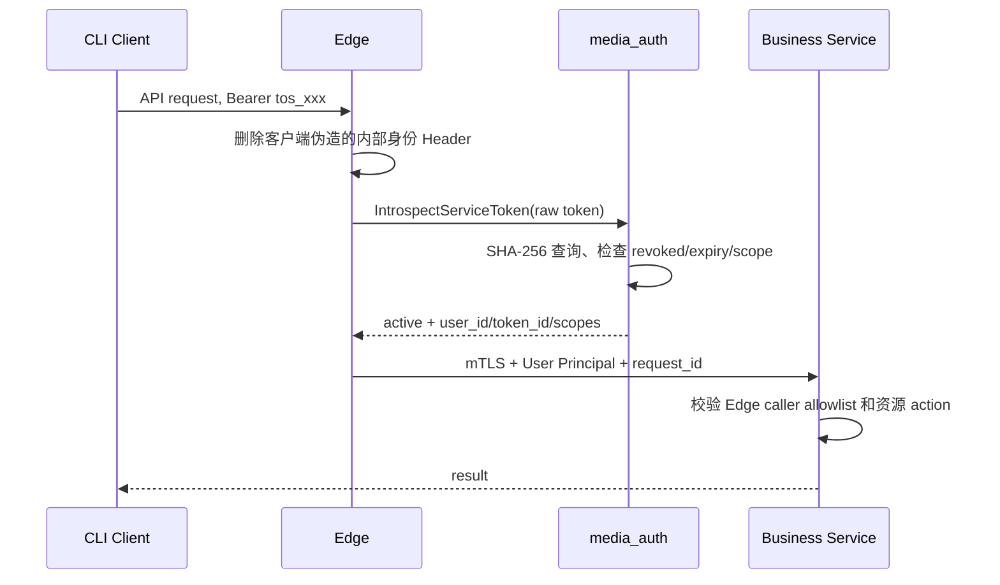

## 一句话说明

CLI/B2B 请求携带 opaque 用户 Service Token 到 Edge；Edge 通过 mTLS 调用 media_auth introspection，获得受 scope 约束的 User Principal，再以 mTLS 和受控内部身份 Header 调业务服务。

## 执行时间线

## 关键参数

- 原始 Token 仅在 Client、Edge 和 Auth 请求内存中出现，不进入业务服务、日志或 Trace。
- Edge 覆盖内部 Principal Header；业务服务只在 mTLS caller 为 Edge 时信任。
- Auth 返回身份与 scope，不返回 Token 明文，也不替业务服务做资源授权。

## 状态与一致性边界

验证流程是只读操作，无持久化状态机。Service Token 的 active/revoked/expired 状态归 Auth Service Token 聚合决定。业务服务的资源事务发生在 introspection 成功之后，与验证不构成分布式事务。

## 幂等、缓存与失败

Introspection 纯读且幂等。Edge 可按 Token Hash 正缓存最多 60 秒、负缓存最多 5 秒；cache miss 且 Auth 不可用时 fail closed。active=false、过期、撤销或 scope 不足不重试。缓存中不得保存原始 Token。

## 权限与信任边界

Edge 验证“谁在调用”和入口 scope；业务服务从真实资源读取 workspace_id/owner 并执行最终 action 授权。Edge 到 Auth、Edge 到业务服务均使用可配置 mTLS；公共 Edge 拒绝 Session Token 和 Platform Token。

## 结果

成功形成 `Principal{Kind=user, AuthMethod=service_token, UserID, TokenID, Scopes}`；失败返回 401/403，不向客户端区分不存在、撤销或过期细节。
