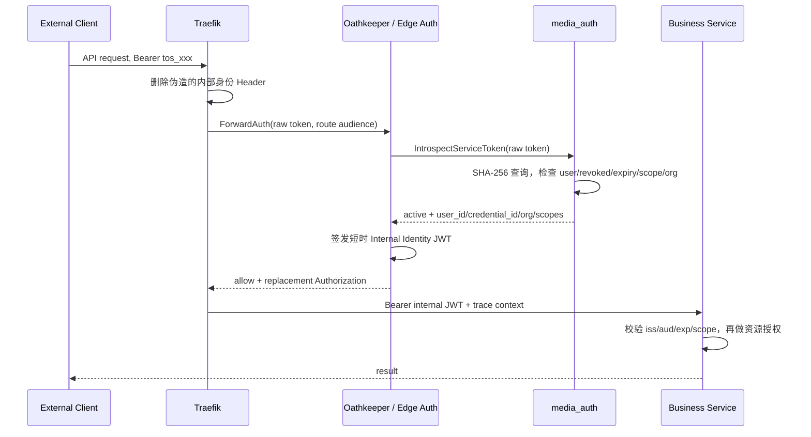

## 一句话说明

CLI、B2B 或客户端 Media Worker 携带 opaque Service Token 到统一网关；Edge Auth 通过受信通道调用 media_auth introspection，获得受 scope 与 Organization 约束的 Principal，签发短时 Internal Identity JWT 后调用目标业务服务。

## 执行时间线

## 关键参数

- 原始 Token 仅在 Client、Traefik/Edge Auth 和 Auth 请求内存中出现，不进入业务服务、Workflow 定义、日志或 Trace。
- Traefik 删除外部 Authorization 和内部身份 Header，转发时只使用 Edge Auth 返回的 Internal Identity JWT。
- `sub` 为业务 User ID；`credential_id` 标识 Service Token；Worker 用 Token 还必须携带唯一 `organization_id`。
- Internal JWT audience 绑定目标服务，TTL 为 1 至 5 分钟，不能作为长期会话或可转发凭证。
- Auth 返回身份与 scope，不返回 Token 明文，也不替业务服务做资源授权。

## 状态与一致性边界

验证流程是只读操作，无持久化状态机。Service Token 的 active/revoked/expired 状态归 Auth Service Token 聚合决定。业务服务的资源事务发生在 introspection 成功之后，与验证不构成分布式事务。

## 幂等、缓存与失败

Introspection 纯读且幂等。Edge 可按 Token Hash 正缓存，但缓存时长不得超过 Internal JWT TTL 和撤销传播目标；负缓存最多 5 秒。cache miss 且 Auth 不可用时 fail closed。active=false、过期、撤销或 scope 不足不重试。缓存中不得保存原始 Token。

## 权限与信任边界

Edge 验证“谁在调用”、Organization 上下文和入口 scope；业务服务从真实资源读取 workspace_id/organization_id/owner 并执行最终 action 授权。Worker API 只接受 Service Token 换取的内部身份，不要求 Kratos Browser Cookie；浏览器 API 继续走 Web Session。Edge 到 Auth 使用受信服务身份，内部 JWT 不替代服务间传输安全。

## 结果

成功形成 `Principal{Kind=user, AuthMethod=service_token, UserID, OrganizationID, CredentialID, Scopes}` 并签发 Internal Identity JWT；失败返回 401/403，不向客户端区分不存在、撤销或过期细节。
