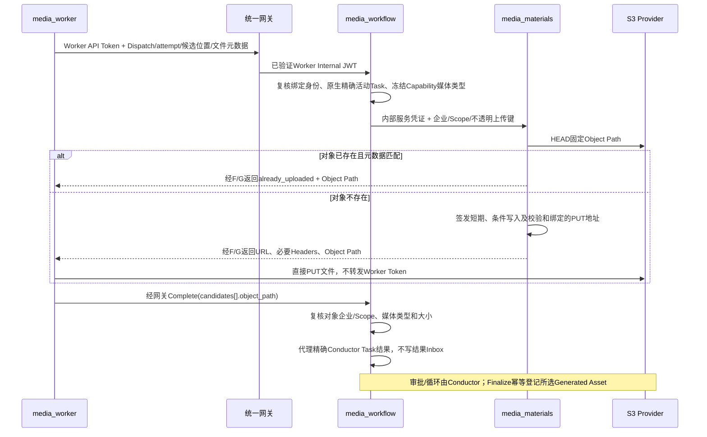

## 触发与结果

Personal Worker为活动Dispatch的某个候选上传本地图片/视频；Managed内部运行时复用相同任务校验与存储端口，不借用User Token。成功只返回稳定Object Path，Generated Asset仍由Conductor调度的内部Finalize登记。既有受控存储URL mock保持兼容；不接入真实模型、不改UI、不扩展部门/角色ACL。

## 执行时间线

## 一致性与生命周期

上传键由服务端原Task ID、attempt与候选数组位置派生，客户端不能提供企业、Scope或任意对象路径。完整路径还包含类型/长度/SHA256/MD5清单摘要，同一任务位置与内容稳定重放，改换文件使用不同路径而不覆盖旧引用；候选终态唯一性仍由原生Task决定。S3条件写与摘要签名限制重复写入，不用上传准备器创建第二套决定状态。不同轮和技术重试有不同Task身份。地址最多有效5分钟；取消不撤销已签URL，但晚到对象不能完成任务或登记资源。

上传准备和PUT不持有数据库事务，不新建上传队列/任务调度器。对象已写入但响应丢失时，以原元数据重新申请，HEAD相同对象确认后跳过PUT；不同内容冲突，不重执行模型以重发文件。上传后的Object Path持久回写，签名地址不进入业务快照。未被接受/引用的对象保留，不自动删除历史或用户文件；生命周期回收不在本轮范围。

## 边界与失败

无身份、错Dispatch/attempt、替代/取消Task不签发；新Capability输出媒体类型决定可上传图片还是视频。图片最多16MiB，视频最多256MiB；候选位置0–7。媒体格式只接受已有图片/视频白名单，客户端先检查实际文件内容并计算摘要，Storage校验传输摘要和条件写。签名过期/上传未知可重申请原地址对应对象，存储故障不标任务成功。源码、存储协议和公开完整流程门禁必须分别验收，存在missing不宣称完成。
