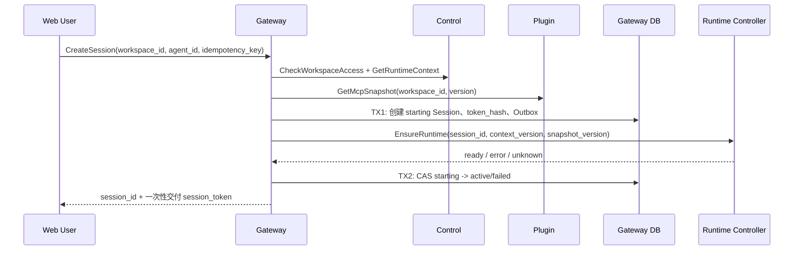

## 一句话说明

Gateway 校验 Workspace 运行上下文、创建稳定 Agent Session，并协调 Runtime 启动；运行期交互不再经过 Control。

## 执行时间线

TX1 提交后才启动 Runtime。结果不明确时用 session_id 查询 Runtime，不能再次创建 Session。明文 Session Token 仅在首次成功响应的受控链路交付；服务端只保存 Hash，重试返回既有 Session 但不重新暴露旧明文。

## 关键参数

- `user_id` 来自 Edge Principal，不接受客户端覆盖。
- `workspace_id` 由 Control 授权；`agent_id` 必须属于运行上下文。
- MCP Snapshot 固定版本，Binding 变更通过新快照更新。

## 幂等与失败

- 创建请求使用 `idempotency_key`，重复请求返回同一 Session。
- Control、Plugin 或 Runtime 不可用时不把 Session 标为 active。
- Session 创建成功但 Runtime 启动失败时进入 failed，可重试 EnsureRuntime，不重复签发 Session Token。

## 状态与一致性边界

`starting -> active/failed`，active 可被后续中断/删除流程改变；failed 不自动变 active，恢复需显式命令。TX1 原子提交 Session、token_hash 和 Outbox；TX2 只提交启动结果。Control/Plugin 查询和 Runtime 启动均在数据库事务外。

## 权限与身份

Web 身份来自 Edge 验证后的 Cookie JWT 或 Service Token；Gateway 不信任请求体 user_id。Control 执行 Workspace 最终授权。Gateway、Control、Plugin、Runtime 之间使用可配置 mTLS。Runtime 获得 Session Token，不获得 Platform Token。
