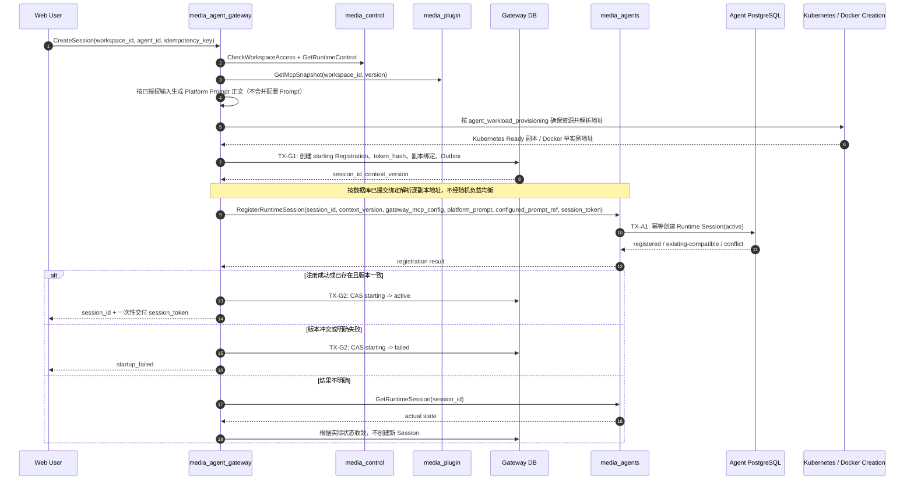

## 一句话说明

Gateway 校验 Workspace 运行上下文并创建 Agent Session Registration，再使用同一 `session_id` 向 Agent 注册 Runtime Session；Gateway 拥有身份与访问元数据，Agent 拥有后续 Turn 和交互事实。

## 触发与结果

| 项目 | 内容 |
|:---|:---|
| 触发 | 已认证用户创建 Session，或默认 Chat 首次进入时自动创建 |
| 前置条件 | 用户有权访问 Workspace；Agent/Plugin 运行上下文可解析 |
| 成功结果 | Gateway Registration 与 Agent Runtime Session 都 active，可以提交 Turn |
| 失败结果 | Gateway Registration 保留 starting/failed，可使用原 session_id 协调或重试注册 |

## 执行时间线

### 步骤说明

1. Control 执行 Workspace 最终授权，Plugin 提供版本化 MCP Snapshot。Gateway 保留后端 MCP 路由配置，只向 Agent 提供统一 Gateway MCP 入口配置；Gateway 只生成 Platform Prompt 正文；用户配置 Prompt 的内容及版本仍归 Control，两者分别交付。Agent 负责 Runtime 特有的配置转换、文件落盘与加载，不能把此次迁移解释为 Gateway 合成一个最终提示词。Default Agent Context 仍必须绑定真实用户和 Workspace。
2. TX-G1 只提交 Gateway Registration 和 Token Hash；Agent PostgreSQL 不参与 Gateway 事务。
3. `RegisterRuntimeSession` 以 session_id 幂等。相同版本重复调用成功等价，不同版本返回冲突，禁止静默覆盖正在运行的上下文。
4. Agent Runtime Session 注册提交后，才允许 Gateway Registration 进入 active。结果不明确时查询 Agent，不重新生成 session_id 或 Session Token。
5. 明文 Session Token 只在受控注册/执行凭据链路交付；注册重试和实例接管可按该 Session 的持久密钥版本重新生成相同 Token。Gateway 数据库只保存 Hash 与密钥版本，不保存明文；用户请求仍使用 Web 身份，Agent 不获得 Platform Token。

Platform Prompt 的生成流程见 [platform_prompt_assembly](../../media_agent_gateway/workflow/0008-platform_prompt_assembly/platform_prompt_assembly.md)。生成职责迁移不改变 Session 的固定配置版本，也不隐含运行时热更新。

资源创建链路由 [agent_workload_provisioning](../../media_agent_gateway/workflow/0009-agent_workload_provisioning/agent_workload_provisioning.md) 协调。Gateway 直接提交 Kubernetes manifest 并读取原生副本状态，Docker 本期只创建单实例；Controller 不承担 Agent 状态探测。

## 状态与不变量

- Gateway Registration：`starting -> active | failed -> deleted`。
- Agent Runtime Session：注册后 `active`，其执行状态独立于 Gateway HTTP/SSE 连接。
- 两侧共享 session_id 和 context_version，不共享表；任何一侧存在不等于另一侧已经注册成功。
- active Gateway Registration 必须存在兼容版本的 Agent Runtime Session；协调任务可以修复短暂投影不一致。

## 关键参数

| 参数 | 产生方 | 使用方 | 语义 |
|:---|:---|:---|:---|
| session_id | Gateway | Agent、Client | 跨上下文稳定关联 ID |
| idempotency_key | Client | Gateway | 防止重复创建 Registration |
| context_version | Gateway/Control | Agent | Runtime Session 配置版本 |
| snapshot_version | Plugin | Agent | MCP Binding 固定版本 |
| session_token | Gateway | Agent | 调用 Platform/Business MCP 的受限凭证 |

## 一致性边界

| 事务 | 原子事实 | 事务外动作 |
|:---|:---|:---|
| TX-G1 | Registration、token_hash、创建 Outbox | Control/Plugin 查询、Agent 注册 |
| TX-A1 | Runtime Session 与上下文引用 | Gateway 状态更新 |
| TX-G2 | Registration active/failed | 客户端响应 |

## 幂等、重试与补偿

| 步骤 | 幂等键 | 规则 |
|:---|:---|:---|
| 创建 Registration | owner + idempotency_key | 返回既有 session_id |
| 注册 Runtime Session | session_id + context_version | 同版本成功等价；异版本冲突 |
| 结果不明确 | session_id | 查询 Agent 后收敛，禁止重复创建 |
| Agent 已注册但 Gateway 更新失败 | session_id | 重试 TX-G2；不删除 Agent Runtime Session |

## 权限与失败

Web 身份来自 Gateway 验证后的 Web Session 或用户 API Token Internal JWT；Control 最终校验 Workspace。Gateway、Control、Plugin 和 Agent 使用 mTLS 服务身份。请求体不得覆盖 user_id；Agent 只接受受信 Gateway 的注册命令。

## 结果事件

- `AgentSessionRegistered`：Gateway Registration 提交。
- `RuntimeSessionRegistered`：Agent Runtime Session 提交。
- `AgentSessionActivated`：两侧协调成功，Gateway Registration 进入 active。
