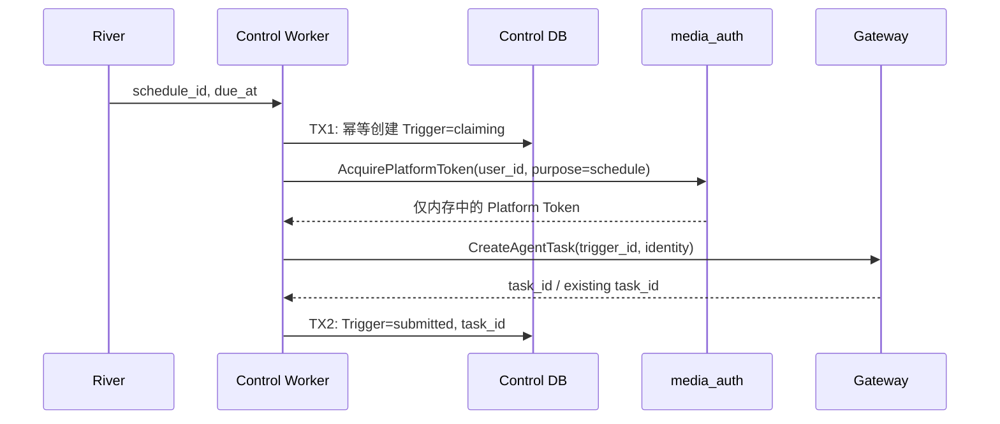

## 一句话说明

Control 的 Schedule Worker 为每次到期创建幂等 Trigger，按需取得 Platform Token，再把实际执行移交 Agent Gateway。

## 执行时间线

Trigger 是业务事实，River Job 不是。Gateway 以 trigger_id 作为 Task 幂等键；CreateAgentTask 结果不明确时按 trigger_id 查询，禁止盲目创建第二个 Task。

## 幂等与安全

- `(schedule_id, due_at)` 唯一；River 重试不能创建第二个 Trigger 或 Agent Task。
- Platform Token 即时获取且只存在于调用内存，不进入 Trigger、River、Outbox、日志或 Trace。
- Schedule 被停用后，未开始的 Trigger 不再提交；已开始的 Agent Task 由 Gateway 的取消规则处理。

## 状态、一致性与失败

Trigger 状态为 `claiming -> submitted/skipped/failed`。TX1 提交 Trigger；取 Token 和调 Gateway 均在事务外；TX2 提交结果。Token 获取瞬时失败可重试；用户/Workspace 已失效则 failed；Schedule 停用且尚未提交则 skipped。Platform Token 不进入数据库、River、Outbox、日志或 Trace，服务间使用可配置 mTLS。

Schedule 自身的 enabled/disabled 由 Schedule 聚合决定；Trigger 终态不可覆盖。Schedule 停用不会强制取消已经 submitted 的 Agent Task，后续取消遵循 Gateway Task 规则。
