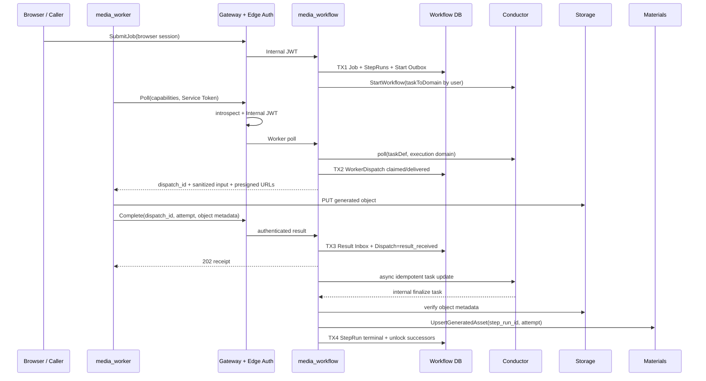

## 一句话说明

`media_workflow` 持有 Job/StepRun 业务状态并在内网代理 Conductor；客户端 `media_worker` 经统一网关执行 Capability，产物先写对象存储，再由服务端 Finalizer 登记 Generated Asset。

## 执行时间线

TX2 必须发生在向客户端暴露任务之前；响应丢失时返回既有有效 Dispatch。TX3 先于 Conductor update，重复完成返回同一 receipt，Conductor 不可用时由 Adapter 重试而不是要求 Worker 重新执行 Provider。对象与 Asset 的事实分别由 Storage 和 Materials 拥有，Workflow 只保存稳定引用。

## 边界与失败

- Conductor、Storage 和 Materials 调用均不置于 Workflow 数据库事务中；本地状态、Inbox/Outbox 与业务事实按明确事务提交。
- Worker 上传完成但 completion 丢失时，未登记对象由 Storage retention/GC 处理；不得由客户端直接创建 Generated Asset。
- 取消阻止续租和新派发；运行中的本地 Provider 是否立即停止取决于 Worker 能力，晚到结果不得反转 cancelled Job。
- Conductor poll 后若服务在 Dispatch 持久化前崩溃，依靠 response timeout 重投；禁止无域 fallback 或从共享队列 poll 后再检查 owner。

## 状态、幂等与权限

Job 由 `pending/running` 进入 `succeeded/failed/cancelled`；StepRun 与 WorkerDispatch 的状态转换归 media_workflow Execution Domain。Job 用 `(workspace_id, idempotency_key)` 去重，Worker 结果用 `(dispatch_id, attempt, operation)` 去重，Asset 登记用 `(step_run_id, attempt)` 去重。Gateway 认证 Service Token，media_workflow 再校验 scope、当前 Organization Membership、Job 所有权和 Capability allowlist；Materials 对 Generated Asset 登记执行最终资源授权。
