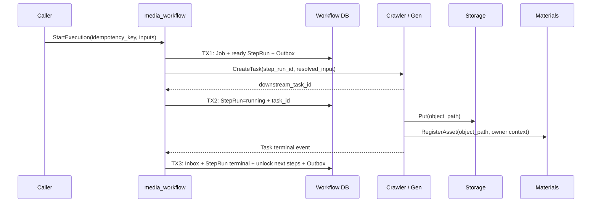

## 一句话说明

`media_workflow` 持有工作流执行状态，通过明确命令协调 Crawler、Gen 和 Materials，各下游服务独立拥有自己的任务与对象事实。

## 执行时间线

下游创建结果不明确时按 step_run_id 查询，不创建第二个任务。Workflow 只保存下游 ID；对象、Asset 和生成/抓取任务的状态由各自 Domain 决定。

## 边界与失败

- Workflow 只保存下游资源 ID，不复制下游任务或对象记录。
- 外部调用不置于 Workflow 数据库事务中；本地状态与 Outbox 同事务提交。
- 重复完成事件通过 event_id/下游任务 ID 去重。
- 补偿只撤销本流程创建且尚未被其他业务引用的资源；物理删除仍由资源所属服务决定。

## 状态、幂等与权限

Job 由 `pending/running` 进入 `completed/failed/cancelled`；StepRun 由 `blocked/ready/running` 进入终态，状态转换归 media_workflow Execution Domain。`execution_id + step_key + attempt` 是下游幂等键，事件由 Inbox event_id 去重。用户身份和 Workspace 从入口 Principal 固定到 Execution；服务间使用 mTLS，需要用户资源权限的下游调用传递受控代表身份并由资源所有服务最终授权。
