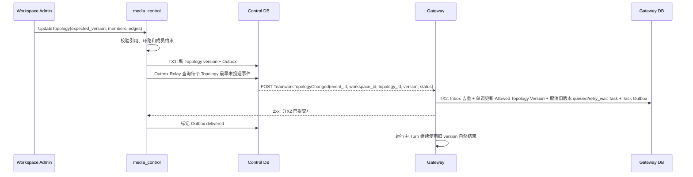

## 一句话说明

Control 发布版本化 Teamwork Topology，Gateway 只允许新任务使用最新版本，同时让已经开始的 Turn 自然结束。

## 执行时间线

## 一致性

- Topology 使用乐观版本控制；过期写入失败。
- 事件至少一次投递，Gateway 以 `event_id` Inbox 去重，并以 `topology_id + version` 单调更新准入投影。
- 删除成员或拓扑不强制中断正在执行的外部调用。
- `queued/retry_wait` 的旧版本 Task 在同一 Gateway 事务内取消并写 `agent_task.cancelled` Outbox；`running/waiting_turn` 不变。

## 状态、失败与权限

Topology 当前指针使用乐观锁；Gateway 只允许 Allowed Topology Version 创建新 Task。Control Relay 对同一 Topology 保持 Outbox 顺序并只在 Gateway 返回 2xx 后确认投递；失败增加 attempts、记录 last_error 并延迟重试。Gateway 应用失败时不写 Inbox，Control 重试同一 `event_id`；重复事件返回成功，晚到旧版本只记 Inbox、不得恢复旧配置。中间版本不承载 Gateway 运行事实，因此版本跳跃时以收到的更高版本收敛，不同步复制 Control 历史快照。

服务间请求使用共享的 `CONTROL_INTERNAL_TOKEN`；请求体携带用于资源归属校验的 Workspace ID，但不携带 Workspace owner 身份或 Provider API Key。外部用户不能直接调用 Gateway 内部事件入口。

本流程没有独立持久化状态机：Topology 版本状态归 Control Teamwork 聚合，Task/Turn 状态归 Gateway 聚合。运行中 Turn 固定旧 topology_version 并自然结束，网络断开或新版本到达都不改变其业务状态。
