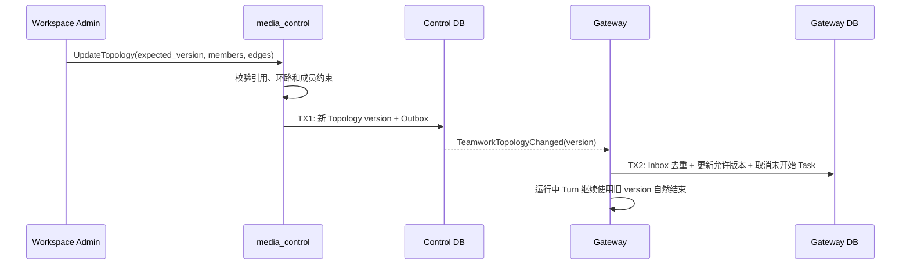

## 一句话说明

Control 发布版本化 Teamwork Topology，Gateway 只允许新任务使用最新版本，同时让已经开始的 Turn 自然结束。

## 执行时间线

## 一致性

- Topology 使用乐观版本控制；过期写入失败。
- 事件至少一次投递，Gateway 按 topology_id + version 幂等消费。
- 删除成员或拓扑不强制中断正在执行的外部调用。

## 状态、失败与权限

Topology 版本不可变，当前指针使用乐观锁；Gateway 只允许最新允许版本创建新 Task。事件重复由 `topology_id + version` 去重，版本跳跃时 Gateway 主动从 Control 拉取缺失版本。Control 入口校验 Workspace manage；服务间使用可配置 mTLS。Gateway 应用失败由 Inbox 重试，不回滚已提交 Topology；晚到旧版本事件不得恢复旧配置。

本流程没有独立持久化状态机：Topology 版本状态归 Control Teamwork 聚合，Task/Turn 状态归 Gateway 聚合。运行中 Turn 固定旧 topology_version 并自然结束，网络断开或新版本到达都不改变其业务状态。
