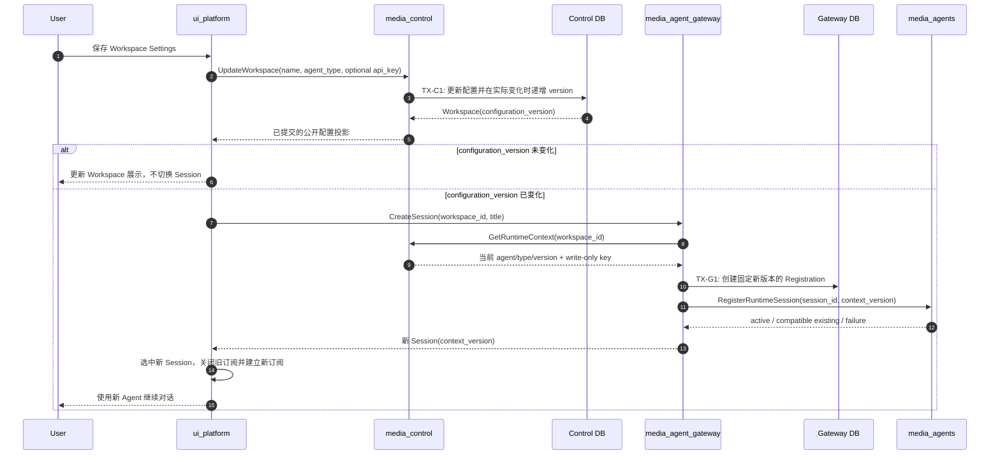

## 一句话说明

用户更新 Workspace Agent Configuration 后，已有 Agent Session 保持历史身份和执行事实不变；UI 为新配置创建并选中新的 Agent Session，旧 Session 转为可浏览但不可提交新 Turn 的历史会话。

## 触发与结果

| 项目 | 内容 |
|:---|:---|
| 触发 | 用户在 Workspace Settings 修改 Agent Type 或提交不同的 Provider API Key |
| 前置条件 | 用户可管理 Workspace；不存在必须先结束的配置写事务 |
| 成功结果 | Control 提交新配置版本；Gateway/Agent 注册同版本的新 Session；UI 选中新 Session |
| 部分成功 | 配置已提交但新 Session 启动失败；旧 Session 历史可读，UI 明确提示重试创建 Session |
| 不变结果 | 仅名称改变或 Key/Agent 实际未变；不创建新 Session |

## 执行时间线

### 容易误实现的步骤

1. Control 的 TX-C1 与 Gateway/Agent Session 注册不是分布式事务。配置提交后不能回滚到旧密钥；Session 创建失败必须保留配置并提供可重试入口。
2. UI 只能用响应中的 `configuration_version` 判断是否发生实际配置变化，不能根据 Key 输入非空自行假设版本变化。
3. 旧 Session 的 `agent_type/context_version` 不得更新。它仍按原 Agent 路由历史查询、事件订阅和 Interrupt，但新 Turn 必须返回版本冲突。
4. 创建新 Session 结果不明确时，UI 重新拉取 Session 列表，优先选择与当前 `configuration_version` 匹配的最新 Session；找不到再提示用户重试，避免盲目重复创建。

## 状态与生命周期

| 对象 | 变化规则 |
|:---|:---|
| Agent Configuration | 实际 Agent/Key 变化产生新 version，旧版本不再是 Workspace 当前配置 |
| 旧 Agent Session | Registration/Runtime Session 保持不变；可读、可订阅、可中断，不接收新 Turn |
| 新 Agent Session | 固定引用当前 configuration_version，启动成功后 active |
| 页面订阅 | 选中新 Session 后关闭旧订阅；旧订阅晚到事件不得写入新 Session 视图 |

配置切换不取消已经 running 的 Turn。用户可在旧 Session 中执行 Interrupt；终态事件仍写入旧 Session 历史。

## 幂等、重试与补偿

| 步骤 | 幂等/恢复键 | 规则 |
|:---|:---|:---|
| 更新配置 | Workspace + 当前版本 | Control 只在实际变化时递增 version |
| 创建 Registration | session_id（Gateway 内部） | Agent 注册同 ID/同版本幂等 |
| UI 创建结果不明确 | workspace_id + configuration_version | 重新 ListSessions，选择最新兼容 Session |
| 配置已提交、Session 创建失败 | configuration_version | 不补偿配置；显示“配置已保存”，允许 Create Session 重试 |

## 权限与秘密

用户身份来自 Cookie JWT；Control 校验 Workspace owner/授权，Gateway 再校验 Session owner。Provider API Key 只从设置表单单向进入 Control，响应和浏览器持久化均不含明文；Gateway 仅在创建/提交 Turn 的受控调用链使用解密值。
