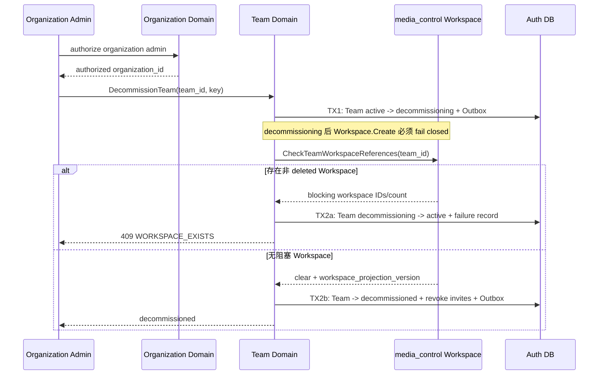
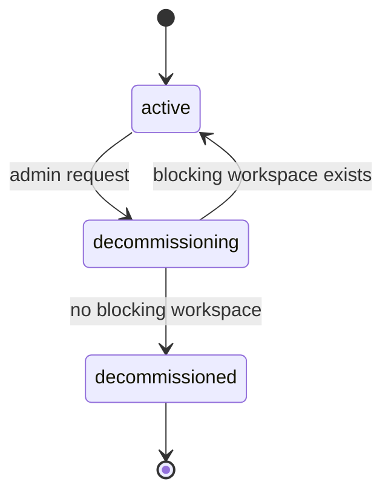

## 一句话说明

Organization admin 发起 Team 停用；Auth 先关闭新写入入口，Control 再确认没有非 deleted Workspace，最后把 Team 置为不可恢复的 decommissioned，同时保留历史 ID 和资源授权引用。

## 触发与结果

| 项目 | 内容 |
|:---|:---|
| 触发 | Organization admin 提交 DecommissionTeam(team_id, idempotency_key) |
| 前置条件 | Team active；调用者是 Team 所属 Organization 的 admin |
| 成功结果 | Team decommissioned；邀请失效；不能创建 Workspace 或产生有效 Team Membership 权限 |
| 失败结果 | 存在非 deleted Workspace 时 Team 恢复 active 并返回冲突；技术失败保留 decommissioning 供恢复任务继续 |

## 执行时间线

### 步骤说明

TX1 必须先提交 decommissioning，Control 创建 Workspace 时查询到该状态后拒绝，避免“检查为空后并发创建 Workspace”的竞态。Team 不物理删除：历史 Workspace、审计记录和其他服务中的 Resource Grant 仍可引用稳定 Team ID，但 decommissioned Team 不再返回有效成员权限。

## 状态与不变量

- decommissioned 是终态，不允许恢复或复用 Team ID。
- decommissioning 期间禁止创建 Workspace、邀请或扩大部门功能；现有 Workspace 可继续执行删除流程。
- 重复停用 decommissioned Team 幂等返回成功。

## 关键参数

| 参数 | 产生方 | 使用方 | 语义 |
|:---|:---|:---|:---|
| team_id | Team Domain | Auth、Control | 跨服务稳定部门 ID |
| idempotency_key | 调用方 | Team Domain | 同一停用请求的稳定键 |
| workspace_projection_version | Control | Team Domain | 本次引用检查的可观察版本 |

## 一致性边界

| 事务 | 原子提交 | 不包含 |
|:---|:---|:---|
| TX1 | Team=decommissioning、Outbox | Control 查询 |
| TX2a | 恢复 active、失败事实 | Workspace 修改 |
| TX2b | Team=decommissioned、Invite 撤销、Outbox | 其他服务 Resource Grant 清理 |

Auth 与 Control 不组成分布式事务。正确性依赖 Workspace.Create 在提交前校验 Team active；Control 不可用或状态不明确时停用流程保持 decommissioning 并重试，不能假定引用为空。

## 幂等、重试与补偿

| 步骤 | 幂等键 | 重试策略 | 补偿/恢复 |
|:---|:---|:---|:---|
| 发起停用 | team_id + idempotency_key | 重复返回同一流程 | decommissioning 由恢复任务继续 |
| 查询 Workspace | team_id + Team version | 读操作可重试 | 不明确时保持 decommissioning |
| 提交终态 | team_id + Team version | 乐观锁重试 | 已 decommissioned 幂等成功 |

## 权限与失败

- 用户身份来自受信 Principal；最终校验由 Organization Domain 使用真实 Team.organization_id 完成，不能信任请求 body 的 organization_id。
- 只有 Organization admin 可以发起；Team admin 无权停用部门。
- Control 不可用、查询超时或结果不明确均不得提交 decommissioned。
- Resource Grant 不做跨服务级联删除；资源服务查询到 Team decommissioned 后有效权限自然为 none。

## 结果事件

| 事件 | 产生条件 | 消费方 |
|:---|:---|:---|
| TeamDecommissioningStarted | TX1 提交 | Control、审计投影 |
| TeamDecommissioned | TX2b 提交 | Control、资源服务缓存 |
