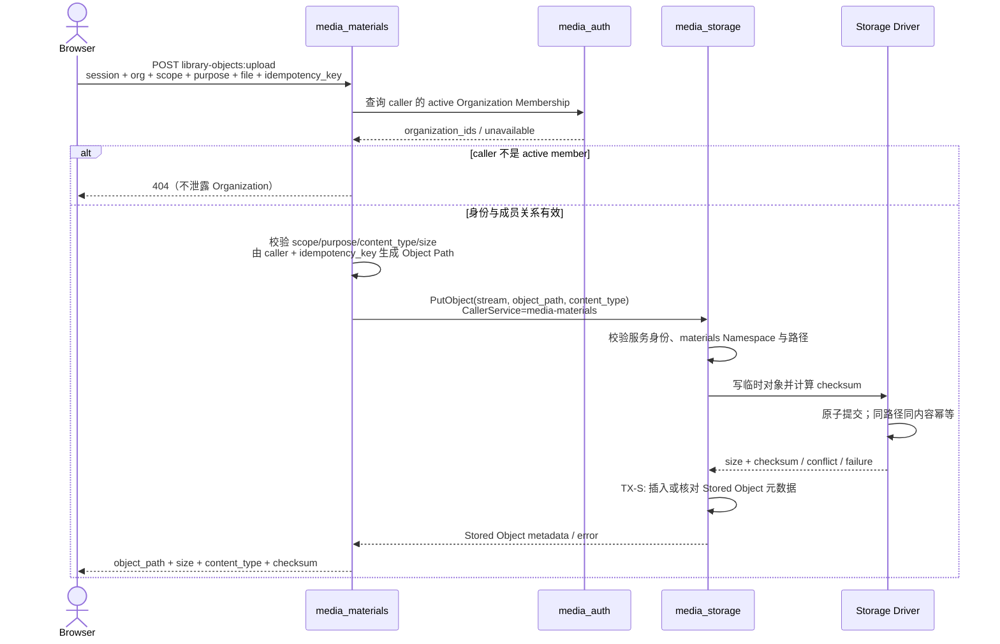
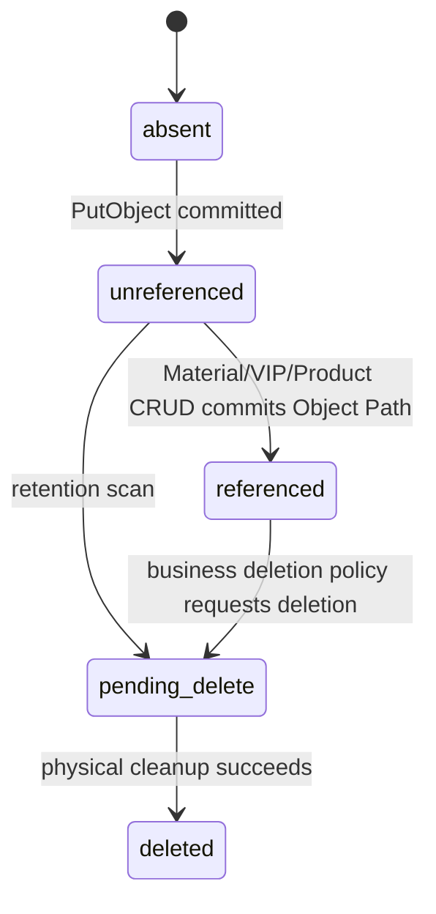

## 目标与边界

Library Object Upload 在 Material、Virtual IP 或 Product CRUD 之前完成二进制写入。`media_materials` 是最终用户入口和 Organization 授权点，负责校验 Organization、Scope、用途并生成 Object Path；`media_storage` 只认证 Caller Service、校验 Storage Namespace 并持久化对象。

本流程不是 Conductor Workflow，也不创建 `media_workflow` 的 Workflow/Job/Step。它是一次同步的跨服务应用工作流；上传成功只产生 Stored Object，不自动创建或修改 Material、Virtual IP、Product。

## 参与者职责

| 参与者 | 职责 |
|:---|:---|
| Browser | 携带用户会话、Organization、Scope、用途、文件和 Idempotency Key 发起上传 |
| media_materials auth middleware | 验证用户身份，并从 media_auth 取得 active Organization Membership |
| media_materials upload workflow | 校验业务边界、生成确定性 Object Path、调用 Storage、映射失败语义 |
| media_storage | 验证 Caller Service 和 Namespace，执行幂等 PutObject |
| Storage Driver | 流式写临时对象、计算 checksum，并原子提交物理内容 |

## 执行时间线

`media_materials` 在发起 Storage 调用前完成最终用户授权。用户 Cookie、Bearer Token 和用户角色不得转交给 `media_storage` 作为授权依据；Storage 看到的是 `media-materials` 的受信服务身份。

## Object Path 与幂等边界

- Namespace 固定为 `materials`。
- 路径必须包含 Organization、Scope、用途以及由 `caller_id + idempotency_key` 计算出的稳定摘要；不得使用用户提供的目录片段。
- 同一 caller、同一 Idempotency Key、同一上传语义生成同一路径。相同内容重试返回原结果；不同内容复用同一键返回冲突，不覆盖已有对象。
- 原始文件名不参与路径或授权；扩展名由服务端检测到的媒体类型推导。

## 一致性与事务

| 边界 | 原子事实 | 不包含 |
|:---|:---|:---|
| Storage Driver Put | 临时对象写入、checksum 计算、物理对象原子提交 | Material/Virtual IP/Product 数据库写入 |
| TX-S | `stored_objects` 元数据插入，或核对同路径的 checksum/content type 完全一致 | 物理对象写入、业务聚合写入 |
| media_materials CRUD | 后续业务聚合保存 Object Path | Storage 对象写入 |

物理对象、TX-S 与业务 CRUD 不组成分布式事务。Driver 已提交但 TX-S 失败时会留下没有元数据的物理对象；相同 Idempotency Key 重试先得到同一 checksum，再补写元数据。上传成功、业务 CRUD 未发生或失败时，对象保持未引用状态，由后续 Retention/GC 流程回收；不得在请求失败路径立即删除，因为客户端可能只丢失了成功响应并正在重试。

## 失败、超时与取消

| 场景 | 可观察结果 | 恢复规则 |
|:---|:---|:---|
| 用户或 Organization 授权失败 | 401/404 | 不调用 Storage |
| 非法 Scope、用途、媒体类型或超限 | 400/413 | 不调用 Storage |
| Storage 服务身份或 Namespace 校验失败 | 503；服务端记录安全事件 | 不降级为匿名或用户身份调用 |
| 同一路径已有不同内容 | 409 | 客户端必须换 Idempotency Key |
| Storage 超时或响应丢失 | 503，结果可能不明确 | 使用相同 Idempotency Key 重试；不得生成新路径 |
| Driver 成功但 Stored Object 元数据写入失败 | 503，物理内容可能已存在 | 使用相同 Idempotency Key 重试并补写元数据，不覆盖内容 |
| Browser 取消 | Context 传播到 Storage | Driver 删除临时文件；已原子提交的对象保留供幂等重试 |
| 晚到成功响应 | 不改变业务聚合 | 同一路径重复 Put 仍返回同一 checksum |

## 生命周期

首期只实现 `absent -> unreferenced` 与后续 CRUD 对 Object Path 的引用；自动发现未引用对象及 Retention GC 属于后续里程碑。

## 身份与权限

- 最终用户身份由统一网关会话进入 `media_materials`；owner/caller 只能从受信 Principal 取得。
- `media_materials` 依据 active Organization Membership 作最终业务授权，失败时 fail closed。
- `media_storage` 只接受内部服务身份，并把 `media-materials` 限定到 `materials` Namespace；它不读取 Organization Membership，也不推导资源 owner/visibility。
- Object Path 中的 Organization/Scope 是隔离和审计信息，不是 Storage 独立授权用户的依据。
