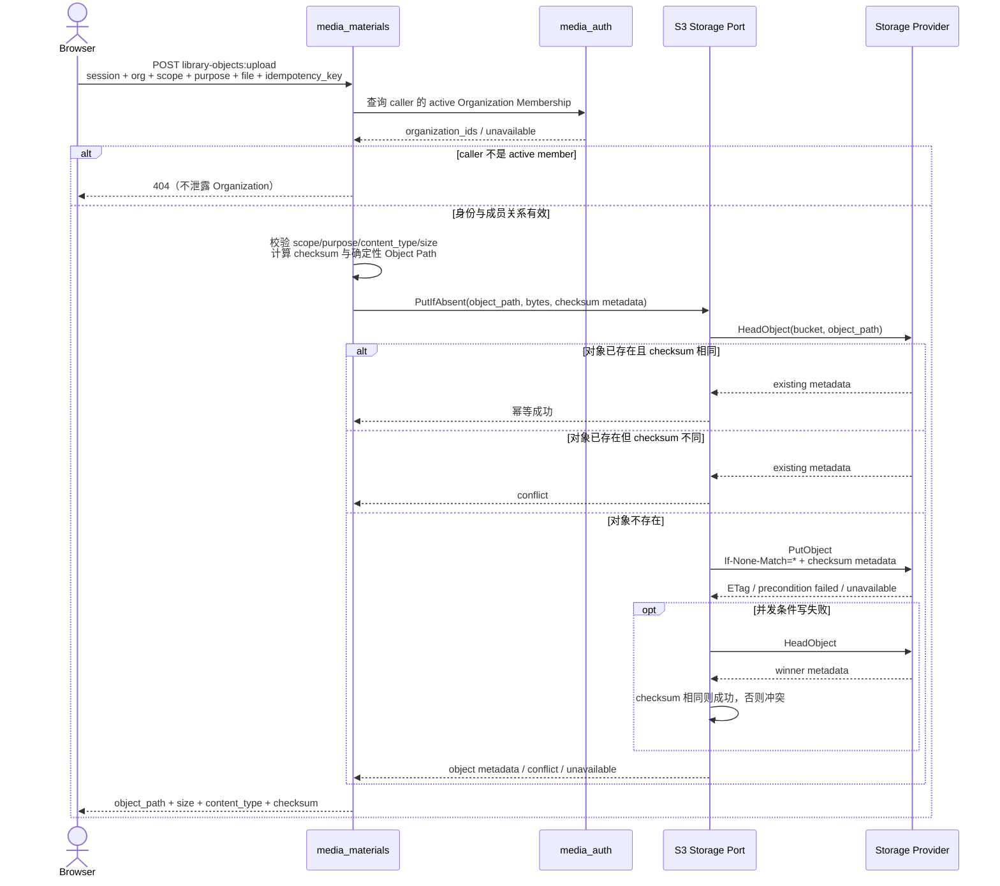
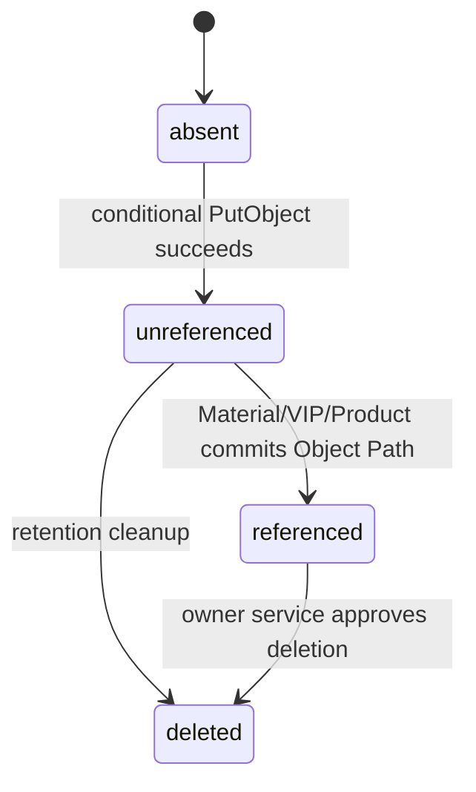

## 一句话说明

Browser 提交企业资源文件，`media_materials` 完成用户和 Organization 授权、生成确定性 Object Path，再通过 S3 Storage Port 写入 Storage Provider；成功只返回可供业务聚合引用的稳定 Object Path，不自动创建 Material、Virtual IP 或 Product。

## 触发与结果

| 项目 | 内容 |
|:---|:---|
| 触发 | `POST /api/v1/library-objects:upload`，携带用户会话、Organization、Scope、用途、文件和 Idempotency Key |
| 前置条件 | caller 是 active Organization Member；Scope、用途、媒体类型和大小合法；Storage Port 配置可用 |
| 成功结果 | Storage Provider 中存在 Object Path 对应对象；Browser 获得 object_path、size、content_type、checksum |
| 失败结果 | 不创建业务聚合；结果不明确时用相同 Idempotency Key 重试 |

## 执行时间线

### 步骤说明

- `media_materials` 在任何 S3 操作前完成最终用户授权；用户 Cookie、Bearer Token 和角色不传给 Storage Provider。
- Storage Port 使用代表 `media-materials` 的受限 S3 凭证。生产 Policy 只能访问配置 Bucket 中的 `materials/` Prefix；本地开发可使用独立测试凭证。
- S3 条件写是对象创建的原子边界。HeadObject 仅用于快速判定和条件写竞争后的收敛，不能单独保证并发安全。
- 上传成功与后续业务 CRUD 是两个独立提交；Object Path 是二者唯一的稳定关联。

## 状态与不变量

- Storage Provider 不知道 `unreferenced` 与 `referenced` 的业务差异；这是业务服务通过引用关系解释的生命周期。
- 已存在同 Object Path、同 checksum 的对象视为同一上传的幂等结果；不同 checksum 必须冲突，禁止覆盖。
- Object Path 由 Namespace、Organization、Scope、用途和稳定摘要组成；不得包含用户提供的路径片段。

## 关键参数

| 参数 | 产生方 | 使用方 | 语义 |
|:---|:---|:---|:---|
| organization_id | Browser / authenticated context | media_materials | 企业授权与路径隔离边界 |
| idempotency_key | Browser | media_materials | 同一上传业务尝试的稳定标识，最长 128 字符 |
| object_path | media_materials | Storage Port、业务聚合 | 域名、Bucket 和供应商无关的稳定引用 |
| checksum | media_materials | Storage Port | 内容 SHA-256，用于幂等与冲突判定 |
| bucket | 部署配置 | Storage Port | 物理容器，不进入业务表和 API |

## 一致性边界

| 边界 | 原子事实 | 不包含 |
|:---|:---|:---|
| Storage Provider conditional Put | 对象字节与 S3 metadata 一次提交 | Material/Virtual IP/Product 数据库写入 |
| media_materials CRUD | 业务聚合保存 Object Path | 对象写入或删除 |

两者不组成分布式事务。对象写入成功而响应丢失时，相同 Idempotency Key 重试得到相同路径并通过 checksum 收敛。对象写入成功但业务 CRUD 未发生时保留未引用对象，后续 Retention/GC 回收；请求失败路径不得立即删除可能已提交的对象。

## 幂等、重试与补偿

| 步骤 | 幂等键 | 重试策略 | 补偿/恢复 |
|:---|:---|:---|:---|
| 生成 Object Path | caller_id + idempotency_key | 每次重试重新计算，结果必须相同 | 无 |
| HeadObject | bucket + object_path | 瞬时错误有限退避 | 不修改状态 |
| Conditional PutObject | bucket + object_path | 超时或结果不明确时先 HeadObject | checksum 相同视为成功，不同则 409 |
| 后续业务 CRUD | 业务资源 ID | 由各聚合自己的幂等规则决定 | 未引用对象由 Retention/GC 回收 |

## 权限与失败

| 场景 | 可观察结果 | 处理 |
|:---|:---|:---|
| 用户未认证 | 401 | 不访问 Storage Provider |
| caller 不是 Organization Member | 404 | 不泄露 Organization |
| 非法 Scope、用途、媒体类型或超限 | 400/413 | 不访问 Storage Provider |
| S3 凭证或 Prefix Policy 拒绝 | 503，记录安全与配置错误 | 禁止降级为匿名或用户凭证 |
| 同路径不同 checksum | 409 | 客户端更换 Idempotency Key |
| Provider 超时或响应丢失 | 503，结果可能不明确 | 使用相同 Idempotency Key 重试 |
| Browser 取消 | Context 传播到 S3 请求 | 已提交对象保留供幂等重试 |

## 结果事件

无。上传同步返回 Object Path；首期不发布领域事件。
