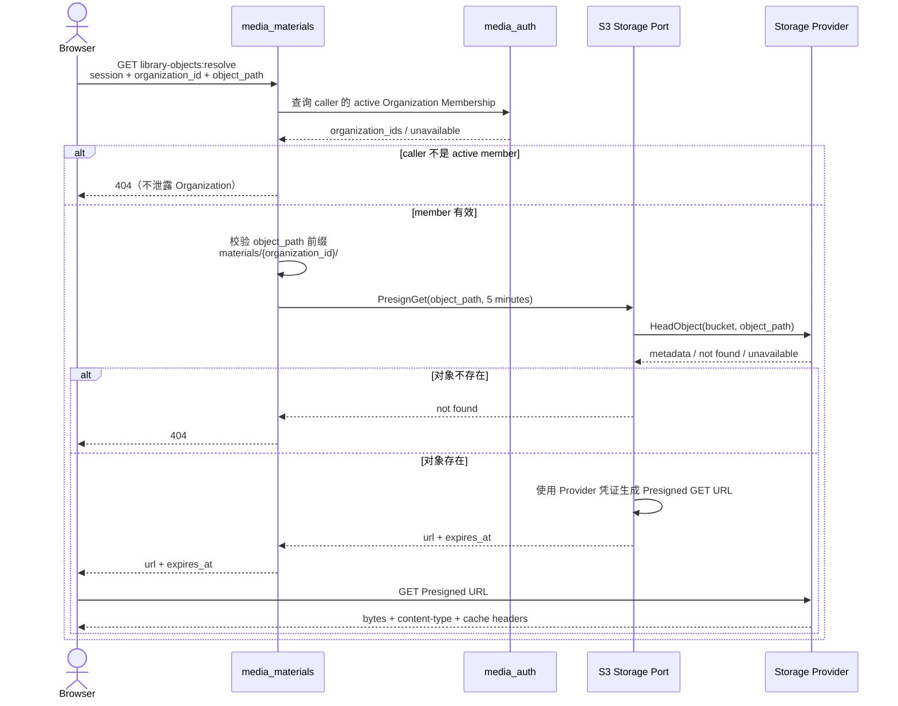

## 一句话说明

Browser 向 `media_materials` 申请 Object Path 的读取地址，服务确认 caller 属于对应 Organization 且路径位于其 `materials/` 命名空间后生成短期 Presigned URL，Browser 再直接从 Storage Provider 读取对象。

## 触发与结果

| 项目 | 内容 |
|:---|:---|
| 触发 | `GET /api/v1/library-objects:resolve?organization_id=&object_path=` |
| 前置条件 | caller 已认证且是 active Organization Member；Object Path 严格属于该 Organization 的 materials Namespace；对象存在 |
| 成功结果 | 返回短期 Resolved URL 与 expires_at；随后对象字节由 Storage Provider 直接响应 |
| 失败结果 | 不签发地址，或已签发地址在到期后失效；不改变业务和存储事实 |

## 执行时间线

### 步骤说明

- Organization Membership 和路径归属由 `media_materials` 最终判定；Storage Provider 只验证签名、过期时间与对象键。
- URL 签名在 SDK 内本地完成，但签发前必须 HeadObject，避免为不存在的对象生成表面有效地址。
- Browser 的对象 GET 不经过 `media_materials` 和业务 API 网关，因此大文件传输、Range 和缓存由 Storage Provider 承担；本地开发直接访问 SeaweedFS 的公开数据端口，云环境使用 OSS/S3 的外部 Endpoint 或对象存储专用域名。
- URL 是短期 bearer credential。不得记录到业务表、日志查询参数或长期缓存；过期后重新调用 resolve。

## 状态与不变量

无持久化状态流转。

- Resolved URL 默认有效期五分钟，服务端配置必须设置上限。
- `object_path` 必须严格匹配 `materials/{organization_id}/`；仅拥有其他 Organization 权限不能解析该对象。
- 业务响应只返回当前请求生成的 URL；Material、Virtual IP、Product 继续保存 Object Path。

## 关键参数

| 参数 | 产生方 | 使用方 | 语义 |
|:---|:---|:---|:---|
| organization_id | Browser / authenticated context | media_materials | 企业授权边界 |
| object_path | 业务聚合 | media_materials、Storage Port | 稳定对象引用 |
| expires_at | Storage Port | Browser | URL 失效的 Unix 时间 |
| provider endpoint | 部署配置 | Storage Port | 签名和 Browser 直读的目标，不持久化 |

## 一致性边界

该流程是只读编排，不提交本地事务。Membership 检查、HeadObject 与 URL 使用之间可能发生权限或对象变化：

- Membership 在 URL 签发后被撤销，已签发 URL 可在剩余短时效内继续使用；五分钟上限限制暴露窗口。
- 对象在 URL 签发后删除，Provider 返回 not found。
- URL 到期或签名被篡改，Provider 拒绝请求；Browser 重新 resolve。

## 幂等、重试与补偿

| 步骤 | 幂等键 | 重试策略 | 补偿/恢复 |
|:---|:---|:---|:---|
| Membership 查询 | caller + organization_id | 瞬时失败由 Browser 重试整个 resolve | fail closed |
| HeadObject | bucket + object_path | 有限退避 | 不存在返回 404 |
| PresignGet | object_path + expiry | 可重复生成不同签名但等价地址 | 无持久化补偿 |
| Browser GET | 完整 Presigned URL | 网络错误可在到期前重试 | 到期后重新 resolve |

## 权限与失败

| 场景 | 结果 | 规则 |
|:---|:---|:---|
| 未认证 | 401 | 不调用 Storage Port |
| 非 Organization Member | 404 | 不泄露企业存在性 |
| Object Path 越出企业前缀 | 403 | 不签发 URL |
| 对象不存在 | 404 | 不签发 URL |
| Provider 或凭证不可用 | 503 | 不返回未验证 URL |
| URL 过期或篡改 | Provider 403 | Browser 重新 resolve，不代理读取 |

## 结果事件

无。读取地址签发不产生领域事件。
