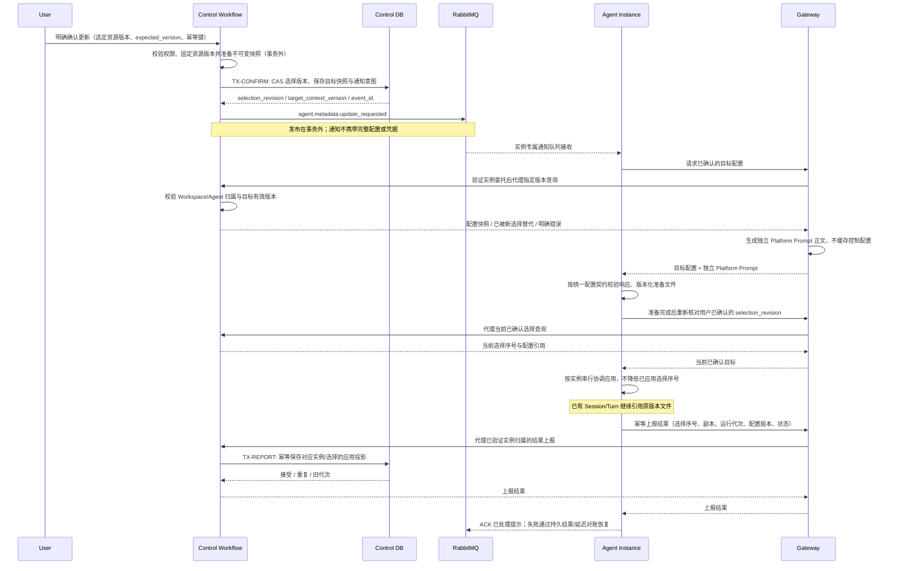

## 一句话说明

用户在 Control 明确确认选定元数据版本后，Control 保存选择、构建版本化运行配置并向 Agent 发通知；Agent 经 Gateway 拉取该有效版本，Gateway 代理查询并仅生成 Platform Prompt 正文，不缓存控制配置。

## 触发与结果

| 项目 | 内容 |
|:---|:---|
| 触发 | 用户明确确认 Prompt/Skill/Memory/工具配置等升级或更新 |
| 非触发 | 目录资源编辑、发布新版本、Gateway 缓存失效；这些不等价于用户同意运行更新 |
| 成功 | Agent 就绪的候选运行配置与用户已确认版本一致，可供新 Session 使用 |
| 失败 | 保留用户选择与上一可用配置，重试拉取或报告无效资源；不伪装已应用 |
| 生命周期 | 已有 Session、queued/running Turn 保持原版本；通知不自动修改旧 Session |

## 执行时间线

### 步骤说明

1. 用户选择由 Agent Configuration Domain 决定。Workflow 协调快照构建、消息与配置拉取，不拥有新的配置事实表；写能力的版本和幂等约束保留在该 Domain。
2. Control 发布的是已确认选择对应的运行更新通知，不是把每条资源编辑直接转为运行命令。一个通知只对应一个 Workspace/Agent Configuration 的选定目标；涉及多个 Workspace 时分别路由。
3. 通知资源列表仅用于说明变化，Agent 不按消息拼装配置。目标查询返回完整、经过授权的有效快照；并发用户更新时由 Control 判断目标是否仍有效，旧通知不得降低实例已应用的选择序号，也不能自动拉取尚未被用户选择的 Catalog 新版本。
4. Gateway 每次代理查询，保持无控制配置缓存。Platform Prompt 正文在返回链路生成，Configured Prompt 仍是独立内容；秘密不进入消息或正文。
5. 同 Workspace 多实例都应收到通知，不能共用一个竞争消费队列。每个实例独立准备本地运行状态；共享卷内容采用版本化产物与原子发布，不能覆盖旧 Session 正在引用的 Skill/Prompt 文件。
6. ACK 只表示该实例完成通知处理，不表示所有实例都已更新。处理失败保留旧配置并重试；新实例启动、消息重连及周期对账经 Gateway 查询已确认选择，恢复因无消费者、丢通知或进程重启产生的缺口；对账不自动选择 Catalog 最新版。

7. 更新结果采用 Agent → Gateway → Control 的受控 API，不新增结果反馈消息类型。Gateway 不保存应用投影，Gateway 核对当前登记及独立实例凭证，Control 接受受控代理核验的归属和运行代次后保存结果；上报失败单独重试，不重新应用已成功配置。

## 状态与不变量

目录版本、用户已选配置版本、实例已准备版本、Session 固定版本分别处理。只有用户确认推进已选配置，通知消费推进实例可用版本；Session 版本不随实例刷新变化。用户明确选择旧资源版本属于新的选择，selection_revision 递增，允许有意回滚资源；过期通知不等于用户回滚。成功应用不清空队列、不重新执行 Turn、不替换 Runtime Handle。配置无效时保留已提交选择并暴露加载失败，不偷偷使用其他资源版本。

## 一致性边界

TX-CONFIRM 是用户选择的事实边界，一次提交选择版本、不可变快照与通知 Outbox。授权、固定资源读取和 Skill 校验在提交之前的事务外完成；提交时 CAS 当前配置版本并重新核对幂等键。RabbitMQ publish、Gateway 查询、对象读取和 Runtime 加载均在事务外。发布失败不回滚用户选择；沿用配置更新链路的持久化协调意图重试，并以实例启动/重连查询恢复。协议及载荷详见 [实现规格](../../../spec/agent-metadata-notification.md)。

## 幂等、重试与补偿

| 步骤 | 幂等/版本边界 | 恢复规则 |
|:---|:---|:---|
| 用户确认 | workspace + 客户端幂等键，expected_version | 重复确认返回既有选择；版本冲突重读 |
| 快照构建 | 固定资源版本向量 | 来源不一致不发布；不解析未选定的 latest |
| 通知发布 | source + 稳定 event_id | 重投沿用 ID，不重复生成更新事实 |
| 实例消费 | 当前实例 + source/event_id；选择序号按 workspace/agent_config 分区 | 重复 no-op；过期需权威查询确认，资源版本不参与排序 |
| 拉取/加载 | 用户已确认的配置目标 | 瞬时失败延迟重试；无效内容保留旧配置并报告 |

## 权限与失败

Control 入口取得真实用户身份并校验 Workspace manage 与资源版本授权。消息生产方使用受限服务身份，Agent 不能发布其他 Workspace 的配置通知。Agent 拉取经 Gateway 验证稳定 Agent 委托及 Workspace 归属，Control 执行最终资源授权；实例 ID/Pod ordinal 不是用户授权主体。专用配置查询不能绕过现有通用 API 代理路由 allowlist，需在 spec 中定义独立受控接入。

消息损坏或不支持的封套版本/消息类型/数据版本 进入可观察的协议失败处理，不无限 requeue；临时网络失败延迟重试，授权失效不自动扩大权限。通知不携带 URL、Secret 或可执行脚本；Broker ACK 不等价于配置应用的业务确认。

通知的 changes 是可省略的解释信息；未知变化类型不阻止完整配置拉取。实际配置按系统定义的 schema 与 Runtime adapter 契约校验；不兼容的协议格式或无法加载的产物保留旧配置并报告错误，不能部分跳过后宣称应用成功。Skill 版本选择、产物发布与旧 Session 隔离是平台必须实现的机制，不是 Agent 可选能力，也不需要 skill.versioned 等能力登记。消息封套可由不同服务使用，但 agent.metadata.update_requested 的生产权仍仅授予 Control，不因 source 可扩展而绕过用户确认。

## 结果事件

对 Agent 发布 `agent.metadata.update_requested` 传输通知，表示 Control 已确认可使用的目标配置；不把它当作 Turn 领域事件或 Session Sequence。目录资源变化与运行更新通知是不同事实。Agent 经 Gateway 上报 applied/failed/incompatible/superseded，由 Control 汇总更新中/全部成功/部分失败的用户视图；Broker ACK 不替代该上报。
