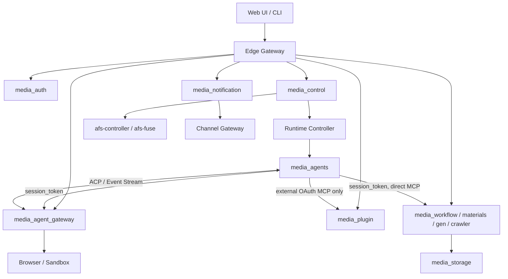

# Media Agent 重构架构

> 状态：设计定稿候选稿
>
> 日期：2026-08-05
>
> 本目录是实现依据；`docs/research` 仅保留讨论过程。

## 1. 目标

重构目标是把旧 `control-plane` 中混合的身份、控制资源、Agent 热路径和业务数据面拆到明确的数据所有者，同时保证新增媒体能力不修改 `media_control`，也不通过 Control 代理高带宽流量。

已确认：

- 采用控制面与数据面分离。
- 采用渐进式拆分方案，不继续保留大 CP，也不拆成过多细粒度服务。
- 不兼容旧 API；旧路由只用于能力覆盖核对。
- `afs-controller` 作为第三方依赖原样使用。
- 普通用户不能上传 Plugin 前端、后端代码或任意 MCP endpoint。
- 当前只做设计，不初始化服务，不开发业务实现。

## 2. 系统拓扑

## 3. 不可破坏的原则

1. 每个业务事实只有一个服务拥有；服务之间不共享数据库表或跨库外键。
2. Edge 负责公网认证和粗粒度路由，资源服务负责最终鉴权。
3. mTLS 证明直接调用服务；用户身份和服务身份不能互相替代。
4. Agent 只持有 `session_token`，不能读取 `platform_token`。
5. 平台内业务 MCP 由 Agent 直连，不经过 `media_plugin`。
6. Browser、Sandbox、Storage 和媒体流量不经过 `media_control` 转发。
7. 本地可靠任务使用 River；跨服务事实通知使用 Outbox/Inbox。
8. IDL 是接口唯一事实源；实现遵守 Harness DDD 和生成代码约束。

## 4. 专项规范

| 文档 | 唯一职责 |
|---|---|
| [`001_auth.md`](./001_auth.md) | 认证、身份传播和资源鉴权边界 |
| [`002_services.md`](./002_services.md) | 服务职责、数据所有权和外部依赖 |
| [`003_plugin_mcp.md`](./003_plugin_mcp.md) | Plugin 登记、MCP 分类和运行路径 |
| [`004_storage.md`](./004_storage.md) | 存储 API、路径、Driver 和生命周期边界 |
| [`005_async.md`](./005_async.md) | River、Schedule、Outbox/Inbox 和故障语义 |
| [`006_domain_model.md`](./006_domain_model.md) | 聚合、不变量和跨服务业务流程 |
| [`007_idl.md`](./007_idl.md) | Public/Internal IDL 与 Harness 实现约束 |
| [`008_migration.md`](./008_migration.md) | 旧 Control Plane 路由能力映射 |
| [`009_bootstrap.md`](./009_bootstrap.md) | Linux 服务初始化命令和验证步骤 |

## 5. 当前状态

本文完成架构和契约设计。新服务尚未初始化，IDL 尚未生成，旧接口映射表示“目标归属已确定”，不表示业务实现已经完成。
