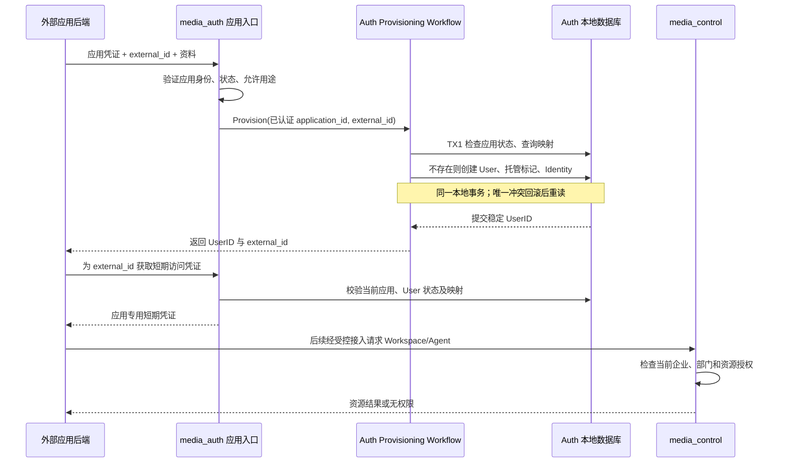
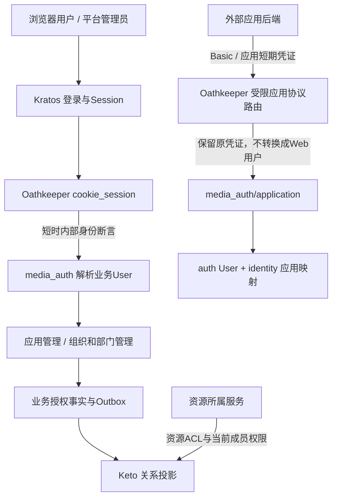

# 002 应用认证与用户映射：领域归属与迁移规划草案

状态：服务边界分析与迁移对照。第 3 节于 2026-11-08 按调用来源补充；第 3.4 节保留初始缺口快照，不能作为当前完成度清单。当前工作区已包含后续实现，尚未完成全部验收或部署；正式规则以对应 Domain、Workflow、spec 为准。

分析基线：`platform` 分支，起点 `58c83cd`（由 `workflow` 创建）。参考上游 [002 原理](/home/tao/code/github/agent-learn/agent-platform/原理/002_应用认证与用户映射.md) 及本地源码。目标是将平台能力内建到 media_agent；旧的“media 接入外部 NAP”实施方案不适用本次方向。

## 1. 服务边界结论

**本章无需创建新服务。应用注册、应用认证、应用用户映射与代用户凭证归入 media_auth；新增 application 领域，复用现有 auth、identity 的事实与规则。**

依据是 [上下文地图](../../../ddd/CONTEXT-MAP.md)：media_auth 已拥有用户、外部身份、组织成员关系和凭证管理。应用接入引入一种新的可信调用者与用户托管规则，没有产生独立的业务用户事实源。若新建 media_platform 或 media_application 服务，注册用户和写映射将变成跨服务操作，还容易出现两份用户状态、应用状态或凭证事实。

新增领域不等于新增限界上下文，更不等于新增部署服务。application 的变化原因是“哪些外部应用可信、允许管理哪些用户、何时可代表用户访问”；它与登录、普通身份绑定、OAuth consent 有清晰差异，适合在同一认证上下文内独立建模。

| 候选方案 | 判断 |
| --- | --- |
| 新建完整平台服务，照搬 control-plane | 不采用。会重复持有 Auth、Control、Gateway 已有事实，破坏现有服务边界 |
| 新建应用认证服务 | 本阶段不采用。用户与映射要求一致写入，暂无独立部署或独立事实所有权的必要 |
| 全部塞入 oauth 领域 | 不采用。OAuth Client 的用户授权与应用托管用户不是同一种授权关系；现有客户端不能自动获得用户创建权 |
| media_auth 新增 application 领域，跨领域流程由 workflow 协调 | 建议采用。保持单一用户事实源，同时隔离应用信任规则 |

以后只有应用平台发展出独立的应用发布、安装、计费等业务生命周期时，才重新评估新的限界上下文；不能仅以接口数量或名字包含 platform 为拆服务依据。

## 2. 能力分别放在哪里

下表是目标归属，尚不表示功能已经实现。

| 能力 | 限界上下文 / 服务 | Domain 或协议层 | 事实、聚合与协作 |
| --- | --- | --- | --- |
| 注册应用、停用、轮换 secret、设置允许用途 | media_auth | 新增 application | Application 聚合持有应用信任状态、凭证版本、允许用途；管理员授权仍使用当前体系 |
| Basic 认证应用 | media_auth | middleware + application service | 中间件解析协议；领域服务验证应用当前状态和 secret，返回应用身份，不构造用户 Session |
| 创建应用托管用户 | media_auth | application + auth + identity | User 归 auth；外部身份映射归 identity；Application 决定应用托管边界；由 provisioning workflow 协调 |
| 外部 ID 解析 | media_auth | identity | `(app:<application_id>, external_id) → UserID`，应用 ID 必须来自已认证上下文 |
| 用户禁用、恢复、软删除 | media_auth | auth，关联 application | 沿用 User 状态与 auth_version；应用只能操作自己托管的用户，不能调用通用管理员能力冒充管理员 |
| 代用户短期凭证 | media_auth | application | 应用专用访问凭证；校验应用、用户、映射及授权用途；不复用 Cookie Session 或长期 API Token 的语义 |
| 浏览器登录、会话 | media_auth + 现有 Kratos/Oathkeeper | 既有身份边界 | 应用托管用户不自动成为可交互登录用户；不新增第二套浏览器登录 |
| Organization、Team、成员和功能授权 | media_auth | organization / team | 维持企业、部门模型；应用注册不自动赋予企业成员或部门权限 |
| 为应用用户确保 Workspace / Agent | media_control | 现有 Workspace / Agent 配置能力，后续评估应用绑定模型 | Control 持有资源绑定和配置；调用 Auth 核验应用与用户，不访问 Auth 数据库 |
| 聊天、Session relay | media_agent_gateway | agent_session / 接入 workflow | 消费已验证用户与 Control 授权上下文，不拥有用户映射 |
| Agent 工作负载认证、MCP 代理 | media_agent_gateway，凭证能力协作 media_auth | 既有 Agent/API Token、Session/MCP 工作流 | 保留 User、Actor、Credential、Session 的分别建模，不照搬另一种 workspace token 取代现有机制 |
| 对外业务 MCP 的 Caller 声明 | media_agent_gateway | MCP 出站协议适配，后续章节设计 | Gateway 从可信运行上下文生成声明；Auth 提供应用身份及外部 ID 查询；接收方仍执行业务授权 |
| 工具、素材、工作流、抓取结果权限 | 各资源服务 | 既有资源领域 | media_workflow、media_materials、media_crawler 等执行最终授权 |
| SDK 的 token 缓存与并发合并 | SDK / 客户端技术层 | 不创建 Domain 或服务 | 按应用、用户及授权上下文隔离缓存；事实与撤销规则仍由服务端决定 |

应用凭证不能被直接当成 Agent Actor。现有 `act.sub=Agent|Worker` 有明确业务含义；应用代用户访问需要保留 application_id 审计维度，是否引入新的 Actor 类型在规格阶段确定，不能先伪造 Agent 身份接通旧链路。

## 3. 按调用来源对照认证方式

对应上游原理文档的「3. 平台不是只有一种认证入口」。这里比较的是能力与信任边界，不要求复制上游的 URL、JWT 算法或凭证格式。

### 3.1 来源、凭证、事实所有者对照

| 来源 / 场景 | agent-platform 的方式 | media_agent 应如何实现 | Ory 承担什么；还缺什么 |
| --- | --- | --- | --- |
| 平台浏览器用户、管理员 | 本地密码或 LDAP 登录，平台自签 Cookie JWT | Kratos 登录/Session → Oathkeeper 校验并签内部断言 → Auth 解析业务 User；管理员身份与当前业务状态仍由 Auth 确认 | Kratos 管登录凭证和 Session，Oathkeeper 管边缘认证；二者不自动拥有 media User、平台管理员与部门事实。当前配置不是上游原生 LDAP 分支的替代实现；企业 LDAP 应经企业 IdP 的 OIDC 桥接等集成进入登录链 |
| 外部业务应用后端管理托管用户 | `/apps/v1`：Basic client_id + secret | Auth/application 验证 Application；workflow 原子创建 User 与 `(app:id, external_id)` Identity；只允许操作本应用用户 | 当前由 Auth 实现应用 Basic。Ory 可提供凭证基础设施，但 Application 状态、托管归属、映射不变量必须由业务实现；OAuth Client 不自动拥有用户管理权 |
| 外部应用后端代表本地用户调用 | 应用换取带 app 的用户 JWT，再访问平台 API | Auth 签发专用短期 `mac_` 凭证；Control/Gateway 专用应用路由在线验证，保留 application_id、UserID、org/team、scopes，并检查绑定和资源权限 | Oathkeeper 匹配专用路径，当前透传给服务验凭证；应用代用户信任与授权交集由 Auth/Control/Gateway 实现。不是 Kratos Session，也不是 client_credentials 的自然结果 |
| CLI、脚本、后台集成访问普通用户 API | 数据库 service token，认证后构造创建者的用户上下文 | 使用现有 API Token 契约：Auth 保存 Actor、User、组织与用途元数据，Talos 管 Secret；经 introspection 和边缘断言进入资源服务 | Talos 管签发/验证/轮换/撤销，Oathkeeper 管边缘适配；Auth 校验当前主体和成员状态。不能照搬“拿到任意 service token 就成为普通用户” |
| Agent 工作负载调用平台 API / 平台 MCP | `/workspace/v1` 与平台 `/mcp` 使用工作区随机 token | Agent API Token 标识 `sub=User, act.sub=Agent`；Gateway 联合 Session Credential、Control 的配置/Workspace 事实，必要时校验实例与 execution epoch | Talos 可管理 Agent API Token，边缘可验凭证；Agent 对应哪个配置、哪个 Workspace、当前 Session/执行归属只能由 Control/Gateway 判断。不能改成普通浏览器用户凭证 |
| 环境 runner / 执行实例 | `/env/v1`、环境连接协议使用 environment token | Control 持有 Runtime Environment、Grant、Placement；按调用方向使用 Controller 创建凭证、原生 K8s/Docker 资源证明、Gateway Instance Credential 等现有契约 | Ory 可辅助机器凭证校验，但不知道 environment/placement、replica/incarnation、资源 generation。现有运行模型与上游 runner 不同，不能宣称已有同等 `/env/v1` 协议 |
| 平台内部服务 | `/svc/v1` 使用内部共享 service key | 使用受限内部路由和明确服务凭证，必要处 mTLS；按 purpose/audience 限制能力，不构造终端用户。现有 `MEDIA_AUTH_INTERNAL_TOKEN`、Control token、运行创建凭证等按各自边界使用 | Oathkeeper 可作为部分入口校验点；内部服务身份、网络隔离和各服务鉴权仍需实现。不能把所有内部凭证合并成一个万能 key |
| 运维自动化 | 部分管理路径接受管理 token 并构造管理员上下文 | 平台管理员链，或独立、最小权限且可审计的运维服务主体；不新增静态 token 直接伪装全局 admin 的通道 | Ory 验证主体，业务管理接口仍判断当前操作权限；上游旁路不作为兼容要求 |
| 第三方应用经用户同意访问平台 | OAuth 授权码、token exchange 等相邻能力 | 如果需要标准 OAuth2/OIDC Provider，单独设计 Hydra + 登录/Consent 适配，并映射稳定业务 User；既有旧 OAuth 代码不等于已完成 Hydra 迁移 | Hydra 提供标准协议和 token endpoint；Kratos 提供登录。当前 ADR 明确 Hydra 不在已接入范围，不能把整个 Ory 产品家族能力当成当前部署能力 |
| 平台 Agent 回调外部业务 MCP | 平台签名 `X-Platform-Caller`，携带平台 User 与业务 external_id | Gateway 从已验证 Agent/Session 上下文请求 Auth 当前映射，为登记的目标签短时、特定 audience 的 Caller；业务方验签并检查本地用户/Workspace/资源权限 | Oathkeeper 的 JWT 签名能力不等于这条出站业务协议；Auth 持有映射，Gateway 持有可信执行上下文。当前工作区已新增专用 Caller 签发及 SDK 验签，仍需完整验收 |

其中应用用户凭证的实际权限为：**Application Team Grant ∩ 当前用户的组织/团队权限 ∩ Workspace/Session 与资源权限**。创建应用、创建托管 User 都不自动授予部门成员或管理员权限。

上游“service token”至少要拆开理解：普通 API 的长期用户/集成凭证、`/svc/v1` 内部服务 key，以及登录时预备的 Platform Token 并非同一种凭证。media_agent 的离线委托 Platform Token 仍由既有 platform_token 领域负责，不因名称相似并入 Talos API Token。

### 3.2 Ory 是否可以完全实现

**仅配置当前 Ory 组件，不能完整实现以上全部场景；以 Ory 为身份基础设施，加上 media_agent 的领域与协议实现，可以覆盖这些业务场景。**

- **Kratos**：人的登录身份、认证方式、恢复和 Session；不是 Agent、Environment 或应用托管 User 的业务事实源。
- **Oathkeeper**：按路径验 Session/Token、调用授权器、生成内部身份断言；不是 Token 生命周期或用户映射数据库。应用路径使用 noop 时，认证由后端完成，不能称为 Oathkeeper 已完成认证。
- **Talos**：现有长期 API Key/Token 的 Secret 生命周期；Auth 保留业务元数据和当前状态判断。
- **Keto**：关系权限判定与投影；不认证密码、不签发用户凭证，也不取代资源服务的业务不变量。当前事实拒绝不能被滞后的投影放行覆盖。
- **Hydra**：当平台需要标准 OAuth2/OIDC 授权服务器时引入；不是所有应用 Basic 接口都必须先迁到 Hydra。

这些分工与 [Ory 产品总览](https://www.ory.com/docs/products/products-overview)、[Ory 开源组件说明](https://www.ory.com/docs/oss/getting-started)一致。产品能力需与本仓库版本、已部署组件区分；本仓库边界以 [ADR 0012](../../../ddd/adr/0012-ory-identity-and-authorization-boundary.md) 为准。

### 3.3 应用认证与代用户授权不能混用

`client_id + secret` 只证明“是这个应用”。即使改用 Hydra `client_credentials`，也不会因此证明“这个应用可代表任意用户”。标准客户端凭证流程可参见 [Hydra 官方示例](https://www.ory.com/docs/oel/hydra/quickstart)。

本次托管用户方案允许应用代表**自己管理且已获平台权限的用户**；这来自平台管理员建立的应用信任和不可变用户映射。若要访问**已有平台用户**的资源，则应走独立的用户同意/绑定或明确管理员委托流程，不能通过提交一个 user_id 或同邮箱偷偷转换。

当前工作区选用 `mac_` opaque 短期凭证而非上游用户 JWT，是本次实现选择，不是 Ory 的能力限制。这样可以每次在线检查应用、用户、凭证版本、Grant 与成员权限。它仅面向已接入的应用资料、Workspace 和聊天入口，不能作为任意 `/api/*` 的通用凭证。JWT 也能用于该方案，但若要求即时撤销，单靠验签与 exp 不够。

### 3.4 初始已有能力与缺口快照

以下是最初规划时的状态，保留作设计依据；不代表 2026-11-08 工作区实现状态。

已核对 [auth 领域](../../../ddd/media_auth/domain/0001-auth/auth.md)、[identity 领域](../../../ddd/media_auth/domain/0002-identity/identity.md)、[oauth 领域](../../../ddd/media_auth/domain/0005-oauth/oauth.md)、[Gateway 上下文](../../../ddd/media_agent_gateway/CONTEXT.md) 和对应代码。

| 002 涉及能力 | 目标归属 | 状态 | 证据 / 缺口 |
| --- | --- | --- | --- |
| 业务 User、状态、撤销版本 | media_auth / auth / User | covered | `media_auth/biz/domain/auth/user.go`；已有用户禁用和软删除流程 |
| 通用外部身份唯一映射 | media_auth / identity / Identity | covered | `media_auth/biz/domain/identity/identity.go` 与 `migrations/0001_init.up.sql` 的双唯一约束 |
| OAuth Client 管理 | media_auth / oauth / OAuth Client | covered | `idl/media_auth/oauth_client.proto`，但不等于应用管理协议 |
| 应用信任注册、停用、secret 生命周期 | media_auth / application / Application | missing | 本轮未发现对应应用模型和 `/apps/v1` 路由 |
| 应用托管用户所有权、禁止交互登录 | media_auth / application + auth | missing | 尚无上游 managed_by 对应能力，不能只加 provider 字符串就宣称完成 |
| 原子创建 User 与应用身份、并发恢复 | media_auth / provisioning workflow | missing | 通用映射仓储存在，应用用例与事务不变量需要新增 |
| 应用代用户 token、验证、撤销 | media_auth / application，接入层协作 | missing | 现有 Session/Internal JWT 验证器不能直接接受上游 HS256 应用 JWT |
| Kratos 登录凭证与 Web Session | Kratos（由现有 Auth/边缘适配） | external-owner | 不复制进 application；本地仍有过渡认证代码 |
| 企业/部门及资源授权 | Auth / organization、team；Control 与资源服务 | covered | 已有 DDD 边界，应用成员开通策略仍需补充 |
| 应用团队、内容 system owner | Auth 与 Control 的应用资源发布协作 | missing | 上游自动创建方式与本项目 Team 语义冲突；另行设计，不本轮照搬 |
| 工作负载与 MCP 委托基础 | Gateway + Auth | covered | 既有 Agent API 代理、Session Token、MCP 委托契约；不是上游协议等价实现 |
| ensureAgent、应用资源发布、对外 Caller 兼容 | Control / Gateway | missing | 属后续平台能力章节，本章只确定边界和依赖 |

这里 covered 仅表示对应基础能力有明确事实所有者与既有实现，不代表端到端应用接入已完成。存在 missing，本轮不宣称领域建模或迁移完成；也未对所有平台章节进行全量入口审计。

## 4. 需要先解决的模型差异

### 应用是可信客户端，不是媒体业务模块

现有词典将 app 留给 media 微服务。后续正式词典建议使用 **Platform Application（平台接入应用）** 表达注册的外部业务应用；media_workflow、media_crawler 不因服务名就各自注册应用、创建一套重复 User。它们继续消费同一个 media User 和受信主体。

### 复用用户模型，不自动合并账号

外部应用 A 的用户 `17` 和应用 B 的用户 `17` 属于不同身份命名空间。应用自行管理的用户可以映射到新建 media User；现有 media 用户继续使用现有 UserID。不能按邮箱或显示名将外部身份自动合并到已有账户。

第一阶段建议只支持应用新建并管理自己的用户。绑定已有 media User 是另一种需要用户或管理员明确授权的流程，不在普通 upsert 中隐式完成。

应用托管归属必须是强约束，而不是 metadata 提示。建议由 auth 的 User 保存不可随意变更的应用托管标记，identity 保存映射；应用不能绕过通用解绑接口解除托管约束，也不能通过改密、LDAP、Kratos 解析等旁路变为交互登录用户。

### 不复用 identity 的通用覆盖写语义

当前 IdentityRepo.Upsert 按 `(user_id, provider)` 更新 external_id。应用映射需要“同一外部身份始终指向同一 User”的稳定语义，应新增受限创建/读取操作，处理唯一冲突；不直接开放通用 Upsert 给应用调用。deleted 用户的映射保留，重试创建不复活旧用户，也不偷偷换一个 UserID。

### 不照搬上游应用团队

上游用应用专属 team 共享 provider 和内容；本项目 Team 是 Organization 内的部门，Workspace 必须属于 Team。因此应用注册与企业成员开通必须分开。建议应用可管理的 Organization/Team 由平台管理者明确配置，成员写入由既有组织流程完成。用户映射成功本身不获得任何部门或 Workspace 权限。

### 凭证协议与现有登录链隔离

现有普通入口拒绝不受信 Bearer 后回落 Cookie。应用凭证需要独立的 issuer/audience/type、用途范围和当前状态验证契约，再在指定边缘入口转成内部主体；不能扩大所有普通 Session 验证器的接受范围。

`media_auth/biz/middleware/platform_caller.go` 的 PlatformCaller 是专用 mTLS 服务调用校验，**不是**上游 `X-Platform-Caller` JWT 校验器；二者不可因同名而复用。

## 5. 用事务推演边界是否合理

- TX1 应锁定/复查 Application 状态，避免停用与并发创建之间越过边界；用户和映射必须同时提交，不留下孤立 User。
- provisioning 幂等键是 `(application_id, external_id)`。响应丢失后重复请求返回相同 UserID；并发创建失败者回滚自身 User，再重读胜者结果。
- 同一用户资料并发更新的覆盖或版本策略须在规格明确；不得把身份映射更新与可覆盖的展示资料混为一谈。
- 应用停用后禁止创建、换 token 和新代表调用；只禁止换 token 不足以撤销已有凭证。首版建议接入时查询当前应用和用户状态，依赖不可用则拒绝，后续缓存才引入明确撤销时限。
- secret 轮换与应用停用不同：是否使已签 token 失效必须由凭证版本策略明确。用户禁用/删除复用 auth_version；恢复不恢复旧凭证。
- Workspace 创建是后续独立业务事务，不与用户映射假装组成分布式原子操作。失败保留用户映射，按 Control 的幂等命令重试；不能删除已被其他请求使用的 User 作为补偿。
- 客户端断开不代表事务未提交；身份服务失败不能降级成默认用户。组织开通、资源创建以及长期 Platform Token 确保不是 TX1 的隐含副作用。

流程判定：应用注册/资料更新可属于单 Application 聚合用例；用户 provisioning 跨 application/auth/identity，需要 Workflow；应用用户删除复用并扩展现有撤销 Workflow；应用用户到 Agent 创建跨 Auth/Control，需要后续跨服务 Workflow。JWT 签验、SDK 缓存、只读映射查询不单独创建业务 Workflow。

## 6. 下一步工作顺序

1. **领域设计**：先补正式词典和 application 领域；同步 auth 的托管用户规则、identity 的不可任意解绑规则，补 provisioning 和撤销流程。保留 User、Organization、Team 的现有含义。
2. **实现规格**：确定应用数据模型、凭证与状态版本、允许调用的 API、边缘交换方式、组织开通策略及错误语义。注册应用是否复用 OAuth Client 底层存储须显式设计；不得让普通 OAuth Client 自动升级成受信应用。
3. **最小闭环实施计划**：应用注册 → 应用认证 → 原子映射 → 短期凭证 → 一个受保护用户接口 → 禁用后拒绝。先跑通身份闭环，再接 ensureAgent 和 MCP Caller。
4. **扩展平台能力**：Control 的应用资源绑定与发布、Gateway 的会话适配和对外 Caller、客户端 SDK 分章节规划，不把全部平台能力塞入 application 领域。

正式实现应按 Harness 的 handler → service/workflow → domain/policy → repository 分层；IDL 先行，生成路由和 DTO 不手改。跨领域只由 Workflow 编排，不让 application service 直接依赖 auth service；跨服务只调用接口，不共享表或跨库外键。

关键验收场景：两个应用同 external_id 隔离；伪造 application_id 无效；重复/并发创建仅一个 User；同邮箱不合并；托管用户不能交互登录；被禁用应用或用户的旧凭证不可用于新请求；无组织成员资格不能创建 Workspace；错误 Bearer 搭配合法 Cookie 仍拒绝；业务资源拒绝不能被应用身份绕过。

## 7. 证据边界与文档债务

本轮读取了 Auth/Control/Gateway 的 DDD 边界，以及 Auth 中间件、Identity 模型和 SQL、OAuth Client 入口、上游应用认证与用户映射源码。仅做静态分析，未运行集成测试，未修改业务代码或数据库。

现有 DDD 自身存在不同迁移阶段的叙述：media_auth CONTEXT 以 Kratos/Oathkeeper 为目标，auth Domain 仍保留本地登录描述；oauth Domain 还有旧 HS256 描述。不能据旧段落确定新增凭证算法或假定迁移已部署。进入规格阶段需依据实际装配与运行配置明确启用路径，再同步受影响文档。本轮不顺带重写整套认证架构。

## 8. 与 Ory 的结合（本次实施补充）

Kratos Identity与业务User不是同一ID；应用托管User没有Kratos Identity。外部应用如何登录其自己的用户由该应用负责。Application secret证明应用身份，external_id确定其托管User；不能直接由浏览器指定他人UserID。

Oathkeeper有两类责任：普通用户/管理员链路执行认证并签发内部JWT；应用协议入口只匹配限定路由，实际认证仍由Auth完成，类似保留独立认证协议的入口。当前工作区的 mac_ 分为 profile 凭证与绑定 Team/scopes 的业务凭证。已接入的 Control/Gateway 应用入口通过 Auth 内部在线校验；普通用户 API 不自动接受 mac_。必须保留 application_id、稳定 UserID 和用途范围，不能把 Application 伪装成 Agent Actor。

Keto的subject使用业务UserID，Organization/Team与资源服务仍是授权事实源。应用注册或用户映射不自动创建Keto关系；成员开通走已有领域命令和Outbox。当前仓库部分资源投影仍未完成，不能把设计边界当成全面部署事实。

Hydra未纳入本次实现：现有ADR明确其OAuth2/OIDC Provider能力另行规划。Talos继续管理长期API Token；本次应用secret和一小时profile凭证不改变API Token的生命周期或Agent/Worker委托协议。

实现现状（2026-11-08 工作区，未部署）：已增加应用管理、团队 Grant、专用应用协议、Control Agent 绑定、Gateway 聊天入口和 Caller/SDK 代码。浏览器沿用 Kratos 链；mac_ 仅接入明确的应用业务入口，未扩展到所有通用业务 API。数据库与部分跨服务测试已通过，真实 Kratos 登录与 Oathkeeper 集成测试已通过，真实模型推理和生产部署尚未验证，不能把代码存在当作上线完成。
