# 从 control-plane 到 agent 启动的阅读计划

这份计划按“先建立主线，再深入分支”的顺序阅读。目标不是一次记住所有字段，而是逐步回答一个问题：一个 workspace 的配置、能力和运行上下文，如何从 control-plane 变成 Codex agent 里的本地文件、目录、环境变量和 ACP session 参数。

建议先配合阅读：

- `docs/wiki/agents/understanding_agent_startup.md`
- `docs/wiki/agents/other_content.md`
- `docs/wiki/agents/mcp.md`
- `docs/wiki/agents/skills.md`
- `docs/wiki/agents/acp_server.md`

下面的代码位置分两类：

- `D:/Code/koala/agent-platform/...`：Koala 侧 control-plane 和 TypeScript Codex agent，是完整链路的主要参考实现。
- `D:/Code/media/media_agent/...`：本仓库 Python agent，目前实现了 config、MCP、credentials、ACP bridge、usage，Skills 同步仍是占位。

## 总体学习路线

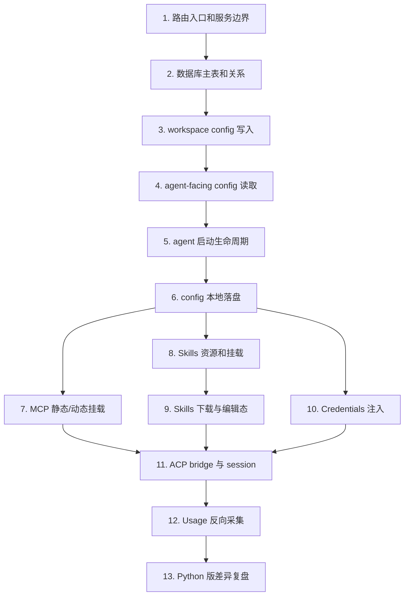

每一步建议读完后都写一两句话笔记：输入是什么，查了哪些表，输出给了谁。

## 第 1 步：先看 control-plane 的路由总入口

学习内容总结：

control-plane 是所有用户 API、内部 API、MCP endpoint 的入口。你先不用理解每个业务，只需要知道哪些路由服务负责 workspace、skills、credentials、MCP，以及 agent 拉配置时走的是 `/_cp` 内部路由。

需要查看的代码：

| 文件 | 行数范围 | 看什么 |
| --- | --- | --- |
| `D:/Code/koala/agent-platform/control-plane/src/index.ts` | 299-351 | 用户 API 和内部 API 的 route 挂载：`/api/workspaces`、`/api/credentials`、`/api/skills`、`/_cp` |
| `D:/Code/koala/agent-platform/control-plane/src/index.ts` | 385-387 | 平台 MCP endpoint：`/mcp` |
| `D:/Code/koala/agent-platform/control-plane/src/routes/internal.ts` | 273-397 | agent-facing config 读取和内部 config 更新 |
| `D:/Code/koala/agent-platform/control-plane/src/routes/internal.ts` | 415-579 | agent-facing skills/package/credentials 读取 |

读完要能回答：

- 用户写配置走 `/api/...`，agent 拉配置走 `/_cp/...`，这两类路由为什么分开？
- `/mcp` 和 `/_cp` 有什么区别？

## 第 2 步：建立数据库表地图

学习内容总结：

先把表分成五类：workspace 身份、workspace 配置、可复用资源、挂载关系、运行时账本。不要一上来背字段，先理解每张表在链路中的角色。

需要查看的代码：

| 文件 | 行数范围 | 看什么 |
| --- | --- | --- |
| `D:/Code/koala/agent-platform/control-plane/migrations/001_init.sql` | 113-170 | `workspaces`：workspace 身份和状态 |
| `D:/Code/koala/agent-platform/control-plane/migrations/001_init.sql` | 1123-1191 | `workspace_config`：agent/model/prompt/MCP/settings/template 的中心表 |
| `D:/Code/koala/agent-platform/control-plane/migrations/001_init.sql` | 456-625 | `model_providers`：可复用 provider |
| `D:/Code/koala/agent-platform/control-plane/migrations/001_init.sql` | 626-712 | `prompts`：可复用 prompt |
| `D:/Code/koala/agent-platform/control-plane/migrations/001_init.sql` | 755-825 | `skill_sources`、`skill_versions`、`skills`：Skill 本体和版本 |
| `D:/Code/koala/agent-platform/control-plane/migrations/001_init.sql` | 961-969 | `template_version_skills`：模板内置 Skills |
| `D:/Code/koala/agent-platform/control-plane/migrations/001_init.sql` | 1192-1202 | `workspace_skills`：workspace 启用 Skills 的挂载关系 |
| `D:/Code/koala/agent-platform/control-plane/migrations/001_init.sql` | 1011-1045 | `user_credential_workspaces`、`user_credentials`：凭据资源和 selected scope |
| `D:/Code/koala/agent-platform/control-plane/migrations/001_init.sql` | 352-400 | `mcp_catalog`、`mcp_oauth_clients`、`mcp_oauth_tokens`：MCP 目录和 OAuth token |
| `D:/Code/koala/agent-platform/control-plane/migrations/001_init.sql` | 713-732 | `session_tokens`：session token 到 workspace/session 的反查 |
| `D:/Code/koala/agent-platform/control-plane/migrations/001_init.sql` | 171-220, 1225-1235 | usage 事件和 usage cursor |

表关系图：

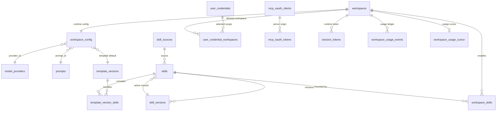

读完要能回答：

- 哪些表保存资源本体？哪些表保存 workspace 挂载关系？
- `mcp_catalog` 为什么不是实际 MCP 启用清单？
- `skills.active_version_id` 和 `workspace_skills.skill_id` 分别解决什么问题？

## 第 3 步：看 workspace config 是如何写入和 reload 的

学习内容总结：

用户创建或更新 workspace 时，control-plane 先写数据库，然后根据 workspace 是否运行、agent 类型是否变化，决定热 reload 还是重建。这里要重点理解 `workspace_config` 是写入中心，`applyWorkspaceConfigUpdate()` 是更新后触发 reload 的汇合点。

需要查看的代码：

| 文件 | 行数范围 | 看什么 |
| --- | --- | --- |
| `D:/Code/koala/agent-platform/control-plane/src/services/db/workspaces.ts` | 4-60 | `createWorkspace()` 写 `workspaces` 和 `workspace_config` |
| `D:/Code/koala/agent-platform/control-plane/src/services/db/workspaces.ts` | 335-405 | `updateWorkspaceConfig()` 如何更新配置字段，尤其 `mcp_config`、`agent_settings`、template 字段 |
| `D:/Code/koala/agent-platform/control-plane/src/services/workspace-config.ts` | 17-38 | `applyWorkspaceConfigUpdate()` 写库后通知 agent reload 或标记重建 |
| `D:/Code/koala/agent-platform/control-plane/src/lib/workspace-address.ts` | 58-96 | `notifyAgentReload()` 如何 POST 到 agent 的 `/reload-config` |
| `D:/Code/koala/agent-platform/control-plane/src/routes/internal.ts` | 367-397 | 内部 `PUT /_cp/workspaces/:id/config` 也走同一套更新逻辑 |

业务时序图：

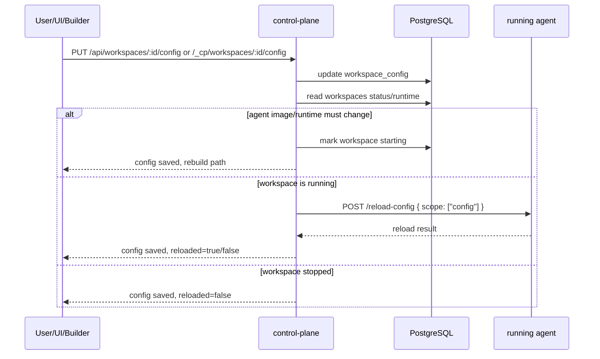

读完要能回答：

- 为什么配置写入和 agent reload 是两个动作？
- 哪些变化可以热加载，哪些变化更像需要 rebuild？

## 第 4 步：看 agent-facing config 是如何组装的

学习内容总结：

agent 不直接查数据库，它请求 `GET /_cp/workspaces/:id/config`。control-plane 会把 `workspace_config`、template、provider、prompt、MCP OAuth 信息合并成一个 payload。这里要重点理解“数据库原始配置”和“agent-facing 运行视图”的区别。

需要查看的代码：

| 文件 | 行数范围 | 看什么 |
| --- | --- | --- |
| `D:/Code/koala/agent-platform/control-plane/src/services/db/workspaces.ts` | 277-333 | `getWorkspaceConfig()` 的 SQL：template/provider/prompt 的合并规则 |
| `D:/Code/koala/agent-platform/control-plane/src/routes/internal.ts` | 273-360 | `GET /_cp/workspaces/:id/config`：加工 `mcp_config`、注入 headers、返回 payload |
| `D:/Code/koala/agent-platform/control-plane/src/routes/mcp-oauth.ts` | 49-125 | MCP OAuth 完成后保存 token，并通知 workspace reload config |
| `D:/Code/koala/agent-platform/control-plane/src/routes/mcp-proxy.ts` | 48-170 | OAuth MCP proxy 如何注入 `Authorization` 并翻译 `X-Session-Token` |

业务时序图：

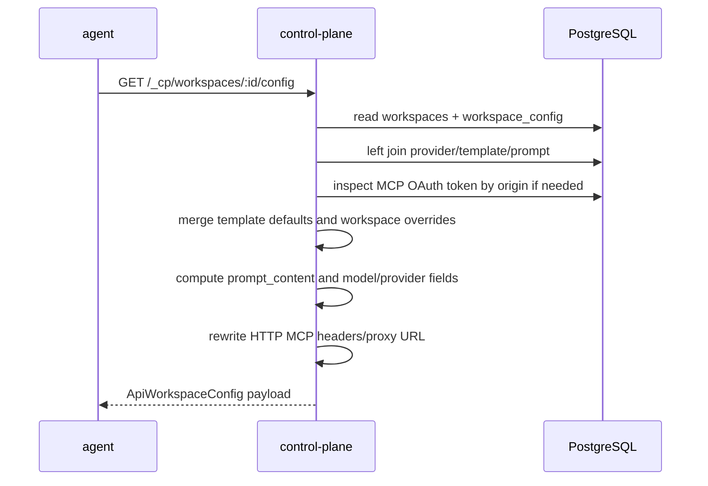

读完要能回答：

- `prompt_content` 为什么不是 `workspace_config` 的物理字段？
- template 默认值和 workspace 覆盖值的优先级是什么？
- MCP OAuth 为什么会影响 agent 拿到的 URL？

## 第 5 步：看 agent 启动生命周期的骨架

学习内容总结：

先读 TypeScript 完整实现，再读 Python 版复刻。启动顺序是：load config、load skills、load credentials、启动 bridge 和辅助进程。Python 版的通用生命周期把这几个动作抽象成 hooks。

需要查看的代码：

| 文件 | 行数范围 | 看什么 |
| --- | --- | --- |
| `D:/Code/koala/agent-platform/agents/codex/src/index.ts` | 16-75 | TS 版 Codex agent 启动顺序：platform prompt、config、skills、credentials、server/processes |
| `D:/Code/koala/agent-platform/agents/codex/src/server.ts` | 25-61 | TS agent server 注入 hooks、ACP adapter、usage 路由 |
| `D:/Code/media/media_agent/media_agents/codex/main.py` | 25-58 | Python Codex app 创建：hooks、bridge_factory、lifespan、usage router |
| `D:/Code/media/media_agent/media_agents/adapter/agent_app.py` | 55-101 | 通用 FastAPI app 如何组合 base lifespan 和 extra lifespan |
| `D:/Code/media/media_agent/media_agents/adapter/agent_lifespan.py` | 16-35 | Python 通用启动生命周期：`load_config()`、`load_skills()`、`load_credentials()`、`restart_bridge()` |

业务时序图：

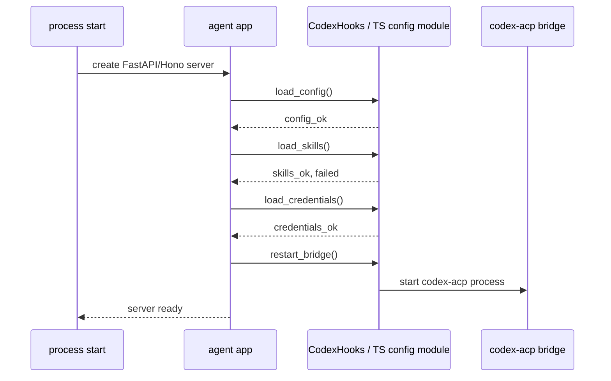

读完要能回答：

- agent 启动时为什么先 load config，再 load skills/credentials？
- Python 版为什么用 hooks，而不是把 Codex 逻辑写进通用 adapter？

## 第 6 步：看 config 如何落成本地文件

学习内容总结：

这一段是 agent 启动的核心。control-plane 返回的是 JSON payload，Codex 运行时需要的是 `AGENTS.md`、`runtime.json`、`config.toml`、`auth.json`。读代码时重点看字段如何转换，以及 HTTP MCP 和 stdio MCP 在这里第一次分流。

需要查看的代码：

| 文件 | 行数范围 | 看什么 |
| --- | --- | --- |
| `D:/Code/koala/agent-platform/agents/codex/src/config.ts` | 74-181 | TS `loadConfig()`：拉 CP config、写 prompt/runtime/auth/mcp/config.toml |
| `D:/Code/koala/agent-platform/agents/codex/src/config.ts` | 379-430 | TS `loadRuntimeConfig()` 和 `loadAcpMcpServers()` |
| `D:/Code/media/media_agent/media_agents/adapter/clients/cp.py` | 18-77 | Python `CpClient`：`CP_URL`、`WORKSPACE_ID`、config/credentials 请求、MCP headers |
| `D:/Code/media/media_agent/media_agents/codex/config.py` | 66-118 | Python `CodexHooks.load_config()`：拉配置、写本地文件、解析 MCP |
| `D:/Code/media/media_agent/media_agents/codex/config.py` | 144-187 | Python `_write_codex_toml()`：provider、model、features、stdio MCP、HTTP MCP flag |
| `D:/Code/media/media_agent/media_agents/codex/config.py` | 189-198 | Python `agent_settings` key 检测和 `auth.json` 写入 |

业务时序图：

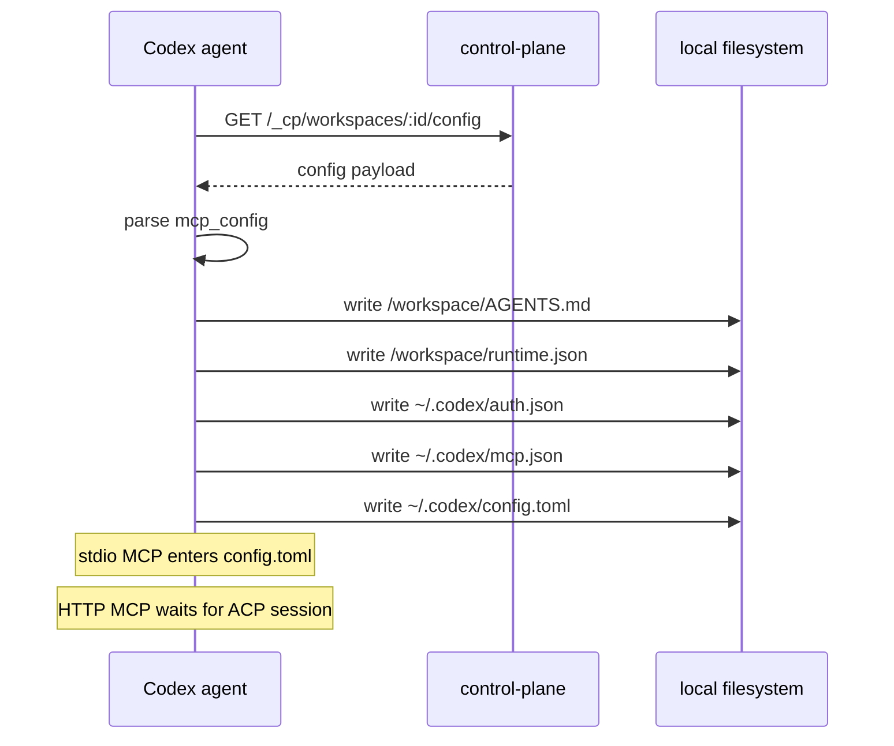

读完要能回答：

- `AGENTS.md`、`runtime.json`、`config.toml`、`auth.json` 分别给谁用？
- 为什么 HTTP MCP 不直接写入 `[mcp_servers]`？

## 第 7 步：专门看 MCP 的两段式加载

学习内容总结：

MCP 有两个时机：config 阶段保存和改写 MCP 配置，session 阶段动态把 HTTP MCP 传给 `codex-acp`。平台 MCP `tos-platform` 也是 session 阶段动态加入。

需要查看的代码：

| 文件 | 行数范围 | 看什么 |
| --- | --- | --- |
| `D:/Code/koala/agent-platform/control-plane/src/routes/internal.ts` | 273-360 | CP 返回 config 前如何加工 HTTP MCP headers/proxy URL |
| `D:/Code/koala/agent-platform/agents/codex/src/config.ts` | 128-181 | 写 `mcp.json`，stdio MCP 写入 `config.toml`，HTTP MCP 不静态写入 |
| `D:/Code/koala/agent-platform/agents/codex/src/config.ts` | 402-430 | `loadAcpMcpServers()`：session 级构造平台 MCP 和用户 HTTP MCP |
| `D:/Code/koala/agent-platform/control-plane/src/mcp/server.ts` | 12-80 | `/mcp` 如何解析 `X-Workspace-ID` 和 `X-Session-Token` |
| `D:/Code/koala/agent-platform/control-plane/src/mcp/tools.ts` | 27-36 | 平台 MCP 注册哪些工具 |
| `D:/Code/koala/agent-platform/control-plane/src/routes/mcp-proxy.ts` | 48-170 | 第三方 OAuth MCP proxy 请求转发 |
| `D:/Code/media/media_agent/media_agents/codex/config.py` | 85-93 | Python `load_mcp_servers()` 构造 ACP MCP server declarations |

业务时序图：

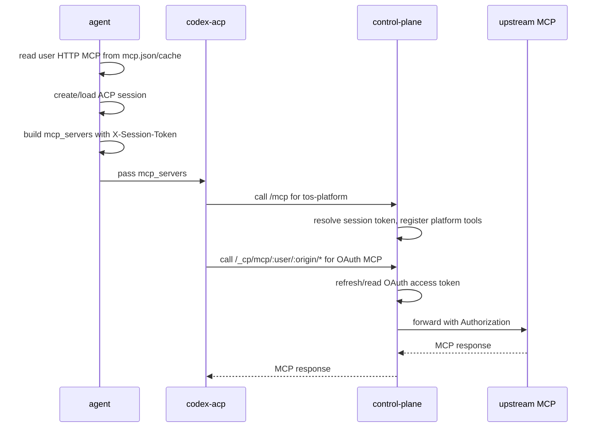

读完要能回答：

- HTTP MCP 为什么是 session 级，而 stdio MCP 是进程配置级？
- `X-Session-Token` 为什么不直接暴露真实 `session_id`？
- `tos-platform` 为什么不是从 `workspace_config.mcp_config` 来的？

## 第 8 步：看 Skills 的资源生命周期和 workspace 挂载

学习内容总结：

Skills 的难点在于它不是单表逻辑。SCS 负责 Skill 本体和版本的写入，control-plane 负责 ACL、workspace 挂载关系和 reload 通知。workspace 只保存启用了哪些 skill id，不保存 package 内容。

需要查看的代码：

| 文件 | 行数范围 | 看什么 |
| --- | --- | --- |
| `D:/Code/koala/agent-platform/control-plane/src/routes/skills.ts` | 391-529 | 上传 tarball、从 Git 导入 Skill |
| `D:/Code/koala/agent-platform/control-plane/src/routes/skills.ts` | 857-905 | 保存 native draft |
| `D:/Code/koala/agent-platform/control-plane/src/routes/skills.ts` | 1427-1495 | 发布 draft、切 active version 的 API 入口 |
| `D:/Code/koala/agent-platform/control-plane/src/services/skills-service.ts` | 4-20 | CP/SCS 职责边界注释 |
| `D:/Code/koala/agent-platform/control-plane/src/services/skills-service.ts` | 232-299 | Git 导入、切 Git、上传 Skill 如何调用 SCS |
| `D:/Code/koala/agent-platform/control-plane/src/services/skills-service.ts` | 329-421 | draft 保存、publish/sync/set-active 后触发受影响 workspace reload |
| `D:/Code/koala/agent-platform/control-plane/src/services/skills-service.ts` | 562-577 | `attachToWorkspace()`：写 `workspace_skills` 并通知 running workspace reload skills |
| `D:/Code/koala/agent-platform/control-plane/src/services/skill-repository.ts` | 491-531 | 查询 workspace 已挂载 Skills、事务替换 `workspace_skills` |
| `D:/Code/koala/agent-platform/control-plane/src/services/skill-repository.ts` | 541-573 | 校验 skill 对 workspace owner 是否可见 |
| `D:/Code/koala/agent-platform/control-plane/src/lib/skill-reload-queue.ts` | 2-19, 62-71 | active 内容变化后为什么异步 fanout reload |
| `D:/Code/koala/agent-platform/control-plane/src/routes/internal.ts` | 415-465, 502-544 | agent 下载 package、列出/设置 workspace skills、reload fanout |

业务时序图：

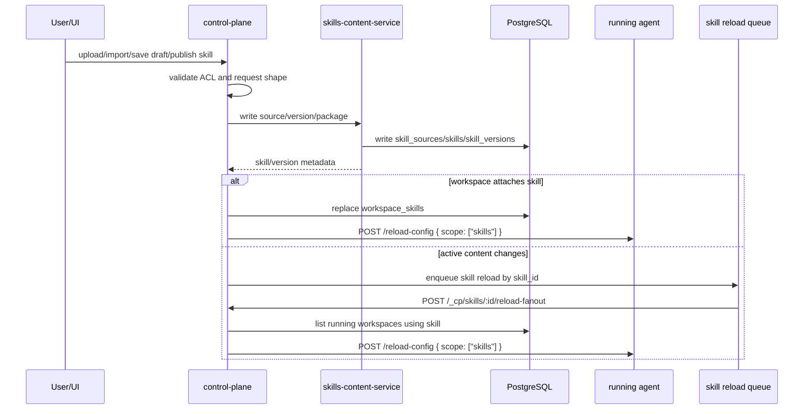

读完要能回答：

- 为什么 `skills` / `skill_versions` 由 SCS 写，而 `workspace_skills` 由 CP 写？
- workspace 启用 Skill 和 Skill 发布新版本，分别如何触发 agent reload？

## 第 9 步：看 agent 如何下载 Skills，以及编辑态如何保护草稿

学习内容总结：

agent 启动或 reload skills 时，会从 CP 拉 workspace 启用列表，再下载 active version package，解压到本地，最后通过 symlink 暴露给 Codex。编辑态使用 `.editing` 锁和 workspace 持久目录，避免 reload 覆盖草稿。

需要查看的代码：

| 文件 | 行数范围 | 看什么 |
| --- | --- | --- |
| `D:/Code/koala/agent-platform/agents/codex/src/config.ts` | 224-264 | TS `loadSkills()` 初始化 `SkillManager` 的目录参数 |
| `D:/Code/koala/agent-platform/internal/agent-skills/src/index.ts` | 58-105 | `SkillManager` 配置项、`.editing` 锁常量 |
| `D:/Code/koala/agent-platform/internal/agent-skills/src/index.ts` | 131-245 | `SkillManager` 构造和目录计算：`skillsDir`、`localBase`、`draftBase`、symlink |
| `D:/Code/koala/agent-platform/internal/agent-skills/src/index.ts` | 323-465 | `load()` 主流程：拉列表、pre-sweep、跳过 editing、下载、清理 |
| `D:/Code/koala/agent-platform/internal/agent-skills/src/index.ts` | 644-705 | 进入/退出 editing，草稿目录和 `.editing` 文件 |
| `D:/Code/koala/agent-platform/internal/agent-skills/src/routes.ts` | 64-80 | agent 本地 skills 编辑路由如何切换 editing 状态 |
| `D:/Code/media/media_agent/media_agents/codex/config.py` | 120-123 | Python 版 `load_skills()` 当前只是占位 |

业务时序图：

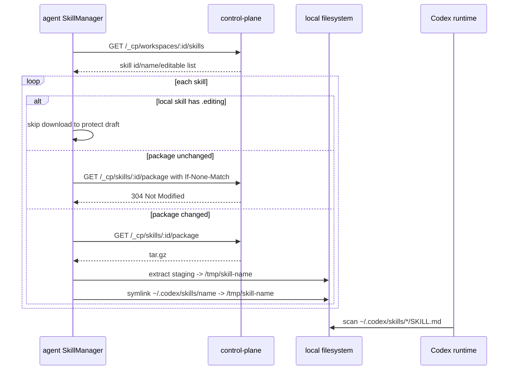

读完要能回答：

- 发布态为什么可以放 `/tmp`？草稿态为什么要放 workspace 持久目录？
- `.editing` 解决的是并发问题、数据安全问题，还是版本问题？
- Python 版要补齐 Skills，需要补哪些模块？

## 第 10 步：看 credentials 的写入、过滤和 agent 注入

学习内容总结：

credentials 是用户级资源，不是 workspace_config 字段。它通过 `scope=global/selected` 决定哪些 workspace 可见。用户 API 写入时加密保存，agent-facing internal API 拉取时解密返回给 agent 注入。

需要查看的代码：

| 文件 | 行数范围 | 看什么 |
| --- | --- | --- |
| `D:/Code/koala/agent-platform/control-plane/src/routes/credentials.ts` | 26-31 | 用户凭据变化后 reload 该用户所有 running workspaces |
| `D:/Code/koala/agent-platform/control-plane/src/routes/credentials.ts` | 51-159 | list/upsert/delete 用户 API |
| `D:/Code/koala/agent-platform/control-plane/src/services/db/credentials.ts` | 38-62 | `listWorkspaceCredentials()` 如何按 workspace 和 scope 过滤，并解密 value |
| `D:/Code/koala/agent-platform/control-plane/src/services/db/credentials.ts` | 64-101 | `upsertUserCredential()` 加密写入和 selected workspace 关系维护 |
| `D:/Code/koala/agent-platform/control-plane/src/services/db/credentials.ts` | 118-133 | soft delete / hard delete |
| `D:/Code/koala/agent-platform/control-plane/src/lib/reconcile.ts` | 130-155 | deleting credentials 的后台 reconcile |
| `D:/Code/koala/agent-platform/control-plane/src/routes/internal.ts` | 566-579 | agent-facing `GET /_cp/workspaces/:id/credentials` |
| `D:/Code/media/media_agent/media_agents/codex/config.py` | 124-134 | Python `load_credentials()` 调 CP client 并注入 |

业务时序图：

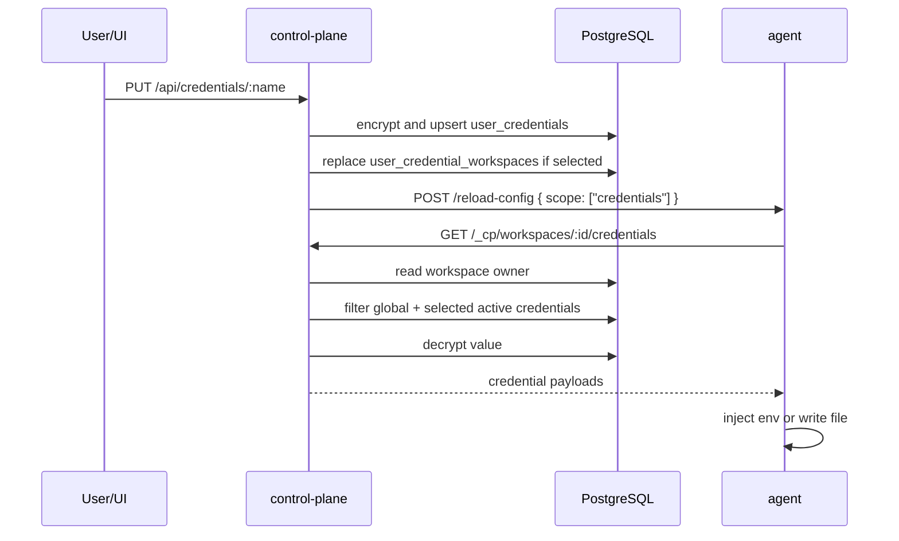

读完要能回答：

- 为什么用户侧 list credentials 不能返回明文，而 agent-facing API 可以？
- soft delete 为什么要等 running workspace reload 后再 hard delete？

## 第 11 步：看 ACP bridge、session 和 reload-config

学习内容总结：

agent server 对外暴露 chat/reconnect/interrupt/reload-config 等接口。真正和 Codex CLI/ACP 通信的是 bridge。reload-config 会按 scope 选择性刷新 config、skills、credentials，并在必要时重启 bridge。

需要查看的代码：

| 文件 | 行数范围 | 看什么 |
| --- | --- | --- |
| `D:/Code/media/media_agent/media_agents/adapter/biz/api/v1/routes/acp/router.py` | 37-104 | health/info/chat 路由，chat 如何启动 session turn 和 SSE |
| `D:/Code/media/media_agent/media_agents/adapter/biz/api/v1/routes/acp/router.py` | 107-136 | reconnect 和 interrupt |
| `D:/Code/media/media_agent/media_agents/adapter/biz/api/v1/routes/acp/router.py` | 139-173 | `/reload-config` 按 scope 调 hooks，并在 config/credentials 变化后 restart bridge |
| `D:/Code/media/media_agent/media_agents/adapter/biz/service/acp/service.py` | 17-70 | `SessionManager` 如何创建/复用 session 和 bridge |
| `D:/Code/media/media_agent/media_agents/adapter/biz/domain/acp_adapter/bridge.py` | 38-121 | `AcpBridge` 启动进程、create/load session、等待 MCP ready |
| `D:/Code/media/media_agent/media_agents/adapter/biz/domain/acp_adapter/bridge.py` | 124-149 | prompt/cancel/destroy |
| `D:/Code/media/media_agent/media_agents/adapter/biz/domain/acp_adapter/session.py` | 159-290 | `AcpSession` 的 stream、permission、run_turn、usage record |
| `D:/Code/media/media_agent/media_agents/codex/bridge.py` | 11-36 | Codex bridge 默认 program/env/cwd 设置 |
| `D:/Code/media/media_agent/media_agents/codex/config.py` | 136-143 | `restart_bridge()` 和 usage 记录 hook |

业务时序图：

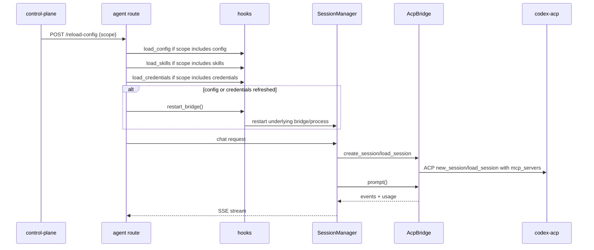

读完要能回答：

- reload skills 为什么不一定需要 restart bridge？
- create session 和 load session 的区别是什么？
- usage 是在哪里从 turn 结果里记录下来的？

## 第 12 步：看 usage 为什么是 control-plane pull

学习内容总结：

usage 不是启动配置，它是运行后产生的账本。agent 暴露 `/usage`，control-plane 定期或会话结束时来拉，写入 `workspace_usage_events`，并用 cursor 避免重复全量扫描。

需要查看的代码：

| 文件 | 行数范围 | 看什么 |
| --- | --- | --- |
| `D:/Code/koala/agent-platform/agents/codex/src/server.ts` | 49-61 | TS agent 注册 `/usage` pull endpoint |
| `D:/Code/media/media_agent/media_agents/codex/main.py` | 53-60 | Python agent 注册 usage router |
| `D:/Code/media/media_agent/media_agents/adapter/biz/api/v1/routes/usage/router.py` | 14-35 | `/usage` 接收 cursor，调用 sweep |
| `D:/Code/media/media_agent/media_agents/adapter/biz/service/usage/usage.py` | 63-143 | 解析 Codex rollout usage 记录 |
| `D:/Code/media/media_agent/media_agents/adapter/biz/service/usage/usage.py` | 145-181 | `sweep_usage()` 增量扫描和 cursor |
| `D:/Code/koala/agent-platform/control-plane/src/services/db/workspace-usage.ts` | 1-120 | control-plane 侧 usage records/cursor 写入逻辑 |

业务时序图：

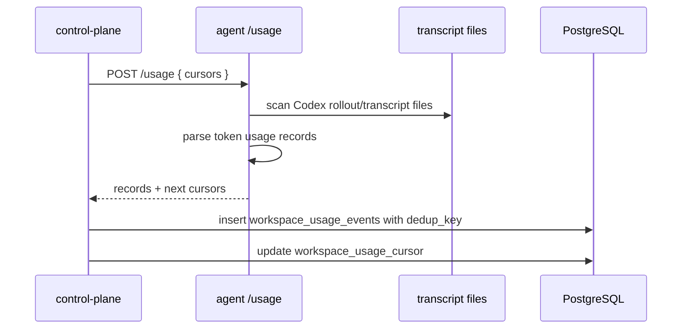

读完要能回答：

- usage 为什么不作为 agent 主动上报？
- `dedup_key` 和 cursor 分别解决什么重复问题？

## 第 13 步：最后复盘 Python 版和 TS 版差异

学习内容总结：

把完整链路和本仓库 Python 实现对齐。Python 版已经有通用 adapter、Codex config 落盘、MCP session declaration、credentials 注入、usage sweep，但 Skills 下载/编辑态/本地 routes 还没有接上。

需要查看的代码：

| 文件 | 行数范围 | 看什么 |
| --- | --- | --- |
| `D:/Code/media/media_agent/media_agents/codex/config.py` | 98-118 | Python 已实现 config 落盘 |
| `D:/Code/media/media_agent/media_agents/codex/config.py` | 120-123 | Python `load_skills()` 仍是 skip |
| `D:/Code/media/media_agent/media_agents/adapter/clients/cp.py` | 59-77 | Python CP client 当前只有 config 和 credentials API |
| `D:/Code/media/media_agent/media_agents/codex/config.py` | 85-93 | Python 已能构造 MCP servers 给 ACP session |
| `D:/Code/media/media_agent/media_agents/adapter/biz/api/v1/routes/acp/router.py` | 139-173 | Python reload-config 已有 scope 分发框架 |
| `D:/Code/koala/agent-platform/internal/agent-skills/src/index.ts` | 323-705 | 如果要补 Python Skills，最应该参考的 TS 行为 |

复盘清单：

| 能力 | TS Codex agent | Python Codex agent |
| --- | --- | --- |
| 拉 workspace config | 已实现 | 已实现 |
| 写 `AGENTS.md` / `runtime.json` / `config.toml` / `auth.json` | 已实现 | 已实现 |
| stdio MCP 静态写入 | 已实现 | 已实现 |
| HTTP MCP session 动态挂载 | 已实现 | 已实现基础结构 |
| Skills list/package 下载 | 已实现 | 未实现 |
| Skills `.editing` 保护草稿 | 已实现 | 未实现 |
| Credentials 注入 | 已实现 | 已实现 |
| ACP bridge/session | 已实现 | 已实现 |
| Usage pull endpoint | 已实现 | 已实现 |

读完要能回答：

- 如果你要补 Python Skills，应该先补 CP client、SkillManager、还是本地 routes？为什么？
- Python 的 hooks 抽象是否足够承载 TS 版 SkillManager 的行为？

## 建议学习节奏

第一轮只读主线：第 1、2、4、5、6、11 步。目标是知道请求从哪里来、配置在哪里合并、agent 怎么启动。

第二轮读能力分支：第 7、8、9、10 步。目标是分清 MCP、Skills、credentials 三种“能力”的不同落地形态。

第三轮读运行闭环：第 3、12、13 步。目标是理解热更新、usage 回收，以及 Python 版还缺什么。

## 读代码时的检查问题

每读完一个文件，用下面五个问题检查自己：

1. 这个文件处理的是用户 API、internal API，还是 agent 本地逻辑？
2. 输入是什么？是 HTTP body、数据库行、CP payload，还是本地文件？
3. 它查了哪些表，或者调用了哪个服务？
4. 输出是什么？写数据库、返回 payload、写本地文件、启动进程，还是通知 reload？
5. 这个动作发生在启动前、启动中、session 创建时，还是运行后采集时？

只要这五个问题能答清楚，control-plane 到 agent 启动的链路就不会乱。

