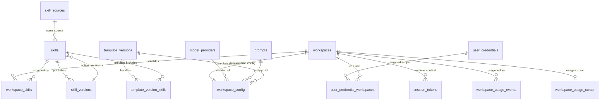
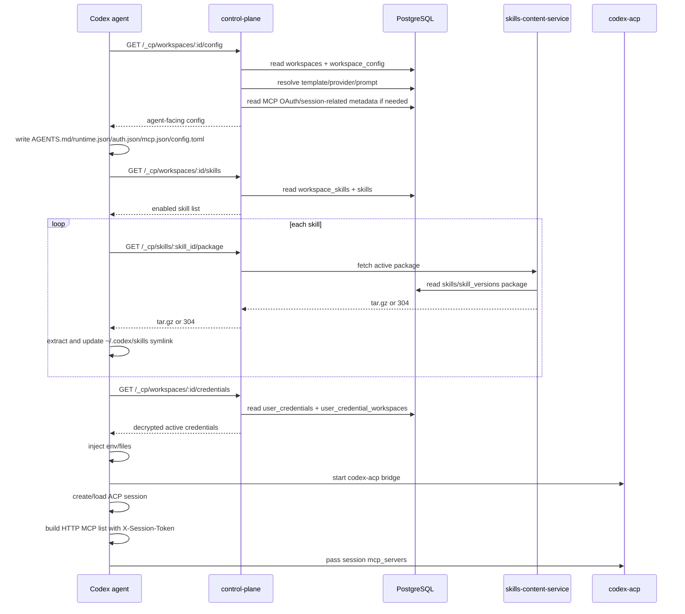

# 如何理解 Codex agent 启动过程

这份文档不是继续补字段清单，而是换一个初学者视角，把 `mcp.md`、`skills.md`、`other_content.md` 三份文档串起来。你可以把它当成一张“读图指南”：先理解主线，再把 MCP、Skills、凭据这些分支挂到主线上。

## 先抓住一句话

Codex agent 启动的本质是：

> control-plane 保存“这个 workspace 应该长什么样”，agent 启动后把这些远端配置拉下来，转换成本地 Codex 能理解的文件、目录、环境变量和 session 参数。

所以不要一开始就陷进每张表的字段里。先问三个问题：

1. 这个东西是谁的？
2. 它在数据库里是“资源本体”，还是“workspace 挂载关系”？
3. agent 最后把它变成了哪个本地文件、目录或运行时参数？

大多数复杂逻辑都能用这三个问题拆开。

## 启动主线

Codex agent 启动时可以按这个顺序理解：

```text
workspace id
  |
  v
control-plane internal API
  |
  +-- GET /_cp/workspaces/:id/config
  |      -> prompt / model / provider / MCP / agent_settings
  |
  +-- GET /_cp/workspaces/:id/skills
  |      -> 当前 workspace 启用的 skills
  |
  +-- GET /_cp/workspaces/:id/credentials
         -> 当前 workspace 可用的凭据

agent 本地转换
  |
  +-- /workspace/AGENTS.md
  +-- /workspace/runtime.json
  +-- ~/.codex/config.toml
  +-- ~/.codex/auth.json
  +-- ~/.codex/skills/*
  +-- 进程环境变量 / 凭据文件

启动 codex-acp bridge
  |
  v
每个 ACP session 再动态挂 HTTP MCP
```

这里有一个关键点：agent 不是直接消费数据库。agent 只消费 control-plane 暴露的 internal API。数据库表之间的复杂关系，会先在 control-plane 里被解析成 agent-facing payload。

## 把表分成三类

看这些表时，不要把它们都当成同一层级。建议分成三类。

| 类型 | 作用 | 典型表 | 怎么理解 |
| --- | --- | --- | --- |
| workspace 身份 | 说明工作区是谁、什么状态、是否运行 | `workspaces` | 这是入口，`WORKSPACE_ID` 就来自这里 |
| workspace 配置 | 说明这个工作区要用什么 agent、模型、prompt、MCP | `workspace_config` | 这是启动配置的中心表 |
| 可复用资源 | 说明平台里有哪些可被引用的资源 | `model_providers`、`prompts`、`skills`、`skill_versions`、`user_credentials`、`mcp_catalog` | 它们不是天然属于某个 workspace，通常需要被引用或挂载 |
| 挂载关系 | 说明某个 workspace 启用了哪些资源 | `workspace_skills`、`user_credential_workspaces`、`template_version_skills` | 这是“把资源接到 workspace 上”的桥 |
| 运行时账本 | 记录运行过程中产生的数据 | `session_tokens`、`workspace_usage_events`、`workspace_usage_cursor` | 不是启动配置本体，而是运行时上下文或审计记录 |

初学时最容易混淆的是“资源本体”和“挂载关系”：

- `skills` / `skill_versions` 是 Skill 本体和版本。
- `workspace_skills` 才表示某个 workspace 启用了哪些 Skill。
- `model_providers` 是 provider 资源。
- `workspace_config.provider_id` 表示某个 workspace 引用了哪个 provider。
- `mcp_catalog` 是 MCP 推荐目录，不是 workspace 真正启用的 MCP 清单。
- `workspace_config.mcp_config` 才是 workspace 实际 MCP 配置。

## 以 workspace_config 为中心看配置

如果只记一张表，先记 `workspace_config`。

它像一张工作区启动清单，里面直接或间接决定：

- 用哪个 agent：`agent_type`
- 用哪个模型：`model`、`small_model`
- 模型连接信息从哪里来：`provider_id` 或内联的 `provider_type` / `base_url` / `api_key`
- prompt 从哪里来：`prompt_id` 或 `system_prompt`
- MCP 配置是什么：`mcp_config`
- Codex 额外配置是什么：`agent_settings`
- 是否继承模板：`template_id` / `template_version`

但 agent 拿到的不是数据库原始行，而是 control-plane 的 `getWorkspaceConfig()` 解析结果。这里会发生几件事：

- 如果配置来自模板，模板值先作为默认值。
- workspace 自己配置了非空值，就覆盖模板值。
- 如果有 `provider_id`，会联表读取 `model_providers`。
- 如果有 `prompt_id`，会联表读取 prompt 内容，并返回 `prompt_content`。
- `prompt_content` 优先于 `system_prompt` 写入 `/workspace/AGENTS.md`。
- `mcp_config` 会被加工，例如为 HTTP MCP 注入 workspace header 或改写成 OAuth proxy URL。

所以你看代码时要分清两层：

- 数据库存的是“原始配置和引用关系”。
- agent-facing config 是“已经解析好的运行视图”。

## 表关系图

下面这张图只画“启动和 reload 时最相关”的关系。箭头的意思不是都一样：有的是外键引用，有的是运行时解析，有的是挂载关系。



如果 Mermaid 不方便渲染，可以看这张简化箭头图：

```text
                              +------------------+
                              | model_providers  |
                              +---------^--------+
                                        |
                                        | workspace_config.provider_id
                                        |
+------------+ 1:1  +-------------------+-------------------+
| workspaces |----->| workspace_config                       |
+-----+------+      | agent/model/prompt/mcp/settings/template|
      |             +----+----------------------+-------------+
      |                  |                      |
      |                  | prompt_id            | template_id/version
      |                  v                      v
      |             +---------+          +------------------+
      |             | prompts |          | template_versions|
      |             +---------+          +--------+---------+
      |                                      includes
      |                                         |
      |                                         v
      |                              +-------------------------+
      |                              | template_version_skills |
      |                              +-----------+-------------+
      |                                          |
      |                                          v
      |    enables                         +-----+---------+
      +------------------------------->    | workspace_skills|
      |                                    +-----+---------+
      |                                          |
      |                                          v
      |                               +----------+------+
      |                               | skills          |
      |                               | active_version  |
      |                               +-----+-----+-----+
      |                                     |     |
      |                         source_id   |     | active_version_id
      |                                     v     v
      |                         +--------------+  +----------------+
      |                         | skill_sources|  | skill_versions |
      |                         +--------------+  | package tar.gz |
      |                                           +----------------+
      |
      | credentials selected scope
      v
+----------------------------+      +------------------+
| user_credential_workspaces |----->| user_credentials |
+----------------------------+      +------------------+

+------------+      +----------------+      +------------------------+
| workspaces |----->| session_tokens |      | workspace_usage_events |
+------------+      +----------------+      +------------------------+
```

### 关系逐条解释

| 关系 | 类型 | 含义 | 什么时候用 |
| --- | --- | --- | --- |
| `workspaces.id -> workspace_config.workspace_id` | 1:1 配置 | 一个 workspace 有一份主要 agent 配置 | `GET /_cp/workspaces/:id/config` |
| `workspace_config.provider_id -> model_providers.id` | 可选引用 | workspace 可以引用一个 provider library 里的模型供应商 | 生成 `base_url`、`api_key`、`provider_type` |
| `workspace_config.prompt_id -> prompts.id` | 可选引用 | workspace 可以引用 prompt library | 解析出 `prompt_content` |
| `workspace_config.template_id/template_version -> template_versions` | 默认值来源 | workspace 使用模板时，从模板版本继承 agent/model/prompt/settings 等默认值 | `getWorkspaceConfig()` 合并配置 |
| `workspace_config.mcp_config` | 内联配置 | MCP 实际启用清单直接存在这里，不通过关系表 | 生成 `~/.codex/mcp.json`、`config.toml`、HTTP MCP session 参数 |
| `workspace_skills.workspace_id -> workspaces.id` | 挂载关系 | 说明 workspace 启用了哪些 Skill | `GET /_cp/workspaces/:id/skills` |
| `workspace_skills.skill_id -> skills.id` | 挂载关系 | 连接 workspace 和 Skill 本体 | 下载 Skill 前先拿到 skill id/name |
| `skills.source_id -> skill_sources.id` | 来源引用 | 说明 Skill 来自 native 草稿还是 Git 仓库 | 管理、同步、发布 Skill 时使用 |
| `skills.active_version_id -> skill_versions.id` | 当前版本指针 | 说明 agent 应该下载哪个发布版本 | `GET /_cp/skills/:id/package` |
| `template_version_skills -> skills` | 模板挂载 | 模板版本内置的 Skills | 创建/解析模板 workspace 时使用 |
| `user_credentials -> user_credential_workspaces` | selected scope 关系 | 凭据如果只给部分 workspace 用，就靠这张关系表过滤 | `GET /_cp/workspaces/:id/credentials` |
| `session_tokens.token -> workspace/session` | 运行时反查 | agent 只带 opaque token，CP 反查 workspace/session 上下文 | MCP 请求、平台工具、proxy |
| `workspace_usage_events` | append-only 账本 | 保存 agent 运行后的 token 使用量 | control-plane 调 agent `/usage` 后写入 |
| `workspace_usage_cursor` | 增量游标 | 记录 usage 已采集到哪里 | 下次采集 usage 时避免全量扫 |

### 用四个中心点理解关系

第一，`workspaces` 是身份中心。几乎所有启动数据都要先知道当前 `WORKSPACE_ID`。

第二，`workspace_config` 是配置中心。模型、prompt、MCP、agent settings、模板继承都在这里汇合，然后由 control-plane 解析成 agent-facing config。

第三，`skills` 是资源中心，但 `workspace_skills` 才是挂载中心。不要把“平台里有哪些 Skill”和“这个 workspace 启用了哪些 Skill”混在一起。

第四，`user_credentials` 是用户级资源。它不是 workspace 配置的一部分，但 agent 拉 credentials 时会按 workspace owner 和 scope 过滤出当前 workspace 可用的凭据。

## 数据 load 顺序

从 agent 视角看，启动时是“先配置、再能力、再凭据、最后启动 bridge”。更细一点可以分成 control-plane 内部解析顺序和 agent 本地落盘顺序。

### 1. control-plane 解析 config

当 agent 请求：

```text
GET /_cp/workspaces/:id/config
```

control-plane 大致按下面顺序准备响应：

```text
1. 根据 workspace id 读取 workspaces
   - 确认 workspace 存在
   - 拿到 owner user_id、status、runtime 信息

2. 读取 workspace_config
   - 拿到 agent_type、model、provider_id、prompt_id、mcp_config、agent_settings 等

3. 如果 workspace 使用 template
   - 读取 template_versions
   - 把模板里的默认 agent/model/prompt/settings/compute_resources 作为 fallback
   - workspace 自己的非空配置覆盖模板默认值

4. 如果有 provider_id
   - 读取 model_providers
   - 用 provider 表里的 provider_type/base_url/api_key 补全模型连接信息

5. 如果有 prompt_id
   - 读取 prompts / prompt_versions
   - 解析出 prompt_content
   - agent 后续优先用 prompt_content，而不是 system_prompt

6. 处理 mcp_config
   - 解析 JSON 字符串
   - 对 HTTP MCP 注入 X-Workspace-ID / X-Agent-ID
   - 如果有 OAuth token，改写成 CP proxy URL
   - 不在这里静态注入 tos-platform

7. 附加 platform prompt 所需上下文
   - user_display_name
   - memory_attachments

8. 返回 agent-facing config payload
```

这一步完成后，agent 已经不需要知道 provider、prompt、template 的原始表结构。它拿到的是一份“能落盘”的配置视图。

### 2. agent 落盘 config

agent 拿到 config payload 后，按本地消费者需要写文件：

```text
1. 写 /workspace/AGENTS.md
   - 内容 = prompt_content || system_prompt

2. 写 /workspace/runtime.json
   - model
   - provider_type
   - base_url
   - small_model

3. 写 ~/.codex/auth.json
   - 如果有 api_key，写 OPENAI_API_KEY

4. 写 ~/.codex/mcp.json
   - 保存规范化后的 mcpServers JSON

5. 写 ~/.codex/config.toml
   - model_provider
   - model
   - custom provider
   - sandbox / approval / features
   - stdio MCP
   - agent_settings TOML 片段
```

这里注意 MCP 的第一次分流：

- stdio MCP 在这一步进入 `config.toml`。
- HTTP MCP 不在这一步静态进入 `config.toml`，它会等 session 创建时动态传入。

### 3. agent load skills

配置落盘后，TypeScript 版 Codex agent 会 load Skills：

```text
1. GET /_cp/workspaces/:id/skills
   - CP 查 workspace_skills
   - 关联 skills
   - 返回当前 workspace 启用的 skill id/name/editable/gitSource

2. 对每个 skill：
   GET /_cp/skills/:skill_id/package
   - CP/SCS 根据 skills.active_version_id 找到 skill_versions.package
   - 返回 active version tar.gz
   - 如果 ETag 命中，返回 304，agent 跳过解压

3. agent 解压 package
   - staging -> /tmp/skill-{name}

4. agent 刷新 symlink
   - ~/.codex/skills/{name} -> /tmp/skill-{name}

5. agent 安装 __platform__ skill
   - 写入 ~/.codex/skills/__platform__
```

如果某个 Skill 处于编辑态：

```text
~/.codex/skills/{name}
  -> {WORKSPACE_DIR}/.skills-draft/skill-{name}

{WORKSPACE_DIR}/.skills-draft/skill-{name}/.editing
```

reload skills 时 agent 会跳过这个 Skill，避免覆盖正在编辑的草稿。

当前 Python 版这里还没有实现完整链路：`load_skills()` 仍是 skip。也就是说，Python 版目前只有生命周期钩子位置，还没真正执行上述下载、解压、symlink。

### 4. agent load credentials

接着 agent 请求：

```text
GET /_cp/workspaces/:id/credentials
```

control-plane 的过滤逻辑可以这样理解：

```text
1. 根据 workspace id 找 workspace owner

2. 读取该 owner 的 user_credentials

3. 保留 active credential

4. scope = global
   - 所有 workspace 都可用

5. scope = selected
   - 必须在 user_credential_workspaces 中关联当前 workspace

6. 返回给 agent 时解密 value
```

agent 本地再按 `inject` 字段处理：

```text
inject = env
  -> 写当前进程环境变量
  -> 写 ~/.agent-credentials.env
  -> 配 BASH_ENV，方便新 shell 继承

inject = file
  -> 展开 ~/ 到 HOME
  -> 写目标文件
  -> chmod 到指定 mode，默认 0600
```

### 5. 启动 bridge 和 session 级 MCP

最后 agent 启动 `codex-acp` bridge。到这里，Codex 已经能看到基础配置和本地 Skills。

但 HTTP MCP 要等 ACP session 创建或加载时才挂：

```text
1. create_session / load_session

2. agent 为本次 session 生成或拿到 X-Session-Token

3. hooks.load_mcp_servers(session_token)
   - 先加入 tos-platform
   - 再加入用户配置里的 HTTP MCP
   - 给 HTTP MCP headers 追加 X-Session-Token

4. 把 mcp_servers 参数传给 codex-acp

5. codex-acp 在该 session 内暴露这些 MCP tools
```

这就是为什么 HTTP MCP 的 load 顺序看起来比其他配置晚：它不是“进程级配置”，而是“session 级工具挂载”。

## 一张总顺序图



## 按“谁在什么时候查表”记忆

| 阶段 | 谁查表 | 主要表 | 产物 |
| --- | --- | --- | --- |
| config API | control-plane | `workspaces`、`workspace_config`、`model_providers`、`prompts`、`template_versions`、`mcp_oauth_*` | agent-facing config payload |
| config 落盘 | agent | 不查表 | `AGENTS.md`、`runtime.json`、`auth.json`、`mcp.json`、`config.toml` |
| skills list | control-plane | `workspace_skills`、`skills` | enabled skills list |
| skills package | SCS/control-plane | `skills`、`skill_versions`、`skill_sources` | active version tar.gz |
| skills 落盘 | agent | 不查表 | `~/.codex/skills/*` |
| credentials API | control-plane | `user_credentials`、`user_credential_workspaces`、`workspaces` | decrypted credentials |
| credentials 注入 | agent | 不查表 | env、`~/.agent-credentials.env`、credential files |
| session MCP | agent/control-plane | `session_tokens`，必要时 `mcp_oauth_tokens` | session 级 MCP tools |
| usage 采集 | control-plane 拉 agent 后写表 | `workspace_usage_events`、`workspace_usage_cursor` | usage ledger |

## 三条分支分别解决什么问题

可以把 agent 启动配置拆成三条分支。

### 1. other_content：让 Codex 知道怎么运行

这条分支解决的是基础运行问题：

- 用什么模型？
- API key 和 base URL 是什么？
- workspace prompt 是什么？
- Codex 原生 `config.toml` 应该长什么样？
- 凭据应该注入到环境变量还是文件？

最后主要落成本地这些东西：

| 本地位置 | 作用 |
| --- | --- |
| `/workspace/AGENTS.md` | workspace 级系统提示词 |
| `/workspace/runtime.json` | 给 agent server/usage/provider 注入逻辑共享的运行时信息 |
| `~/.codex/config.toml` | Codex CLI/ACP 原生配置 |
| `~/.codex/auth.json` | OpenAI-compatible API key |
| `~/.agent-credentials.env` | env 型用户凭据 |

这条线是最基础的。没有它，Codex 不知道用什么模型、读什么 prompt、带什么 key 启动。

### 2. MCP：让 Codex 多一些工具

MCP 的核心不是“下载资源”，而是“把工具 server 挂给 session”。

MCP 有两类：

| 类型 | 存在哪里 | agent 怎么处理 | 为什么这样 |
| --- | --- | --- | --- |
| stdio MCP | `workspace_config.mcp_config` | 写进 `~/.codex/config.toml` 的 `[mcp_servers.*]` | 它是本地命令，适合静态配置 |
| HTTP MCP | `workspace_config.mcp_config` | session 创建时作为 `mcp_servers` 参数传给 `codex-acp` | 它需要带 session token，适合动态挂载 |

这里最重要的特殊逻辑是 HTTP MCP 不静态写入 `config.toml`。原因是每个会话都可能有不同的 `X-Session-Token`。这个 token 会被 control-plane 解析成 workspace/session/task 上下文，用于平台 MCP 和 OAuth proxy。

`tos-platform` 也要按这个思路理解：它不是来自 `mcp_catalog`，也不是静态写入数据库的 workspace MCP。它是 agent 在每个 session 构造时主动加上的平台 MCP：

```text
{CP_URL}/mcp + X-Workspace-ID + X-Agent-ID + X-Session-Token
```

### 3. Skills：让 Codex 多一些说明书和流程

Skills 和 MCP 不一样。MCP 是运行时工具 server；Skill 是本地文件目录，核心是 `SKILL.md`。

Skill 链路可以按“资源本体”和“挂载关系”理解：

```text
skill_sources
  |
  v
skills
  |
  v
skill_versions

workspace_skills
  |
  v
某个 workspace 启用了哪些 skill id
```

具体含义是：

- `skill_sources`：这个 Skill 从哪里来，是 native 上传还是 Git 导入。
- `skills`：Skill 的名字、描述、owner、可见性，以及当前 active version 指针。
- `skill_versions`：每次发布后的不可变 tar.gz 快照。
- `workspace_skills`：某个 workspace 当前启用了哪些 Skill。

agent 启动时不需要理解 Skill 的编辑历史。它只需要：

1. 问 control-plane：这个 workspace 启用了哪些 skill？
2. 对每个 skill id 下载当前 active version 的 package。
3. 解压到本地。
4. 让 `~/.codex/skills/{name}` 指向解压目录。
5. Codex 运行时扫描 `~/.codex/skills`，读取 `SKILL.md`。

所以 Skill 的运行时本质是“远端版本化资源被 materialize 成本地目录”。

## 重点理解 Skills 的编辑态

编辑态 Skills 看起来复杂，是因为它同时满足两个目标：

1. 已发布版本要稳定、可复现。
2. 用户正在编辑的草稿不能被 reload 覆盖。

因此它有两套路劲。

| 状态 | 实际内容位置 | `~/.codex/skills/{name}` 指向 | 特点 |
| --- | --- | --- | --- |
| 发布态 | `/tmp/skill-{name}` | 发布版解压目录 | 来自 active version tar.gz，可通过 ETag 跳过重复下载 |
| 草稿态 | `{WORKSPACE_DIR}/.skills-draft/skill-{name}` | 草稿目录 | 放在 workspace 持久卷，带 `.editing` 锁 |

`.editing` 文件可以理解成一个“不要碰”的标记。agent reload 时如果看到某个 skill 处于编辑中，就跳过它，避免把用户正在改的草稿用远端 active version 覆盖掉。

为什么发布态放 `/tmp`，草稿态放 workspace？

- 发布态可以从 control-plane/SCS 重新下载，丢了也能恢复，所以放 `/tmp`，减少持久卷小文件开销。
- 草稿态是用户正在编辑的内容，可能还没发布，不能因为 pod rebuild 或 reload 丢失，所以放 workspace 持久卷。

这就是编辑态 Skills 的核心逻辑：发布版追求可重建，草稿版追求不丢失。

## reload 时分别刷新什么

不要把 reload 理解成一个动作。它通常是几类动作：

| reload 类型 | 触发原因 | agent 刷新内容 |
| --- | --- | --- |
| reload config | workspace 配置变化，例如模型、prompt、MCP、agent_settings | 重新拉 `/_cp/workspaces/:id/config`，重写本地 Codex 配置 |
| reload skills | workspace 启用 Skills 变化，或某个 Skill 发布了新 active version | 重新拉 skills 列表和 package，刷新 `~/.codex/skills` |
| reload credentials | 用户凭据变化 | 重新拉 credentials，更新 env 或文件 |
| rebuild | agent 类型或镜像相关配置变化 | 重建容器，而不是单纯热加载 |

这样理解后，control-plane 的职责就清楚了：它先写数据库，然后根据 workspace 是否运行、变化类型是什么，决定通知 agent 热加载还是重建。

## 一个完整例子

假设用户创建了一个 Codex workspace，配置了：

- 使用某个 OpenAI-compatible provider。
- 选择了一个 prompt。
- 启用了两个 Skills。
- 配置了一个 HTTP MCP。
- 配了一个环境变量凭据。

启动过程可以这样读：

1. `workspaces` 里有 workspace 身份和运行状态。
2. `workspace_config` 里记录 agent、provider、prompt、MCP 等配置。
3. `workspace_config.provider_id` 指向 `model_providers`，control-plane 解析出 `base_url` 和 `api_key`。
4. `workspace_config.prompt_id` 指向 prompt library，control-plane 解析出 `prompt_content`。
5. `workspace_skills` 记录这个 workspace 启用了哪两个 Skill。
6. `skills.active_version_id` 指向当前发布版本，`skill_versions.package` 保存 tar.gz。
7. `user_credentials` 保存加密凭据，`user_credential_workspaces` 决定这个 workspace 能不能用。
8. agent 拉 config，写 `AGENTS.md`、`runtime.json`、`config.toml`、`auth.json`。
9. agent 拉 skills，下载 tar.gz，解压并刷新 `~/.codex/skills/*`。
10. agent 拉 credentials，注入环境变量或写文件。
11. agent 启动 `codex-acp`。
12. 创建 ACP session 时，agent 把 HTTP MCP 和 `X-Session-Token` 动态传进去。

这个例子里，真正进入 Codex 推理路径的是本地结果：

- prompt 变成了 `/workspace/AGENTS.md`。
- provider/model 变成了 `config.toml`、`auth.json` 和 env。
- Skills 变成了 `~/.codex/skills/*/SKILL.md`。
- HTTP MCP 变成了 session 参数。
- credentials 变成了 env 或文件。

## 推荐阅读顺序

建议按这个顺序读三份原文：

1. 先读 `other_content.md` 的“总体流程”和“Agent 下载与本地落盘”。这是主线。
2. 再读 `mcp.md`，重点看 HTTP MCP 和 stdio MCP 为什么分流。
3. 最后读 `skills.md`，重点看 `skills` / `skill_versions` / `workspace_skills` 的关系，以及编辑态 `.editing`。

读表关系时不要先背字段，先画箭头：

```text
workspace_config.provider_id -> model_providers.id
workspace_config.prompt_id   -> prompts.id
workspace_skills.skill_id    -> skills.id
skills.active_version_id     -> skill_versions.id
user_credential_workspaces   -> user_credentials
session_tokens.token         -> workspace/session context
```

只要能说清楚“这个箭头代表引用、继承、挂载还是运行时反查”，整个启动过程就基本通了。

## 最容易误解的点

- `mcp_catalog` 不是实际启用列表。实际启用的用户 MCP 在 `workspace_config.mcp_config`。
- HTTP MCP 不等于 stdio MCP。前者 session 动态挂载，后者写入 Codex 静态配置。
- `tos-platform` 不是用户配置的 MCP，而是 agent 每个 session 自动挂的平台 MCP。
- Skill 的名字用于本地目录展示，但下载和引用要靠 UUID。
- `skills` 表不是“workspace 启用了哪些 skills”，`workspace_skills` 才是。
- `skill_versions` 是发布快照。agent 下载的是 active version 的 package，不是草稿。
- `.editing` 的意义是保护草稿，reload 时跳过正在编辑的 Skill。
- `prompt_content` 是 control-plane 联表解析出来的运行时内容，不是 `workspace_config` 的物理字段。
- credentials 对用户 API 不返回明文，但 agent-facing internal API 会解密后返回给 agent 注入。
- usage 不是启动配置。它是 control-plane 反向从 agent 拉取的运行账本。

## 一句话总结

理解 Codex agent 启动过程，不要从所有表同时入手，而要从 `workspace_config` 和 `WORKSPACE_ID` 入手：control-plane 根据 workspace id 拼出一份运行视图，agent 把这份运行视图变成本地 Codex 能消费的文件、目录、环境变量和 session 参数。MCP、Skills、credentials 的差异，只是“最后变成本地什么形态”不同。


