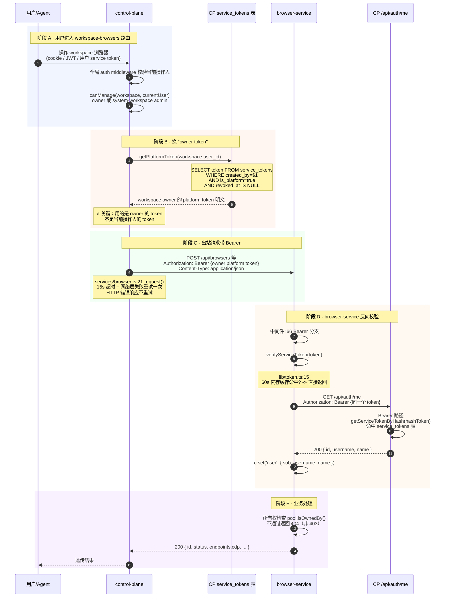

# Browser Service 鉴权两条路：control-plane 调用 & OAuth 登录

> 本文回答两个具体问题，所有结论都对源码行号负责：
> 1. **control-plane 请求 browser-service 的时候是如何鉴权的？**（service-to-service，机器对机器）
> 2. **browser-service 里的 OAuth 认证什么时候会使用？**（人对 UI 登录）
>
> 底层逻辑：browser-service 同时挂了两套独立鉴权--**NAP 平台 Service Token（Bearer）** 服务后端调用，**OAuth/PKCE + 本地 Session JWT（Cookie）** 服务人类用户登录自带 Web 控制台。两条路在 `browser-service/src/index.ts:52-97` 中间件里并列，互不交叉。

---

## 0. 一张图分清两条路

```
                       browser-service /api/*
                              │
            ┌─────────────────┴──────────────────┐
            ▼                                     ▼
   Bearer / ?token=                       browser_token cookie
   (service-to-service)                   (浏览器 UI)
            │                                     │
            ▼                                     ▼
   verifyServiceToken                    verifySessionToken
   = 反向回调 CP /api/auth/me              = 本地 HS256 JWT 验签
   = 查 service_tokens 表                  = 不调 CP
            │                                     │
            ▼                                     ▼
   来源：workspace owner 的                来源：用户走完 OAuth/PKCE
   is_platform=true service token         /api/auth/{login,callback} 后
   (control-plane 代用户调用)             由 browser-service 自己签发
```

| 维度 | Bearer / `?token=` | Cookie（`browser_token`） |
|------|---------------------|---------------------------|
| 谁在用 | control-plane / MCP / Agent / CI | 人类用户的浏览器 |
| 凭证类型 | NAP Service Token（`tos_` 前缀） | HS256 Session JWT |
| 签发方 | CP（`service_tokens` 表，`is_platform=true`） | browser-service 自己（`BROWSER_JWT_SECRET`） |
| 校验方 | browser-service -> CP `/api/auth/me` 反查 | browser-service 本地验签 |
| 触发场景 | 所有 API 调用、WebSocket upgrade、文件下载链接 | 用户打开 browser-service Web 控制台 |
| 寿命 | 永久（直到吊销） | 7 天 |

---

# 问题一：control-plane 请求 browser-service 时如何鉴权

## 1.1 链路全景（5 个环节）



## 1.2 五个环节逐个拆

### 环节 A：用户进入路由 + 权限校验

**代码**：`control-plane/src/routes/workspace-browsers.ts:32-53`

用户走 CP 全局 auth middleware（cookie / JWT / 用户自己 service token 任一）进入路由，先做 `canManage`：

```typescript
function canManage(workspace, user): boolean {
  return workspace.user_id === user.sub
      || (workspace.is_system && user.role === 'admin')
}
```

非 owner 且非 system-workspace admin 直接 404，不进入下一步。

### 环节 B：换 "owner token"（整条链路最关键的设计）

**代码**：`control-plane/src/routes/workspace-browsers.ts:14-18` + `control-plane/src/services/db/shares.ts:154-160`

```typescript
async function getOwnerToken(workspace: { user_id: string }): Promise<string> {
  const token = await getPlatformToken(workspace.user_id)
  if (!token) throw new Error('No platform token for workspace owner')
  return token
}
```

```sql
-- shares.ts:154 getPlatformToken
SELECT token FROM service_tokens
WHERE created_by = $1          -- $1 = workspace.user_id
  AND is_platform = true
  AND revoked_at IS NULL;
```

**底层逻辑**：用的不是当前操作人的 token，而是 **workspace 所有者**的 platform service token。这样即便 admin 代操作别人 workspace，对 browser-service 来说仍是 workspace owner 在调用，归属语义在 browser-service 侧保持一致。

如果 owner 还没有 platform token，由 `ensurePlatformToken`（`shares.ts:130-151`）自动创建一个 `tos_` 前缀、名为 `__platform__`、`is_platform=true` 的 token，**明文存库**（其他 service token 只存 SHA-256 hash，platform token 特殊）。

### 环境C：出站请求带 Bearer

**代码**：`control-plane/src/services/browser.ts:21-62`

```typescript
async function request<T>(token: string, path: string, opts?: RequestInit): Promise<T> {
  const fetchOnce = () =>
    fetch(`${BROWSER_SERVICE_URL}${path}`, {
      ...opts,
      signal: AbortSignal.timeout(REQUEST_TIMEOUT_MS),  // 15s
      headers: {
        'Content-Type': 'application/json',
        Authorization: `Bearer ${token}`,               // ← owner platform token
        ...opts?.headers,
      },
    })
  // 网络层失败（DNS/TCP/abort/timeout）重试一次；HTTP 错误响应不重试
  ...
}
```

**目标地址**：`BROWSER_SERVICE_URL`（默认 `http://nap-browser:3005`）。

**所有出站方法**（统一走这个 `request()`）：

| 函数 | HTTP | 路径 |
|------|------|------|
| `createBrowser` | POST | `/api/browsers` |
| `listBrowsers` | GET | `/api/browsers?metadata.{k}=v` |
| `getBrowser` | GET | `/api/browsers/:id` |
| `renewBrowser` | POST | `/api/browsers/:id/renew` |
| `deleteBrowser` | DELETE | `/api/browsers/:id` |
| `getCdpVersion` | GET | `/cdp/:id/json/version` |
| `listFiles` | GET | `/api/browsers/:id/files?path=...` |
| `buildFileDownloadUrl` | - | `/api/browsers/:id/files/content?path=...&token=...`（构造可分享链接，走 `?token=` fallback） |

### 环节 D：browser-service 反向回调 CP 校验

**代码**：`browser-service/src/index.ts:65-74` + `browser-service/src/lib/token.ts:15-50`

```typescript
// index.ts:65 中间件
const authHeader = c.req.header('authorization')
if (authHeader?.startsWith('Bearer ')) {
  const user = await verifyServiceToken(authHeader.slice(7))
  if (user) { c.set('user', user); return next() }
  return c.json({ error: 'Unauthorized' }, 401)
}
```

```typescript
// lib/token.ts:15 verifyServiceToken
const cached = cache.get(token)                       // 60s 缓存
if (cached && cached.expiresAt > Date.now()) return cached.user

const res = await fetch(`${NAP_URL}/api/auth/me`, {
  headers: { Authorization: `Bearer ${token}` },      // 反向调 CP
  signal: AbortSignal.timeout(5000),
})
if (!res.ok) return null
const data = await res.json()
cache.set(token, { user: data, expiresAt: Date.now() + 60_000 })
return data
```

**闭环关键**：browser-service **不直连 DB**，靠反向调 CP `/api/auth/me` 校验同一个 token。CP 端 `index.ts:207-228` 的 Bearer 分支会先 `getServiceTokenByHash(hashToken(bearerToken))` 查 `service_tokens` 表，命中且未吊销即放行。

60s 内存缓存避免每个请求都回打 CP，牺牲 60s 的吊销生效延迟换 QPS。

### 环节 E：所有权检查 + 业务响应

**代码**：`browser-service/src/services/pool.ts:98-104`

```typescript
export function isOwnedBy(sbx, userId): boolean {
  if (claims.get(sbx.id)?.userId === userId) return true           // 暖池实例
  return sbx.metadata?.['browser.user_id'] === userId              // 按需实例
}
```

所有权不匹配返回 **404 而非 403**（避免泄露"这个浏览器存在但不属于你"）。

## 1.3 凭证流转对照表

| 环节 | 凭证 | 谁持有 | 校验方 | 关键代码 |
|------|------|--------|--------|----------|
| 用户 -> CP | cookie `token` / 用户 service token | 用户浏览器 / Agent | CP auth middleware | `control-plane/src/index.ts:145-269` |
| CP 取 token | workspace owner 的 `is_platform=true` service token | CP DB（明文） | - | `services/db/shares.ts:154` |
| CP -> browser-service | `Authorization: Bearer <platform_token>` | CP 后端 | browser-service 中间件 | `services/browser.ts:29` |
| browser-service -> CP | `Authorization: Bearer <同 token>` | browser-service 后端 | CP `/api/auth/me` | `browser-service/src/lib/token.ts:23` |

## 1.4 这条路的设计要点（owner 必看）

1. **身份转嫁**：admin 代操作别人 workspace 时，browser-service 看到的仍是 workspace owner。归属语义统一在 owner 维度，简化 browser-service 侧的所有权判定。
2. **双向解耦**：browser-service 不直连 CP DB，靠 HTTP 反查校验。代价是 60s 吊销延迟 + CP `/api/auth/me` 的 QPS 压力，收益是服务间无 DB 耦合。
3. **Platform token 明文存库**：和其他 service token（只存 SHA-256 hash）不同，`is_platform=true` 的 token 明文存在 `service_tokens.token` 列，因为 CP 后端要把它透传给 browser-service。这是一个**有意识的妥协**--安全颗粒度让位于服务解耦。
4. **`?token=` fallback**：`buildFileDownloadUrl` 把 token 放 query，让 agent 能把文件下载链接直接递给最终用户点击，用户无需经过 CP。
5. **网络层重试 ≠ HTTP 重试**：`services/browser.ts:38-55` 只对 fetch 抛 rejection（DNS/TCP/timeout/abort）重试一次，HTTP 5xx 不重试，避免对非幂等接口造成重复副作用。

---

# 问题二：browser-service 里的 OAuth 认证什么时候使用

## 2.1 一句话结论

**OAuth/PKCE 路径只服务于"人类用户用浏览器登录 browser-service 自带 Web 控制台"这一种场景**。所有 service-to-service 调用（control-plane、MCP、Agent、CI）都不走 OAuth，走 Bearer service token。

## 2.2 触发条件

**代码**：`browser-service/web/src/App.tsx:106`

```tsx
<a href="/api/auth/login" className="...">{t('loginPage.loginButton')}</a>
```

未登录时 React 渲染 LoginPage，用户点"Login"按钮 -> GET `/api/auth/login` -> 进入 OAuth/PKCE 流程。这是唯一入口。

## 2.3 完整 OAuth/PKCE 时序

```mermaid
sequenceDiagram
    autonumber
    participant U as 用户浏览器
    participant BS as browser-service
    participant CP as control-plane (OAuth Provider)
    participant Mem as BS pendingOAuth Map

    rect rgba(220,230,255,0.4)
    Note over U,BS: 阶段 A · 触发登录
    U->>BS: GET / (无 cookie)
    BS-->>U: 200 index.html (SPA)
    U->>BS: GET /api/auth/me (无 cookie)
    BS-->>U: 401 Unauthorized
    Note over U: React 渲染 LoginPage
    U->>BS: GET /api/auth/login (点 Login 按钮)
    end

    rect rgba(255,230,220,0.4)
    Note over BS,CP: 阶段 B · BS 发起 OAuth/PKCE 跳转
    BS->>BS: 生成 code_verifier / code_challenge / state
    BS->>Mem: pendingOAuth.set(state, { codeVerifier, next? })
    BS-->>U: 302 -> CP /oauth/authorize?<br/>client_id=browser-service<br/>&redirect_uri=.../api/auth/callback<br/>&response_type=code<br/>&code_challenge=...&code_challenge_method=S256<br/>&state=...&scope=profile
    end

    rect rgba(255,240,220,0.4)
    Note over U,CP: 阶段 C · 用户在 CP 登录 + 授权
    U->>CP: GET /oauth/authorize?...
    Note over CP: 检测未登录 -> 302 /login?next=...
    U->>CP: GET /login?next=...
    CP-->>U: 200 登录页 SPA
    U->>CP: POST /api/auth/login (账号密码)
    CP-->>U: 200 + Set-Cookie: token=<CP JWT>
    Note over U: React navigate(next) -> /oauth/authorize
    U->>CP: GET /api/oauth/authorize?... (查 client_name)
    CP-->>U: 200 { client_name, scope }
    Note over U: 渲染 "Browser Service wants to access your profile"
    U->>CP: POST /api/oauth/authorize (点 Authorize)
    CP->>CP: INSERT oauth_authorization_codes<br/>(code, client_id, user_id, redirect_uri,<br/>code_challenge, scope, expires_at=NOW()+10min)
    CP-->>U: 200 { redirect_uri: .../api/auth/callback?code=...&state=... }
    Note over U: window.location.href = redirect_uri
    end

    rect rgba(220,255,230,0.4)
    Note over U,BS,CP: 阶段 D · BS 后端用 code 换 token + userinfo
    U->>BS: GET /api/auth/callback?code=...&state=...
    BS->>Mem: pendingOAuth.get(state) 校验 + delete (防重放)
    BS->>CP: POST /api/oauth/token<br/>grant_type=authorization_code<br/>&code=...&redirect_uri=...<br/>&client_id=browser-service<br/>&code_verifier=...
    Note over CP: 校验 code 有效 + PKCE:<br/>base64url(SHA256(code_verifier)) === code_challenge<br/>DELETE oauth_authorization_codes<br/>INSERT oauth_refresh_tokens (+30d)
    CP-->>BS: 200 { access_token, refresh_token, expires_in:3600 }
    BS->>CP: GET /api/oauth/userinfo<br/>Authorization: Bearer <access_token>
    Note over CP: JWT 签名校验，无 DB
    CP-->>BS: 200 { sub, username, name, email }
    end

    rect rgba(240,220,255,0.4)
    Note over BS,U: 阶段 E · BS 自己签 session JWT 写 cookie
    BS->>BS: createSessionToken(userinfo)<br/>sign({ sub, username, name, exp:now+7d },<br/>BROWSER_JWT_SECRET, HS256)
    BS-->>U: 302 -> /<br/>Set-Cookie: browser_token=<JWT><br/>HttpOnly, SameSite=Lax, Path=/, Max-Age=604800
    U->>BS: GET / (带 browser_token)
    BS-->>U: 200 index.html
    U->>BS: GET /api/auth/me (带 browser_token)
    Note over BS: sessionMiddleware:<br/>verifySessionToken(cookie) 本地验签
    BS-->>U: 200 { id, username, name }
    Note over U: React setUser -> 渲染 HomePage，登录闭环
    end
```

## 2.4 OAuth 流程的 5 个关键代码位置

### Step 1：发起跳转（`internal/oauth-client/src/index.ts:188-205`）

```typescript
redirectRoutes.get('/login', async (c) => {
  const codeVerifier  = generateCodeVerifier()                  // 43 字符 base64url(32 随机字节)
  const codeChallenge = await generateCodeChallenge(verifier)  // 43 字符 base64url(SHA-256(verifier))
  const state         = generateState()                         // 22 字符 base64url(16 随机字节)
  const next = sanitizeNext(c.req.query('next'))                // 仅允许同源绝对路径，防开放重定向
  pendingOAuth.set(state, { codeVerifier, createdAt: Date.now(), next })

  const params = new URLSearchParams({
    client_id: config.clientId,                                 // 'browser-service'
    redirect_uri: config.callbackUrl,                           // ${serviceUrl}/api/auth/callback
    response_type: 'code',
    code_challenge: codeChallenge,
    code_challenge_method: 'S256',
    state,
    scope: 'profile',
  })
  return c.redirect(`${config.authorizeUrl}?${params.toString()}`)
})
```

**`pendingOAuth` Map**：进程内存，10 分钟自动清理。多副本部署时要注意--用户可能被 LB 导到 B 副本登录，但 callback 回到 A 副本，`state` 找不到导致 `invalid_state`。生产环境需粘性会话或共享存储。

### Step 2：用 code 换 token + userinfo（`internal/oauth-client/src/index.ts:207-262`）

```typescript
redirectRoutes.get('/callback', async (c) => {
  const code = c.req.query('code')
  const state = c.req.query('state')
  if (!code || !state) return c.redirect('/?error=invalid_callback')

  const entry = pendingOAuth.get(state)
  if (!entry) return c.redirect('/?error=invalid_state')
  pendingOAuth.delete(state)                                    // 防重放

  // 用 code + code_verifier 换 access_token
  const tokenRes = await fetch(config.tokenUrl, {
    method: 'POST',
    headers: { 'Content-Type': 'application/x-www-form-urlencoded' },
    body: new URLSearchParams({
      grant_type: 'authorization_code',
      code, redirect_uri: config.callbackUrl,
      client_id: config.clientId,
      code_verifier: entry.codeVerifier,                        // ⭐ PKCE 关键
    }),
  })
  const tokenData = await tokenRes.json()

  // 用 access_token 查 userinfo
  const userinfoRes = await fetch(config.userinfoUrl, {
    headers: { Authorization: `Bearer ${tokenData.access_token}` },
  })
  const userinfo = await userinfoRes.json()

  if (opts.onLogin) await opts.onLogin(userinfo, tokenData)     // hook，本服务未用

  // 签自己的 session JWT 写 cookie
  const sessionToken = await createSessionToken({
    id: userinfo.sub, username: userinfo.username, display_name: userinfo.name,
  })
  setCookie(c, config.cookieName, sessionToken, {
    httpOnly: true, secure: cookieSecure, sameSite: 'Lax',
    maxAge: expiresIn, path: '/',
  })
  return c.redirect(entry.next ?? '/')
})
```

### Step 3：session JWT 签发（`internal/oauth-client/src/index.ts:164-176`）

```typescript
async function createSessionToken(user): Promise<string> {
  const payload: SessionPayload = {
    sub: user.id,
    username: user.username,
    name: user.display_name,
    exp: Math.floor(Date.now() / 1000) + expiresIn,             // 默认 7 天
  }
  return await sign(payload, opts.jwtSecret)                    // BROWSER_JWT_SECRET，HS256
}
```

### Step 4：session JWT 验签（后续请求）（`internal/oauth-client/src/index.ts:178-184, 278-301`）

```typescript
async function verifySessionToken(token: string): Promise<SessionPayload | null> {
  try {
    return (await verify(token, opts.jwtSecret, 'HS256')) as SessionPayload
  } catch { return null }
}
```

### Step 5：登出（`browser-service/src/routes/auth.ts:39-56`）

```typescript
auth.openapi(logoutRoute, (c) => {
  deleteCookie(c, COOKIE_NAME, { path: '/' })
  return c.json({ success: true }, 200)
})
```

## 2.5 后续 UI 请求的中间件判定顺序

**代码**：`browser-service/src/index.ts:52-97`

| 优先级 | 来源 | 校验方式 | 场景 |
|--------|------|----------|------|
| 0 | `/api/auth/{login,callback,logout}`、`/api/docs*` | 白名单跳过 | OAuth 流程自身 + 文档 |
| 1 | `Authorization: Bearer` | `verifyServiceToken`（反查 CP，60s 缓存） | control-plane / MCP / Agent |
| 2 | `?token=` query | `verifyServiceToken` | 可分享的文件下载 / live view 链接 |
| 3 | `browser_token` cookie | `verifySessionToken`（本地 HS256） | **人类用户的浏览器 UI** |

> 前一个失败**不会** fallthrough 到后一个，直接 401。这是有意设计：Bearer 路径一旦提供就必须有效，避免 cookie "误救" API 调用导致权限边界混乱。

**WebSocket upgrade**（`index.ts:189-220`）不走 Hono 中间件，单独处理，策略按路径分流：

| 路径模式 | 策略 | 认证方式 |
|----------|------|----------|
| `/live/t/:token/:id/*` | `live-token` | URL 路径取 token，`verifyServiceToken` |
| `/cdp/:id/devtools/*` | `cdp` | Bearer > `?token=` > Cookie，但 cdp 仅认 `verifyServiceToken` |
| `/live/:id/*` | `live` | Bearer（先 session JWT 再 service token）> `?token=` > Cookie |

CDP 代理和 live view（`lib/proxy.ts:9-18`、`routes/cdp.ts:24-25`）也先吃 cookie，让浏览器 UI 能直连。

## 2.6 OAuth 不参与的场景（明确边界）

| 场景 | 凭证 | 是否走 OAuth |
|------|------|--------------|
| 用户打开 browser-service Web 控制台 | OAuth session cookie | ✅ 走 |
| control-plane 调 `/api/browsers` CRUD | workspace owner 的 Bearer service token | ❌ 不走 |
| Agent 通过 MCP 工具创建/控制浏览器 | workspace owner 的 Bearer service token | ❌ 不走 |
| 用户点击 agent 回传的 live_view_url | URL 路径里的 `:token`，`verifyServiceToken` | ❌ 不走 |
| 用户点击 agent 回传的文件下载链接 | `?token=` query，`verifyServiceToken` | ❌ 不走 |
| WebSocket 建立 CDP / live view 信令 | 见上表 | ❌ 不走 |
| CI 脚本调 browser-service API | Bearer service token | ❌ 不走 |

**一句话**：只要不是"人在浏览器里点 Login 按钮"，就不走 OAuth。

## 2.7 OAuth 配置（`browser-service/src/lib/session.ts`）

```typescript
export const oauth = createOAuthClient({
  clientId: process.env.OAUTH_CLIENT_ID || 'browser-service',
  serviceUrl: process.env.BROWSER_SERVICE_URL || 'http://localhost:3005',
  napUrl: process.env.NAP_OAUTH_URL || process.env.NAP_URL,
  cookieName: 'browser_token',
  jwtSecret: process.env.JWT_SECRET || 'browser-jwt-secret-change-me',
})
```

| 配置项 | 值 | 说明 |
|--------|-----|------|
| `clientId` | `browser-service` | 对应 CP `oauth_clients` 表里 seed 的一行 |
| `serviceUrl` | `BROWSER_SERVICE_URL` | 拼接 `redirect_uri` 用 |
| `napUrl` | `NAP_OAUTH_URL` / `NAP_URL` | CP 的 OAuth Provider 端点 |
| `cookieName` | `browser_token` | 和 CP 的 `token` cookie 名区分开 |
| `jwtSecret` | `JWT_SECRET` env | K8s Secret `nap-browser-secret.JWT_SECRET` 注入，承载 `BROWSER_JWT_SECRET` 值 |

> ⚠️ 注意 env 名陷阱：K8s Secret 字段叫 `JWT_SECRET`，Pod 内 env 也叫 `JWT_SECRET`，但承载的是 `BROWSER_JWT_SECRET` 的值（gen-secrets.sh 独立生成），和 CP Pod 的 `JWT_SECRET` 完全不是同一个值。详见 `docs/wiki/auth/oauth.md` 第 5.4 节。

---

# 三、两条路的闭环对照与易踩坑

## 3.1 完整对照表

| 维度 | Bearer service token 路 | OAuth session cookie 路 |
|------|--------------------------|--------------------------|
| 服务对象 | 机器（CP / MCP / Agent / CI） | 人（浏览器 UI） |
| 入口 | `Authorization: Bearer` 或 `?token=` | 用户点 `/api/auth/login` 按钮 |
| 凭证签发方 | CP（`service_tokens` 表，`is_platform=true`） | browser-service 自己（`BROWSER_JWT_SECRET`） |
| 凭证类型 | `tos_` 前缀随机串 | HS256 JWT |
| 凭证寿命 | 永久（主动吊销） | 7 天 |
| 凭证存储 | CP DB（platform token 明文）+ 60s 缓存（BS 侧） | 浏览器 cookie |
| 校验路径 | BS -> CP `/api/auth/me` -> `service_tokens` 表 | BS 本地 `verifySessionToken` |
| 吊销生效 | 60s 内（BS 缓存过期后） | cookie 过期或 JWT exp 到期 |
| 所有权判定 | `pool.isOwnedBy` 查 metadata `browser.user_id` / claim map | 同左 |
| 失败响应 | 401 JSON | 401 JSON（UI 会被前端拦截跳登录） |

## 3.2 owner 必看的 5 个易踩坑

1. **身份转嫁导致审计迷惑**：admin 代操作别人 workspace 时，browser-service 侧的日志/所有权判定全是 workspace owner，看不到 admin 痕迹。若需要操作审计，要在 CP 侧记录（`workspace-browsers.ts` 路由已有 `currentUser`，可扩展日志）。
2. **Platform token 明文存库**：`is_platform=true` 的 service token 明文存在 `service_tokens.token` 列，和其他 service token（只存 hash）不同。DB 泄露 = 这些 token 直接可用。需要重点保护 DB 访问边界。
3. **60s 吊销延迟**：browser-service 的 `verifyServiceToken` 带 60s 缓存，CP 端吊销 platform token 后最多 60s 才在 browser-service 侧生效。紧急封禁场景需手动重启 browser-service 或清缓存。
4. **`pendingOAuth` Map 多副本陷阱**：OAuth 流程的 `state` 存在 browser-service 进程内存，多副本部署时用户登录跳转可能跨副本，导致 `invalid_state`。生产环境需粘性会话（sticky session）或共享存储（Redis）。
5. **Bearer 路径不 fallback cookie**：`index.ts:65-96` 中间件里，Bearer 失败直接 401，不会尝试 cookie。这是有意的安全设计--避免 cookie "误救" API 调用。调试时不要被"明明浏览器能访问但 curl 带 Bearer 失败"迷惑：检查 Bearer token 本身，别指望 cookie 兜底。

## 3.3 关键源码索引

| 文件:行 | 职责 |
|---------|------|
| `control-plane/src/routes/workspace-browsers.ts:14-18` | `getOwnerToken` 换 owner platform token |
| `control-plane/src/routes/workspace-browsers.ts:10-12` | `canManage` workspace 权限校验 |
| `control-plane/src/services/db/shares.ts:130-151` | `ensurePlatformToken` 创建/取 platform token |
| `control-plane/src/services/db/shares.ts:154-160` | `getPlatformToken` 查 platform token |
| `control-plane/src/services/browser.ts:21-62` | `request()` 统一 Bearer 出站客户端 |
| `control-plane/src/services/browser.ts:144-147` | `buildFileDownloadUrl` `?token=` fallback |
| `browser-service/src/index.ts:52-97` | 双模认证中间件（Bearer / `?token=` / cookie） |
| `browser-service/src/index.ts:189-220` | WebSocket upgrade 认证（cdp / live / live-token） |
| `browser-service/src/lib/token.ts:15-50` | `verifyServiceToken` 反查 CP + 60s 缓存 |
| `browser-service/src/lib/session.ts:6-16` | OAuth client 配置 + 导出 `verifySessionToken` |
| `browser-service/src/routes/auth.ts:10-56` | `/me`、`/logout` 路由（OpenAPI 包装） |
| `browser-service/web/src/App.tsx:96-114` | `LoginPage` 触发 `/api/auth/login` |
| `internal/oauth-client/src/index.ts:126-176` | OAuth client 工厂 + PKCE helper + `createSessionToken` |
| `internal/oauth-client/src/index.ts:188-262` | `/login` + `/callback` OAuth 主流程 |
| `internal/oauth-client/src/index.ts:278-301` | `sessionMiddleware`（cookie + 可选 Bearer fallback） |

---

> **闭环总结**：browser-service 同时挂两套鉴权--Bearer service token 路（CP 代 workspace owner 调用，反查 CP 校验，60s 缓存）服务机器；OAuth/PKCE + 本地 session JWT 路（用户点 Login 走 CP OAuth Provider，签自己的 7 天 JWT 写 cookie）服务人。两条路在中间件里按 Bearer -> `?token=` -> cookie 顺序判定，前一个失败不 fallthrough。底层逻辑：**Session Token 给人，Service Token 给机器**，与 NAP 全平台认证体系（详见 `docs/wiki/auth/auth.md`）保持一致。
