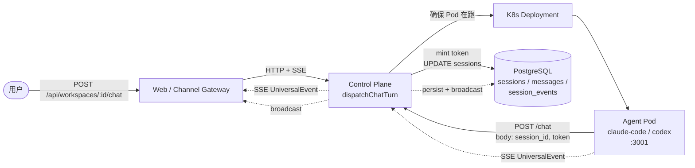
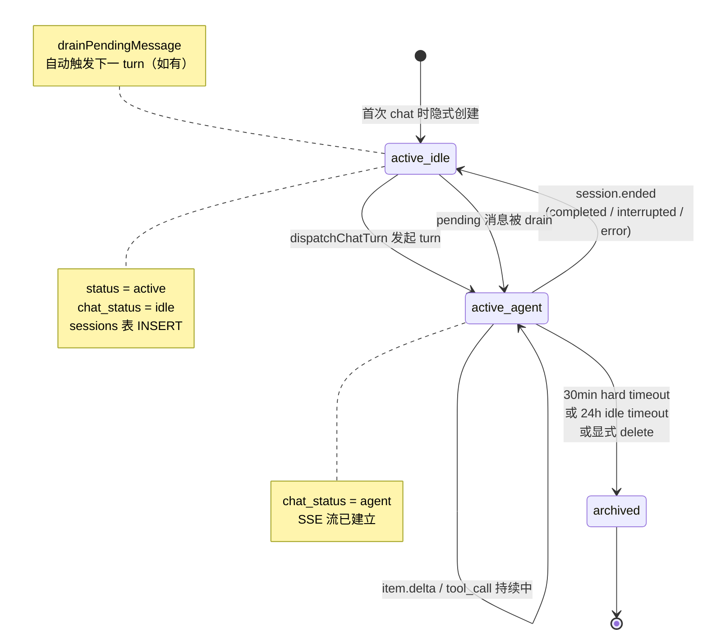

# Session 生命周期全链路

> 视角：架构师给新人讲解。读完后，你应该能用一张图把一次 chat 请求在平台里走过哪些服务、哪些表、哪些回调全部说清楚。

---

## 0. 先把术语对齐

新人最容易混淆的是 **session**、**turn**、**workspace** 这三个词。这里先把它们钉死，后面的图就不再解释。

| 术语 | 业务含义 | 在哪 | 一句话关系 |
|------|----------|------|------------|
| **Workspace** | 一个 AI agent 的运行时容器（K8s Pod + PVC + 侧车） | `workspaces` 表 + K8s Deployment | 物理隔离单位 |
| **Session** | 一次"对话"，可以多轮，绑定到一个 workspace | `sessions` 表 | workspace 内的逻辑对话 |
| **Turn** | 一次 user message → agent response 的完整回合 | 一次 SDK/ACP 跑完 | session 由若干 turn 组成 |
| **chat_status** | session 当前是否在执行 turn | `sessions.chat_status` 字段：`idle` / `agent` | session 自己的状态机 |
| **UniversalEvent** | 平台标准化的 SSE 事件协议 | `internal/types/events.ts` | agent ↔ CP ↔ Web 唯一的对话格式 |
| **SessionSink** | 一个 turn 内可替换的 SSE writer，支持 buffer | `agents/claude-code/src/server.ts:84-90` | UI 刷新不丢事件的秘密 |

记住这句话：**Workspace 是家，Session 是屋里的一次对话，Turn 是对话里的一问一答。**

---

## 1. 一张图看懂端到端流程

新人最容易在"控制面 ↔ agent pod"这两层之间迷路。先把骨架画出来。



把上面的图按"谁来负责"分一下层，记忆就立住了：

| 层 | 职责 | 关键路径 |
|----|------|----------|
| **Web / Channel** | 收集用户输入，转发到控制面 | `web/src/app/api/...` |
| **Control Plane** | 编排 Pod、签发 token、持久化事件、广播 SSE | `control-plane/src/routes/chat.ts`, `control-plane/src/lib/sse.ts` |
| **K8s + Agent Pod** | 跑 agent 子进程，把 SDK/ACP 输出翻译成 UniversalEvent | `agents/claude-code/src/server.ts`, `agents/codex/src/server.ts` |
| **PostgreSQL** | 所有元数据 + 消息历史的 source of truth | `sessions`, `messages`, `session_events` |

---

## 2. session 自己的状态机

session 只有两个状态字段，但背后藏着六种实际形态。新人画状态机图时务必区分 `status` 和 `chat_status`。



**两个易混点**：
- `status = archived` ≠ "已删除"。数据库里还在，只是 `chat_status` 永远不会再回 `agent`。
- `chat_status = agent` 期间如果 CP 重启 → 由 `recoverOrphanedSessions()` 接管，session 仍是 orphan 但 chat_status 还是 `agent`，直到新 pod 重连或超时回收。

---

## 3. 七个阶段：一次 turn 的完整生命周期

下面按时间顺序拆解。每个阶段都会标出**入口函数、关键文件:行号、可能出错的地方**。

### 阶段 ① 隐式创建 — `POST /api/workspaces/:id/chat`

用户点了输入框发第一条消息。**session 这时候还没存在**。

```text
Web                                  CP
 |                                    |
 |--POST /api/workspaces/:id/chat --->|
 |   body: { session_id?, content }   |
 |                                    |
 |   ← dispatchChatTurn({             |
 |       workspaceId, sessionId,       |
 |       content, mode })              |
 |                                    |
 |   1. ensureWorkspaceRunning(ws)    |  ← 如果 workspace.status='stopped'
 |                                    |     触发 startWorkspaceInstance (K8s scale 0→1)
 |   2. session = getSession(sid)     |  ← sid 为空时 getSession 返回 null
 |                                    |     然后 createSession(workspaceId)
 |   3. validate owner                |  ← session.owner_id 必须等于 ctx.userId
 |   4. if chat_status='agent':       |
 |        enqueuePendingMessage       |  ← 不是拒绝！是排队，见阶段 ⑦
 |        return 202                  |
```

**关键点**：
- session 是**懒创建**的，不需要单独的 `POST /sessions` 接口。第一次 chat 自动建。
- 如果 session 已经在跑（`chat_status='agent'`），**不拒绝用户消息**，而是塞进 pending queue。新人最容易踩的认知坑。

> 详见 `docs/control-plane/0002-session/session.md` 的「Pending Message」段、`docs/control-plane/0001-chat-turn/chat-turn.md` 时间线。

---

### 阶段 ② Pod 编排 — `ensureWorkspaceRunning` & `reconcileWorkspacePod`

session 能不能执行 turn，取决于它所在 workspace 的 Pod 是不是 `running`。

```text
Reconcile Loop (每 ~10min)        CP                    K8s               Agent Pod
        |                          |                    |                    |
        |--list+watch------------->|                    |                    |
        |   computeWorkspaceDrift  |                    |                    |
        |                          |                    |                    |
        |   if drift.requiresRebuild:                  |                    |
        |     k8s.rebuildInstance--------------------->|                    |
        |     DELETE+CREATE Deployment                |                    |
        |     UPDATE workspaces status='starting'     |                    |
        |                          |                    |--Pod 0→1----------->|
        |                          |                    |                    |
        |                          |                    |    agent 容器启动    |
        |                          |                    |    POST /_cp/config→|  ← CP 内部接口
        |                          |<----------------------------------     |
        |                          |    返回 workspace_config+credentials |
        |                          |                    |                    |
        |                          |                    |    bind :3001       |
        |                          |                    |    就绪             |
        |                          |<----------------------------------     |
        |                          |    resolveDeploymentStatus=running     |
        |   UPDATE workspaces status='running'          |                    |
        |                          |                    |                    |
        |                          |    recoverOrphanedSessions()           |
        |                          |    query sessions WHERE chat_status=agent
        |                          |    for each orphan:                     |
        |                          |      token = ensureTokenForSession      |
        |                          |      POST /cp-reconnect ────────────────>|  ← 新 pod 重连
```

**两个 drift 通道**：
- `requiresRebuild`（agent_type / image 变了）→ 删 Pod 重建，强一致但会断 turn
- `requiresReload`（config / skills / credentials 变了）→ `POST /reload-config` 热加载，turn 不中断

> 详见 `docs/control-plane/0002-agent-pod-startup/agent-pod-startup.md`，里面有完整参数传递表。

---

### 阶段 ③ Turn 发起 — `executeChat` & Session Token 签发

```text
executeChat({ workspace, session, content, token, mode })
  address = resolveWorkspaceAddress(workspace)   // cluster DNS

  token = ensureTokenForSession(sessionId, workspaceId)
    // 查 session_tokens；未过期则复用
    // 否则 INSERT 'tos_sess_' + randomBytes(32), expires_at = now()+24h

  POST `${address}/chat`   (SSE)
    body: { session_id, content, session_token: token }
    headers: { Authorization: `Bearer ${token}` }

  createInterceptedSSEResponse(response, {
    persist: persistPlugin(session),     // 写 messages/session_events 表
    broadcast: broadcastPlugin(session)  // 推 SSE 给 Web
  })
```

**Session Token 的作用**：
- 它不是 session id。session id 是 agent 内部 SDK 标识，token 是 **CP 签发的反向凭证**。
- agent pod 用它回调 CP 的 `/_cp/*` 接口（K8s 网络隔离信任边界）。
- 也供 UI reconnect 时验证身份。
- 24h 过期 → 让任何"长连接"不可能无限活，必须经过 reconcile 重新签发。

---

### 阶段 ④ Turn 执行 — `POST /chat` → SDK/ACP → UniversalEvent

agent 容器收到请求后，做三件事：建一个 SessionSink、调 SDK、把 SDK 输出翻译成 UniversalEvent。

```text
claude-code/server.ts                UniversalEventTranslator           SDK query()         claude-code child
        |                                      |                              |                       |
        | 1. 解析 ChatRequest                  |                              |                       |
        |    {message, session_id?,            |                              |                       |
        |     images?, session_token?}         |                              |                       |
        |                                      |                              |                       |
        | 2. new SessionSink                   |                              |                       |
        |    activeSinks.set(sessionId, sink)  |                              |                       |
        |                                      |                              |                       |
        | 3. translator.sessionStarted(sid)    |                              |                       |
        |--> SSE: session.started ---> CP      |                              |                       |
        |                                      |                              |                       |
        | 4. callbacks = {                     |                              |                       |
        |     onMessage, onError,              |                              |                       |
        |     onComplete, onAskUser            |                              |                       |
        |   }                                  |                              |                       |
        |                                      |                              |                       |
        | 5. await chat(sid, msg, token, cb)   |                              |                       |
        |--------------------------------------|--> query({prompt, options})-->|                       |
        |                                      |                              |  spawn 子进程         |
        |                                      |                              |                       |
        |                                      |                              |<-- SDKMessage[] (流式)
        |                                      |                              |                       |
        | 6. cb.onMessage(msg)                 |                              |                       |
        |    translator.translate(msg)         |                              |                       |
        |    → UniversalEvent[]                |                              |                       |
        |    for evt: sink.write(event, data)  |                              |                       |
        |--> SSE: item.started -----> CP      |                              |                       |
        |--> SSE: item.delta -------> CP      |                              |                       |
        |--> SSE: item.completed ---> CP      |                              |                       |
        |                                      |                              |                       |
        |    [若 SDK 触发 AskUserQuestion]     |                              |                       |
        |    cb.onAskUser(request)             |                              |                       |
        |--> SSE: question.requested -> CP    |                              |                       |
        |    turn 暂停在 SDK canUseTool        |                              |                       |
        |    等待 CP POST /respond             |                              |                       |
```

**翻译层做了什么**（`universal-events.ts`）：

| SDKMessage 类型 | 翻译产出 UniversalEvent |
|----------------|------------------------|
| `stream_event`（text_delta） | `item.started` + 多个 `item.delta` |
| `stream_event`（content_block_start/tool_use） | `item.started`（tool_call） |
| `assistant`（完整消息） | `item.completed` |
| `user`（tool_result） | `item.completed`（tool_result） |
| `system`（compact_boundary） | `item.completed`（status） |
| `result` | 不直接产事件，由 `onComplete` 触发 `session.ended` |

**两个并发保护**：
- `activeControllers: Map<sessionId, AbortController>` — 一个 session 同一时刻只允许一个 turn
- SSE **keepalive**（`agents/claude-code/src/server.ts:166-172`）— 每 15s 写注释帧，防 5min idle TCP 被 conntrack 切

---

### 阶段 ⑤ 持久化 + 广播 — CP 侧 SSE 拦截器

CP 不会盲转 agent 的 SSE 流，而是装两个 plugin：

```text
Agent Pod --SSE--> CP(createInterceptedSSEResponse)
                          |
                          ├──persist plugin──> DB
                          |   (写 messages / session_events / 更新 sessions)
                          |
                          └──broadcast plugin──> Web
                              (推 SSE 给订阅的 UI / Channel)
```

**persist plugin 行为**（`control-plane/src/lib/sse.ts`）：

| 收到 UniversalEvent | 写入 DB |
|---------------------|---------|
| `session.started` | UPDATE sessions SET chat_status='agent', last_active_at=now() |
| `item.started` | INSERT messages (id=event.messageId, role='assistant', content='') |
| `item.delta`（text） | UPDATE messages SET content = content \|\| delta |
| `tool_call` | INSERT session_events (kind='tool_call', call_id, payload) |
| `tool_result` | INSERT session_events (kind='tool_result', call_id, payload) |
| `item.completed` | UPDATE messages SET blocks=event.blocks |
| `session.ended` | UPDATE sessions SET chat_status='idle', last_turn_stats=event.stats |
| `session.ended` 后 | drainPendingMessage(sessionId) |

> 注意：状态机推进（`chat_status` 翻转）由 SSE 事件驱动，**不是** 由 session domain 的业务函数主动推进。session domain 只负责存储。这是新人最容易混淆的"session domain 到底推进状态机没？"的答案：没有。

---

### 阶段 ⑥ 异常处理 — 三种常见打断

新人需要重点理解的三种异常：客户端断开、用户主动中断、超时。

#### 6.1 客户端断开（UI 刷新 / 网络抖动）

`SessionSink` 自动切 buffer 模式：

```text
CP                              agent/server.ts                SessionSink                SDK/ACP
 |                                    |                            |                          |
 |<-- SSE: item.delta ----------------|                            |                          |
 |                                    |                            |                          |
 |  X (TCP 断开)                       |                            |                          |
 |                                    |                            |                          |
 |                                    | 1. abort 事件触发           |                          |
 |                                    |    switchToBufferMode(sid,  |                          |
 |                                    |      expectedWriter)        |                          |
 |                                    | 2. 校验 sink.write          |                          |
 |                                    |    === expectedWriter        |                          |
 |                                    |    (防止覆盖已被            |                          |
 |                                    |     reconnect 替换的 writer) |                          |
 |                                    |                            |                          |
 |                                    | 3. sink.disconnected=true   |                          |
 |                                    |    sink.write = push buffer |                          |
 |                                    |                            |                          |
 |                                    |                            |  [turn 继续执行]         |
 |                                    |                            |  SDK/ACP 不受影响        |
 |                                    |                            |  events 进 buffer[]      |
 |                                    |                            |                          |
 |  [UI 刷新完成, CP 重建 SSE]         |                            |                          |
 |-- POST /sessions/:id/reconnect -->|                            |                          |
 |                                    | 4. 重建 reconnectWriter    |                          |
 |                                    | 5. flush sink.buffer[]      |                          |
 |                                    |    (逐条写新 writer)        |                          |
 |<-- SSE: 历史缓存 events ------------|                            |                          |
 |                                    | 6. sink.write = reconnectWriter                         |
 |                                    |    disconnected=false       |                          |
 |                                    |                            |                          |
 |                                    | 7. await sink.donePromise   |                          |
 |                                    |    (等 turn 真完成)         |                          |
```

**关键点**：turn 不被打断，只是事件流换了出口。详见 `docs/agents/0003-ui-reconnect/ui-reconnect.md`。

#### 6.2 用户主动中断 — `POST /sessions/:id/interrupt`

```text
CP                              agent/server.ts                              agent.ts
 |                                    |                                          |
 |--POST /sessions/:id/interrupt -->|                                          |
 |                                    | interruptSession(sessionId)             |
 |                                    |--> controller = activeControllers.get(sid)
 |                                    |    controller.abort()                    |
 |                                    |    activeControllers.delete(sid)         |
 |                                    |                                          |
 |                                    |    SDK child 进程被中止                   |
 |                                    |    throw "Claude Code process aborted by user"
 |                                    |                                          |
 |                                    |    catch 块识别为 abort                  |
 |                                    |    调用 cb.onComplete()                  |
 |                                    |    → translator.sessionEnded('interrupted')
 |<-- SSE: session.ended (interrupted)|                                          |
```

注意 abort 错误识别有 **两种形态**（`agents/claude-code/src/agent.ts:451-455`）：
- `AbortError`（DOMException 风格）
- `Error.message` 含 `"aborted by user"`（SDK 子进程被 kill 时）

两者都必须路由到 `onComplete`，不能当成错误处理。否则 session 永远 stuck 在 `chat_status='agent'`，直到 24h 过期。

#### 6.3 超时

| 超时类型 | 时长 | 触发方 | 后果 |
|----------|------|--------|------|
| Hard timeout | 30 min | CP 侧 fetch 超时 | 关闭 SSE 流，session.ended 未必能送达 |
| Idle timeout | 24 h | agent pod 进程级 | CP 找不到 activeSink，认为 turn 已死 |

---

### 阶段 ⑦ Turn 结束与 drain — `session.ended` → 自动接力

```text
SDK query() 完成
    |
    v
cb.onComplete(stats)
    |
    v
translator.sessionEnded(reason, stats)
    |
    v
SSE: session.ended ---> CP
    |
    v
persist plugin:
  UPDATE sessions SET chat_status='idle', last_turn_stats=event.stats
  drainPendingMessage(sessionId)
    |
    v
  pending = queryPendingMessages(sid) ORDER BY created_at
  if pending.length > 0:
    dispatchChatTurn({ sessionId, content: pending[0].content })
    // 其余保持排队，等下一轮 turn 结束再 drain
```

**两个不显然的细节**：
1. `reason` 由 `stats` 是否存在决定：`stats != null` → `'completed'`；`stats == null` → `'interrupted'`。所以纯 abort 不会污染 `last_turn_stats`。
2. `drainPendingMessage` 只取 **第一条** 发起新 turn，剩下的留在 queue 里等下一轮结束再 drain。**不批量**是有意设计，避免 race condition。

---

## 4. session 销毁 / 归档路径

session 不会主动消失，只会变 `status='archived'`：

| 触发方式 | 路径 |
|----------|------|
| 用户删除 workspace | `DELETE /api/workspaces/:id` 级联删除 sessions |
| 用户删除单个 session | `DELETE /api/workspaces/:id/sessions/:sid` |
| 30 min hard timeout | CP 关闭 SSE，session 留 `chat_status='agent'` 直到下次 reconcile 清理 |
| 24 h idle timeout | session 永久转 idle，可被 GC 识别 |
| bridge 被 LRU 驱逐（codex） | turn 抛 `BridgeChildDiedError` → session.ended(error) |

**重点**：`status='archived'` 不删表行，只是不再被路由选中。`messages` 和 `session_events` 仍保留供查询/导出。

---

## 5. 整条链路的幂等性总览

| 维度 | 幂等机制 | 出问题会怎样 |
|------|----------|--------------|
| Session Token | `ensureTokenForSession` 查未过期则复用 | 重复签发，浪费 DB 行 |
| Pending queue | `enqueuePendingMessage` 不去重，按 created_at 顺序处理 | 用户发 N 条就排 N 条 turn |
| SessionSink reconnect | 写手竞争保护 (`expectedWriter`) | 晚到的 abort 覆盖新 writer，UI 收不到事件 |
| persist plugin | 按 `message_id` UPSERT messages | 重复事件不重复写 |
| K8s reconcile | 每 10min 实际状态 vs 期望状态 | drift 累积到下次 rebuild |
| recoverOrphanedSessions | 启动时一次执行；失败的 session 标 idle/archived | orphan session 永远 stuck |
| `notifyAgentReload` | 失败不阻塞，下次重试 | 配置延迟生效一次 reconcile 周期 |

---

## 6. 新人常问的 5 个问题

**Q1：session 是按 workspace 维度隔离的吗？**
是。一个 session 只能属于一个 workspace，跨 workspace 不复用 session id。

**Q2：同一个 session 能并发多个 turn 吗？**
不能。`chat_status='agent'` 时新 user message 进 pending queue，单 turn 串行。

**Q3：claude-code 和 codex 的 session 生命周期有差别吗？**
主流程完全一致（UniversalEvent 协议是统一的）。差别：
- claude-code 用 SDK 自管子进程，无 LRU 问题
- codex-acp 通过 AcpBridge 托管 child process，有 LRU 驱逐可能，触发 `BridgeChildDiedError`

**Q4：turn 失败但 session.ended 没送达 CP 怎么办？**
CP 会在下次 reconcile 看到 `chat_status='agent'` 但 agent pod 已死 → 不会自动恢复，session 留在 idle；CP 重启时由 `recoverOrphanedSessions` 一次性扫表。

**Q5：pending message 里的图片附件怎么处理？**
暂存在 `pending_queue` 表的 `blocks` jsonb 里；drain 时随 user message 一起走标准 turn 路径。

---

## 7. 想深挖请看这些文档

| 文档 | 重点 |
|------|------|
| `docs/control-plane/0002-session/session.md` | session domain 数据模型、CRUD、persist plugin 表 |
| `docs/control-plane/0001-workspace/workspace.md` | workspace 状态机、Pod 编排、drift 检测 |
| `docs/control-plane/0001-chat-turn/chat-turn.md` | dispatchChatTurn 完整时间线 + 状态机图 |
| `docs/control-plane/0002-agent-pod-startup/agent-pod-startup.md` | Pod 启动 → SSE 建链 → orphan 恢复 |
| `docs/agents/0002-claude-code-turn-execution/claude-code-turn-execution.md` | claude-code 场景的 SDK/UniversalEvent 翻译细节 |
| `docs/agents/0001-acp-adapter/acp-adapter.md` | codex 场景的 ACP 适配与 BridgeChildDiedError |
| `docs/agents/0003-ui-reconnect/ui-reconnect.md` | SessionSink buffer/reconnect 状态机 |
| `docs/agents/CONTEXT.md` | Agent Runtime 术语词典（UniversalEvent / SessionSink / X-Session-Token） |

---

## 8. 一句话总结

**Session 生命周期 = 「Web 触发 → CP 编排 Pod → mint token → agent 跑 turn → SDK 翻译 UniversalEvent → CP persist+broadcast → session.ended → drain pending」**。每一个箭头背后都有具体的表、具体的文件:行号、具体的幂等保证。读这张图，再去看任何一个具体文件就不会迷路。