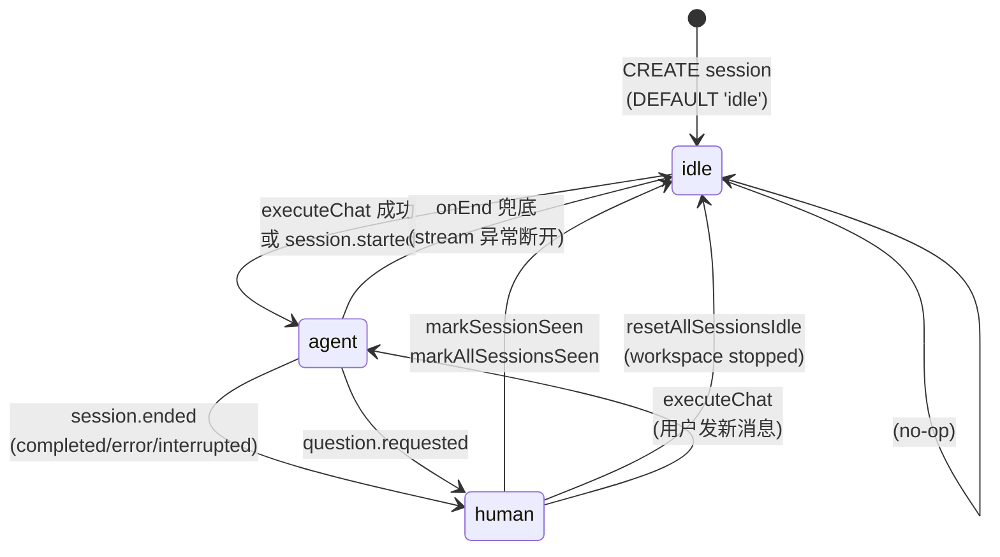
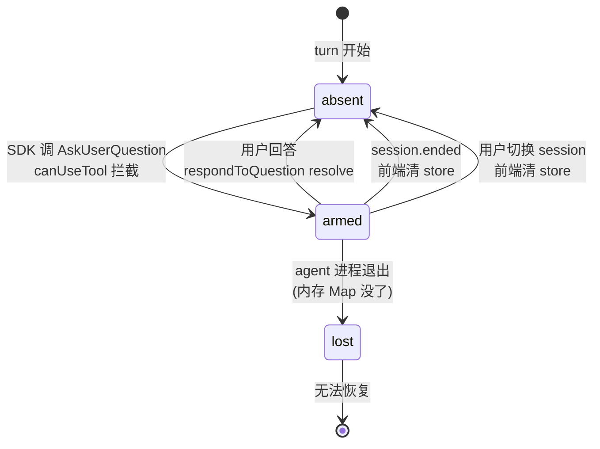

# Session 状态流转全链路：chat_status 与 pendingQuestion

> 视角：架构师给新人讲解。配套 [sse.md](sse.md) 与 [session.md](session.md) 一起看 -- sse.md 讲「一条 SSE 消息怎么从 agent 嘴里吐到前端屏幕」，session.md 讲「一次对话从创建到归档的七阶段」，本文专门拆**两个状态机**：DB 里的 `sessions.chat_status` 字段 + agent 进程内存里的 `pendingQuestion`。读完后你应该能回答：这两个状态分别存在哪、谁推进、谁读取、怎么联动、踩了哪些坑。

---

## 0. 为什么单独有这一篇

新人看完 sse.md 和 session.md 后，最容易卡在两个问题上：

1. **「session 现在到底在干嘛？」** -- 前端有个 `chat_status` 字段，后端 DB 也有 `chat_status` 列，但它**不出现在任何 SSE 事件里**。那前端是怎么知道 session 状态变化的？谁在什么时机改这个值？
2. **「agent 问用户问题的时候，答案走哪条路回去？」** -- SSE 是单向的（agent -> 前端），但 `AskUserQuestion` 要求用户回答 agent。这条「逆流」的答案是怎么绕回去的？问题本身存在哪？刷新页面还找回得回吗？

这两个问题本质上是**两条独立的状态机**：

| 状态机 | 存储位置 | 持久化 | 推进方 | 生命周期 |
|--------|---------|--------|--------|---------|
| `chat_status` | PostgreSQL `sessions` 表 | ✅ 落库 | CP 的 persist 插件 + 少量业务函数 | 跨 cp 重启、跨 agent 重启 |
| `pendingQuestion` | agent 进程内存（两个 Map） | ❌ 不落库 | claude-code agent 独有 | agent 进程一死就丢 |

> 顶层设计一句话：**`chat_status` 是「DB 持久化的会话级状态」，`pendingQuestion` 是「agent 内存里的问答级状态」**。两者通过 `question.requested` 这个 SSE 事件耦合 -- 事件到达 CP 时同时推进两个状态机：DB 里 `chat_status -> human`，前端 store 里 `pendingQuestion = request`。理解这对耦合，是看懂整个 session 状态图的关键。

---

## 1. 两个状态机一览

### 1.1 chat_status（DB 持久化）



三个合法值，定义在 `transitionSessionStatus` 的参数类型里（`control-plane/src/services/db/sessions.ts:152-157`）：

| 值 | 语义 | 谁能看到 |
|----|------|---------|
| `idle` | 会话空闲，无 turn 在跑，无待回复 | 任何接口 |
| `agent` | Agent 正在执行 turn（推理/工具/生成） | 任何接口 |
| `human` | Turn 已结束或被 question 打断，轮到用户输入 | 任何接口，但 `listRecentSessions` 会排除（`sessions.ts:289-291`） |

### 1.2 pendingQuestion（agent 内存）



注意：**`pendingQuestion` 没有「持久」状态**。它要么在 agent 内存里（`armed`），要么不存在（`absent`）。agent 一重启，所有 armed 的 question 直接进入 `lost`，前端再拉也拉不回来。

### 1.3 两者怎么耦合

| 事件 | chat_status 副作用 | pendingQuestion 副作用 |
|------|-------------------|------------------------|
| `question.requested` | `agent -> human`（`sse.ts:1073`） | store 设置 `pendingQuestion = request`（`agent-session-store.ts:615-617`） |
| `session.ended` | `agent -> human`（`sse.ts:937`） | store 清除 `pendingQuestion = null`（`agent-session-store.ts:380`） |
| 用户回答 | （无直接副作用，agent 继续 turn） | store 清除 + agent resolve Promise |
| `session.started` | `idle/any -> agent`（`sse.ts:873`） | （无关） |

> 颗粒度对齐：`question.requested` 是**唯一一个同时推进两个状态机的事件**。这就是为什么它在前端 store 里要单独留一个 `pendingQuestion` 字段，而不能只靠 `chat_status === 'human'` 判断 -- 因为 `session.ended` 也会把 `chat_status` 翻成 `human`，但那时根本没有待答问题。两个状态机必须分开看。

---

## 2. chat_status 状态流转（DB 持久化视角）

### 2.1 DB schema

`control-plane/migrations/001_init.sql:93-106`：

```sql
CREATE TABLE public.sessions (
    id text PRIMARY KEY,
    workspace_id text NOT NULL,
    status text DEFAULT 'active',       -- active | archived（会话级生命周期，不是 chat_status）
    chat_status text DEFAULT 'idle',    -- ← 本文档的主角：idle | agent | human
    last_active_at timestamptz,
    last_turn_stats jsonb,
    pending_message jsonb,              -- ← 注意：是「用户排队的下一条消息」，不是 pendingQuestion
    ...
);
```

> 易混点：`sessions` 表有三个状态字段 -- `status`（active/archived）、`chat_status`（idle/agent/human）、`pending_message`（用户排队的 follow-up）。新人最容易把 `pending_message` 当成 `pendingQuestion`，其实它们方向相反：`pending_message` 是「用户 -> agent 的排队消息」，`pendingQuestion` 是「agent -> 用户的待答问题」。详见 §3.1 对比表。

### 2.2 核心写入函数

`control-plane/src/services/db/sessions.ts:152-157`：

```typescript
export async function transitionSessionStatus(
  sessionId: string,
  to: 'agent' | 'human' | 'idle',
): Promise<void> {
  await pool.query('UPDATE sessions SET chat_status = $1 WHERE id = $2', [to, sessionId])
}
```

所有「单条 session」的状态变更都走这条函数。类型签名把 `to` 限定为三个字面量，DB 层没有 `CHECK` 约束 -- 代码层兜底。

### 2.3 所有写入点（穷举）

#### 2.3.1 SSE 事件驱动的写入（CP persist 插件，`control-plane/src/lib/sse.ts`）

这是**最主要的写入路径** -- 状态机推进完全由 SSE 事件驱动，session domain 自己不主动推进。

| 触发事件 | 写入值 | 行号 | 场景 |
|---------|--------|------|------|
| `session.started` | `'agent'` | `sse.ts:873` | agent 创建了 session（新 session 或继续已有 session） |
| `session.ended` | `'human'` | `sse.ts:937` | turn 正常结束（reason=completed/error/interrupted） |
| `question.requested` | `'human'` | `sse.ts:1073` | agent 向用户提问，turn 暂停等回答 |
| （stream 异常断开，从未收到 `session.ended`） | `'idle'` | `sse.ts:1094` | persist 插件 `onEnd` 兜底，防止 session 永远卡在 `agent` |

> 关键认知：**`session.ended` 写的是 `human` 而不是 `idle`**。turn 结束后 session 进入「等用户输入」态，只有用户主动标记已读或发新消息才会回 `idle`/`agent`。`onEnd` 的 `idle` 写入是「异常路径兜底」，只在没收到 `session.ended` 事件时才触发。

#### 2.3.2 业务函数的写入（`control-plane/src/services/chat/executeChat.ts`）

继续已有 session 时，CP 在 HTTP 请求阶段就推进状态（不等 SSE）：

| 场景 | 写入值 | 行号 |
|------|--------|------|
| 成功拿到 agent 的 SSE Response | `'agent'` | `executeChat.ts:151` |
| fetch agent 失败（网络/pod 不可达） | `'idle'` | `executeChat.ts:133` |

这两处是「乐观推进」-- 让 DB 状态尽早反映「turn 开始了」，前端拉列表时立刻看到 `agent`，不必等第一个 SSE 事件。

#### 2.3.3 孤儿 session 恢复（`control-plane/src/lib/session-recovery.ts`）

CP 重启时扫 `chat_status='agent'` 的 session，尝试重连 agent：

| 场景 | 写入值 | 行号 |
|------|--------|------|
| workspace 不在 running 状态 | `'idle'` | `session-recovery.ts:35` |
| agent 返回 404 且无 pending 消息 | `'idle'` | `session-recovery.ts:75` |
| 恢复过程抛异常 | `'idle'` | `session-recovery.ts:121` |

这三处都是「恢复失败 -> 回退到 idle」，避免 session 永远卡在 `agent`。

#### 2.3.4 批量写入（workspace 级别的重置）

不走 `transitionSessionStatus`，直接 SQL：

| 函数 | 写入值 | 条件 | 行号 |
|------|--------|------|------|
| `resetAllSessionsIdle` | `'idle'` | `chat_status != 'idle'`（全部） | `sessions.ts:222-226` |
| `markSessionSeen` | `'idle'` | `chat_status = 'human'`（仅 human -> idle） | `workspaces.ts:141` |
| `markAllSessionsSeen` | `'idle'` | `chat_status = 'human'`（仅 human -> idle） | `workspaces.ts:149` |

`resetAllSessionsIdle` 的触发者：`control-plane/src/lib/workspace-status.ts:28-30` -- workspace 状态变为 `stopped`/`error`/`unknown` 时调用。这是「workspace 挂了，别让 session 永远假装在跑」的兜底。

### 2.4 对外暴露（HTTP 接口）

`chat_status` 通过以下 HTTP 接口返回给前端，字段名都是 `chat_status`：

| 接口 | 返回结构 | 行号 |
|------|---------|------|
| `GET /workspaces/:id/sessions` | `items[].chat_status`（`ApiSession`） | `read.ts:25`（`toApiSession` 映射） |
| `GET /workspaces/:id/sessions/:sessionId` | `chat_status`（`ApiSessionLite`） | `sessions.ts:78` |
| `GET /workspaces` | `items[].active_sessions[]` + 聚合计数 | `workspaces.ts:69-87`（SQL 聚合，只含 `agent`/`human`） |
| `GET /me/recent-sessions` | `items[].chat_status` | `sessions.ts:289-291`（SQL 排除 `human`） |
| `GET /system-workspaces/:id/sessions` | `items[].chat_status` | `system-workspaces.ts:199` |

Schema 定义在 `internal/types/api.ts:26-35, 198, 249`。

### 2.5 SSE 事件里有没有 chat_status？

**没有**。`UniversalEvent`（`internal/types/events.ts`）的任何变体都不携带 `chat_status` 字段。前端通过两种方式感知状态变化：

1. **事件类型推断**：收到 `session.started` -> 推断进入 `agent`；收到 `session.ended` / `question.requested` -> 推断进入 `human`。
2. **HTTP 主动拉取**：`switchSession` / `followPendingTurn` 里调 `getSession` 拿最新的 `chat_status` 字段值。

> 顺序保证（`sse.md` §3.4 详讲）：persist 插件和 broadcast 插件共享同一个 `SerialQueue`。persist 先把 `chat_status` 写进 DB，broadcast 才把 SSE 事件转发给前端。所以「前端收到事件」一定晚于「DB 已更新」。但前端 store 里不存 `chat_status` 的镜像 -- 它只在需要时（switchSession、followPendingTurn）拉一次。

### 2.6 前端消费点

#### 2.6.1 `agent-session-store.ts` -- 核心 store

| 行号 | 用法 | 作用 |
|------|------|------|
| `agent-session-store.ts:283` | `followPendingTurn` 里 `detail.chat_status === 'agent'` 判断 | 轮询等 cp 把排队的 follow-up 变成新 turn，确认后 `startReconnect()` |
| `agent-session-store.ts:719-732` | `switchSession` 用 `sessionResult.value.chat_status` 决定是否 `startReconnect()` | **关键逻辑**：用最新 fetch 的值，而非 caller 传的 `context.sessionChatStatus` 快照 |

#### 2.6.2 `WorkspaceSessionsPanel.tsx` -- 侧边栏列表

| 行号 | 用法 | 作用 |
|------|------|------|
| `WorkspaceSessionsPanel.tsx:44-52` | `classifyStatus(chatStatus)` 映射 | `human` -> `needs-you`，`agent` -> `running`，其他 -> `idle` |
| `:210-244` | `statusNode` 渲染 | 绿色脉冲圆点（running）/ 黄色圆点（needs-you） |
| `:312` | `status === 'needs-you'` | 显示「标记已读」按钮 |
| `:472-481` | `handleSelect` | `chat_status` 作为 `sessionChatStatus` 传入 `switchSession` 的 context |
| `:583` | `handleLocateUnread` | `s.chat_status === 'human'` 过滤找第一个待回复 session |

#### 2.6.3 `WorkspaceChatPanel.tsx` -- 聊天面板

| 行号 | 用法 | 作用 |
|------|------|------|
| `:298-322` | `useEffect` 自动标记已读 | `chat_status === 'human'` 时自动调 `markSeen.mutate` |
| `:634-645` | `onValueChange` | `chat_status` 作为 `SwitchSessionContext` 传给 `switchSession` |

#### 2.6.4 `useUnread.ts` -- 未读计数

| 行号 | 用法 | 作用 |
|------|------|------|
| `:43-44` | `useUnreadCount` | 读 `ws.active_human_sessions` / `ws.active_agent_sessions` 驱动 Header 未读 badge |
| `:72-127` | `useMarkSeen` 的 `onMutate` | 乐观更新 `chat_status` 为 `idle`，立即刷 UI |

#### 2.6.5 `WorkspacePage.tsx` + `AgentSessionContext.tsx`

| 行号 | 用法 |
|------|------|
| `WorkspacePage.tsx:79` | `sessionChatStatus: initialSession?.chat_status` 传给 `AgentSessionProvider` |
| `AgentSessionContext.tsx:28` | `initialContext` 类型 `{ sessionChatStatus?: string }` |

---

## 3. pendingQuestion 状态流转（agent 内存视角）

### 3.1 先把 pending_message 和 pendingQuestion 钉死

这两个名字像，方向完全相反，新人必踩坑：

| 方面 | `pending_message`（DB 列） | `pendingQuestion`（agent 内存） |
|------|---------------------------|-------------------------------|
| 方向 | 用户 -> agent | agent -> 用户 |
| 存储 | `sessions.pending_message jsonb`（`001_init.sql:104`） | agent 进程的两个 `Map`（`agent.ts:73-88`） |
| 目的 | 用户在 turn 跑时排队下一条消息，turn 结束后 drain | 把 agent 的问题呈现给用户等答案 |
| 持久化 | ✅ 落库，跨 cp 重启 | ❌ 不落库，agent 死就丢 |
| 恢复路径 | `GET /sessions/:id` 随 session 返回 | `GET /sessions/:id/pending-question` 单独拉（agent 内存还在才行） |
| CP 处理 | `sessions.ts` 的 `setPendingMessage` / `takePendingMessage` | CP 不处理，只做 HTTP 透传 |
| 类型 | `SessionPendingMessage { content, images }` | `AskUserRequest { requestId, questions }` |

### 3.2 数据结构

前端类型（`web/src/lib/api/types.ts:408-425`）：

```typescript
interface AskUserQuestionOption {
  label: string
  description: string
}

export interface AskUserQuestionItem {
  question: string
  header: string
  options: AskUserQuestionOption[]
  multiSelect: boolean
}

export interface AskUserRequest {
  requestId: string          // 幂等键，匹配答案用
  questions: AskUserQuestionItem[]
}
```

UniversalEvent 协议层（`internal/types/events.ts:56-62, 95-98`）：`question.requested` 事件携带 `request_id?: string` + `questions?: unknown[]`（传输时是 `unknown[]`，前端转成 `AskUserQuestionItem[]`）。

### 3.3 产生点（agent 端，仅 claude-code）

> 关键边界：**AskUserQuestion 机制是 claude-code agent 独有的**。ACP 协议代理（codex / goose）不支持，走存根端点（见 §3.7）。

`agents/claude-code/src/agent.ts:263-294`，SDK 的 `canUseTool` 钩子拦截 `AskUserQuestion` 工具调用：

```typescript
canUseTool: async (toolName, input, { signal }) => {
  // 只拦 AskUserQuestion，其他工具一律放行
  if (toolName !== 'AskUserQuestion') {
    return { behavior: 'allow' as const, updatedInput: input }
  }

  const requestId = crypto.randomUUID()                    // ← 幂等键
  const questions = (input as Record<string, unknown>).questions as unknown[]
  callbacks.onAskUser?.({ requestId, questions })          // ← 触发 SSE question.requested

  // 按 session 存一份，用于 UI 刷新后反查
  if (resultSessionId) {
    pendingQuestionsBySession.set(resultSessionId, { requestId, questions })
  }

  // 返回一个不 resolve 的 Promise —— turn 在这里挂起
  return new Promise((resolve, reject) => {
    pendingResponses.set(requestId, {
      resolve,
      originalInput: input as Record<string, unknown>,     // ← 保留 questions 字段
    })
    signal.addEventListener('abort', () => {
      pendingResponses.delete(requestId)
      if (resultSessionId) pendingQuestionsBySession.delete(resultSessionId)
      reject(signal.reason ?? new Error('aborted'))
    })
  })
},
```

两个内存 Map（`agent.ts:73-88`）：

| Map | key | value | 用途 |
|-----|-----|-------|------|
| `pendingResponses` | `requestId` | `{ resolve, originalInput }` | 答案回来时 resolve 掉挂起的 Promise |
| `pendingQuestionsBySession` | `sessionId` | `{ requestId, questions }` | UI 刷新后按 session 反查待答问题 |

> 设计要点：**两个 Map 是同一份待答问题的两套索引**。`pendingResponses` 给「答案回传」用（按 requestId 找 Promise），`pendingQuestionsBySession` 给「UI 恢复」用（按 sessionId 找问题）。两边都要清理，否则泄漏。

### 3.4 传递通道（SSE 事件）

agent 端写入（`agents/claude-code/src/server.ts:221-224`）：

```typescript
onAskUser: ({ requestId, questions }) => {
  const event = translator.questionRequested({ requestId, questions })
  sink.write(event)
}
```

事件构造（`agents/claude-code/src/universal-events.ts:70-78`）：

```typescript
questionRequested(request: AskUserRequest): UniversalEvent {
  return {
    type: 'question.requested',
    timestamp: Date.now(),
    session_id: this.sessionId,
    request_id: request.requestId,
    questions: request.questions,
  }
}
```

CP 侧双插件处理（`control-plane/src/lib/sse.ts:1070-1076`）：

```typescript
case 'question.requested': {
  queue.run(async () => {
    if (state.sessionId) {
      await transitionSessionStatus(state.sessionId, 'human')   // ← 推进 chat_status
    }
  }, logError('transition to human (question)'))
  // broadcast 插件：enqueueDeferredEmit 等 persist 写完再广播
  break
}
```

> 颗粒度对齐：`question.requested` 是**唯一一个不落 `session_events` 表的 SSE 事件**（persist 插件只做状态切换，不 `insertEvent`）。这是个真实 gap -- cp 重启后这一帧的 trace 会丢，详见 §5.4。

### 3.5 前端消费

#### 3.5.1 SSE 实时接收

`web/src/lib/api/sse.ts:101-108`：

```typescript
case 'question.requested':
  handlers.onQuestionRequested({
    requestId: evt.request_id,
    questions: evt.questions,
  })
  break
```

`web/src/stores/agent-session-store.ts:615-617`：

```typescript
onQuestionRequested: guard((request) => {
  store.setState({ pendingQuestion: request })
}),
```

`pendingQuestion` 被 guard 包裹（`agent-session-store.ts:340-346`）-- 如果用户已切走（`switchVersion` 变了），事件被丢弃，不会污染新 session 的 store。

#### 3.5.2 UI 展示

`web/src/components/workspace/AskUserQuestionPanel.tsx`：

- 接 `request: AskUserRequest` + `onRespond: (answers) => void` 两个 prop
- `buildAnswers()`（`:21-27`）：以 `question` 文本为 key，优先取自定义输入，否则取选中的 option label
- 每个问题渲染 header chip + question 文本 + option 按钮 + 自定义输入框
- 全部问题答完后「确认」按钮可点，调 `onRespond(buildAnswers())`

#### 3.5.3 刷新后恢复

`switchSession` 里并行拉 history + pendingQuestion（`agent-session-store.ts:687-716`）：

```typescript
const [historyResult, questionResult, sessionResult] = await Promise.allSettled([
  deps.api.getWorkspaceMessages(workspaceId, sessionId),
  deps.api.getPendingQuestion(workspaceId, sessionId),      // ← 拉 pendingQuestion
  deps.api.getSession(workspaceId, sessionId),
])
// ...
store.setState({
  messages: historyResult.value.map(toChatMessage),
  pendingQuestion: questionResult.status === 'fulfilled' ? questionResult.value : null,
  // ...
})
```

`getPendingQuestion` 经 CP proxy 透传到 agent 的 `GET /sessions/:id/pending-question`（`agents/claude-code/src/server.ts`），最终调 `agent.ts:118-122` 的 `getPendingQuestion(sessionId)` 从 `pendingQuestionsBySession` Map 拿。

### 3.6 答案回传与生命周期终止

#### 3.6.1 前端提交流程

`web/src/stores/agent-session-store.ts:824-840`：

```typescript
async respondToQuestion(answers) {
  const { pendingQuestion, activeSessionId } = store.getState()
  if (!pendingQuestion || !activeSessionId) return
  store.setState({ pendingQuestion: null })           // ← 乐观清除 UI
  try {
    await deps.api.respondToQuestion(
      workspaceId,
      activeSessionId,
      pendingQuestion.requestId,
      answers,
    )
  } catch (err) {
    store.setState({
      error: err instanceof Error ? err.message : i18n.t('session.errors.respondFailed'),
    })
    // ⚠️ 注意：catch 块只设 error，没有恢复 pendingQuestion
    // 答案提交失败后 UI 上问题卡片已消失，用户需要重新触发或刷新恢复
  }
},
```

> 真实代码行为（核实过）：失败时**不恢复** `pendingQuestion`。这与「乐观更新失败就回滚」的常见模式不同 -- 因为 agent 端的 Promise 还挂着，question 本身没丢，只是 UI 上看不见了。用户刷新页面后 `getPendingQuestion` 能重新拉回。但如果不刷新，用户会看到 error 提示却看不到问题卡片，这是个 UX gap（见 §5.5）。

#### 3.6.2 HTTP 路径

```
前端 POST /_proxy/agent/:workspaceId/sessions/:sessionId/respond
  body: { request_id, answers }
  ↓
CP proxy.ts 透传（不解析 body）
  ↓
agent POST /sessions/:sessionId/respond
  ↓
agent.ts:101-116 respondToQuestion(requestId, answers)
```

#### 3.6.3 agent 端 resolve（`agent.ts:101-116`）

```typescript
export function respondToQuestion(requestId: string, answers: Record<string, string>): boolean {
  const pending = pendingResponses.get(requestId)
  if (!pending) return false
  // 关键：展开 originalInput 再覆盖 answers
  pending.resolve({ behavior: 'allow', updatedInput: { ...pending.originalInput, answers } })
  pendingResponses.delete(requestId)
  // 清理 session 映射
  for (const [sid, q] of pendingQuestionsBySession) {
    if (q.requestId === requestId) {
      pendingQuestionsBySession.delete(sid)
      break
    }
  }
  return true
}
```

> 为什么是 `{ ...pending.originalInput, answers }` 而不是 `{ answers }`？文件顶部注释（`agent.ts:80-85`）讲得很清楚：SDK 拿到 `updatedInput` 后会**重新执行** built-in AskUserQuestion 工具，工具内部做 `questions.map(...)`。如果 `questions` 字段丢了，就会抛 "undefined is not an object"。所以必须保留 `originalInput` 里的 `questions`，只追加 `answers`。

Promise resolve 后，`canUseTool` 钩子返回，SDK 继续 turn -- 吐 `item.delta` / `item.completed`，最终 `session.ended`。

#### 3.6.4 所有清理点（穷举）

| 触发 | 清理位置 | 清什么 |
|------|---------|--------|
| 用户回答成功 | `agent-session-store.ts:827` | store `pendingQuestion = null` |
| 用户回答成功（agent 侧） | `agent.ts:107, 109-113` | `pendingResponses` + `pendingQuestionsBySession` 两个 Map |
| `session.ended` SSE 事件 | `agent-session-store.ts:380` | store `pendingQuestion = null` |
| `switchSession` 切走（到新 session） | `agent-session-store.ts:660, 676` | store `pendingQuestion = null`（fetch 前清） |
| `switchSession` 切到 undefined | `agent-session-store.ts:660` | 同上 |
| `destroy()` | `agent-session-store.ts:929` | store `pendingQuestion = null` |
| agent abort 信号 | `agent.ts:289-293` | agent 侧两个 Map（reject Promise） |

### 3.7 ACP 适配器（codex / goose）的差异

`internal/acp-adapter/acp-server.ts:601-608` 提供存根端点：

```typescript
router.get('/sessions/:id/pending-question', async (ctx) => {
  ctx.body = null                            // 始终返回 null
})

router.post('/sessions/:id/respond', async (ctx) => {
  ctx.status = 501
  ctx.body = { success: false, error: 'Not supported' }
})
```

ACP 协议有自己的 `requestPermission` 机制（`acp-server.ts:470-473`），但适配器**始终自动批准第一个 option**，不向用户呈现。所以 codex/goose 用户根本看不到 AskUserQuestion 卡片 -- `getPendingQuestion` 返回 null，前端 store 的 `pendingQuestion` 永远是 null。

> 边界：如果你在 codex session 上看到 `pendingQuestion` 不为 null，那是 bug，不是预期行为。

---

## 4. 两个状态机的联动（端到端时序）

把两个状态机放一起看一次完整的「agent 问用户 -> 用户答 -> turn 继续」流程：

```
┌──────┐  ┌──────┐  ┌─────┐  ┌──────┐  ┌────┐
│ Web  │  │  cp  │  │ DB  │  │agent │  │SDK │
└──┬───┘  └──┬───┘  └──┬──┘  └──┬───┘  └─┬──┘
   │         │         │        │        │
   │  [turn 进行中，chat_status=agent, pendingQuestion=null]        │
   │         │         │        │        │
   │         │         │        │ canUseTool(AskUserQuestion, input)│
   │         │         │        │◄───────│
   │         │         │        │ requestId = randomUUID()
   │         │         │        │ pendingResponses.set(requestId, {resolve, originalInput})
   │         │         │        │ pendingQuestionsBySession.set(sid, {requestId, questions})
   │         │         │        │ onAskUser({requestId, questions})
   │         │         │        │ sink.write(question.requested)
   │         │         │        │        │
   │         │ SSE: question.requested   │        │
   │         │◄────────│────────│        │
   │         │ persist: transitionSessionStatus(sid, 'human')
   │         │────────►│        │        │
   │         │ broadcast (延迟，等 DB 写完)   │
   │         │         │        │ [SDK 在等 resolve，turn 暂停]│
   │ SSE: question.requested                  │
   │◄────────│         │        │        │
   │ onQuestionRequested:                    │
   │   store.pendingQuestion = request       │
   │   UI 渲染 AskUserQuestionPanel          │
   │         │         │        │        │
   │  [chat_status=human, pendingQuestion=armed]                  │
   │         │         │        │        │
   │ 用户选答案点确认                          │
   │ buildAnswers() -> Record<string,string>│
   │ store.pendingQuestion = null (乐观)     │
   │ POST /_proxy/agent/:wid/sessions/:sid/respond
   │────────►│         │        │        │
   │         │ proxy 透传     │        │
   │         │─────────────────►│        │
   │         │         │   respondToQuestion(requestId, answers)
   │         │         │        │ pending.resolve({behavior:'allow',
   │         │         │        │   updatedInput: {...originalInput, answers}})
   │         │         │        │ pendingResponses.delete(requestId)
   │         │         │        │ pendingQuestionsBySession.delete(sid)
   │         │         │        │────────►│
   │         │         │        │        │ SDK 拿到 updatedInput，重跑 AskUserQuestion
   │         │         │        │        │ -> answers 灌进后续逻辑
   │         │         │        │        │
   │         │         │        │ 继续吐 item.delta / item.completed ...
   │         │         │        │ sink.write -> SSE
   │         │ SSE: item.delta (转发)      │
   │◄────────│         │        │        │
   │         │   ... 最终 session.ended ...│
   │         │◄────────│────────│        │
   │         │ persist: transitionSessionStatus(sid, 'human')
   │         │────────►│        │        │
   │         │ broadcast: session.ended   │
   │◄────────│         │        │        │
   │ onSessionEnded:                          │
   │   store.pendingQuestion = null (兜底清)  │
   │         │         │        │        │
   │  [chat_status=human, pendingQuestion=null]                  │
```

> 注意 `chat_status` 在 question 场景下的轨迹：`agent -> human`（question.requested）-> 保持 `human`（session.ended）。它**不会**在用户回答后自动回 `agent` -- 因为 `chat_status` 是「会话级」状态，question 期间 turn 还在跑（只是挂在 Promise 上），但 DB 已经标记成 `human` 等用户输入了。turn 真正结束（session.ended）时仍然是 `human`。这是设计选择，不是 bug -- `human` 语义是「轮到用户」，question 期间确实轮到用户。

---

## 5. 边界与陷阱

### 5.1 switchSession 用最新 fetch 的 chat_status，而非 context 快照

**文件**：`web/src/stores/agent-session-store.ts:719-732`

`context.sessionChatStatus` 来自侧边栏列表最后一次刷新，可能是几秒甚至几分钟前的值。如果用户在一个 session 跑 turn 时切到另一个 session 再切回来，侧边栏缓存的 `chat_status` 可能已经从 `idle` 变成 `agent`。直接用快照会错过正在跑的 turn，让 composer 看起来 idle 但实际 turn 在跑。

```typescript
// 用最新 fetch 的值，fetch 失败才回退到 context 快照
const liveChatStatus =
  sessionResult.status === 'fulfilled'
    ? sessionResult.value.chat_status
    : context?.sessionChatStatus
if (liveChatStatus === 'agent') {
  startReconnect()
}
```

### 5.2 followPendingTurn 的轮询机制

**文件**：`web/src/stores/agent-session-store.ts:251-317`

用户在 turn 跑时排队 follow-up -> turn 结束 -> cp 的 `drainPendingMessage` 自动起一个新 turn。前端怎么知道新 turn 已经起来了？**轮询** `getSession`，等 `chat_status === 'agent'`。

- 每 1.2s 一次，最多 8 次（约 9.6s 超时）
- 每次轮询前检查 `switchVersion`，用户切走就静默退出
- 超时则 fallback 到加载最终状态并 idle
- 成功则 reload history + `startReconnect()` 接管新 turn

### 5.3 markSeen 的乐观更新与后端竞态

**文件**：`web/src/hooks/useUnread.ts:72-127` + `control-plane/src/services/db/workspaces.ts:141`

前端 `onMutate` 把 `chat_status` 从 `human` 乐观改成 `idle`。后端 `markSessionSeen` 的 `WHERE chat_status = 'human'` 只在当前是 `human` 时才更新。如果 agent 在乐观更新和实际请求之间又发了 `session.ended` -> `chat_status = 'human'`，后端会成功更新（新值仍是 `human`），前端乐观值被后续 `invalidateQueries` 修正。竞态不会丢数据，但 UI 会闪一下。

### 5.4 question.requested 不落 session_events 表

**文件**：`control-plane/src/lib/sse.ts:1070-1076`

persist 插件处理 `question.requested` 时**只做状态切换，不 `insertEvent`**。这意味着：

- cp 重启后重放 buffered 事件，`question.requested` 会再来一次 -> 状态切换幂等（`UPDATE ... SET chat_status='human'` 重复执行无害）
- 但**历史消息里看不到 question 这一帧** -- `session_events` 表没这条记录，前端拉 history 也不会渲染问题卡片
- 这是真实 gap，目前靠 `getPendingQuestion` 实时拉 agent 内存兜底

### 5.5 respondToQuestion 失败不恢复 pendingQuestion

**文件**：`web/src/stores/agent-session-store.ts:835-839`

提交答案失败时，catch 块只设 `error`，不把 `pendingQuestion` 恢复回来。UI 上问题卡片已消失（乐观清除），用户看到 error 却没法重试。需要刷新页面让 `switchSession` 重新拉 `getPendingQuestion` 才能恢复问题卡片。

> 这不是 bug 而是设计权衡：agent 端 Promise 还挂着，question 没丢。但 UX 上确实有 gap -- 如果要修，catch 块里加 `store.setState({ pendingQuestion })` 即可。

### 5.6 pendingQuestion 跨 agent 重启丢失

**文件**：`agents/claude-code/src/agent.ts:73-88`

两个 Map 是进程内存，agent pod 重启就全丢。前端在 `switchSession` 时调 `getPendingQuestion` 会拿到 `null`，UI 上问题卡片消失。但此时 `chat_status` 可能还是 `human`（DB 里没被清），用户会看到一个「需要输入但没有问题卡片」的 session -- 只能手动发新消息或中断。

> 这是 question 闭环最大的脆弱点。session.md §6.5 提过：如果要让 question 跨 agent 重启恢复，需要把 `pendingQuestionsBySession` 序列化到 cp 的 DB，并在 agent 启动时拉回来 -- 但这会增加 cp 与 agent 的耦合，目前没做。

### 5.7 onEnd 的兜底 idle 写入

**文件**：`control-plane/src/lib/sse.ts:1087-1101`

persist 插件 `onEnd` 回调：如果 `state.sessionEndedSeen === false`（stream 结束但从未收到 `session.ended`），写 `chat_status = 'idle'`。防止 stream 异常断开时 session 永远卡在 `agent`。

注意：如果 `sessionEndedSeen === true`（收到了 `session.ended` 或 `question.requested`），`chat_status` 已经在 `onEvent` 里写成 `human` 了，`onEnd` 不会覆盖。

### 5.8 resetAllSessionsIdle 的批量回退

**文件**：`control-plane/src/lib/workspace-status.ts:28-30`

workspace 状态变成 `stopped`/`error`/`unknown` 时，`applyStatusChange` 调 `resetAllSessionsIdle`，把该 workspace 下所有 `chat_status != 'idle'` 的 session 强制设为 `idle`。避免 workspace 挂了 session 还假装在跑。

### 5.9 listRecentSessions 排除 human

**文件**：`control-plane/src/services/db/sessions.ts:289-291`

Home 页面的「继续工作」列表 SQL 明确 `WHERE chat_status != 'human'`。`human` 状态的 session 走单独的「drain queue」渲染。注释原文：
> excludes `chat_status='human'` which is rendered separately as the drain queue

### 5.10 listStreamingWorkspaceIds 用于滚动更新

**文件**：`control-plane/src/services/db/sessions.ts:243-252`

查 `chat_status='agent'` 且 `last_active_at` 在指定时间窗口内的 workspace，用于滚动更新时**跳过正在流式传输的 workspace**，避免杀死正在跑的 turn。这是 `chat_status` 在运维侧的一个隐藏用途。

---

## 6. 一句话总结

> **两个状态机，一个落库一个不落库，通过 `question.requested` 事件耦合。`chat_status` 是 DB 里的会话级状态机（idle/agent/human），由 CP 的 persist 插件根据 SSE 事件类型推进，跨重启可恢复；`pendingQuestion` 是 agent 进程内存里的问答级状态机（armed/absent），由 claude-code agent 独有，agent 一死就丢。前端 store 里两者分开存、分开清，通过 `chat_status === 'human'` + `pendingQuestion !== null` 的组合判断「session 是否在等用户回答问题」。**
>
> 排查状态问题的标准三步：
> 1. **看 DB 的 `chat_status`** -- 直接 `SELECT` sessions 表，确认持久化状态对不对
> 2. **看 agent 的两个 Map** -- claude-code agent 日志里有 `pendingResponses` / `pendingQuestionsBySession` 的大小，确认 question 没泄漏
> 3. **看前端的 `pendingQuestion` store** -- React DevTools 看 `pendingQuestion` 字段，确认 UI 状态和 agent 内存一致
>
> 加一种新「需要用户输入」的场景的标准三步：
> 1. agent 侧 `canUseTool` 钩子加新工具拦截 + 生成 requestId + 存 Map + `onAskUser` 回调
> 2. CP 侧 `sse.ts` 的 persist 插件 switch 加 case 决定怎么推进 `chat_status`（如果要落 `session_events` 也在这里加）
> 3. 前端 `agent-session-store.ts` 的 `onQuestionRequested` 处理新 payload 格式 + UI 组件渲染
>
> 不用改 `transitionSessionStatus`、不用改 DB schema、不用改 HTTP 接口 -- 这就是这套分层架构的扩展性边界。
