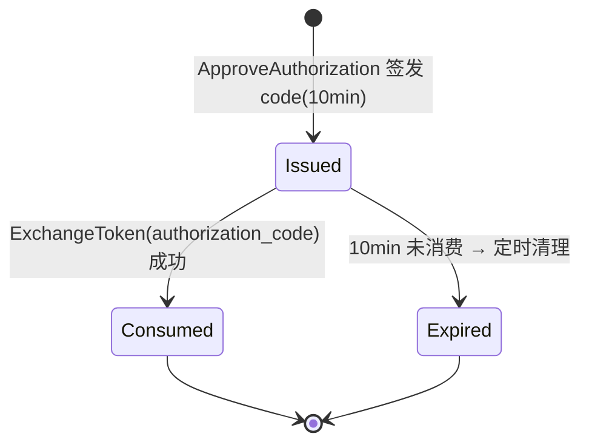

## 一句话说明
第三方 OAuth Client 经 media_auth 完成 authorization_code（含 PKCE）/ refresh_token / token-exchange 三种 grant 换取 Access Token，并用 userinfo 取用户信息；oauth domain 主导，复用 auth 的 users 读取与 JWT 签名。

## 执行时间线（每个接口内嵌内部处理）

```text
client(3rd)        browser(资源owner)        media_auth                        ext RS
   |                    |                        |                               |
   |-- redirect authorize ----------------------->|                               |
   |                    |-- GET /oauth/authorize -->|                            |
   |                    |   oauth.GetAuthorizeInfo                                |
   |                    |   ├─ response_type!=code → 400                          |
   |                    |   ├─ client 不存在 → 400 invalid_client                 |
   |                    |   └─ redirect_uri 不在白名单 → 400                       |
   |                    |<-- {client_name, scope} --|                            |
   |                    | (consent 页)                                            |
   |                    |-- POST /oauth/authorize (cookie) -->|                  |
   |                    |   oauth.ApproveAuthorization                            |
   |                    |   ├─ 校验同上 + code_challenge_method=S256              |
   |                    |   ├─ code=hex(32); INSERT auth_code(10min, user=sub)   |
   |                    |   └─ redirect_uri?code=&state=                          |
   |                    |<-- {redirect_uri} --|                                  |
   |<== redirect with code ==================|                                   |
   |                    |                        |                               |
   |-- POST /oauth/token (form-urlencoded) -------->|                            |
   |   oauth.ExchangeToken (按 grant_type 分发)                                   |
   |   ├─ authorization_code:                                                     |
   |   │   DELETE code RETURNING(一次性); 过期→invalid_grant                       |
   |   │   client_id/redirect_uri 不匹配→400                                      |
   |   │   PKCE: sha256(verifier)!=challenge→invalid_grant                        |
   |   │   access=signJWT(user,1h); refresh=hex(32)→存hash(30d)                   |
   |   ├─ refresh_token:                                                          |
   |   │   hash 查表; 旧删新发(轮转)                                               |
   |   ├─ token-exchange(RFC8693):                                                |
   |   │   校验 client_secret(常量时间)                          -- introspect -->|
   |   │   POST {resource}/introspect(token=subject_token)    <-- {active} -------|
   |   │   不 active→invalid_grant; 签 access(1h, 不发 refresh)                   |
   |   └─ 其它→unsupported_grant_type                                             |
   |<-- {access_token, refresh_token?, expires_in=3600} --|                      |
   |                    |                        |                               |
   |-- GET /oauth/userinfo (Bearer access) -------->|                            |
   |   oauth.GetUserInfo                                                          |
   |   ├─ 本地 HS256 验签 access_token; 失败→401                                  |
   |   └─ {sub, username, name, email}                                            |
   |<-- {sub,...} --|                                                             |
```

## 关键流程参数传递
- `code` + `code_verifier`：client 在 authorize 阶段提交 `code_challenge`(S256)，token 阶段提交 `code_verifier`；media_auth 算 `base64url(sha256(verifier))` 与 challenge 比较。PKCE 仅 S256。
- `redirect_uri`：authorize 与 token 两阶段都校验，须与 client 白名单精确匹配、且两次一致。
- `state`：authorize 原样回传 client，media_auth 不解析、不校验（防 CSRF 由 client 自行负责）。
- token-exchange 的 `subject_token`：经外部 RS `/introspect` 解析为 user，再签 media_auth 自己的 access_token；`resource` 必须是合法 URL，其 origin 即 RS。
- access_token：HS256 JWT（与 session cookie 同 `JWT_SECRET`），1h TTL，自包含 sub/role；refresh_token：opaque，DB 仅存 hash。

## 状态流转
authorization_code 一次性消费：

refresh_token 轮转：每次使用旧 token 删除、签新 token，无状态机。

## 幂等设计
- authorization_code 严格一次性：`DELETE ... RETURNING`，重复消费第二次返回 invalid_grant。
- refresh_token 轮转非幂等：重复提交旧 refresh_token（已被删）返回 invalid_grant，client 须用最新 refresh_token。
- token-exchange 可重复：同一 subject_token 可多次换 access_token（每次新签 1h access），无幂等约束。
- userinfo 纯读，天然幂等。
