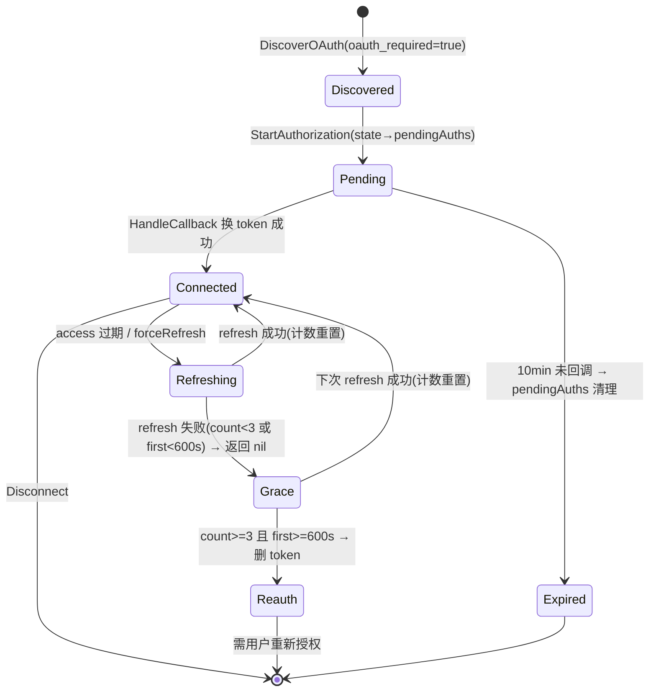

## 一句话说明
用户把第三方 MCP 服务器接入平台：discover 探测 OAuth → popup 发起授权（PKCE+state）→ callback 换 token 按 (user,server) 存储 → 控制面 mcp-proxy 经 getValidAccessToken 取/刷新 token 调 MCP；mcp_oauth domain 主导，回调后跨服务通知 control_plane reload。

## 执行时间线（每个接口内嵌内部处理）

```text
browser(popup)        media_auth                              MCP server           control_plane
   |                     |                                       |                       |
   |-- POST /mcp-oauth/discover {url} -->|                       |                       |
   |   mcp_oauth.DiscoverOAuth                                                   |
   |   ├─ GET {origin}/.well-known/oauth-authorization-server (5s) -->|           |
   |   │   缺 authorize+token endpoint → {oauth_required:false}                  |
   |   └─ upsert mcp_oauth_clients(server_origin, metadata) → {true,origin}      |
   |<-- {oauth_required, server_origin} --|                                      |
   |                     |                                       |                       |
   |-- GET /mcp-oauth/authorize?server_origin=&workspace_id= -->|               |
   |   mcp_oauth.StartAuthorization                                              |
   |   ├─ code_verifier=rand(32); challenge=S256; state=rand(16)                |
   |   ├─ pendingAuths[state]={user_id,server_origin,code_verifier,workspace_id}(10min 内存)
   |   └─ c.Redirect → {authorize_endpoint}?...&code_challenge=&state=           |
   |<== 302 ===================================================================>|
   |                     |                                       |                       |
   |<== MCP server 重定向 callback?code=&state= ==========================|      |
   |-- GET /mcp-oauth/callback?code=&state= -->|                        |       |
   |   mcp_oauth.HandleCallback                                                  |
   |   ├─ pendingAuths[state] 不存在/过期→400; user_id!=sub→403                  |
   |   ├─ POST {token_endpoint}(code,code_verifier,redirect_uri) -->|            |
   |   │<-- {access_token, refresh_token, expires_in} ------------|              |
   |   ├─ upsertToken(user,server,tokens): ON CONFLICT DO UPDATE                 |
   |   │   重置 refresh_fail_count=0, refresh_fail_first_at=NULL                 |
   |   │   expires_at=now+expires_in(无则+1800s)                                 |
   |   ├─ notifyAgentReload(workspace_id,['config']) ─────────────────--------->|
   |   └─ 返回 HTML: window.opener.postMessage + window.close()                  |
   |<-- HTML(200) --|                                                            |
   |                     |                                       |                       |
   |                     | <-- getValidAccessToken(user,server,forceRefresh?) ----|
   |                     |   mcp_oauth 取 token 行                              |
   |                     |   ├─ 未过期且非 force → 返回 access_token              |
   |                     |   └─ 过期/force → refresh {token_endpoint}            |
   |                     |       成功→upsert(重置计数)→返回新 access              |
   |                     |       失败→宽限判定(count>=3 且 first>=600s→删+抛      |
   |                     |              ReauthRequired; 否则返回 nil 暂态)        |
   |                     | ---- access_token (或 nil/err) ---------------------->|
```

## 关键流程参数传递
- `server_origin`：贯穿全流程的主键，标识一个 MCP server；discover 时确定并 upsert 到 `mcp_oauth_clients`。
- `state`（随机 16 字节）：authorize 下发、callback 回传，media_auth 用内存 `pendingAuths` 映射回 `{user_id, server_origin, code_verifier, workspace_id}`，并校验 `user_id == session.sub` 防越权。
- `code_verifier` / `code_challenge`（S256）：仅存于内存 pendingAuths（10min），不落库；callback 时提交给第三方 token_endpoint。
- `workspace_id`：callback 成功后用于 `notifyAgentReload(workspace_id, ['config'])` 跨服务通知 control_plane 该 workspace 重载 MCP 配置。
- access/refresh token：明文存 `mcp_oauth_tokens`（对 media_auth 不透明），key `(user_id, server_origin)`。

## 状态流转


## 幂等设计
- `upsertToken` 幂等：`ON CONFLICT (user_id, server_origin) DO UPDATE`，重复 callback 以最新 token 覆盖并重置失败计数。
- `DiscoverOAuth` 幂等：重复 discover 对同 `server_origin` 仅更新 metadata。
- `pendingAuths` 严格一次性：state 消费即从内存移除，重复 callback 同 state 返回 400。
- `Disconnect` 幂等：删除已不存在的 token 行不报错，返回 success。
- 宽限计数非幂等：每次 refresh 失败 count++，是预期行为，不回避。
