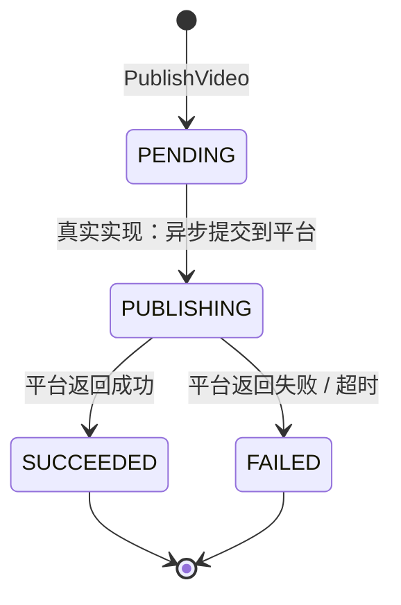

## 一句话职责
publish 域负责接收一个已生成的视频 `generated_asset_id` + `publish_target`，把视频发布到目标平台（本期 mock：直接返回假发布 url + `SUCCEEDED` 状态，不实际调平台 API）；维护发布状态机 `PENDING -> PUBLISHING -> (SUCCEEDED | FAILED)`（本期 mock 直接跳到 SUCCEEDED）。不读写 `media_materials`，不修改 `generated_asset` 本身。

## 边界

### 做什么
- 接收 `PublishVideo(asset_id, target, metadata?)` 请求，校验 asset_id 非空、target 在支持列表内。
- mock：构造发布结果 `PublishResult{state: SUCCEEDED, publish_url: "mock://publish/{target}/{asset_id}", platform_publish_id: "mock-{asset_id}-{timestamp}"}`。
- 返回结果给调用方（BFF / 编排层），不持久化。
- 状态机概念：`PENDING -> PUBLISHING -> (SUCCEEDED | FAILED)`。本期 mock 跳过 PUBLISHING 异步阶段，直接 SUCCEEDED。

### 不做什么
- 不实际调平台 API（小红书 / 抖音 / B 站等）--本期 mock，留 stub 接口。
- 不持久化发布记录--发布状态查询由调用方在 BFF 层用调用返回的 `platform_publish_id` 自行轮询平台（真实实现需异步轮询 + 状态存储，本期不做）。
- 不修改 `generated_asset` --发布动作只读 asset，不改 asset 状态。
- 不发布非视频类型 asset --本期校验仅判 asset_id 非空；真实实现需调 `media_materials.AssetRead` 校验 media_type=VIDEO。
- 不触发 generation --发布是独立的下游动作，调用方负责串 generation -> publish。

## 能力清单

| 能力 | 说明 | 对外接口/函数 |
|:---|:---|:---|
| PublishVideo | 接收 asset_id + target，mock 发布到平台，返回 publish_url + 状态 | `POST /api/v1/publish:video` |
| GetSupportedTargets | 返回当前支持的 publish_target 列表（mock 静态列表） | `GET /api/v1/publish/targets` |
| Publish | service 层方法：执行单次发布（mock） | `service.Publish(ctx, cmd)` |

## 数据模型

**无表**。本域不持久化，发布结果一次性返回给调用方。

> 设计决策：本期 mock 阶段不持久化。真实实现需新增 `publishes` 表（asset_id, target, platform_publish_id, state, ...）+ 异步轮询平台状态，到时再建表。当前不预建表，避免空表维护成本。

## 实体与值对象

```go
// PublishTarget -- 发布目标平台
type PublishTarget string
const (
    PublishTargetXHS     PublishTarget = "xhs"
    PublishTargetDouyin  PublishTarget = "douyin"
    PublishTargetBili    PublishTarget = "bilibili"
)

// PublishState -- 发布状态机
type PublishState string
const (
    PublishStatePending    PublishState = "PENDING"
    PublishStatePublishing PublishState = "PUBLISHING"
    PublishStateSucceeded  PublishState = "SUCCEEDED"
    PublishStateFailed     PublishState = "FAILED"
)

// PublishCommand -- PublishVideo 入参
type PublishCommand struct {
    AssetID  string            // 已生成的 generated_asset id（视频）
    Target   PublishTarget
    Metadata map[string]string // 平台特定元数据（标题、标签等），可选
}

// PublishResult -- PublishVideo 出参
type PublishResult struct {
    AssetID           string
    Target            PublishTarget
    State             PublishState
    PublishURL        string            // 平台上的发布 url（mock）
    PlatformPublishID string            // 平台返回的发布 id（mock），供后续轮询用
    PublishedAt       int64             // 发布时间戳
}
```

## 状态机



> 本期 mock：`PENDING -> SUCCEEDED`（跳过 PUBLISHING 异步阶段）。真实实现需引入异步 worker + 平台轮询。

## 能力详细说明

### PublishVideo
```
入参：asset_id, target, metadata?
1. 校验 asset_id != ""（否则 400）
2. 校验 target ∈ {xhs, douyin, bilibili}（否则 400）
3. 校验 metadata 可选，无 metadata 不报错
4. mock 执行：
   publish_url = "mock://publish/{target}/{asset_id}"
   platform_publish_id = "mock-{asset_id}-{unix_ms}"
   state = SUCCEEDED
   published_at = now()
5. return PublishResult
异常：
- 真实实现可能返回 PUBLISHING（异步），调用方用 platform_publish_id 轮询
- 真实实现可能返回 FAILED（平台拒绝），调用方决定是否重试
- 本期 mock 不会失败
```

### GetSupportedTargets
```
return ["xhs", "douyin", "bilibili"]
注：本期静态列表，真实实现可由配置驱动。
```

## 跨服务 RPC 列表

本期无跨服务 RPC 调用（mock 不调 `media_materials` / `media_crawler`）。

> 真实实现预期：
> - `media_gen` -> `media_materials` `AssetRead`：校验 asset_id 存在 + media_type=VIDEO + 拿 url。
> - `media_gen` -> `media_crawler`：调平台 API 发布（具体 RPC 待 crawler 暴露发布接口）。
> - 本期不预建 client，留 TODO。

## 关联关系

### 依赖的 domain
- 无本服务内 domain 依赖（与 generation 不直接互依，调用方在 BFF 串接）。

### 被依赖的 domain
- 无。

### 参与的 workflow
- [video-publish](../../workflow/0002-video-publish/video-publish.md) - 视频发布流程，调用本域 Publish

### 关联术语
[Publish](../../CONTEXT.md)、[Publish Target](../../CONTEXT.md)、[Publish State](../../CONTEXT.md)。
