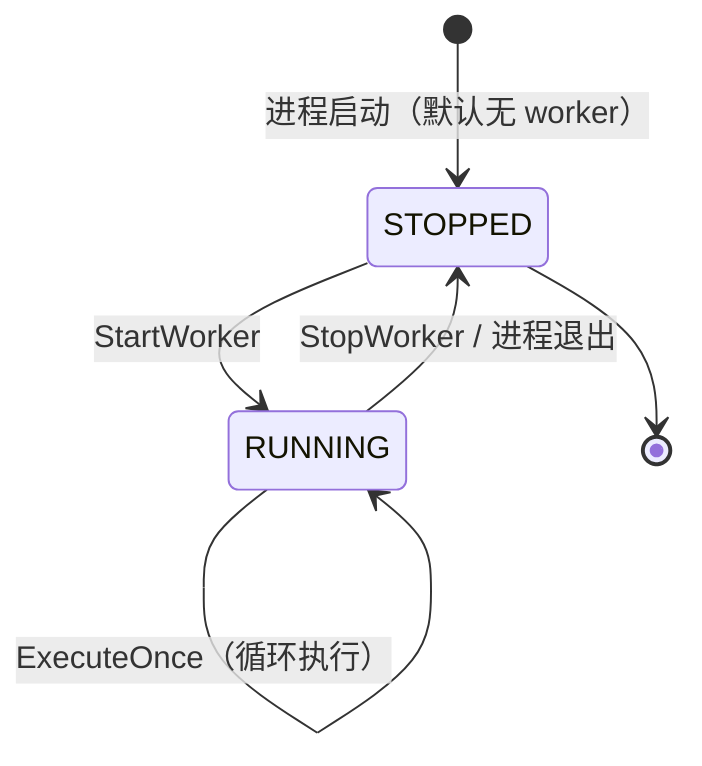

## 一句话说明

media_gen 单个 worker 进程内的主循环：周期性调 `media_workflow.ClaimStepRun` 按 `(platform, gen_way, gen_type)` 拉取待执行 StepRun -> 调 [generation](../../domain/0001-generation/generation.md) 域 `ExecuteOnce` 完成执行（mock 产候选）-> 回写 `CompleteStepRun` / `FailStepRun`。循环由 `StartWorker` RPC 启动、`StopWorker` RPC 停止；本期 stub（接口就绪，不实际跑 loop，避免空转）。

## 触发点

- `POST /api/v1/workers:start`（StartWorker）：在进程内启动一个 worker goroutine，记录 `(worker_id, platform, gen_way, gen_type, state=RUNNING)` 到进程内注册表。
- `POST /api/v1/workers/{worker_id}:stop`（StopWorker）：停止 worker goroutine，state -> STOPPED。
- `GET /api/v1/workers/{worker_id}`（WorkerStatus）：查询 worker 进程内状态。
- `GET /api/v1/workers`（ListWorkers）：列出进程内全部 worker。

> worker loop 与 HTTP server 同进程（in-process goroutine），不独立 listener。设计简单，回退成本低（拆为独立进程只需把 StartWorker/StopWorker 换成 IPC），未达 ADR 阈值。

## 阶段

### 1. StartWorker（启动）
```
入参：worker_id, platform, gen_way, gen_type, poll_interval_ms?
1. 校验 worker_id 在进程内未注册（否则 409 Conflict）
2. 校验 platform / gen_way 非空（否则 400）
3. 注册 worker 到进程内 map：{worker_id, platform, gen_way, gen_type, state: RUNNING, started_at: now()}
4. 启动 goroutine 跑 loop(ctx, worker)
5. return WorkerInfo{...}
```

### 2. Worker Loop（goroutine 内）
```
入参：ctx, worker
loop:
  1. 检查 ctx.Done() -> 退出
  2. 检查 worker.state == STOPPED -> 退出
  3. 调 generation.ExecuteOnce(ctx, worker)
     - 若返回 nil -> 等待 poll_interval_ms（默认 5000ms）-> 继续
     - 若返回 ErrNoStepRun（Claim 返回空）-> 等待 poll_interval_ms -> 继续
     - 若返回其他 err -> 记日志 -> 等待 backoff（默认 2x，上限 30s）-> 继续
  4. 回到 1
注：本期 stub - goroutine 启动后立即 select { <-ctx.Done() }，不实际跑 Claim 循环。
   避免无 postgres / 无 media_workflow 的本地启动场景空转报错。
   真实实现需把 stub 换为上述 loop 逻辑。
```

### 3. StopWorker（停止）
```
入参：worker_id
1. 查找 worker -> 不存在返回 404
2. cancel worker.ctx（goroutine 监听 ctx.Done() 退出）
3. worker.state = STOPPED
4. 保留注册表记录（便于查询历史状态），不立即删除
5. return WorkerInfo{state: STOPPED}
```

### 4. WorkerStatus（查询）
```
入参：worker_id
return WorkerInfo{
  worker_id, platform, gen_way, gen_type, state, started_at, stopped_at?,
  last_claim_at?, last_complete_at?, last_error?
}
```

### 5. ListWorkers
```
return []WorkerInfo（进程内全部 worker，含 STOPPED）
```

## 关键流程参数传递

| 参数 | 来源 | 用途 |
|:---|:---|:---|
| `worker_id` | StartWorker 调用方 | 进程内唯一标识；透传给 `media_workflow.ClaimStepRun` 作为 `claimed_by`（用于回收识别） |
| `platform` / `gen_way` / `gen_type` | StartWorker 调用方 | Claim 匹配键，决定该 worker 领哪些 StepRun |
| `poll_interval_ms` | StartWorker 入参，默认 5000 | 空闲轮询间隔；避免无任务时打爆 `media_workflow` |
| `candidate_count` | `media_workflow.ClaimStepRun` 返回 | 决定 GenerateCandidates 产 N 还是 1 候选 |
| `rendered_prompt` / `input_assets` | `media_workflow.ClaimStepRun` 返回 | 本期 mock 不消费；真实实现传给下游生成器 |

## 状态流转



> 进程重启后所有 worker 默认 STOPPED（无持久化），需运维或编排层重新 `StartWorker`。

## 幂等设计

- `StartWorker(worker_id)`：若 worker_id 已注册且 state=RUNNING -> 409 Conflict；若 state=STOPPED -> 复用注册记录重新启动（幂等）。
- `StopWorker(worker_id)`：若 state=STOPPED -> 直接返回当前状态（幂等）；若不存在 -> 404。
- `ExecuteOnce`：幂等可重复调用；单次执行失败不影响下次 Claim。

## 错误处理

| 来源 | 处理 |
|:---|:---|
| `media_workflow.ClaimStepRun` RPC 失败 | 记日志 + backoff（2x，上限 30s）后重试；不影响 worker state |
| `media_workflow.CompleteStepRun` RPC 失败 | 记日志；不本地 retry（`media_workflow` scanner 会回收 claimed 超时的 step_run 重新入队） |
| GenerateCandidates 失败（真实实现） | 调 `FailStepRun(step_run_id, reason)` |
| worker goroutine panic | recover + 记日志 + worker.state -> STOPPED + last_error |

## 跨服务 RPC 列表

| RPC 方向 | 目的 |
|:---|:---|
| `media_gen` -> `media_workflow` `ClaimStepRun` | worker loop 周期性拉取待执行 StepRun |
| `media_gen` -> `media_workflow` `CompleteStepRun` | 回写候选产物 |
| `media_gen` -> `media_workflow` `FailStepRun` | 回写执行失败原因 |

> client stub 位置：`hertz_gen/media_workflow/job_service/`。本服务 `biz/shared/client/` 装配实例。

## 关联 domain

- [generation](../../domain/0001-generation/generation.md) - worker loop 调用其 ExecuteOnce 完成单次执行

## 关联术语
[Worker Loop](../../CONTEXT.md)、[Worker State](../../CONTEXT.md)、[Claim / Complete / Fail](../../CONTEXT.md)、[Generation Worker](../../CONTEXT.md)。
