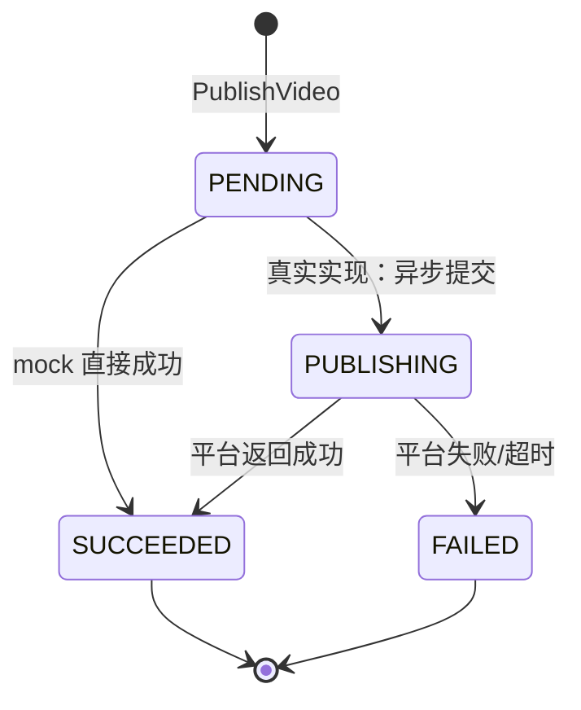

## 一句话说明

视频发布流程：调用方（BFF / 编排层）在用户确认最终产物后调 `POST /api/v1/publish:video` -> [publish](../../domain/0002-publish/publish.md) 域 mock 执行 -> 返回 `PublishResult{state, publish_url, platform_publish_id}`。本期一次性同步返回 SUCCEEDED；真实实现需异步轮询平台状态。

## 触发点

- `POST /api/v1/publish:video`（PublishVideo）：由调用方在用户确认最终产物后显式触发。
- `GET /api/v1/publish/targets`（GetSupportedTargets）：查询支持的目标平台列表。

> 本 workflow 不被 generation 自动触发；调用方负责在 BFF 层串接 generation（产出最终 asset）-> 用户选图 -> publish。

## 阶段

### 1. PublishVideo（同步 mock）
```
入参：asset_id, target, metadata?
1. 调 publish.Publish(ctx, cmd)
   - 校验 asset_id 非空、target 在支持列表内
   - mock: state=SUCCEEDED, publish_url="mock://publish/{target}/{asset_id}"
   - return PublishResult
2. return PublishResult
```

### 2. GetSupportedTargets
```
return ["xhs", "douyin", "bilibili"]
```

## 关键流程参数传递

| 参数 | 来源 | 用途 |
|:---|:---|:---|
| `asset_id` | PublishVideo 调用方 | 已生成的 generated_asset id（视频）；真实实现需调 `media_materials.AssetRead` 校验 + 拿 url |
| `target` | PublishVideo 调用方 | 发布平台：`xhs` / `douyin` / `bilibili` |
| `metadata` | PublishVideo 调用方，可选 | 平台特定元数据：标题、标签、描述等；本期 mock 不消费 |
| `publish_url` | publish 域返回 | 发布成功后平台上的 url（mock），返回给调用方 |
| `platform_publish_id` | publish 域返回 | 平台返回的发布 id（mock），供后续轮询状态用 |

## 状态流转



> 本期 mock：`PENDING -> SUCCEEDED`（跳过 PUBLISHING）。

## 幂等设计

本期 mock 无幂等要求（不持久化）。真实实现需：
- `(asset_id, target)` 复合幂等键：同一 asset 发布到同一 target 不重复发布（返回已存在的 PublishResult）。
- `platform_publish_id` 作为平台侧幂等键，重试时透传。

## 错误处理

| 来源 | 处理 |
|:---|:---|
| asset_id 为空 / target 不支持 | 400 Bad Request，不进入 mock 执行 |
| 真实实现：AssetRead 失败 | 404 Not Found（asset 不存在）或 409（media_type 非 VIDEO） |
| 真实实现：平台 API 失败 | 返回 FAILED + reason；调用方决定是否重试 |
| 本期 mock | 不会失败 |

## 跨服务 RPC 列表

本期无跨服务 RPC 调用（mock）。

> 真实实现预期：
> - `media_gen` -> `media_materials` `AssetRead`：校验 asset_id 存在 + media_type=VIDEO + 拿 url。
> - `media_gen` -> `media_crawler`：调平台 API 发布（具体 RPC 待 crawler 暴露发布接口）。
> - 本期不预建 client，留 TODO。

## 关联 domain

- [publish](../../domain/0002-publish/publish.md) - 调用其 Publish 方法执行发布

## 关联术语
[Publish](../../CONTEXT.md)、[Publish Target](../../CONTEXT.md)、[Publish State](../../CONTEXT.md)。
