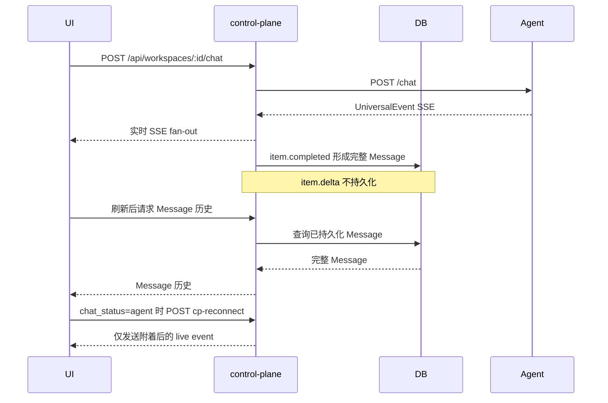
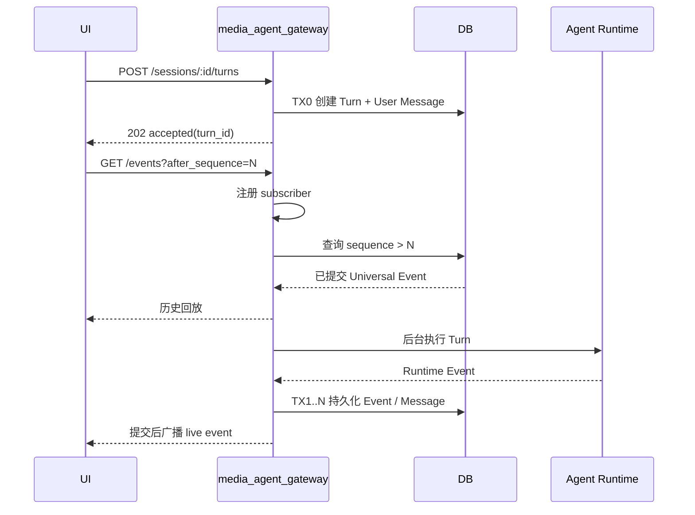

# Run Turn / SSE 传输设计实现审查

## 审查结论

本项目 Run Turn Workflow 有意将“提交命令”和“消费 SSE”拆成两个独立生命周期：`POST /turns` 只返回 accepted，`GET /events` 承担回放与实时订阅。这与 agent-platform 默认 `/chat` 直接承载 SSE、刷新后使用 live-only `cp-reconnect` 的 Workflow 不同。该分叉先写入设计，再进入实现。

## 两套 Workflow

### agent-platform

### media_agent_gateway 目标设计

容易误实现的核心区别：agent-platform 的 reconnect 不补历史，完整性最终由 `item.completed` 和 Message 保证；本项目把每个 delta 也变成恢复事实，因此必须维护 sequence、回放/live 重叠去重和 poison event 处理。

## 接口契约对照

| 用例 | agent-platform | 本项目 | 状态 |
|:---|:---|:---|:---|
| 发起 Turn | `POST /api/workspaces/:id/chat`，默认直接 SSE；async 返回 session id | `POST /api/chat/sessions/:sid/turns`，返回 turn id | 设计分叉 |
| 读取 Message | `GET /api/workspaces/:id/messages?session_id=`，返回 `ApiMessage[]` | `GET /api/chat/sessions/:sid/messages`，返回 `{messages}` | 设计分叉 |
| 重连/订阅 | `POST cp-reconnect?session_id=`，live-only | `GET /events?after_sequence=`，replay + live | 设计分叉 |
| 是否连接 | `chat_status == agent` 才 reconnect | 选中 Session 后持续订阅 | 设计分叉 |

## 本项目 Workflow 实现偏差

| 规则 | 当前实现 | 状态 | 影响 |
|:---|:---|:---|:---|
| Event 提交后才能广播 | `PersistEvent` 成功后才 `Publish` | covered | 客户端收到的事件可回放 |
| 注册 → 回放 → live，按 cursor 去重 | Handler 顺序与规则一致 | covered | 回放/live 窗口无缺口 |
| 客户端断开不取消 Turn | `go w.execute` 使用后台 Context | covered | 页面刷新不终止执行 |
| `session.ended` 或 `error` 后刷新 Message | UI 仅在 `session.ended` 刷新；`error` 只更新错误状态 | missing | error 前已提交的 Message 可能直到下次页面加载才成为 UI 权威状态 |
| heartbeat 使用 SSE 注释 | Handler 发送命名为 `heartbeat` 的 SSE event | partial | 客户端当前会忽略它，保活有效，但 wire contract 与 spec 不一致 |
| 回放/live 重叠与刷新恢复自动化验证 | 计划/spec 声明已验证 | 未发现对应 Handler/UI 回放重叠或完整刷新测试 | missing | 关键竞态主要依赖代码审阅，缺少回归保护 |
| Turn 终态按 Runtime 结果分类 | `execute` 在 `runtime.Chat` 无 transport error 时统一写 `completed` | partial | 若 Runtime 用事件表达 error/interrupted 而调用本身返回 nil，Turn 状态可能与事件终态不一致 |

## 判断

主结论：**设计阶段已经没有与 agent-platform 对齐**。实现不是误把 agent-platform 的 cp-reconnect 写成了 event replay；event replay 正是本项目 2026-08-11 明确批准的目标设计。

次结论：**实现对本项目自身设计仍非完全对齐**。优先修复项是 error 后刷新 Message、严格 sequence 分配/约束、Turn 终态映射和 replay/live/刷新恢复测试；heartbeat 与授权顺序属于较低风险契约偏差。
