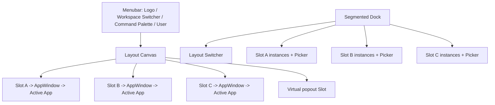

# UI Platform 与 agent-platform 交互差距调研

## 结论

当前实现只对齐了 `AppDefinition -> SlotProvider -> SlotContainer -> AppWindow` 的组件名称和最小状态形状，没有对齐 agent-platform 的主要交互模型。它更接近“Workspace 侧栏 + 两个带标签页的面板”，而 agent-platform 是“Menubar + 可切换 Layout + 分段 Dock + Slot AppWindow + Workspace Profile”的桌面式应用平台。

因此当前状态只能判定为 `partial`，不能称为“完全参考 agent-platform 的结构与交互”。本报告只调研和审查，不修改目标设计或业务代码。

## 调研范围与事实来源

### agent-platform

- `web/docs/new-ux.md`
- `web/src/components/shell/Desktop.tsx`
- `Menubar.tsx`、`WsSwitcher.tsx`、`Dock.tsx`
- `SlotPicker.tsx`、`SlotContainer.tsx`、`AppWindow.tsx`
- `LayoutSwitcher.tsx` 与 `layout/{One,Two,Three}ColumnLayout.tsx`
- `PopoutLayer.tsx`、`CommandPalette.tsx`
- `contexts/SlotContext.tsx`
- `stores/workspace-profile-store.ts`、`instance-state-store.ts`
- `pages/WorkspacePage.tsx`
- `WorkspaceSessionsPanel.tsx`、`WorkspaceChatPanel.tsx`
- `agent-session-store.test.ts`

### 当前项目

- `ui_platform/src/pages/chat/index.tsx`
- `foundation/providers/slot-provider.tsx`
- `foundation/components/{slot-container,app-window}.tsx`
- `foundation/slots/*`
- `domains/chat/*`、`domains/workspace/*`
- `ui_platform/e2e/tests/chat.spec.ts`
- `docs/ddd/ui_design/*`

## agent-platform 的真实交互骨架

职责划分：

1. Menubar 负责 Workspace 和全局入口；
2. Layout 只决定可见 Slot、尺寸和排列；
3. Dock 展示每个 Slot 的所有 App Instance，负责激活、拖拽排序、跨 Slot 移动和打开 App；
4. SlotContainer 只渲染活动实例；
5. AppWindow header 左侧由 App portal 注入业务操作，右侧由 Shell 提供 popout、fill、fullscreen、close；
6. Workspace Profile 保存 Layout、Slot、Instance 和 Popout 几何信息；
7. URL 只保存可分享的活动 Session。

## 差距矩阵

状态含义：`aligned` 已对齐；`partial` 只有形状或部分行为；`missing` 缺失；`implementation-only` 当前自行增加、参考实现没有对应交互。

| 交互/设计声明 | agent-platform 行为 | 当前实现 | 状态 | 影响 |
|:---|:---|:---|:---|:---|
| Workspace 入口 | 顶部 `WsSwitcher` popover；URL `/w/:workspaceId`；可返回 Fleet | 左侧常驻 Workspace 列表 | `missing` | Workspace 抢占一整列，Shell 与业务内容混杂 |
| Workspace 创建 | Switcher/空态触发全局 Dialog Stack | 左侧底部常驻表单 | `missing` | 创建行为持续占屏，无法从多入口复用 |
| 用户入口 | 头像按钮打开 Preferences | 单独 Sign out 按钮 | `partial` | 缺少稳定的用户菜单扩展点 |
| Command Palette | Menubar 与 `Cmd/Ctrl+K`，可跳 Workspace/App/全局动作 | 无 | `missing` | App 规模增加后缺少统一快速入口 |
| Layout | 1/2/3 栏可切换；Workspace 默认 3 栏 | 硬编码 sidebar/main 两栏 | `missing` | Sessions/工作区/Chat 无法同时形成参考结构 |
| 面板尺寸 | 2/3 栏支持拖动调整并持久化宽度 | 固定 sidebar 宽度 | `missing` | 不能按工作内容分配空间 |
| Saved Layout | 应用、重置、另存、更新、删除布局 | 无 | `missing` | 可作为后续阶段，不属于最小闭环 |
| Dock | 底部按 Slot 分段展示所有实例 | AppWindow header 内显示标签 | `missing` | 实例导航位置和平台层级错误 |
| Dock 激活 | 点击 pill 激活；活动态按 Slot 显示 | 点击 header tab 激活 | `partial` | 基本切换可用，但不符合目标交互 |
| Dock 溢出 | 根据可用宽度计算容量，超出进入 overflow | 横向滚动标签 | `missing` | App 增多后导航退化 |
| Dock 拖拽 | 同 Slot 排序、跨 Slot 移动、键盘 sensor | 无 | `missing` | Slot 不能由用户组织 |
| Slot Picker | Command popover、搜索、分组、状态、多实例、新实例、popout | 原生 `<select>` | `missing` | 交互不可发现，无法承载未来 App Catalog |
| Slot 空态 | 居中 CTA 打开同一 SlotPicker | 文本 `Choose an app` | `missing` | 关闭最后 App 后没有直观恢复入口 |
| AppWindow header | App 用 portal 注入自身标题/动作 | Shell 显示所有 App 标签 | `missing` | App 业务动作与实例导航混在一起 |
| Window controls | hover 显示 popout/fill/fullscreen/close | 只有常显 close | `missing` | App 不能聚焦、全屏或浮出 |
| Fill | 单 Slot 填满 Canvas，其他 Slot 状态保留 | 移动端用 CSS 隐藏；桌面无 | `missing` | 缺少临时聚焦工作流 |
| Fullscreen | 浏览器 Fullscreen API | 无 | `missing` | 次要，可后置 |
| Popout | 虚拟 Slot；移动实例且保持 instanceId；几何持久化 | 无 | `missing` | 当前范围可后置，但 Slot 模型未预留 |
| App 多实例 | `open()` 默认创建新实例；`ensureInstance()` 复用已有实例 | 默认单实例 | `partial` | 用户已明确当前单实例，可接受差异 |
| 单实例约束 | 若采用单实例，应跨全部 Slot 唯一 | 当前只在目标 Slot 内查重 | `implementation-only` | 同一个 App 可在两个 Slot 各开一次，违反本项目 ADR |
| Instance 状态 | memory/persistent 两层，关闭自动清理 | App 内 `useState` | `missing` | 切换 App 会丢搜索、草稿和位置 |
| Profile 后端 | Workspace DB profile，debounced PATCH，跨设备 | localStorage | `partial` | 单浏览器可恢复，但非跨设备，且没有并发合并 |
| Profile 加载门 | Profile 加载完成前不挂 Slot，避免默认布局闪烁 | localStorage 同步，无后端加载门 | `partial` | 当前无闪烁；迁移服务端 Profile 时必须补 |
| Profile 迁移 | 保留未知键、清理不存在 App、实例状态清理 | 只过滤不存在 App | `partial` | 缺少版本迁移和关闭后的实例状态治理 |
| Workspace URL | Workspace ID 是路由身份 | 只在 React state/localStorage | `missing` | 刷新、前进后退、分享和深链行为不可靠 |
| Session URL | `?session=` 可分享，非法值会回退 | 无 | `missing` | 无法直达/分享指定会话 |
| Workspace 切换并发 | URL/provider key 隔离，查询按 workspace key | 异步 `listSessions` 无 Workspace 结果版本校验 | `partial` | 快速切换可能让旧 Workspace Session 覆盖新 Workspace |
| Session 自动选择 | URL session 优先，再按规则选择；支持 new-session mode | 总是选择第一个 Session | `missing` | 用户无法保持显式选择或直接开始新会话 |
| Session 创建 | Chat 可处于无 Session 模式，首次发送由 SSE `session.started` 建立 | 必须先点击 Create session | `missing` | 核心聊天路径多一步，与参考交互明显不同 |
| Session 列表 | 搜索、过滤、时间分组、状态、来源、重命名、删除、收藏、分享 | 简单标题列表与创建按钮 | `missing` | 即便缩小业务范围，也至少缺少状态和重命名/删除 |
| Chat header | Session selector、new、rename、share、search 等注入窗口 header | Chat 内另起 header，仅显示 Workspace/Session 名 | `missing` | 双层 header，且 AppWindow portal 模型未实现 |
| Session 草稿 | 每个 Session 独立 draft store | Chat App 单个 input state | `missing` | 切换会话后草稿丢失或串用 |
| 流式切换隔离 | Abort 前一 SSE，并全面阻止 stale ended/error/question | 只忽略旧消息增量 | `partial` | 旧请求仍在消耗连接；全局 streaming 状态可能影响新 Session |
| SSE 重连 | 活动 Session 为 agent 状态时重连 | 无 | `missing` | 刷新或短暂断网后无法继续显示运行中 turn |
| Agent 状态 | running/needs-you/idle，支持 interrupt/pending question | 只有 `streaming` boolean | `missing` | 用户不清楚 Agent 是否仍在运行或等待输入 |
| Chat Composer | 发送键偏好、stop、slash/mention、附件、voice 等 | 文本发送 | `partial` | 当前范围可以只保留文本，但至少需要 stop 和 per-session draft |
| 错误边界 | Desktop `ChunkErrorBoundary` + Suspense | Shell 内无 Error Boundary | `missing` | 单个 App 报错可能再次导致全页崩溃 |
| 移动端 | 参考实现主要是 viewport Desktop，未定义当前项目的单 Slot 导航 | 项目自行实现 Sessions/Chat 两按钮 | `implementation-only` | 这是用户确认的合理扩展，但应基于 Dock/Fill，而非固定 App 按钮 |
| E2E | 参考状态层有大量竞态和 SSE 回归测试 | 主要验证页面可见、基础发送、Settings 恢复 | `partial` | 尚不能证明平台交互稳定 |

## 最重要的结构误解

### 1. App 标签不属于 AppWindow header

当前 `AppWindow` 遍历 `slot.opened` 并渲染标签；参考实现的 AppWindow header 是 App 自身工具栏的 portal target。实例标签位于底部 Dock。这个差异会直接阻碍：

- App header 的 Session selector、新建、搜索和设置动作；
- 分 Slot 的统一 App 导航；
- Dock 拖拽和 overflow；
- fill/fullscreen/popout 控件的一致位置。

### 2. Workspace 列表不是永久侧栏

agent-platform 将 Workspace 选择放入顶部 Menubar，并使用 Fleet `/` 与 Workspace `/w/:id` 两种 scope。当前永久侧栏既占据 Layout 空间，又使移动端必须再创造一套抽屉逻辑。即使本阶段不实现完整 Fleet，也应采用顶部 Workspace Switcher + 创建 Dialog。

### 3. 两栏不是参考实现的 Workspace 默认信息架构

agent-platform Workspace 默认三栏：Sessions、工作 App、Chat。当前只有 Sessions 与 Chat，Settings 被打开到其中一个 Slot 后会替换锚点 App。虽然暂时没有 Files/Terminal 等 App，中间工作 Slot仍应存在，Workspace Settings 应进入中间 Slot；没有工作 App 时可让中间 Slot默认 Settings 或保持可发现空态。

### 4. Slot Profile 不只是 opened/active

参考模型还要求：Layout、实例级持久状态、popout 虚拟 Slot、窗口几何、服务端 Profile 和加载门。当前 localStorage 适合作为原型，但它不足以支撑“平台级”承诺。

## 排除项：本阶段不应照搬的功能

以下交互虽然存在于 agent-platform，但按照用户已确认范围不应立即实现：

- plugin loader、远程 bundle 和 plugin 权限；
- Files、Terminal、Browser、Skills、Automation 等内置 App；
- Workspace tag、runtime lifecycle、团队和复杂配置；
- Saved Layout 管理；
- Popout 几何和隐藏 viewer App；
- Chat 图片、语音、文件 mention、slash command、分享；
- Session 来源过滤、收藏、分享和高级统计。

“不实现这些能力”不等于可以省略 Dock、Layout、AppWindow portal、URL session 和 Session 状态隔离，因为后者属于平台骨架或基本聊天交互。

## 建议的最小目标交互

### Shell

- 顶部 Menubar：Logo、Workspace Switcher、可选 Command Palette、用户菜单；
- Workspace Switcher：当前 Workspace、搜索、创建入口；
- Workspace 创建/更新使用 Dialog，API Key 不回显；
- 路由采用 `/w/:workspaceId?session=:sessionId`，根路由只提供 Workspace 选择空态或极简 Fleet。

### Canvas 与 Layout

- 保留 1 栏和 3 栏两种布局即可，暂不做 2 栏和 Saved Layout；
- 3 栏默认：Sessions / Workspace Settings-or-empty / Chat；
- 侧栏支持拖动宽度；
- 移动端映射为 1 栏，通过 Dock 切换活动 App，而不是固定 Sessions/Chat 导航按钮。

### Dock 与 Slot

- 底部 Segmented Dock，每个 Slot 一个 segment；
- pill 点击激活；Picker 使用 Command/Popover，可搜索；
- 当前单实例必须跨全部 Slot 唯一；
- 第一阶段可不做拖拽、overflow 和 popout，但 API 预留 `ensureInstance`、`moveInstance`；
- Slot 空态复用相同 Picker。

### AppWindow

- header 不显示 App tabs；
- 提供 AppHeader portal；
- 右侧至少实现 fill 与 close；fullscreen/popout 后置；
- Sessions 将 new/search 注入 header；Chat 将 Session selector/new 注入 header；Settings 注入标题。

### Session 与 Chat

- URL 保存活动 Session；
- 支持 new-session mode，首次发送后接受服务端返回的新 Session ID；
- 每 Session 独立草稿；
- 切换时 abort 旧 stream，隔离 message/error/ended/streaming 全部状态；
- 展示 idle/running/error 最小状态并支持 stop；
- Sessions 至少支持创建、选择、重命名、删除和状态标识；高级过滤/分享后置。

### Profile

- 短期可以继续 localStorage，但抽象 `ProfileBackend`；
- Profile 包含 `layoutId`、`slots`、`instances`，并有 schema version/migration；
- 后续增加 `media_control` Workspace Profile GET/PATCH，再切换为服务端 backend；
- 服务端 Profile 未加载完成前不渲染默认 Layout。

## 建议阶段

### P0：纠正交互骨架

1. Menubar + Workspace Switcher + 创建/设置 Dialog；
2. Workspace/Session URL；
3. 1/3 栏 Layout；
4. 底部 Segmented Dock + Command SlotPicker + Slot Empty State；
5. AppWindow header portal + fill/close；
6. 移动端从固定按钮改为单栏 Dock 导航。

### P1：补齐基本会话体验

1. new-session mode；
2. 每 Session 草稿；
3. stream Abort 与完整竞态隔离；
4. Session 状态、重命名、删除和 stop；
5. Chat/Session 业务动作进入 AppWindow header。

### P2：平台持久化和可扩展性

1. ProfileBackend 抽象与服务端 Workspace Profile；
2. instance memory/persistent state；
3. Dock reorder/cross-slot move/overflow；
4. Error Boundary、Suspense 和 Profile load gate；
5. Command Palette。

### P3：明确后置

Popout/fullscreen、Saved Layout、完整 plugin loader、复杂 Workspace 配置及高级 Chat/Session 能力。

## 验收矩阵建议

| 场景 | 应验证 |
|:---|:---|
| Workspace 深链 | 刷新 `/w/:id` 保持 Workspace；无效 ID 回根页 |
| Session 深链 | 刷新 `?session=id` 保持 Session；非法 ID 回退 |
| 快速切 Workspace | 旧 Sessions 请求不能覆盖新 Workspace |
| 快速切 Session | 旧 history/SSE/error/ended 不污染新 Session |
| Dock 激活 | 每个 segment 的活动实例与 Canvas 一致 |
| Slot 关闭为空 | 显示 Picker CTA，可重新打开 App |
| Layout 切换 | 非可见 Slot 状态保留，返回后恢复 |
| 移动端 | 单栏 Dock 切换 App，Workspace Switcher 可访问 |
| Profile 损坏/旧版 | 迁移或安全回退，不白屏 |
| App 崩溃 | 只影响 AppWindow，不导致 Shell 崩溃 |

## 审查结论

- `aligned`：App Definition 基本形状、稳定 instanceId、Slot opened/active、未知 App 过滤、Workspace 级本地恢复、API Key 不持久化。
- `partial`：Slot 生命周期、App 激活/关闭、Profile、基础 Session/Chat、移动端单 Slot。
- `missing`：Menubar Workspace Switcher、Dock、Layout、AppHeader portal、Window controls、URL 状态、Instance state、会话竞态完整治理和主要交互测试。
- `implementation-only`：永久 Workspace 侧栏、AppWindow 内标签、固定 Sessions/Chat 移动导航。

在 P0 完成前，不应再描述为“完全参考 agent-platform 的交互”；更准确的表述是“已建立可演进的 Slot 原型”。
