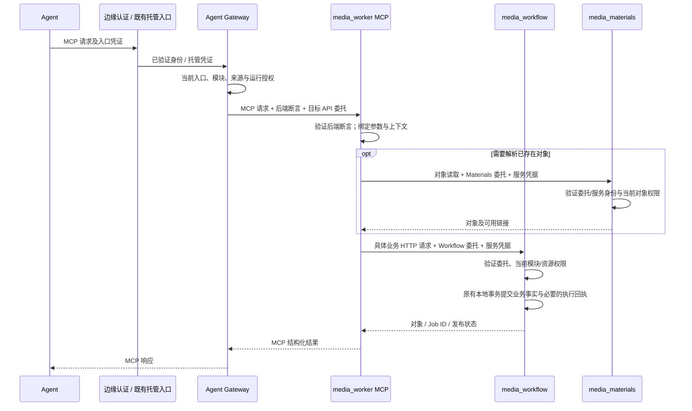

# 媒体 MCP 与统一 Gateway 实现规格（已确认）

状态：2026-10-28 用户确认，实施中。本文描述完整目标；现有能力与新增能力在各节明确区分。对应 [实施计划](../plan/media-worker-mcp-server.md)和 [设计审查记录](../review/media-worker-mcp-server.md)。遵循 [Harness 架构](../../harness/contributing/architecture.md)。

## 1. 范围与服务边界

所有 Agent 使用 Gateway 提供的标准 MCP 接口，不假定内部 Agent 具备特殊工具加载能力。用户通过页面签发 API Token，配置 MCP 地址和所属组织；可以选择 Workspace。媒体 MCP 在 media_worker 中作为独立服务进程运行。

| 所有者 | 本次职责 | 不属于它的职责 |
|:---|:---|:---|
| media_auth | Token 生命周期、当前用户/企业/部门与功能授权事实 | Template、Workflow、Job 的对象 ACL |
| media_control | Workspace 归属、当前访问权限；既有托管 Agent 执行身份 | 媒体生成与 MCP 工具业务 |
| media_agent_gateway | MCP 入口认证授权、来源目录、标准发现、过滤、代理、签发受众限定的内部委托 | 业务 HTTP 回调代理、媒体业务规则、模型工具动态注入 |
| media_plugin | 既有 Workspace Binding、固定版本和外部 MCP 凭据 | 本次平台媒体模块使用权限的另一本授权账 |
| media_worker MCP 进程 | 工具协议适配、参数校验、调用业务 API、组合结果 | 模板/工作流/Job 数据库、用户浏览器生成循环 |
| media_workflow | Template/Workflow/Job 事实与资源 ACL、能力目录、发布与执行调度 | MCP 会话与用户 Token 签发 |
| media_materials | 已有素材、生成资产、对象访问与链接授权 | MCP 会话及工作流调度 |

真实生成仍由现有 doubao_generate、gpt_generate 独立 Worker Workflow 执行。MCP 不持有业务事实表，不新增 execution、MCP 或通用 generate Domain。

本期提供 Template、Workflow、Job 的查看/添加，以及完成可执行流程必要的显式发布、校验和能力查询。素材管理作为统一授权模型的另一个模块，**不在本期扩展完整素材 CRUD MCP**；仅复用输入对象解析和结果读取 API。

明确不做：分级发现、搜索/通用调用元工具、MCP resources/prompts 新接口、Agent 动态加载、完整 MCP OAuth 授权服务器、外部 User 对任意第三方 MCP Binding 的新接入能力、Job 取消/重试/审批工具、浏览器生成能力扩展。现有托管 Agent 的 resources/prompts、第三方 Binding 和 OAuth 功能保持兼容。

## 2. 现有实现基线与真实缺口

| 代码证据 | 现状 | 本次修改 |
|:---|:---|:---|
| `hertz_infra/mcpprotocol`；Gateway `go.mod` | 官方 Go SDK v1.8.0、无状态 Streamable HTTP、标准协议兼容 | 复用；后端 typed tools 注册与服务名称参数化收口基础设施 |
| Gateway `workflow/mcp_identity.go` | 强制 Agent+Session，托管实例另验 Turn/epoch | 新增 User 入口分支，保留原分支，不以空 Session 模拟用户 |
| Gateway `workflow/mcp_gateway.go` | 自动加入 platform；其余来源依赖 Plugin 固定 Binding；上游完整枚举后分页 | 增加受平台管理的内部业务来源分支；复用命名空间与分页 |
| Auth `service/team/service.go:Authorize` | 当前 DB 事实判定 `use_workflow` / `use_materials` | Gateway 复用现有权威查询，不自行推断企业/部门授权 |
| Auth `workflow/authorization_projection.go`；Keto namespace | 关系经 Outbox 异步投影；`workflow.*` 目前折叠成模块使用权限 | 不把异步 Keto 投影当成即时撤权读；不声称已支持操作/入口粒度 |
| Control `service/workspace/service.go:CheckAccess` | 校验 Workspace 所属部门及业务功能 | 按所选 Workspace 调用 `use_workflow` |
| Workflow `shared/client/resource_authority.go` | Template 为企业资源，不依赖 Workspace；Workflow/Job 有 Workspace 范围 | 新委托身份必须进入现有资源事实过滤与 Command 范围 |
| `internaljwt/agent_delegation.go` | 仅支持 Agent Actor；签名绑定实际 HTTP method/URI/body | 保留原协议；不能改名后直接用于 User 或转发至不同请求 |
| Workflow `job/submission.go` | Job 有服务端幂等回执；Template/Workflow 创建无等价契约 | 复用 Job 幂等；其他写操作禁用自动重试 |

采用仓库已有 `github.com/modelcontextprotocol/go-sdk v1.8.0`，不迁移 crawler/CLI 的另一个 SDK。此前调研来源：[官方 Go SDK](https://github.com/modelcontextprotocol/go-sdk/releases/tag/v1.8.0)、[标准 Tools](https://modelcontextprotocol.io/specification/2026-07-28/server/tools)。

## 3. 公网入口和调用上下文

### 3.1 User API Token

公网 `POST /mcp` 经边缘 Ory 验证，随后只路由到 media_agent_gateway。旧协议所需 GET/DELETE 由 SDK 处理，所有受保护方法使用同一认证规则；Origin/CORS 使用明确部署 allowlist。原始 Token 不进入 Worker、业务服务、日志或工具结果。

新增 User Token scope `mcp.access` 表示“此凭证可调用 MCP 入口”。它不授予业务模块或资源权限。页面签发入口增加这一 scope 的选择；已有 `api.access` Token 不被隐式升级。托管 Agent 继续用现有 `agent.gateway` 及 Session/执行凭证，不要求混合 User scope。**此 scope 是本版新增提案，当前代码尚无此值。**

Ory 为公网 MCP 使用独立规则：仅 API Token introspection（不靠浏览器 Cookie），要求 `mcp.access`，签发 audience=`media-agent-gateway-mcp` 的短期内部 JWT，保留 User/actor/credential/org/scope。Gateway 验证 issuer、audience、期限及 `Actor=User`；拒绝 Worker Actor、过期凭证和未识别认证形式。公网剥离外部提交的内部身份及委托 Header。

每次请求带 `X-Media-Organization-ID`；若 Token 自带组织约束，必须相等。`X-Media-Workspace-ID` 可选，仅是选择参数，不是身份或授权声明。没有组织返回参数错误，不自动选择用户的第一个组织。

### 3.2 托管 Agent 兼容

既有内部接入保留 Agent Token、Session Token 和运行实例验证，不强迫其通过只接受 User scope 的公网 Ory 规则。两条认证路径进入同一 Gateway 业务调用流程，使用相同工具协议与业务权限。

认证路径按受信任的入口/issuer 明确区分，不依据失败后的猜测切换认证。携带冲突身份直接拒绝；User 不创建 Session，托管 Agent 不降格为 User Actor。组织与 Workspace 来自已验证的执行上下文，不能被请求 Header 覆盖。

### 3.3 内部调用上下文

应用层使用无框架依赖的 `MCPPrincipal`：`kind(user|managed_agent)`、`user_id`、`actor_id`、`credential_id`、`organization_id`、可选 `workspace_id`；托管分支附加实际 Session、AgentConfiguration、版本和执行代次。服务身份另记为 presenter，不与业务 actor 混淆。

User 入口不返回 `platform__session_context`、`platform__read_skill` 或固定 Session prompt。托管入口继续遵守原固定上下文与运行约束。工具元数据缓存、分页游标和连接不得通过空 Session 把不同用户合并。

## 4. 统一业务授权

### 4.1 权限计算

`有效调用 = 入口权限 ∩ 当前业务功能授权 ∩ 来源启用范围 ∩ 已有运行约束 ∩ 具体资源权限`。

- 入口权限：User Token 有 `mcp.access`；托管 Agent 有合法 `agent.gateway` 及原执行上下文。
- 企业/部门模块权限：复用 Auth 的 `use_workflow` / `use_materials`。当前企业管理员并不天然绕过部门使用权限，Gateway 不增加角色特判。
- 未选 Workspace：在选定企业中，至少一个当前有效成员部门允许 `use_workflow` 才开放媒体工作流来源；只用于模块可见性。Template 仍执行企业资源 ACL。
- 已选 Workspace：由 Control 查询当前 Workspace、组织/部门归属，再检查 `use_workflow`；其他部门的授权不能替代该 Workspace 的授权。
- 模块权限默认同时支持页面和 MCP。细分 `web/mcp` 或 `read/create/publish` 是后续业务授权模型扩展，本期不凭 `workflow.read` 字符串猜出已实现细粒度限制，也不按工具名称维护用户 ACL。
- 所有对象调用仍由 Workflow/Materials 依据当前资源事实授权。查询工具可见不保证目标对象可见。

Gateway 通过现有 Auth/Control 服务认证接口读取事实；policy 只接受已读取事实，不调用 Keto/HTTP。Auth 是授权事实所有者，Keto 是现有关系投影。首期使用当前同步权威查询完成撤权检查；不新建一套独立工具权限系统。

### 4.2 来源接入

媒体来源注册为平台拥有的 Definition `media-workflow`，transport=`streamable_http`、authentication=`session_context`，endpoint 指向内网 Worker MCP 服务。这里的旧认证类型名称代表受信任平台上下文，不代表 User 必须存在 Session。

Gateway 增加明确的受平台配置管理的内部业务来源注册项：Definition ID + 所需模块权限。企业不能自行将外部 endpoint 标记为内部业务来源。注册项只把既有模块能力映射到 MCP 来源，不存用户授权或 Token。

内部业务来源直接按当前模块权限开放，**不额外要求用户创建 Workspace Binding**。现有第三方来源仍走 Plugin 的固定 Binding/凭据流程。本期 User 入口仅开放该内部业务来源，不新增 Plugin 的 User Binding 查询 API。托管运行已有的来源/工具限制仍取交集，显式禁用不得被自动来源重新加入。Plugin 的内部 access 响应额外返回固定配置引用的 `restricted_definition_ids`（包含已停用 Binding）；该来源存在约束但未产生可用 Grant 时，Gateway 不自动开放，避免把停用与未绑定混为一谈。此为内部合同扩展，不新增 User Binding API。

来源停用或模块无权限时，在连接上游前排除。没有任何获准来源时，标准工具列表为空。权限依赖不可用返回 unavailable，不能把故障伪装成空列表，不能回退缓存授权。

### 4.3 撤权与并发边界

每个 MCP 发现/调用请求重新验证身份及当前功能权限；列表、旧 cursor 和手写名称没有授权效力。业务服务在执行前重新查询当前模块与对象权限。

“撤权生效”指权威授权变更提交后新开始的检查拒绝访问。已通过检查并提交的业务事务不会倒退；不承诺撤权取消已开始的生成。入口 introspection 不使用跨请求正向缓存；既有在途内部委托最长 60 秒，Token 撤销不能追溯取消已经验过身份的在途操作。对外文档不得写成零竞态、零窗口的“即时撤销所有请求”。

## 5. 单向调用与内部身份委托

### 5.1 调用路径



Worker 不回调 Gateway 申请签名或转发业务 API。Gateway 不知道模板字段如何转换为 Workflow HTTP 请求；业务路由映射只存在于 Worker 适配器和目标服务的准入规则中。

### 5.2 两类受众不同的内部断言（新增技术契约）

Gateway 使用服务端签名密钥签发两类 RS256 JWT，沿现有可信 issuer/JWKS 机制验签，使用新的 `auth_source=mcp_delegation`，不放宽原 `AgentSigner` 或 Ory User JWT 验证规则。独立公钥发布于 Gateway 内网地址的 `/.well-known/mcp-jwks.json`，不要求调用服务凭据；其内容仅含公开验签密钥，Edge 不将该路由转发到公网。

| 断言 | 受众及接收方 | 内容与用途 |
|:---|:---|:---|
| 后端请求断言 | `media-worker-mcp`；Worker 验证 | 已验证 principal、来源/定义版本、MCP method、工具名、参数摘要、call_id；只用于这次 MCP 请求 |
| 目标 API 委托 | 单一 `media-workflow-mcp` 或 `media-materials-mcp`；目标服务验证 | 同一 principal/call_id、presenter=`media-worker-mcp`、单一工具操作、组织/可选 Workspace；仅用于该工具对应的允许业务路由 |

共同字段：`iss/sub/act/aud/iat/nbf/exp/jti`、`credential_id`、`organization_id`、可选 `workspace_id`、`principal_kind`、`call_id`、`source_id`、`operation`。`sub=User:<id>`；User actor 保持 User，托管 actor 保持 Agent。有效期不超过 60 秒且不超过已验证入口断言剩余寿命；不允许续期、跨调用缓存或扩权。托管 Session/epoch 只作为来源校验和审计信息，不当作下游免检权限。

后端断言摘要绑定 method、原始工具名和完整批量 envelope 的规范化 JSON arguments（采用稳定对象键序列化，数组保持顺序）；禁止对未解析或重复键 JSON 生成歧义摘要。断言摘要不是 Job 幂等键。

Gateway → Worker 用 `Authorization` 携带后端断言；按需通过私有 `X-Media-MCP-Workflow-Delegation`、`X-Media-MCP-Materials-Delegation` 传递目标委托。Worker 校验二者 subject/actor/org/workspace/call_id/operation 一致，且不得落盘或进入 SDK 工具结果。发现与初始化请求只有后端断言，没有业务 API 委托。

只有当前授权允许访问 Materials 且工具为 jobs_submit/jobs_get 时，Gateway 才附加 Materials 委托；该权限不足时不影响纯文本任务和 Job 状态读取。目标服务仍执行当前授权。

Worker → 目标服务将对应目标委托放入 `Authorization`，另带目标专用 `X-Media-MCP-Service-Token`。该服务凭据验证 presenter；Workflow 与 Materials 使用不同凭据。凭据仅证明可信适配服务，不赋予用户业务权限。跨主机部署使用 TLS；后端端口不暴露公网。密钥与服务凭据只通过私密部署配置注入。

这是明确签发给目标业务服务的委托凭证，不是转发用户 Token，也不是将面向 Worker 的 Token 原样用于 Workflow。

### 5.3 目标服务的准入与信任边界

目标服务新增独立 MCP 委托认证分支，先验 JWT、受众/时效/actor、服务凭据及 `operation → HTTP method/route` 闭合映射，再构造可信调用上下文；未知操作、管理/Worker/internal 路由全部拒绝。拒绝后不能回退 Cookie、旧 JWT 或系统身份。

Workflow 的映射仅包括第 7 节工具对应路由及必要只读前置查询；Materials 仅包括输入/输出对象的授权只读查询。`jobs_submit` 委托不允许发布、删除、Worker complete 或上传。Materials 的允许路由闭合为：jobs_submit 可 GET `/api/v1/products/{id}`、`/api/v1/virtual-ips/{id}`、`/api/v1/library-objects:resolve`；jobs_get 可 GET `/api/v1/generated-assets/{id}` 与 `/api/v1/library-objects:resolve`。不开放列表、写入、上传或内部无用户校验路由。所有 ID/对象路径仍需相应资源授权，凭据不授予对象访问权。

Workflow 的只读前置查询按工具固定：模板创建可读能力定义；Workflow 创建/校验/发布可读所引用 Template 版本与能力；Job 提交可读所引用 Workflow/Template 版本及能力。工具不得使用这个“前置查询”概念访问任意 GET 路由。实现中必须有显式映射与反向拒绝测试。

组织和 Workspace 以委托为上限：创建参数冲突拒绝，查询在数据库分页前收窄范围，跨组织/Workspace 对象拒绝。

**目标 API 委托不绑定最终 HTTP body**，因为业务请求是在 Worker 中生成的。本版明确把 Worker MCP 进程视为可信的参数转换服务：它不能改变调用者、组织、Workspace 或工具操作，但目标服务不证明每个字段与原 MCP arguments 一一相同。原 Agent HTTP 代理的逐请求签名继续保留，不被削弱。若要求 Worker 本身不可信，则必须另行设计可验证转换协议；不以“受限凭证”掩盖这一信任边界。

凭据不承担 exactly-once。重复提交依靠业务幂等；Template/Workflow 写请求自动重试关闭。目标服务无需回 Gateway 复核，也不共享 Gateway 私钥。授权失败不持有 DB 事务，不产生业务副作用。

## 6. 标准 MCP 发现与协议行为

- 只使用 SDK 的标准初始化/协商、`tools/list`、`tools/call`；不新增私有 JSON-RPC 方法。内部与外部 Agent 均不要求动态工具注册。
- 工具名复用 `<definition>__<tool>`，例如 `media-workflow__jobs_submit`。媒体后端只注册短工具名。
- Gateway 在连接来源前检查模块权限；拿到工具后应用已存在的来源/运行限制；调用时再次检查。工具列表描述与 Schema 不因某次 describe 调用变化。
- 维持稳定排序、现有分页上限。cursor 绑定 principal kind/user/credential/org/workspace，以及托管上下文、来源版本、获准工具集合摘要和期限；不能仅绑定 Session。绑定当前可见集合摘要，不伪造现有服务没有的全局授权 revision。
- 元数据可以复用，授权不可跨请求复用；元数据按 source version 和身份可见范围隔离。后端请求凭证必须逐请求生成，不能把 Token 固定在跨用户共享 MCP client/session Header 中。
- 首期媒体后端不注册 resources/prompts；查看对象通过 get 工具完成。Gateway 对既有来源的资源 URI 重写保持原行为。
- `readOnlyHint` 等 annotation 根据工具行为声明，只辅助客户端展示，不作为权限来源。对象 ACL 不需要为了 tools/list 逐条枚举。

## 7. 媒体工具合同

### 7.1 统一批量合同

本期所有 13 个媒体 MCP 工具均为批量接口，包括 list、get、create、publish、validate、submit 和 capabilities_list；单项操作也传长度为 1 的数组。不另设单项工具或接收单对象的兼容分支。此要求作用于本期媒体工具；既有 platform 和第三方来源的协议保持兼容。

每个工具的输入统一为 `{"items":[{"item_id":"a","params":{...}}]}`。`params` 使用该工具的 typed Schema，第 7.2 节列出的字段均属于**单项 params**；同一批次只能调用该工具的一种操作，不混合创建/发布/提交，不允许项之间引用尚未产生的结果。

- `items` 必填，1–20 项；`item_id` 必填，为 1–64 字符的调用方关联标识，批内唯一。它不授予权限、不代替幂等键，也不是数据库 ID。
- 请求 JSON 上限 1 MiB。Schema 明确 required 与 `additionalProperties=false`。先校验完整批次结构、各项字段类型、数量及重复 item_id；不合法则整批拒绝且没有业务副作用。对象权限、版本状态等业务校验逐项执行。
- `user_id/created_by/submitted_by/actor/token` 不进入输入。整批使用同一已验证调用者、组织和可选 Workspace，项内不得覆盖。需要 Workspace 的工具在未选择时整批返回 `workspace_required`；模板工具不要求 Workspace。
- list 工具的每一项是一组独立过滤与分页参数。`page>=1`，`page_size` 默认 20、最大 100；批内所有列表项的 page_size 之和不得超过 200。每项返回自己的 items/total/page/page_size，不混合不同查询的 total。
- Gateway 的标准 `tools/list` 是协议发现，不改成此业务批量 envelope；批量合同位于标准 `tools/call.arguments` 内，不使用 JSON-RPC batch。

输出统一为 `{"results":[...],"summary":{"total":2,"succeeded":1,"failed":1,"unknown":0,"not_dispatched":0}}`。结果数组与输入一一对应并保持输入顺序，每项包含 item_id、status，以及互斥的 data/error。status 为 `succeeded | failed | outcome_unknown | not_dispatched`；error 包含稳定 code 与可读 message。成功只表示该项 API 操作成功，例如 Job 被接收或 Workflow 开始发布，不表示生成/发布已完成。

```json
{
  "results": [
    {"item_id":"a","status":"succeeded","data":{"job_id":"job_example","status":"PENDING"}},
    {"item_id":"b","status":"failed","error":{"code":"version_conflict","message":"工作流版本已变化"}}
  ],
  "summary":{"total":2,"succeeded":1,"failed":1,"unknown":0,"not_dispatched":0}
}
```

输出使用 SDK structuredContent/outputSchema，并提供同一结果的 JSON 文本兼容旧客户端。任一项未成功时 `isError=true`，但已成功项必须保留，工具描述明确禁止因此重试整批。身份/入口/整体 Schema 错误按协议或 HTTP 错误处理，不伪造逐项成功。

批次不是事务：逐项调用现有业务 API，事务与 ACL 均由资源所有者负责。单项业务失败不回滚成功项，也不阻止其他独立项。纯只读工具与 validate 最多并发 4 项；写工具按输入顺序执行，不提供并发写选项。无跨项数据依赖、没有自动补偿。publish 同批重复目标 ID、jobs_submit 同批重复 idempotency_key 在发送前拒绝，避免同批重复操作语义含混。

在总期限内保留逐项结果：未发送项为 not_dispatched；写请求已发送但结果不明为 outcome_unknown；已有确定结果不得覆盖。取消、委托到期或调用方授权整体失效时停止派发剩余项；单项对象无权只影响该项。若连接已断开，客户端可能收不到整个回执，此时不得假定整批失败或整批未执行。

### 7.2 工具到业务 API 映射

| 工具（均批量） | 单项 params 合同 | 单项业务 API | 单项 data 及前置条件 |
|:---|:---|:---|:---|
| templates_list | scope/name/visibility + 分页，字段按现有 ListTemplatesReq | GET `/api/v1/templates` | 企业范围内获准对象及 total |
| templates_get | id；可选 version>0 | GET `/api/v1/templates/{id}` 或 `/versions/{version}` | 模板、输入槽位、能力映射、版本与 allowed_actions |
| templates_create | scope/name/prompt_body/inputs/output_asset_kind/capability_key/capability_version/invocation_mapping；description、needs_confirm、candidate_count 按现有默认 | POST `/api/v1/templates` | 草稿 id/version；兼容 platform/gen_way/gen_type 如需填写由能力元数据映射 |
| templates_publish | id | POST `/api/v1/templates/{id}/publish` | 模板实际状态/version；不隐式更新草稿 |
| workflows_list | 现有 ListWorkflowsReq 过滤 + 分页 | GET `/api/v1/workflows` | 当前企业、可选 Workspace 内获准对象 |
| workflows_get | id；可选 version>0 | GET `/api/v1/workflows/{id}` 或 `/versions/{version}` | DAG、派生输入、版本、publication_status |
| workflows_create | scope/name/steps/output_step_key；可选 description；Workspace 必须已选择 | POST `/api/v1/workflows` | 草稿 id/version；steps 使用现有 WorkflowStep 合同 |
| workflows_validate | scope/steps/output_step_key | POST `/api/v1/workflows/validate` | 现有 ValidationResult；不存草稿 |
| workflows_publish | id | POST `/api/v1/workflows/{id}/publish` | 实际发布状态；返回不等于已完成注册 |
| jobs_list | scope/workflow_id/status + 分页 | GET `/api/v1/jobs` | 当前企业、可选 Workspace 内可读 Job |
| jobs_get | id | GET `/api/v1/jobs/{id}` | Job/StepRun 状态、候选、output_asset_id；可选授权解析后的产物链接 |
| jobs_submit | workflow_id、workflow_version>0、input、idempotency_key；Workspace 必须已选择 | POST `/api/v1/jobs?workflow_id=...` | job_id/status；不等待浏览器生成 |
| capabilities_list | 可选 provider/generation_method/generation_type + 分页 | GET `/api/v1/capabilities`，必要时 GET 具体版本 | 本期支持的已发布能力定义；不表示执行账号在线 |

批量编排由 media_worker 的 media_management Workflow 承担；下游 API 仍保持已有单项合同，不因批量 MCP 增加另一套业务事实或跨项事务。

字段类型/嵌套结构直接对齐仓库 `idl/media_workflow/{template,workflow,job,capability}.proto`，但工具 Schema 不暴露其中的身份可写字段。模块实现时必须以 Schema 快照/契约测试保证映射，不把 protobuf 生成 DTO 直接传入 workflow/domain。

**jobs_submit 是异步执行的提交接口**：每个成功项的 data 必须包含业务服务返回的非空 job_id 和当前 status；只等待提交回执，不轮询执行、不等待图片/视频。Agent 用返回 ID 构造 jobs_get 的 items，批量查询是否完成与产物；部分失败不能丢弃成功项的 job_id。

create/publish/submit 分开。已有 Workflow 版本查询 API 可读取历史快照，但当前 Submit 的显式版本是对当前已发布版本的乐观锁，**不是任意历史版本执行接口**。提交前要求当前版本已发布且注册完成；版本变化返回冲突，不能悄悄改用最新版本。

### 7.3 能力范围与输入对象

本期新增/发布/提交的可执行步骤仅限：

- `doubao.i2v.first_frame_prompt@1`；
- `doubao.i2v.multi_image_prompt@1`（2026-10-29 扩展，真实验收记录见 Worker 扩展计划）；
- `gpt.t2i.text_prompt@1`；
- `gpt.i2i.multi_image_prompt@1`。

只读工具可以查看现有获准的其他模板/工作流/Job，不能把历史数据伪装成不存在。写能力范围检查在 Worker policy；Workflow 保持通用能力事实所有权。`capabilities_list` 对四个确切 key/version 分别查询已有版本 API，仅保留当前可读的 published 定义后计算本工具分页/total；缺失版本跳过，服务不可用必须报错。不扫描与本期无关的能力，不复用筛选前 total。

Job input 保持现有 `JobInput` 的 product/virtual_ip/asset/material 语义，不能设计一个当前 API 没有的顶层 `prompt`。提示词来自模板/输入映射。首期文件输入不接受本地文件路径、base64 或任意下载 URL：图片槽位以 object_path 表达已上传平台对象，Worker 用当前 User 的 Materials resolve API 得到 URL，再转换为现有 JobInput；TEXT content 原样传递。product/virtual_ip 使用 ID，经已有授权详情 API取得业务字段，不能由调用者伪造产品快照。asset/material 的 name/asset_kind 保持 Workflow 输入槽位定义，数组顺序不变。当前四个能力的媒体引用为图片，解析结果必须为 image/*；asset_ref 对应图片槽位不能绑定 CONST 字面 URL，也不能使用 content 替代 object_path，允许绑定上游 Step 输出。

现有 `library-objects:resolve` 仅以企业成员身份和企业 object_path 命名空间授权，不是逐文件 Resource Grant。首期 object_path 输入沿用这项已有语义，并新增委托组织上限和模块检查；不能声称其具备私有资产级 ACL。若通过 generated_asset_id 读取产物，必须先经生成资产详情 API 的资源授权，不能用路径解析替代资产授权；不从不可读资产详情泄露 object_path。产品/虚拟形象使用各自对象 ACL。

这一适配结构明确分为：工具 `input.product_id/virtual_ip_id`，以及 `input.asset[]/material[]` 的 `name/asset_kind/object_path/content`；object_path 与 content 根据目标槽位媒体类型校验，不允许用 content 隐藏下载 URL。不新增上传工具。素材权限缺失时，纯文本 Job 仍可提交，涉及对象解析的调用返回相应授权错误。

jobs_get 先返回已授权 Job 状态，再按 output_asset_id 查询 Materials 并解析对象链接。Materials 不可用/无权时保留 Job 与资产 ID，返回 `artifact_access=unavailable|denied`，不返回过期链接或将已成功 Job 改成失败。完整视频二进制不经 MCP 返回。候选 URL 不能直接透传旧签名链接；在 Job 已授权的前提下按所属企业对象解析，权限或解析失败只返回候选索引/状态及不可访问原因。

## 8. 事务、错误、超时与幂等

批量结果按 §7.1 逐项报告，以下错误语义应用于每一项（入口/整体结构错误除外）。MCP 进程不持有跨服务事务。模板/工作流写入事务由 Workflow 原服务控制；发布/提交沿用既有执行回执与后台注册/调度机制。API 调用期间不持有本地 DB 事务。

| 情况 | 行为 |
|:---|:---|
| 入口 Token 无效 / 缺少入口 scope | 认证失败 401 / 已认证但无入口许可 403；不连接后端 |
| 模块无权 | 列表隐藏来源；直接调用返回统一不可用/无权错误，不泄露目标定义 |
| 参数不合法 / 资源不可见 | 协议参数错误或结构化 `invalid_argument` / `not_found_or_forbidden` |
| Auth/Control 不可用 | 未通过检查的项不写入，不回退旧允许结果；已提交的批次项保留结果，不宣称整批没有副作用 |
| 写请求尚未发送即失败 | `not_dispatched`，允许调用方明确重试 |
| 写请求已发送但未取得确定响应 | `outcome_unknown`，带 call_id；禁止网关/SDK/client 自动重发 |
| Job 同 key、同业务输入重试 | Workflow 返回原 Job；同 key 改输入返回冲突 |
| Template/Workflow create 结果未知 | 没有服务端幂等保证；查询列表/详情核对，不能声称名称或 call_id 唯一定位 |
| Workflow 发布中 | 返回实际 publication_status，客户端 get 查询；不自动创建 Job |
| Job NEED_CONFIRM | 返回候选/状态，由现有页面审批；本期不自动批准 |
| MCP 连接取消或超时 | 尽力取消未完成 HTTP；已提交事务和 Job 不自动取消 |

每个 jobs_submit 项独立携带 idempotency_key；不得以一个批次键覆盖多个 Job。调用方只重试需要恢复的项，保留该项原 key 和业务输入；已成功项无需再次发送。create/publish 的 item_id 不是幂等承诺，未知结果仍需核对。

Job idempotency_key 为稳定业务意图键（不由 MCP request id 生成），复用现有 `(submitted_by, organization_id, workspace_id, key)` 唯一性与摘要校验。对象 URL 解析可能更新签名，必须验证现有 Job 幂等规范化不会把同一 object_path 视为新意图。首期所有写请求自动重试均关闭；调用方可在授权仍有效时用相同 Job key 核对/重试。

30 秒预算覆盖整批，不是每项各 30 秒；达到派发期限时停止启动新项并尽力返回已知逐项回执。Worker 应在 Gateway 截止前预留 2 秒响应预算；下游超时取剩余时间，不因批次项多而续签或无限延长。20 项是容量上限，不保证慢上游能在一批内全部执行。

Gateway 总处理预算维持既有 30 秒；Worker 每次下游请求取剩余预算且单次至多 10 秒，委托不续签。超时不等待生成完成。关联日志记录 call_id、item_id、actor、credential_id、来源/工具、对象 ID、状态与耗时；不记录 Token、输入正文或签名链接。

## 9. Harness 分层与改动清单

| 位置 | 具体改动 |
|:---|:---|
| `media_worker/cmd/media_worker_mcp` | 配置/依赖装配、HTTP 服务启停；无生成循环 |
| `media_worker/biz/handler/mcp` | typed 输入/输出、工具注册适配、Command 转换；无业务权限计算 |
| `media_worker/biz/workflow/media_management` | 批量逐项编排、并发/截止预算、能力/对象读取、业务命令与产物读取；接口不依赖 SDK、Hertz、生成 DTO |
| `media_worker/biz/policy/media_management` | 能力范围、输入槽位与对象形式、错误重试纯决策；不访问 HTTP/DB |
| `media_worker/biz/client/workflow_api`、`materials_api` | 按现有非 HTTP Worker 架构的 client 例外放 wire DTO/HTTP 适配，消费技术治理与可信上下文；不引用其他服务 biz 包 |
| Gateway `biz/handler/mcp_catalog` | User/托管凭证绑定与 SDK 请求映射 |
| Gateway `biz/workflow/mcp_identity*`、`mcp_gateway*` | 两种身份、实时业务授权、内部业务来源、逐请求委托、分页绑定 |
| Gateway `biz/workflow/mcp_business.go` | 复用既有来源编排结构，按当前模块授权与固定来源/工具约束取交集；技术来源校验不新建业务 Domain |
| Gateway `biz/shared/client` | 复用 Auth/Control 客户端读取当前事实；不新增任意业务 HTTP 代理 |
| `hertz_infra/mcpprotocol`、`authn/mcpdelegation` | 官方 SDK 封装；断言编码/验签/时效、可信身份技术类型。无媒体路由与业务规则 |
| Workflow/Materials 认证适配层 | 新委托认证分支、限定操作路由、可信身份注入；保持旧 JWT 分支严格性 |
| Workflow/Materials handler → Command / 资源授权适配 | 将新 principal 的组织/Workspace 传到现有查询和权限路径；不能只兼容旧 AgentPrincipal 导致 User 委托漏限范围 |
| Auth API Token service / 页面签发入口 | 新增 mcp.access 可选 scope，沿用已有签发/到期/撤销生命周期 |
| Gateway catalog 配置 | 登记平台媒体 Definition、受控内部业务来源映射；不修改第三方 Binding 语义 |
| `idl/config/config.proto` | typed MCP 服务、来源映射、委托 issuer/audience/JWKS/密钥路径及目标服务凭据引用；生成配置模型 |
| 边缘/部署 | 公网 /mcp Ory 专用规则；媒体 MCP 内网端口；Workflow/Materials 目标认证配置 |

遵守 handler → workflow/service → policy/domain，业务层不 import SDK/Hertz/生成 DTO；跨服务只走 API，不读对方表。HTTP 服务的生成 client 装配留在 `biz/shared/client`，配置和路由按 IDL 生成，禁止手改生成文件。Worker 的 wire DTO 采用架构文档末节已有例外，不把该例外扩展成全项目的新规则。

本期不需要媒体 MCP 自有数据库迁移，也不新增 Plugin User Binding API、Gateway 内部业务回调 API或新的领域。若需要业务列表显式组织/Workspace过滤，优先使用已验证上下文传递到现有 query；不得在 Worker 做分页后过滤。

## 10. 验收及确认范围

必须验证：

1. 只有 api.access 的 User Token 不能进入 MCP；mcp.access 不能访问未授权业务；Worker Token 拒绝。页面签发、到期和撤销链路可用。
2. 企业/部门功能开通后页面和 MCP 使用同一授权事实；撤销后标准列表与手写工具调用均拒绝。Keto 投影延迟不延长当前事实授权。
3. Template 无 Workspace 可操作；Workflow 创建和 Job 提交缺 Workspace 拒绝；跨企业/Workspace 的 list/get/create 与关联引用不能越界。
4. 后端断言不能调用业务 API，Workflow 委托不能用于 Materials；缺服务认证、篡改 actor/operation、错误受众、过期凭证全部拒绝。
5. 一次调用是 Gateway → Worker → 业务服务，没有 Worker → Gateway 业务回调；不转发原始 API Token。
6. 两个 User 无 Session 时不能共享 cursor/身份；托管固定 Session/实例校验、现有外部 OAuth/Binding 行为无回归。
7. Job 同 key 返回原 Job、改输入冲突；写超时不重发；发布中不误判成功；断开 MCP 后已提交 Job 正常执行。
8. 所有 13 个工具均接受 items 数组，单项也使用相同合同；校验重复标识、容量、顺序、部分失败、逐项授权、批次截止、逐项 Job 幂等与断线后禁止整批盲重试。
9. 外部普通 MCP 客户端通过标准列表完成 Template→发布→Workflow→校验/发布→Job→结果，真实 GPT 图片和豆包视频各一次，无模型工具动态加载依赖。

已确认需求：统一 Gateway、统一业务模块授权、MCP 入口鉴权、内部外部 Agent 相同工具协议、暂不分级加载、所有媒体工具采用批量接口。已确认的本版具体方案：`mcp.access` 入口 scope；平台业务来源不要求额外 Binding；受众分离的直接委托及可信 Worker 转换边界；仅 tools 的首期工具/输入合同。正式 DDD Workflow/变更记录与实现同步推进；实现进度以 plan 为准，本文不宣称全部目标已实现。

## Materials 查询扩展（2026-10-29，用户授权）

保留 media-workflow 的 13 工具；新增独立平台来源 media-materials，共享同一内网 MCP 进程与公网入口。按实时 use_materials 权限决定是否连接、列出和调用；不要求用户同时拥有 Workflow 权限。各来源独立套用固定 Binding 限制。Materials 来源仅获得 Materials 受众委托，不签发 Workflow 凭据；调用时及目标 API 再检查当前授权，旧工具名不能绕过撤权。

新增六个批量只读工具：virtual_ips_list/get、materials_list/get、generated_assets_list/get。前两组查询虚拟形象/原始素材，最后一组查询生成素材，可返回业务 API 当前授权范围内的 object_path 与实时产物链接。沿用 items/results、每批 20 项、列表每页 100 与总量 200、并发 4、30 秒期限。组织从已验证身份取得，Scope 为筛选，不接收 caller/owner 身份覆盖；保持原对象 ACL 与分页前授权过滤。不得把已有 Materials 业务 API 当作已经具备 MCP 工具。
