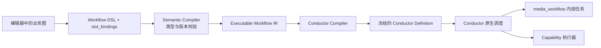
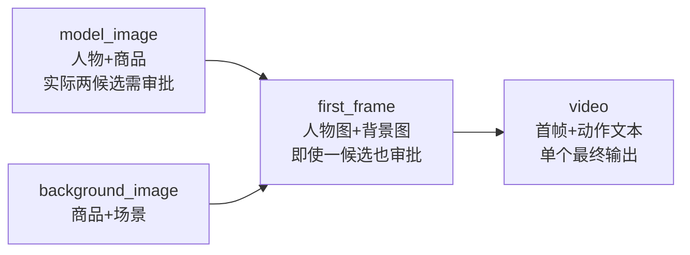
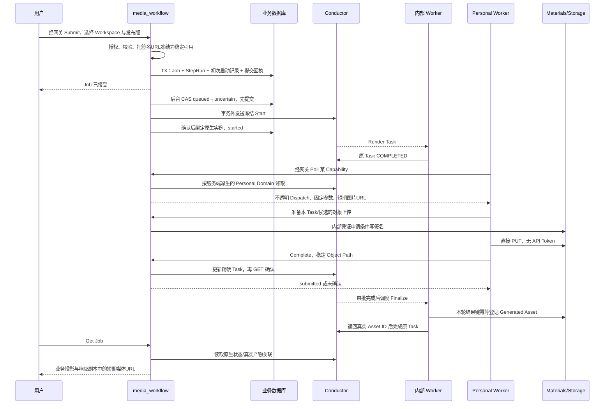

# Workflow：编译、执行边界与 Conductor 交互

本文解释当前后端实现，不是重新设计一套执行器。依据仓库代码、运行中的 Conductor 3.32.4 和已记录的技术/公开接口验收。UI、权限扩展、全量历史迁移、真实厂商接入不属于本轮验收；客户端联调使用明确标识的 mock。

## 1. 整体抽象

业务 Workflow 表达“用哪些业务资源生成什么”；Capability 表达“执行器接受什么参数并返回哪类媒体”；Conductor 表达“哪些任务何时执行、失败后怎样恢复”。这三层不能混为一层。



IR 是本项目选择的中间表示，不是 Conductor 的标准格式。它把模板、能力版本、上下文引用、调用映射、审批策略和依赖冻结下来，使类型检查与引擎表达式生成分开。存入 Compilation 的 IR 和 Definition 是发布产物，不是一个运行时调度器。

| 问题 | 所有者 | 平台做什么 |
| --- | --- | --- |
| 资源属于谁、输入/模板是否合法 | media_workflow / Materials / Control | 基线身份与归属校验、冻结业务输入 |
| 从业务槽位得到 prompt/images | Semantic Compiler、内部 Renderer | 编译映射，执行纯模板渲染 |
| DAG、并行、合流、生成循环 | Conductor | 生成 FORK_JOIN/JOIN/DO_WHILE 等定义 |
| Task 超时、自动 retry、失败 Workflow retry | Conductor | 配置 TaskDef、代理原生 API |
| 用户选择哪张图、是否重新生成 | 用户决定 + 原生 HUMAN | 持久化不可变决定，完成精确 HUMAN |
| 对象上传与媒体资源登记 | Storage / Materials | 短期签名、条件写、幂等登记 |
| Job/Step 当前展示状态 | Conductor 事实的业务投影 | 查询并投影，不调度、不补登记 |

代码入口：[语义编译器](../../media_workflow/biz/workflow/semantic/)、[IR](../../media_workflow/biz/workflow/executable/ir.go)、[引擎编译器](../../media_workflow/biz/workflow/compiler/executable_ir.go)。

## 2. Capability 与业务节点

`model_image`、`background_image`、`first_frame` 是业务节点/产物分类，不是厂商能力。同一种即梦能力可以执行这些节点，只是模板和输入绑定不同。

当前契约示例：

| 引用 | 平台 | 生成方式 | 生成类型 | 执行目标 | 固定输入 / 输出 |
| --- | --- | --- | --- | --- | --- |
| `jimeng.i2i.multi_image_prompt@1` | jimeng | image-to-image (`i2i`) | multi_image_prompt | personal_worker | prompt 字符串、images 有序数组 / IMAGE 候选 |
| `doubao.i2v.first_frame_prompt@1` | doubao | image-to-video (`i2v`) | first_frame_prompt | personal_worker | prompt 字符串、images 恰好一张 / VIDEO 候选 |

唯一引用包含 Key 与 Version。托管目标的 Key 使用 `.managed` 后缀，托管池随该能力版本冻结；目标不由调用方或离线状态临时决定。`output_asset_kind` 留在业务模板/节点层，不绑定到厂商能力。发布版不可修改 TaskDef、输入签名或目标来“兼容”新 Worker。

这是本项目 Worker 的契约，不是宣称厂商公开 API 原生接受同样 JSON。真实厂商 SDK 的调用适配属于 Capability 执行器；当前 mock 不证明真实模型已经接入。[契约代码](../../media_workflow/biz/domain/capability/contract.go)。

## 3. 一个带并行、审批、反馈和失败恢复的例子

这个示例解释编译结果，不声称它是已迁移的历史工作流。真实四节点样本与复杂并行技术门禁分别记录在验收文档。

目标：人物服装图和背景图先并行准备，合成首帧，再生成单个视频。不包含飞书发布、发布文案或多视频剪辑。



Workflow Input 是输入快照，不是一个必须执行的“输入 Task”。输入引用不会制造从一个运行节点连到所有节点的依赖。只有 `step_output` 引用形成执行依赖。

| Step | 主要 slot_bindings | Capability | 审批 |
| --- | --- | --- | --- |
| model_image | person ← workflow_input.virtual_ip；garment ← workflow_input.product | jimeng i2i multi | when_multiple_candidates |
| background_image | garment ← product；scene ← scene 文本 | 同一 jimeng 能力 | when_multiple_candidates |
| first_frame | person ← step_output.model_image；background ← step_output.background_image；pose ← pose 文本 | 同一 jimeng 能力 | always |
| video | frame ← step_output.first_frame；movement ← movement 文本 | doubao i2v first_frame | when_multiple_candidates |

model_image 的模板可写成 `人物{{.person.value.name}}展示商品{{.garment.value.name}}，保留服装纹理。`。它的调用映射分别声明：prompt = render_template；images = [asset_ref(person), asset_ref(garment)]。资源 URL 不需要拼进提示词；顺序不能由 Worker 根据名字猜测。

### 3.1 DSL 到 IR

Semantic Compiler 用冻结 Template/Capability 版本检查槽位资源类型、调用参数类型、图片数量、输出类型与依赖。共享输入的 required 是消费者要求的逻辑 OR，不会被可选消费者削弱。

例如 DSL 中首帧节点的局部 JSON（source 使用 IDL 枚举名说明，不是完整请求）是：

```json
{
  "key": "first_frame",
  "template_id": "tpl_first_frame",
  "template_version": 2,
  "approval_policy": "always",
  "slot_bindings": {
    "person": {"source": "STEP_OUTPUT", "ref": "model_image"},
    "background": {"source": "STEP_OUTPUT", "ref": "background_image"},
    "pose": {"source": "WORKFLOW_INPUT", "ref": "pose"}
  }
}
```

语义编译器从这两条 STEP_OUTPUT 得到 `depends_on=[model_image,background_image]`，从 pose 派生 Workflow 输入。节点顺序不是执行前置条件，能力从发布 Template 快照取得，不让客户端临时指定另一个能力来执行。

一个节点的 IR 摘要如下，省略仅为阅读方便的其他节点/策略字段，不是可直接发布的完整 API 请求：

```json
{
  "key": "model_image",
  "depends_on": [],
  "template": {
    "id": "tpl_model", "version": 3,
    "body": "人物{{.person.value.name}}展示商品{{.garment.value.name}}，保留服装纹理。"
  },
  "context": {
    "person": {"source": "workflow_input", "ref": "virtual_ip"},
    "garment": {"source": "workflow_input", "ref": "product"}
  },
  "capability": {
    "key": "jimeng.i2i.multi_image_prompt", "version": 1,
    "conductor_task_def": "jimeng_i2i_multi_image_v1",
    "execution_target": "personal_worker"
  },
  "invocation": {
    "prompt": {"op": "render_template"},
    "images": {"op": "list", "items": [
      {"op": "asset_ref", "slot": "person"},
      {"op": "asset_ref", "slot": "garment"}
    ]}
  },
  "output_asset_kind": "model_image",
  "approval_policy": "when_multiple_candidates"
}
```

IR 不携具体 Worker Token、实例 ID 或某个 Job 的签名 URL。它表达运行时转换计划；实际用户输入在启动时单独提供。

### 3.2 IR 到 Conductor Definition

编译器按依赖生成波次。本例第一波是两个并行分支，以两个分支的 Finalize 为 JOIN 目标；第二波 first_frame；第三波 video。

每个节点降低为：

```text
DO_WHILE
  media_render_template_v1 (SIMPLE)
  厂商 Capability Task (SIMPLE)
  HUMAN，或按实际候选数量选择 HUMAN 的 SWITCH
media_finalize_step_v1 (SIMPLE，位于循环外)
```

内部 Renderer 的入参形状固定为冻结 template、context、generation、previous_generation、previous_review。context 的内容可以不同，不需要为每种业务节点创建不同 Renderer Worker。Renderer 执行模板，不负责下载图片、调用模型或领取后继任务。

令 `R(key, phase)` 表示实际代码 `taskref.Reference`，即 `step_` + 节点 Key 的 UTF-8 十六进制 + `_phase`。编译映射是：

| IR 表达式 | Conductor 输入表达式 |
| --- | --- |
| workflow_input.virtual_ip | `${workflow.input.inputs.virtual_ip}` |
| asset_ref(person) | `${workflow.input.inputs.virtual_ip.asset_ref}` |
| render_template | `${R(model_image,render).output.prompt}`（写入时展开真实引用名） |
| step_output.model_image | `${step__model_image__finalize.output.output_resource}` |
| 首帧使用人物图 | `${step__model_image__finalize.output.output_resource.asset_ref}` |

循环内使用编码引用，因为 Conductor 保留 `__` 作为迭代后缀；循环外 Finalize 不需要改变既有引用形状。运行时查找最新轮次且跳过 `retried` 旧 Task，不能仅以业务 Step 名匹配任意历史任务。

例如本例生成的第一波 Definition 包含以下部分。`branch(...)` 是本文表示“该节点完整循环及 Finalize 数组”的阅读占位，不是实际 Conductor JSON 语法；实际数组由上面的 lowering 生成。

```text
FORK_JOIN wave_0_fork
  forkTasks: [branch(model_image), branch(background_image)]
JOIN wave_0_join
  joinOn: [step__model_image__finalize, step__background_image__finalize]
DO_WHILE R(first_frame,loop)
  Render(context.person=${step__model_image__finalize.output.output_resource}, ...)
  Invoke(prompt=${R(first_frame,render).output.prompt}, images=[人物引用, 背景引用])
  HUMAN R(first_frame,approval)
Finalize step__first_frame__finalize
DO_WHILE R(video,loop)
  Render → Invoke → 实际多候选时 HUMAN
Finalize step__video__finalize
workflow.output.output_resource_id=${step__video__finalize.output.output_resource_id}
```

DO_WHILE 的条件读取**本次 iteration 快照**中的 HUMAN decision，而不是跨所有轮次找最近一条审批。这是为了避免“第一轮 regenerate、第二轮单候选自动通过”仍读取第一轮决定并无限再生成。新图使用安全引用；已发布旧 Compilation 不原位改写，不能给旧图凭空补上循环。

### 3.3 发布是冻结注册，不是每次运行重新编译

发布根据仓储中的授权源 Workflow 编译，得到 canonical IR/Definition、Definition SHA256，以及完整且确定排序的 TaskDefinitions。Compilation 与 Publication 意图在一笔事务中保存；HTTP 的 publishing/pending 不是可以 Submit 的 published。

后台只消费冻结命令，事务外注册 TaskDefinition 与 WorkflowDefinition，再 GET 核对现有内容。响应丢失时恢复核对，不偷偷改用新模板重新编译；同名/版本内容不同是永久冲突，不覆盖。临时故障保留原意图退避重试。最终收口还检查源版本与 claim，源已修改/归档不能把它标成已发布。只有 registered 的版本可 Submit，Job 冻结其 Compilation Hash。

取舍：保留最小发布投递记录解决“请求接受后客户端离线”的义务；不保留第二份运行时执行计划来调度。Conductor 元数据没有替本项目提供跨外部作者的 CAS，其他管理员直接修改同名定义仍是已知边界，不声称本地预检实现了全局互斥。[发布实现](../../media_workflow/biz/workflow/publication/flow.go)、[投递](../../media_workflow/biz/workflow/publication/delivery.go)、[真实丢响应/进程重启证据](../plan/media_workflow/publication-outbox.md)。

## 4. 从 Submit 到产物的请求链



Personal Worker 使用绑定 Worker Actor 的 API Token，网关验证后签发 Internal JWT；media_workflow 隐藏 Conductor Task/Workflow ID，核对 User、企业、凭据、实例与 attempt。Managed Worker 在可信服务边界内按配置的能力/池领取，不向 Talos申请 Token，不和 Personal Domain 相互回退。内部 Render/Finalize 不由客户端执行。

## 5. 幂等与事务到底保证什么

### 5.1 不是一张万能 Outbox

| 操作 | 同一本地事务内 | 明确不在事务内 |
| --- | --- | --- |
| 首次 Submit | Job、全部 StepRun、冻结启动记录、提交去重回执 | Conductor Start、对象网络读取 |
| 用户审批决定 | Job→Step 锁与归属/取消复核、不可变 Review/候选快照/目标 Task | HUMAN 更新、生成、素材登记 |
| 输入覆盖的确认后审计 | 新输入、历史审计、旧查询缓存失效 | 原生 rerun（它已经发生） |
| Worker 回写 | 没有跨引擎结果接收事务；确认后仅 Dispatch 记账 | Conductor 更新和对象登记 |

Worker 结果 **不再写服务端 Inbox/Outbox**。客户端先把待交付结果写私有本地日志，重试同一结果；代理更新原 Task 后查询状态及输出确认。已确认同结果重放不再次 POST，不同终态内容冲突；未知返回可重试错误，不把 HTTP 200 当作任务已接受。

初次启动和审批仍保留持久投递记录，因为“用户请求已接受后，调用方可能不再在线”，不能把后台义务交给一次连接。审批记录本身同时承担不可变决定与投递状态，不额外再存一份相同命令。

### 5.2 不同层的键

| 层 | 身份/键 | 保护范围 |
| --- | --- | --- |
| Submit | User/Organization/Workspace/idempotency_key + 语义摘要 | 同一提交意图只接受一个 Job |
| 原生初次启动 | Job correlation + 完整冻结清单 | 查询定位并核对已有实例，不提供引擎去重保证 |
| Dispatch | 原生 Task ID + retryCount 对应的 attempt | 精确技术尝试、同身份重投 |
| Worker 本地结果 | Dispatch/attempt/操作的稳定键、不可变结果文件 | 未确认结果重发，不重新调用生成函数 |
| 对象上传 | Task/attempt/候选位置的哈希 + 文件清单哈希 | 重复内容同路径，改变内容不覆盖旧对象 |
| Review | Step/HUMAN Task 唯一约束；Step/显式用户键 | 一次审批目标一个决定，同键同内容重放 |
| 已接受生成产物 | instance + StepRun + 本轮成功 invoke Task ID | Finalize 重试仍同一 Asset，新生成结果独立 ID |

trace_id 不属于任何幂等或授权键。

### 5.3 启动去重的未实现边界

当前运行版本的启动入口没有通过本项目的幂等启动门禁；correlation 不是唯一约束。按用户决定，记录引擎问题，**不实现 Conductor 扩展**。

启动记录外部调用前从 queued 变 uncertain。响应丢失或进程退出后只查询原 correlation；找到唯一候选还须核对 Definition 名称/版本、完整输入和 Task Domain。没有查到不能证明没有启动，不能自动重新 POST。它牺牲自动恢复可用性来避免偷偷创建第二个执行，不承诺 exactly-once。

## 6. 复杂例子的失败、审批与重试

假设 background_image 已完成并登记 GB，model_image 第一轮返回两张图。用户要求调整构图。

1. API 从当前唯一 IN_PROGRESS HUMAN 冻结候选，保存 regenerate 与反馈。返回 pending 只表示接受决定；Step 不在事务里改成下一轮。
2. Review Delivery 完成原 HUMAN，GET确认相同决定后 applied。DO_WHILE 原生进入第二轮。
3. Renderer 使用原冻结模板，只附加紧邻上一轮反馈。反馈是普通文本，不执行其中模板语法、不累计更早反馈。
4. 第二轮模型调用失败。transient → FAILED，是否自动重试由原 TaskDef 决定；permanent → FAILED_WITH_TERMINAL_ERROR，停止自动重试。mock 验收使用明确的永久失败来触发人工恢复。
5. 用户从 model_image 的 Step Retry 点击恢复：API 代理 **所属整个 Workflow 的原生 retry**。不是保证“仅该节点 rerun”，不重置自己的 DAG。
6. Conductor 保留已成功的 GB 分支和 A 的本轮 Render，恢复失败调用。新的技术 Task ID/retryCount 不等于新的用户生成轮；提示词不会因普通 retry 重新渲染。
7. 第二轮成功返回两候选，用户选位置 1。当前 HUMAN 完成后结束 A 的循环；Finalize 登记 GA，键来自成功 invoke，不来自 Finalize Task ID。
8. JOIN 等两个分支 Finalize；first_frame 用 GA/GB 引用生成一张图，但 always 策略仍等 HUMAN。
9. 首帧确认后 video 接受一个首帧和动作提示词；正常一候选自动通过。若实际返回多候选，仍必须审批，预计 candidate_count=1 不能绕过它。

未批准轮次的候选对象/原 Task 输出和 Review 快照保留技术审计，不冒充已登记的 Generated Asset。**每轮被接受的结果**登记独立 Asset，节点只指向当前选定结果；旧 Asset 不覆盖、不删除。成功旁支不能被晚到旧轮快照覆盖。

## 7. retry、rerun、超时、取消不要混用

| 操作 | 当前语义 |
| --- | --- |
| 技术自动 retry | Conductor TaskDef 决定次数/延迟/超时策略 |
| Job Retry / Step Retry（无覆盖） | 代理父 Workflow 原生 retry，保留成功任务 |
| regenerate | 最新 HUMAN 决定，DO_WHILE 新生成轮 |
| Job input_override | 原 FAILED/TIMED_OUT 实例的整次原生 rerun；删除旧 Task，成功节点也会重跑 |
| 历史未完成 Resume | 独立的导入恢复协议；不用于普通失败恢复，本轮不跑历史迁移 |
| Pause / Resume | 引擎原生能力；平台查询 PAUSED=8/RUNNING，不新建暂停调度器 |
| Cancel | 先保存取消意图与清理义务，后台确认原实例终态 |

本地 lease_expires_at 只表示交付记账/刷新时间。只要原生精确 Task 仍活动，不能因为本地 90 秒时间到了拒绝心跳/回写；Conductor 拥有 Task/response timeout。没有本地 Reaper 或过期失败 Job 扫描。不同 Worker/凭据/实例不会借“过期”接管旧 Dispatch，需要原生重投/新 Task 身份或稳定配置的原实例。

取消与启动记录按 Job→记录锁序协调：queued 撤销发送；uncertain 保留只读查找义务；started 变 cancel_pending，找到并终止原实例。重复取消返回原事实；清理失败不能撤销意图或复活 Job。原生 TERMINATED 投影为 cancelled，不当作模型失败。

input_override 的 POST 成功后也要 GET 精确实例确认新输入/Definition。丢响应还须证明输入或旧 Task 身份发生变化，不凭“它现在 RUNNING”猜测成功。原生提交与本地审计不是跨系统原子事务，失败返回未确认，不能自动换键重发。

Conductor 3.32.4 的 `rerunFromTask` 技术门禁发现它按 Task seq 截断后续记录，不是沿业务 DAG 仅重跑受影响节点；即使某个旁支没有业务依赖，也可能被截断。因此当前普通 Step Retry **不调用**该接口、不计算局部重置，而代理父实例原生 retry。whole rerun 则明确允许已成功节点重新运行，不能称为“只继续失败节点”。对应技术证据是 `TestConductorParallelRerunTruncatesCompletedSibling` 与原生编译并行 retry 门禁，详见[旧阶段记录](../plan/media_workflow/executable-workflow-compilation.md)和[当前边界计划](../plan/media_workflow/conductor-native-execution.md)。

本地快照 fencing 与引擎重试也不是一回事。查询在读取引擎前捕获 Job/实例/审计周期，事务锁内再复核；Review 目标绑定精确 HUMAN，已接受决定使旧轮观察不能覆盖新事实。投递记录用 claim/CAS 防止已过期后台进程落盘；Worker 则看精确原生 Task，90秒记账过期不等于失去资格，旧 Task 已被 retry/rerun/取消替换才拒绝或冲突。跨系统 rerun 已发生但本地审计尚未提交仍有不确定窗口；确认失败不自动补发，是明确的限制，不宣称获得全局事务。

一次公开门禁发现的平台 bug：期待输入含 Go Product/VirtualIP 结构体，响应是解码后的 map；直接比较 json.Marshal 字节会因字段顺序不同误判。现以规范化 wire JSON 比较并用 UseNumber 保留大整数精度。这个问题不是 Conductor 的调度 bug，简单 map 桩测试不足以证明完整业务输入确认。

## 8. 对象存储、结果一致性与日志

Worker 先申请绑定 Task/attempt/位置的短期 PUT，再直接传 Storage。SHA256、MD5、类型、长度、If-None-Match 条件一起绑定；成功、412或响应丢失后重新申请，服务端 HEAD 核对是否已存。上传成功不等于 Task 完成。取消不即时撤销旧签名，晚到上传可能是未引用对象，不自动删除用户数据。

执行结果中的媒体必须位于本企业/Scope、类型/大小符合能力；不接受文本字段冒充媒体或任意外部 URL。当前是元数据/协议检查，不承诺内容审核或完整图像/视频解码安全性。新客户端返回 Object Path；Get/GetStepRun 只在响应副本生成短期 URL，不持久化签名、不在查询中补登记。

Provider 生成、客户端日志落盘、对象写入、Conductor 完成、Materials 登记不处于一笔事务。客户端在结果落盘前崩溃仍依赖 Provider 自身幂等；内部登记响应丢失由同结果键重放恢复。没有任何一层声称端到端 exactly-once。

请求 traceparent 随初次启动输入冻结，独立后台/内部进程从精确实例恢复；客户端从传输元数据提取，调用 Provider 前移除。回写和 Materials 内部请求继承 trace_id，span_id 各自不同。存储 PUT 不带 Token/追踪头。固定日志只记身份、状态/错误码，不记提示词、结果正文、凭据或签名。无需启动可观测性服务即可关联；旧无追踪数据不回填历史。

## 9. 阅读代码与验收证据

- [初次启动接受](../../media_workflow/biz/service/job/start.go)、[后台启动与取消](../../media_workflow/biz/workflow/start_delivery/flow.go)。
- [Worker 网关](../../media_workflow/biz/workflow/worker_gateway/flow.go)、[直接结果确认](../../media_workflow/biz/workflow/worker_gateway/result_delivery.go)、[客户端私有恢复日志](../../media_worker/internal/results/store.go)。
- [审批](../../media_workflow/biz/service/job/review.go)、[审批投递](../../media_workflow/biz/workflow/review_delivery/flow.go)、[Finalize 登记](../../media_workflow/biz/workflow/finalize_task/registration.go)。
- [普通执行与输入覆盖](../../media_workflow/biz/service/job/service.go)、[输入确认](../../media_workflow/biz/service/job/rerun_confirmation.go)、[确认后本地审计](../../media_workflow/biz/service/job/retry_commit.go)。
- [上传验收](../plan/worker-artifact-upload.md)：真实客户端四节点、反馈/失败/原生 retry、四份图片/视频完整 SHA256读取；保留首轮测试缓存误判失败证据。
- [异步关联验收](../plan/workflow-trace-correlation.md)：公开 Submit→独立后台/Render→客户端→Materials 同 trace_id，原生暂停/恢复投影及取消。
- [执行边界总计划](../plan/media_workflow/conductor-native-execution.md)：技术并行图门禁与公开业务门禁分开，不用一个替代另一个。

最后的公开输入覆盖/真实交付时间边界已通过：部分执行 `job_63630368-245c-45f3-ace8-7a6c2437835a` 整次 rerun 后，分别等待本地 90 秒记账时间过期，原生活动 Task 仍接受心跳和 Complete；输入审计提交一次、保留原 trace。首轮确认失败及修复过程记录在总计划，不隐藏原生已经提交的事实；测试最后取消，没有审批或第二条完整模型执行。

本文不单独宣称整个 Goal 已验收；当前状态与明确暂缓范围以总计划为准。未来扩展不能把本地任务池、DAG 重置、Worker 结果 Inbox 或运行状态控制器重新塞回这些代理流程。
