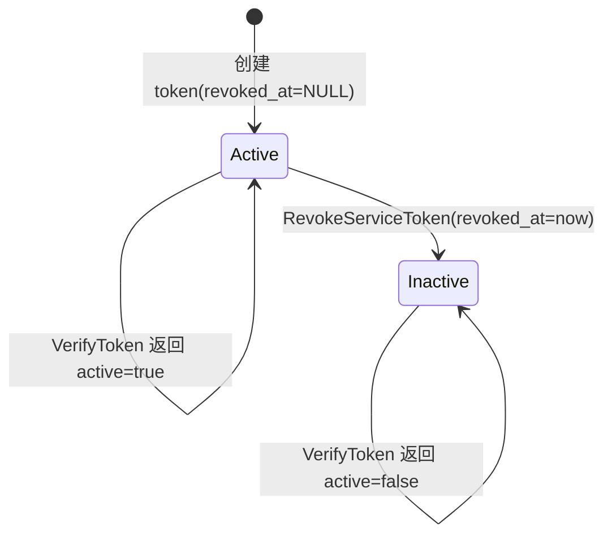

## 一句话说明
control_plane 收到带 `Authorization: Bearer tos_xxx` 的自有路由请求时，因 service token 为 opaque 无法本地验，经 mTLS 调 media_auth internal `VerifyToken` RPC 解析为 Subject；cookie JWT 与 bearer JWT 仍由 control_plane 本地 HS256 验（见 ADR-0001）。

## 执行时间线（每个接口内嵌内部处理）

```text
client(B2B)            control_plane(网关)                         media_auth
   |                        |                                          |
   |-- POST /api/workspaces (Bearer tos_xxx) -->|                     |
   |   middleware 鉴权                                                  |
   |   ├─ 取 Authorization: Bearer <token>                             |
   |   ├─ 1) 先尝试本地 HS256 验签(token 非 JWT) → 失败               |
   |   ├─ 2) 调 media_auth VerifyToken(token, hint=service_token) ---→|
   |   │      media_auth internal token service:                      |
   |   │        service_token.getServiceTokenByHash(sha256(token))    |
   |   │        ├─ 命中且 revoked_at IS NULL                           |
   |   │        │   → {active:true, sub=created_by, username=svc:name,|
   |   │        │      name, role=user, token_type=service_token}     |
   |   │        └─ 未命中/已撤销 → {active:false}                      |
   |   │<-- {active, sub,...} ---------------------------------------|
   |   ├─ active=false → 401                                           |
   |   ├─ 注入 ctx.user = Subject{sub,...}                             |
   |   └─ next() → 业务 handler(以 sub 为 caller)                      |
   |<-- 200/4xx --|                                                    |
```

> 鉴权解析顺序（control_plane 中间件，见 ADR-0001）：
> 1. plugin-admin 旁路（`x-plugin-admin-token`，自留，不进本流程）
> 2. Bearer：先 `VerifyToken` RPC（service token），失败再本地 HS256 验签（OAuth access JWT）
> 3. Cookie：本地 HS256 验签 + 滑动续期（session JWT）
>
> 即 service token 走 RPC、JWT 全本地验。control_plane 不再直读 media_auth 任何表。

## 关键流程参数传递
- `token`（opaque `tos_xxx`）：control_plane 原样传给 media_auth `VerifyToken`；media_auth 内部 `sha256(token)` 查 `service_tokens.token_hash`，明文 token 永不出 media_auth 边界。
- `token_type_hint`：可选，`service_token`；预留未来 JWT 也可经此 RPC 统一校验。
- 返回 `Subject`：`{ active, sub, username, name, role, token_type, exp? }`；`sub = service_tokens.created_by`，control_plane 据此识别调用方。
- mTLS：control_plane ↔ media_auth 走内网 mTLS，`VerifyToken` 不挂网关路由、不出 OpenAPI，仅内部可达。

## 状态流转
无状态机；`service_tokens.revoked_at` 决定 active：


## 幂等设计
- `VerifyToken` 纯读，天然幂等；同一 token 多次校验结果一致（直至被撤销）。
- 撤销即时生效：`revoked_at` 一旦写入，后续 `getServiceTokenByHash` 因 `revoked_at IS NULL` 过滤即返回未命中。
- 性能：control_plane 可对近期 VerifyToken 结果做短 TTL 本地缓存（按 token hash），但缓存须在撤销后能及时失效——本批次不强制，留 P1 评估。
